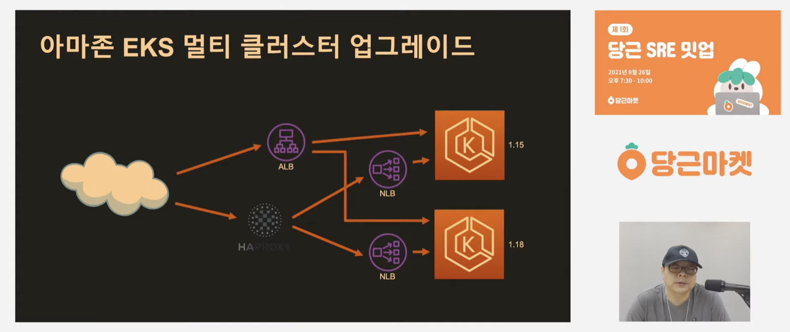
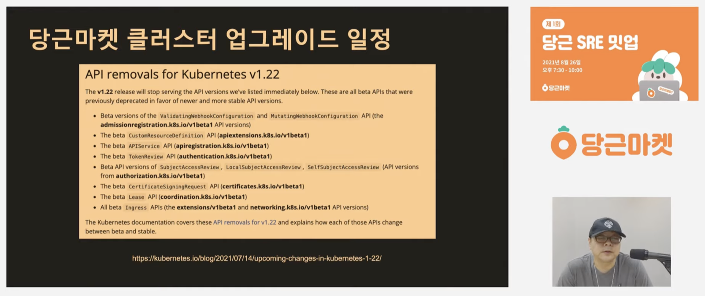
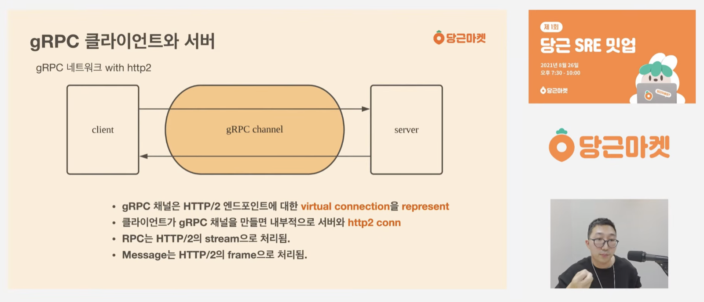

これから Daangn(당근)とトスが公開している技術発表を一つずつ見て整理していくつもりだ。最初は2021年8月に開かれた**Daangn SRE ミートアップ 第1回**。Daangn マーケット SRE チームのクラスターパートが2つの発表を行った。

---

## 1. Amazon EKS 無停止アップグレード

ユ・ジョンヨルさん(Daangn マーケット SRE チーム クラスターパート)



この発表は EKS をアップグレードする方法を扱う。大きく2つの状況、シングルクラスターとマルチクラスターに分けて、それぞれどのようにアップグレードできるのかを整理して発表している。

シングルクラスターについては一般的な方法(公式ドキュメント)がよく知られているので、発表の内容は知っていたものと大きく変わらなかった。公式ドキュメントによれば、バージョンは一度に複数上げるのではなく一回に一つずつ上げなければならず、だいたい3〜4か月ごとにマイナーバージョンのアップデートが配布されるので、それを追いかける必要があるという内容だ。方法も知られている通り、ノードを一つ drain し、cordon などの設定で Pod が立ち上がらないようにしておいて、ノードを一つずつアップグレードする方式だ。

いつものように、Kubernetes のバージョンを見て何がなくなり何が増えるのかを把握し、deprecated になった設定を別途ケアしたり、beta だった Kubernetes マニフェストのタグを変えたりして処理した上でアップグレードする方式だ。

シングルクラスターのアップグレードはあまりにも well-known なので、特に変わった点はなかった。一つ知ったのは、EKS を使う場合は eksctl が提供されていて、この方式がかなり便利だということ。だいたい40分ずつかかるそうで、スライドでも実際にやってみるとそこまで難しくないと書かれている。シングルクラスターについては発表で上のようにまとめられていた。

一つ引っかかるのは、やはり最後に書かれている「ロールバック不可」だろう。Daangnではシングルクラスターで使っている部分のほかにマルチクラスターを使う方法も採っていて、この部分の内容がかなり面白かった。

もともとDaangnでは ALB と NLB を EKS の前に一つだけ置く構成だったそうだ。ただ ALB はセキュリティグループ関連の事故が多かったので機能をできるだけ外して Terraform に移管し、NLB は単体ではトラフィック制御がかなり難しいので前段に HAProxy を使っているという。

個人的には、NLB をハードに扱ったことはないが、L7 レベルのロードバランシングがないとスマートなトラフィック制御が難しいので前段に HAProxy を導入したのではないかと思う。後の Q&A で「HAProxy の代わりに Route 53 の Weighted Routing を使ってはだめですか?」という質問が出たが、悪くない代案ではあるものの DNS キャッシュなどの仕組みをきちんと把握するのが難しいので HAProxy を使うことにしたそうだ。それに発表の前半でも、チーム内に HAProxy を上手く使える同僚がいると話していた。

そうして結果的に、上の図のように HAProxy を前段に置き、後段に NLB をつないでから Kubernetes クラスターにトラフィックを送る構成になった。バージョンアップが必要な場合は新しいバージョンを立ち上げた後、トラフィックを canary しながらクラスターのアップグレードを判断する方式を使っているという。

結果的に、マルチクラスターには上のような特徴があるという。一番気に入ったのは、マルチクラスターの状況ではロールバックが可能だという点で、クラスターをアップグレードするという大きな作業において、これはセーフティネットであり安心ポイントだろう。

先ほど話した内容だが、クラスターをアップグレードする際にはパッチノートに従ってサポートされない API を置き換える必要があり、だいたい上のように整理されて出てくる。Q&A で出た内容が「サポートされない API はどう処理するのか?」だったが、ユ・ジョンヨルさんの回答は、リソースのアップデートをサポートしている API を基準にすべて進めているとのことだった。

---

## 2. 実践! gRPC サービス運用ノウハウ

ペ・サンイクさん(Daangn マーケット SRE チーム クラスターパート)



この発表はタイトル通り gRPC の運用ノウハウを扱う。構成としては、なぜ gRPC を使うことになるのかから始まり、gRPC とは何かという簡単な概念から発展的な概念までを紹介し、インフラの観点からどうモニタリングできるのかを詳しく扱う。

この図を見ると、Daangnでは gRPC で呼び出す回数と HTTP を使う回数に大きな差はなさそうだ。内部で互いに呼び出す場合、JSON 形式で HTTP で渡すのはかなりオーバーヘッドがあり、小さなオーバーヘッドが積み重なるとかなり大きなレイテンシになるだろうし、リソースの使用によって発生するコストもあるだろう。

正直、発表を見るまでは gRPC をあまり扱ったことがなく、大まかな概念しか知らなかった。protobuf 方式と内部コールに特化したロジック(HTTP/2 を使う方式)のおかげで MSA の状況で効果が高い、という程度だ。実際、発表でも gRPC のチャネルとメッセージの概念を HTTP/2 に置き換えて詳しく説明していて、HTTP/2 についても詳しく知っておかないと gRPC をきちんと理解できなさそうだと感じた。

説明は上のように、丁寧に gRPC を HTTP/2 の概念に置き換えて行われる。そもそも gRPC 自体が HTTP/2 プロトコルを使うので当然のことではあるが、インフラチームの役割はこうした gRPC をモニタリングし、きちんと動いているかを把握することなので、HTTP/2 だけでなくネットワークレベルでかなり詳しく知っておく必要があると思った。

特に発表がもう少し深くなると、Go ベースのプログラムをデバッグモードで実行して正常にコネクションが張られているかを確認する内容が出てくる。後述するが、トスでも Go 言語ベースのオープンソースを多く使っているので、問題があったり性能改善が必要な場合は pprof で分析した上で GOMEMLIMIT、GOMAXPROCS などの Go 言語ベースの設定で性能を改善している。そのため Go 言語への理解もかなり必要そうだ。

こうした gRPC のモニタリング方法としては、Prometheus の多次元メトリクスで行っているという。SRE レイヤーではグローバルクエリで error が発生したサービスをモニタリングし、アプリケーションレイヤーではサービスに合わせてカスタムのダッシュボードを設定しているそうだ。Daangnの場合はサービスの言語が多様なので、この発表の時点では Java 陣営では Micrometer、Go 言語では grpc-prometheus を使っているという。SRE は Istio を通じてモニタリングしているそうだ。

そして先ほどのユ・ジョンヨルさんの発表と結びつけて考えると、L7 ロードバランサーの話が出てこざるを得ない。個人的に、ある開発者が L7 ロードバランサーを「賢い」と表現したのが好きなのだが、同じように gRPC の状態を確認するには HTTP プロトコルをサポートする賢い L7 がどうしても必要になる。発表でもこの話が出てくる。

Kubernetes で使う Service は L4 レベルの仕事を処理してくれる。したがって gRPC 関連の処理をするには L7 レベルの作業が必要で、この部分を現代のプロキシがサポートしているという。istio や linkerd のようなプロキシが gRPC 関連の設定を提供しているので、ドキュメントを確認して設定すればうまく対応できるそうだ。

発表では、適用するプロキシの gRPC support documentation を精読するという。プロキシごとに次のように確認できるそうだ。
- HAProxy: option `http-use-htx`
- nginx: `ngx_http_grpc_module`
- envoy: gRPC フィルターの動作方式を確認

上のような説明を終えた後、インフラチームは重要な指標を見なければならないという。ただ、重要な指標が何でどうモニタリングするかについては発表の時点ではまだ確認中で、次のような指標をモニタリングしているとのことだった。

- Proxy Connection.* metric
- CPU throttling/CPU wait
  - ingress の役割をする Pod はモニタリングの感度を上げることが重要だという。
- Network in/out byte
- 開発者の Sentry
  - 人間 Alert のような人がどの会社にもいるらしい..
- APM

最後に k6 や ghz のようなおすすめツールを紹介しながらDaangnの開発文化を説明して終わる。Daangnでは主に開発者がやりたいサービスを使えるようにするために多くの努力をしていて、そうすると多くのことを学べるという。そして、まるで MacBook のように使いたくなるインフラを作りたいと言って発表が終わる。

---

## おわりに

まず、2つ目の発表の感想からは外したが、keepalive の話が出てくる。以前、会社で使っているレガシーの nginx を取り除き、ALB で設定を制御するように分離する中で、nginx に設定されていた keepalive に苦しめられたことがある。

発表でもこうしたネットワークコネクションに関わるツールを使うときには keepalive に気を配る必要があると説明していて、コネクションや keepalive は思ったより注意深く見なければならないキーワードだと感じたし、もっとカーネルや OS のレベルで理解する必要があるなと思った。

以前、「物語」というキーワードが書かれていたので簡単だろうと思って開いた『Linux カーネル物語』という本には、カーネルレベルで理解すべきことと、コンピューターのパフォーマンスをプロファイリングするときに考慮すべきことがすべて紹介されている。最初に読んだときは内容が難しすぎて半分も吸収できなかった。ここで言う「コンピューターのパフォーマンス」をプロファイリングする方法とは、tcpdump でパケット単位で分析したり、CPU スケジューリングが非効率になっていないかを見たり、そういったものだ..(本はまた読み直さないといけないと思っている)

結局、インフラを扱うエンジニアとしてさらに深いところを確認するにはカーネルレベルの理解が必要だと感じたし、加えて Go 言語ベースのソースコードを自分で書いてプロファイリングするという話を発表で聞いた。Daangnだけでなくトスでも Go 言語ベースのオープンソース、特に Prometheus をハードに使っているので、Go 言語ベースの知識を土台に Prometheus の config を直接触る設定最適化などを頻繁に行っているのだと感じた。

### References

- [Amazon EKS アップグレード — Daangn マーケット SRE ミートアップ 第1回 (YouTube)](https://www.youtube.com/watch?v=4Q8It_UvIws)
- [Daangn マーケット gRPC サービス運用ノウハウ — Daangn マーケット SRE ミートアップ 第1回 (YouTube)](https://www.youtube.com/watch?v=igHrQPzLVRw)
- [Daangn SRE ミートアップ 第1回 再生リスト](https://www.youtube.com/playlist?list=PLaHcMRg2hoBqWWla-pCBSRqU-jSriiZHj)
