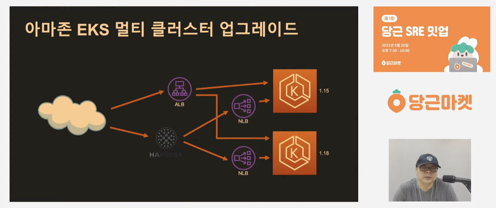
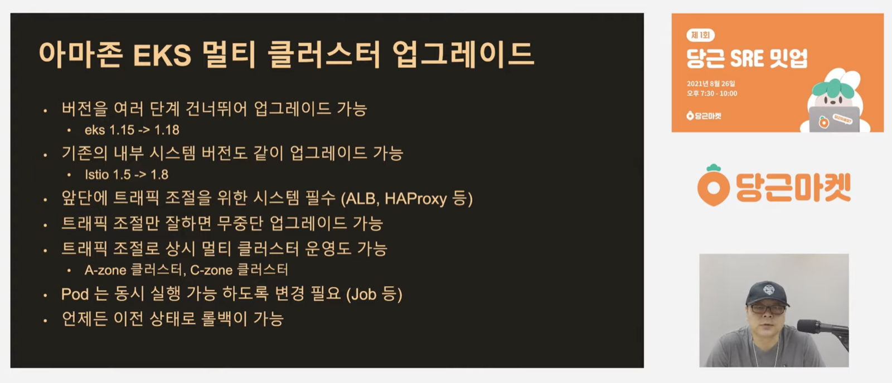
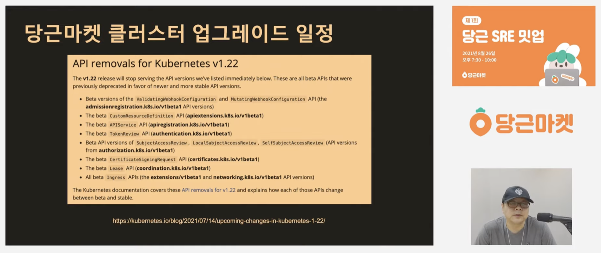
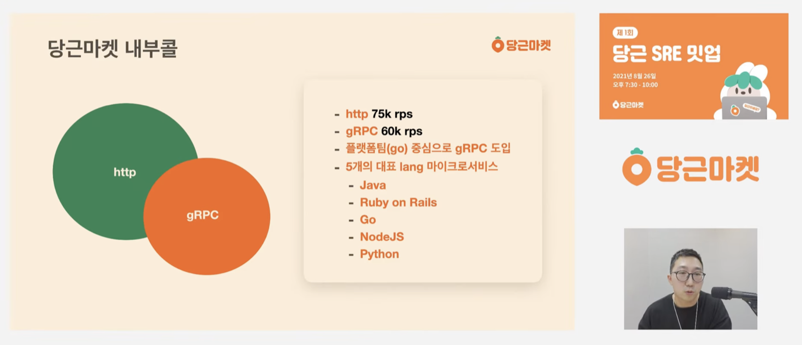
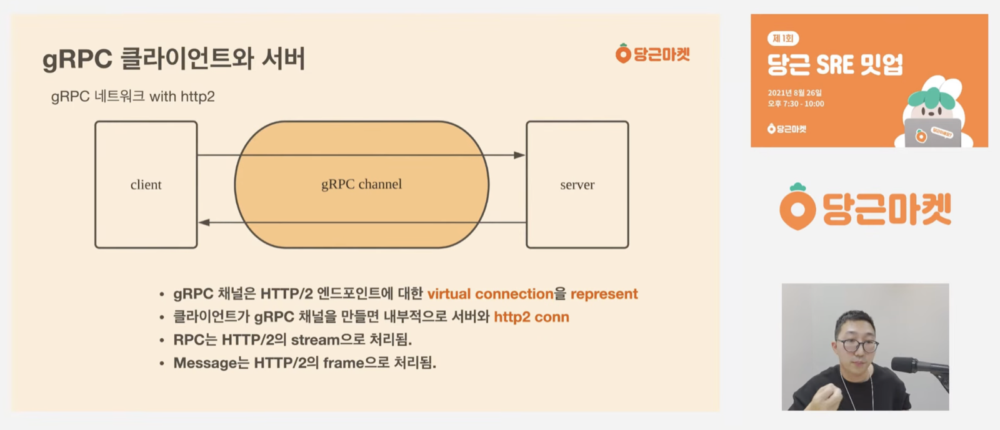
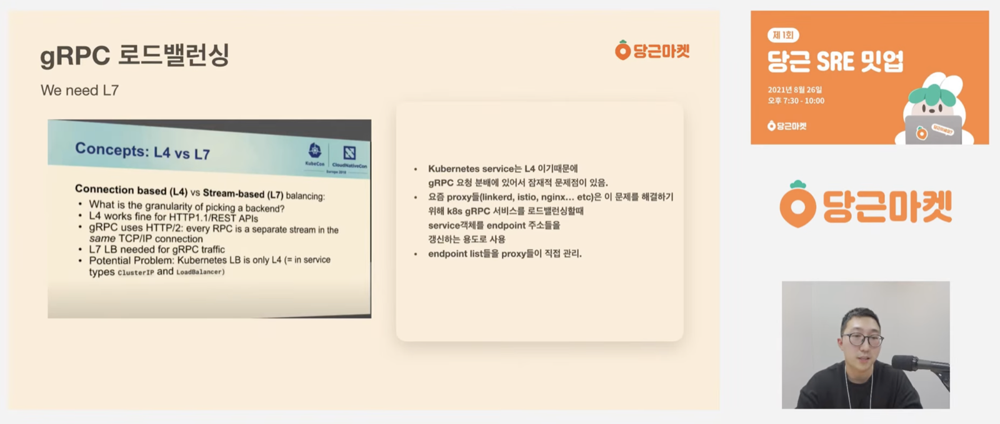

앞으로 당근과 토스가 공개한 기술 발표를 하나씩 보고 정리하는 시간을 가지려 한다. 첫 번째는 2021년 8월에 열린 **당근 SRE 밋업 1회**다. 당근마켓 SRE 팀 클러스터 파트에서 두 개의 발표를 했다.

---

## 1. 아마존 EKS 무중단 업그레이드

유정열 님 (당근마켓 SRE 팀 클러스터 파트)



해당 발표는 EKS를 업그레이드하는 방법에 대해서 다룬다. 크게 2가지 상황으로 나누어서, 싱글 클러스터와 멀티 클러스터 상황에서 어떤 식으로 업그레이드할 수 있는지 정리하여 발표한다.

싱글 클러스터에 대해서는 워낙 일반적인 방법(공식 문서)이 잘 알려져 있어서 발표 내용은 크게 알고 있던 것과 다르지 않았다. 공식 문서에 따르면, 버전은 한 번에 여러 개 업그레이드하는 것이 아니라, 한 차례에 하나씩 업그레이드해야 하며, 주로 3~4개월마다 마이너 버전의 업데이트가 배포되어 이를 챙겨야 한다는 내용이다. 방법 또한 알려진 대로 노드 하나를 drain하고, cordon 등의 설정으로 pod가 뜨지 못하게 해놓고서 노드를 하나씩 업그레이드하는 방식이다.

늘 그렇듯이, 쿠버네티스 버전을 보고 어떤 것들이 사라지며, 생기는지 파악하여 이제는 deprecated된 설정을 따로 챙긴다거나, beta였던 쿠버네티스의 매니페스트의 태그를 바꿔준다거나 처리하여 업그레이드를 하는 방식이다.

싱글 클러스터 업그레이드는 워낙 well-known이어서 크게 특이한 점은 없었다. 한 가지 알게 된 점은 EKS를 사용하는 경우에는 eksctl을 제공하는데, 이 방식이 꽤 편하다고 한다. 주로 40분씩 걸린다고 하며, 장표에서도 실제로 해보면 그렇게까지는 어렵지 않다고 한다. 싱글 클러스터에 대해서는 위와 같이 발표에서 정리가 되었다.

한 가지 걸리는 부분은 아무래도 마지막에 적힌 롤백 불가일 것이다. 당근에서는 싱글 클러스터로 사용하는 부분 외에도 멀티 클러스터를 사용하는 방법을 사용했는데, 이 부분은 내용이 꽤 재미있었다.

원래 당근에서는 ALB랑 NLB를 EKS 앞에 하나만 두는 구조였다고 한다. 다만 ALB는 뭔가 보안 그룹 관련된 사고가 잦아서 기능을 최대한 빼서 terraform으로 이관하였고, NLB는 자체적으로 트래픽 제어가 꽤 어려운 편이라 앞단에 HAProxy를 사용한다고 한다.

개인적인 생각으로는, NLB를 하드하게 다뤄본 적이 없지만 L7 수준의 로드밸런싱이 없다면 스마트하게 트래픽 제어가 어려워서 앞단에 HAProxy를 도입한 것이 아닐까 한다. 나중에 Q&A에서 "HAProxy 대신에 Route53의 Weighted Routing을 쓰면 안 되나요?"와 같은 질문이 들어왔는데, 나쁘지 않은 대안이었으나 DNS 캐싱 등의 원리를 제대로 파악하기 어려워서 HAProxy를 사용하기로 했다고 한다. 그리고 발표 앞에서도 팀 내에서 HAProxy를 잘 사용하는 동료가 있다고 하기도 했다.

그래서 결과적으로는 위 그림처럼 HAProxy를 앞단에 두고 뒷단에 NLB를 붙인 다음에 쿠버네티스 클러스터로 트래픽을 보내는 구조를 갖게 되었다. 버전 업데이트가 필요한 경우 새로운 버전을 띄운 다음에 트래픽을 canary 하면서 쿠버네티스 클러스터 업그레이드를 결정하는 방식을 사용한다고 한다.

결과적으로 멀티 클러스터는 위와 같은 특징이 있다고 한다. 가장 마음에 들었던 부분은 멀티 클러스터 상황에서는 롤백이 가능하다는 점이며, 클러스터를 업그레이드하는 대형 작업에 있어 이런 부분은 안전망이자 안심 포인트일 것이다.

앞서 이야기했던 내용이, 클러스터를 업그레이드할 때, 패치노트에 따라서 지원하지 않는 API는 바꿔줘야 하는데, 대략 위와 같이 정리가 되어 나온다. Q&A에서 나온 내용이 "지원하지 않는 API는 어떻게 처리하는지?"였는데, 유정열 님의 답변으로는 리소스 업데이트를 지원하는 API 기반으로 모두 진행한다고 한다.

---

## 2. 실전! gRPC 서비스 운영 노하우

배상익 님 (당근마켓 SRE 팀 클러스터 파트)



이번 발표에서는 제목 그대로 gRPC의 운영 노하우에 대해서 다룬다. 내용의 구성은 gRPC를 왜 쓰게 되는지부터 시작해서, gRPC는 뭔지에 대한 간단한 개념부터 심화 개념을 소개하고, 인프라의 관점에서 어떻게 모니터링할 수 있는지 자세하게 다룬다.

해당 그림을 살펴보면 당근에서는 gRPC를 통해서 호출하는 횟수와 HTTP를 사용하는 것의 차이는 크게 없어 보인다. 내부에서 서로 호출하는 경우에는 JSON의 방식으로 HTTP로 전달하는 것이 꽤나 오버헤드가 있고, 사소한 오버헤드가 모이면 꽤 큰 수준의 레이턴시가 될 것이고, 리소스의 사용으로 인해 발생하는 비용도 있을 것이다.

사실, 발표를 보기 전까지는 gRPC에 대해서는 크게 다뤄본 적이 없어서 대략적인 개념만 알고 있었다. protobuf 방식과 내부 콜을 위해서 특화되어 있는 로직(HTTP/2를 사용하는 방식)으로 인해서 MSA 상황에서 효과가 좋다 정도였다. 실제로 발표에서도 gRPC의 채널과 메시지 개념을 자세하게 설명하면서 이를 HTTP/2로 치환하여 설명하는데, HTTP/2에 대해서도 자세하게 알아두어야 gRPC를 자세하게 이해할 수 있을 것 같았다.

설명은 위와 같이 친절하게 gRPC와 HTTP/2의 개념으로 치환해서 설명한다. 애초에 gRPC 자체가 HTTP/2 프로토콜을 사용하기 때문에 당연한 처사지만, 인프라팀의 역할은 이러한 gRPC를 모니터링하고 잘 동작하는지 이런 것들을 파악해야 하기 때문에 HTTP/2뿐만 아니라 네트워크 레벨에서 꽤 자세하게 알아야 한다고 생각했다.

특히 발표에서 좀 더 내용이 심화되면, go 기반의 프로그램을 실행할 때 디버그 모드로 실행하여 정상적으로 커넥션이 되었는지 확인하는 내용이 나온다. 후술하겠지만 토스에서도 go 언어 기반의 오픈소스들을 많이 사용하기 때문에 문제가 있거나 성능 개선이 필요한 경우에는 pprof를 통해서 분석하고 나서, GOMEMLIMIT, GOMAXPROCS 등의 go 언어 기반의 설정으로 성능을 개선하기 때문에 go 언어에 대한 이해도 꽤 필요해 보인다.

이러한 gRPC를 모니터링하는 방법으로는, 프로메테우스의 다차원 메트릭을 통해서 진행한다고 한다. SRE 레이어에서는 전역 쿼리를 통해서 error가 발생한 서비스를 모니터링하고, 애플리케이션 레이어에서는 커스텀하게 서비스에 맞는 대시보드를 세팅한다고 한다. 당근의 경우에는 서비스들의 언어를 다양하게 활용하고 있기 때문에 해당 발표 기준으로는 java 진영에서는 Micrometer, go 언어 기준으로는 grpc-prometheus를 사용한다고 한다. SRE는 istio를 통해서 모니터링한다고 한다.

그리고 앞서 유정열 님의 발표와 연관 지어 생각해 보면, L7 로드밸런서 이야기가 나올 수밖에 없다. 개인적으로 어떤 개발자가 L7 로드밸런서를 똑똑하다고 표현한 것을 좋아하는데, 마찬가지로 gRPC의 상태를 확인하기 위해서는 HTTP 프로토콜을 지원하는 똑똑한 L7이 필요할 수밖에 없다. 발표에서도 이 이야기가 나온다.

쿠버네티스에서 사용하는 Service는 L4 수준의 일을 처리해준다. 따라서, gRPC와 관련된 작업을 처리하기 위해서는 L7 수준의 작업을 해야 하는데, 이 부분을 현대 프록시들이 지원한다고 한다. istio나 linkerd 이런 프록시들이 gRPC와 관련된 설정을 제공하기 때문에 문서를 확인해서 설정하는 것으로 잘 대응할 수 있다고 한다.

발표에서는 적용할 프록시들의 gRPC support documentation을 정독한다고 한다. 프록시마다 다음과 같이 확인해볼 수 있다고 한다.
- HAProxy: option `http-use-htx`
- nginx: `ngx_http_grpc_module`
- envoy: gRPC 필터 동작 방식 확인

이제 위와 같이 설명을 마치고 나서 인프라팀에서는 중요 지표를 봐야 한다고 한다. 하지만 중요 지표가 무엇이고 어떻게 모니터링하는지에 대해서는 발표 기준으로는 아직 확인 중이며 다음과 같은 지표를 모니터링하고 있다고 한다.

- Proxy Connection.* metric
- CPU throttling/CPU wait
  - ingress 역할을 하는 Pod들은 모니터링 민감도를 높이는 것이 중요하다고 한다.
- Network in/out byte
- 개발자의 sentry
  - 인간 Alert 같은 사람들이 회사마다 있다고 한다..
- APM

마지막으로는 k6나 ghz 같은 추천 툴들을 소개하면서 당근의 개발 문화를 설명하고 끝난다. 당근에서는 주로 개발자분들이 하고 싶어하는 서비스들을 사용할 수 있도록 하고자 많은 노력을 하며 이렇게 하게 되면 많은 부분을 배울 수 있다고 한다. 그래서 마치 맥북처럼 쓰고 싶어지는 인프라를 만들고 싶다면서 발표가 끝난다.

---

## 마치며

우선 두 번째 발표 후기에서 내용을 뺐지만, keepalive에 대한 내용이 나온다. 예전에 회사에서 사용하는 레거시 nginx를 덜어내고 ALB를 통해서 설정을 제어하도록 분리하면서 nginx에 설정되어 있는 keepalive에 대해 고통을 받은 적이 있다.

발표에서도 이러한 네트워크 커넥션에 관련된 툴들을 사용할 때에는 keepalive를 신경 써야 한다는 점을 설명하면서, 커넥션이나 keepalive는 생각보다 주의 깊게 들여다봐야 하는 키워드라는 점을 느꼈고, 좀 더 커널과 OS 레벨에서 이해하는 것이 필요하겠구나 생각했다.

예전에 '이야기'라는 키워드가 쓰여 있어서 쉬울 줄 알고 펼쳤던 책인 '리눅스 커널 이야기'라는 책에 커널 수준에서 이해해야 하는 것들과, 컴퓨터 퍼포먼스를 프로파일링할 때 고려해야 하는 것들을 전부 소개한다. 책을 처음 읽었을 때 해당 내용이 너무 어려워서 반도 흡수를 못했다. 여기서 말하는 '컴퓨터 퍼포먼스'를 프로파일링하는 방법은 tcpdump로 패킷 단위로 분석하고, CPU 스케줄링이 비효율적으로 되는 건 아닌지 그런 것들이다.. (책은 다음에 또 읽어야겠다 생각이 든다)

결국 인프라를 다루는 엔지니어로서 더욱 깊은 곳을 확인하기 위해서는 커널 수준의 이해가 필요하다는 것을 느꼈고, 추가로 go 언어 기반의 소스 코드를 직접 작성해서 프로파일링하는 것을 발표로 들었다. 당근뿐만 아니라 토스에서도 go 언어 기반의 오픈 소스인 특히 prometheus를 하드하게 사용하다 보니 직접 go 언어 기반의 지식 베이스로 prometheus의 config를 건드리는 설정 최적화 등을 자주 진행한다는 것을 느끼게 되었다.

### References

- [아마존 EKS 업그레이드 — 당근마켓 SRE 밋업 1회 (YouTube)](https://www.youtube.com/watch?v=4Q8It_UvIws)
- [당근마켓 gRPC 서비스 운영 노하우 — 당근마켓 SRE 밋업 1회 (YouTube)](https://www.youtube.com/watch?v=igHrQPzLVRw)
- [당근 SRE 밋업 1회 다시보기 재생목록](https://www.youtube.com/playlist?list=PLaHcMRg2hoBqWWla-pCBSRqU-jSriiZHj)
