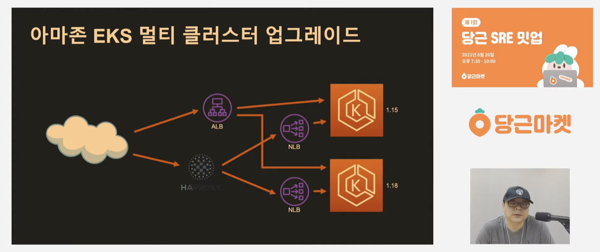
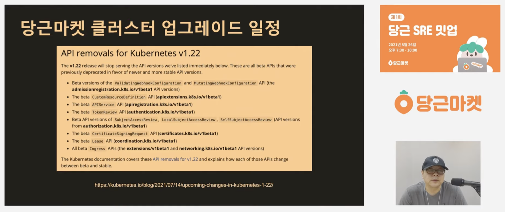
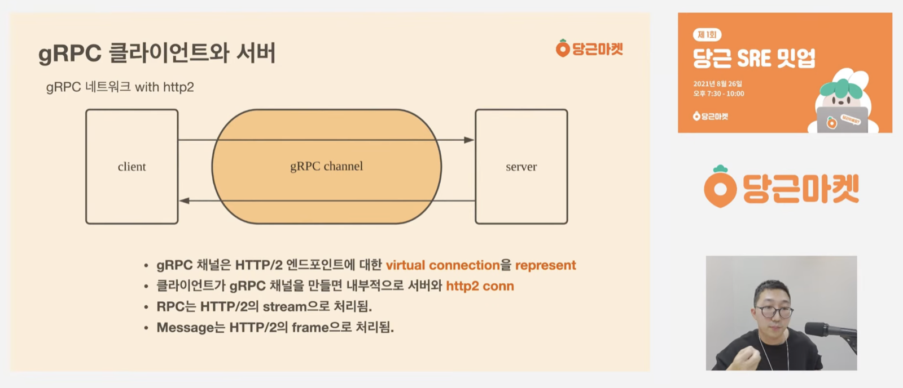
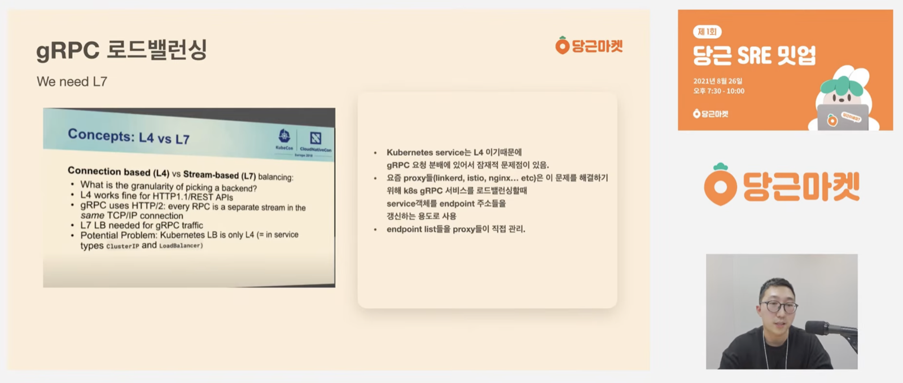

I plan to work through the tech talks that Daangn and Toss have made public, one at a time. The first is the **Daangn SRE Meetup #1**, held in August 2021. The cluster part of the Daangn SRE team gave two talks.

---

## 1. Zero-Downtime Amazon EKS Upgrades

Jeongyeol Yoo (Daangn SRE team, cluster part)



This talk covers how to upgrade EKS. It splits the problem into two situations, single cluster and multi cluster, and walks through how each can be upgraded.

For the single-cluster case, the standard approach (the official docs) is so well known that the talk didn't differ much from what I already knew. According to the docs, you don't jump several versions at once but upgrade one version at a time, and since a minor version ships roughly every three to four months you have to keep up with them. The method is also the familiar one: drain a node, use cordon and similar settings so pods can't be scheduled onto it, and upgrade nodes one by one.

As always, you look at the Kubernetes version to see what is going away and what is new, take care of settings that are now deprecated, bump the tags on manifests that used to be beta, and so on, then upgrade.

Single-cluster upgrades are so well known that nothing stood out much. One thing I learned is that EKS provides eksctl, and apparently that route is quite convenient. It usually takes about 40 minutes, and the slide says that once you actually do it, it's not that hard. That is how the talk wrapped up the single-cluster case.

The one thing that nags at me is the "no rollback" line at the end. Besides the single-cluster setup, Daangn also used a multi-cluster approach, and that part was quite interesting.

Originally, Daangn had a single ALB and NLB in front of EKS. But the ALB kept causing security-group-related incidents, so they stripped as much as possible out of it and moved that into Terraform, and since an NLB on its own makes traffic control fairly hard, they put HAProxy in front of it.

My own take, although I've never worked an NLB hard, is that without L7 load balancing it's hard to steer traffic smartly, which is probably why they introduced HAProxy up front. Later in the Q&A someone asked, "Couldn't you use Route 53 weighted routing instead of HAProxy?" It wasn't a bad alternative, but they said it was hard to fully understand things like DNS caching, so they went with HAProxy. Earlier in the talk they had also mentioned having a colleague on the team who is good with HAProxy.

So in the end they arrived at the structure in the picture above: HAProxy in front, NLBs behind it, then traffic flowing into the Kubernetes clusters. When a version update is needed, they bring up the new version, canary the traffic, and decide on the cluster upgrade from there.

As a result, multi cluster has the characteristics above. The part I liked most is that in a multi-cluster setup you can roll back, and for a big job like a cluster upgrade that is both a safety net and peace of mind.

As mentioned earlier, when upgrading a cluster you have to replace APIs that are no longer supported according to the release notes, and the list comes out roughly like the one above. A Q&A question was "How do you handle unsupported APIs?", and Jeongyeol's answer was that they do everything based on APIs that support resource updates.

---

## 2. Hands-On! gRPC Service Operations Know-How

Sangik Bae (Daangn SRE team, cluster part)



As the title says, this talk is about operating gRPC. It starts with why you end up using gRPC, goes from a simple explanation of what gRPC is to more advanced concepts, and then covers in detail how to monitor it from an infrastructure point of view.

Looking at this picture, the number of gRPC calls at Daangn doesn't look very different from HTTP. For internal calls between services, sending JSON over HTTP carries quite a bit of overhead, and small overheads add up to a fairly large amount of latency, plus the cost that comes from the resources being used.

Honestly, before watching this talk I hadn't really dealt with gRPC, so I only knew the rough idea: protobuf plus logic specialized for internal calls (using HTTP/2) makes it effective in a microservices setting. The talk actually explains gRPC's channel and message concepts in detail by mapping them onto HTTP/2, and it felt like I'd need to know HTTP/2 well to really understand gRPC.

The explanation kindly maps gRPC onto HTTP/2 concepts, as above. Since gRPC itself runs on HTTP/2 this is only natural, but because the infra team's job is to monitor gRPC and figure out whether it's working properly, I thought you need to know not just HTTP/2 but the network level in some depth.

As the talk goes deeper, it shows running a Go program in debug mode to confirm that connections are being made correctly. I'll get to this later, but Toss also uses a lot of Go-based open source, so when there's a problem or performance needs improving they analyze with pprof and then tune Go-level settings like GOMEMLIMIT and GOMAXPROCS. So a decent understanding of Go seems necessary as well.

For monitoring gRPC, they use Prometheus's multi-dimensional metrics. At the SRE layer they monitor services that produce errors through global queries, and at the application layer each service sets up its own custom dashboard. Since Daangn's services use a variety of languages, as of this talk the Java side uses Micrometer and the Go side uses grpc-prometheus. SRE monitors through Istio.

Tying this back to Jeongyeol's talk, the L7 load balancer topic was bound to come up. I personally like how one developer described an L7 load balancer as "smart", and likewise, to check the state of gRPC you need a smart L7 that understands the HTTP protocol. The talk makes the same point.

The Service in Kubernetes handles L4-level work. So to handle gRPC-related work you need L7-level work, and modern proxies support this. Proxies like istio and linkerd provide gRPC-related settings, so you can handle it well by reading the docs and configuring them.

In the talk they said they read the gRPC support documentation of each proxy they're going to apply closely. Per proxy, you can check the following.
- HAProxy: option `http-use-htx`
- nginx: `ngx_http_grpc_module`
- envoy: how the gRPC filter works

After finishing the explanation above, they said the infra team needs to watch the key metrics. But as of the talk they were still figuring out what the key metrics are and how to monitor them, and they were watching the following.

- Proxy Connection.* metric
- CPU throttling/CPU wait
  - For pods acting as ingress, it's important to raise the monitoring sensitivity.
- Network in/out bytes
- Developers' Sentry
  - Apparently every company has a few people who work as human alerts..
- APM

Finally, they introduced recommended tools like k6 and ghz, described Daangn's engineering culture, and wrapped up. Daangn puts a lot of effort into letting developers use the services they want to use, and they said you learn a lot that way. The talk ended with the wish to build infrastructure people want to use, the way they want to use a MacBook.

---

## Closing Thoughts

First, I left it out of the second talk's write-up, but keepalive comes up. A while back at work, while removing a legacy nginx and splitting things so that configuration was controlled through an ALB instead, I suffered because of the keepalive settings in that nginx.

The talk also explains that when you use tools involving network connections you have to pay attention to keepalive. I felt that connections and keepalive are keywords you have to look at more carefully than you'd think, and that I need to understand them better at the kernel and OS level.

There's a book I once opened thinking it would be easy because the word "story" was in the title, "The Linux Kernel Story", and it introduces everything you need to understand at the kernel level and everything to consider when profiling computer performance. When I first read it the content was so hard that I absorbed less than half. The "computer performance" profiling it talks about means things like analyzing packet by packet with tcpdump and checking whether CPU scheduling is being inefficient.. (I think I need to read that book again.)

In the end, I felt that as an engineer dealing with infrastructure, going deeper requires understanding at the kernel level, and the talk also showed writing Go source code yourself and profiling it. Not just Daangn but Toss too uses Go-based open source, especially Prometheus, so heavily that they often do configuration optimization, touching Prometheus's config directly on a knowledge base grounded in Go.

### References

- [Amazon EKS Upgrades — Daangn SRE Meetup #1 (YouTube)](https://www.youtube.com/watch?v=4Q8It_UvIws)
- [Daangn gRPC Service Operations Know-How — Daangn SRE Meetup #1 (YouTube)](https://www.youtube.com/watch?v=igHrQPzLVRw)
- [Daangn SRE Meetup #1 replay playlist](https://www.youtube.com/playlist?list=PLaHcMRg2hoBqWWla-pCBSRqU-jSriiZHj)
