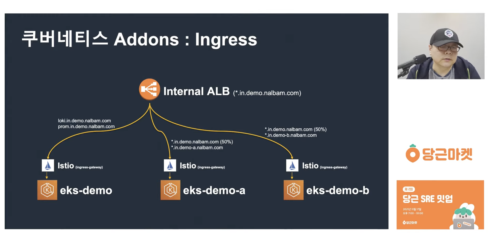
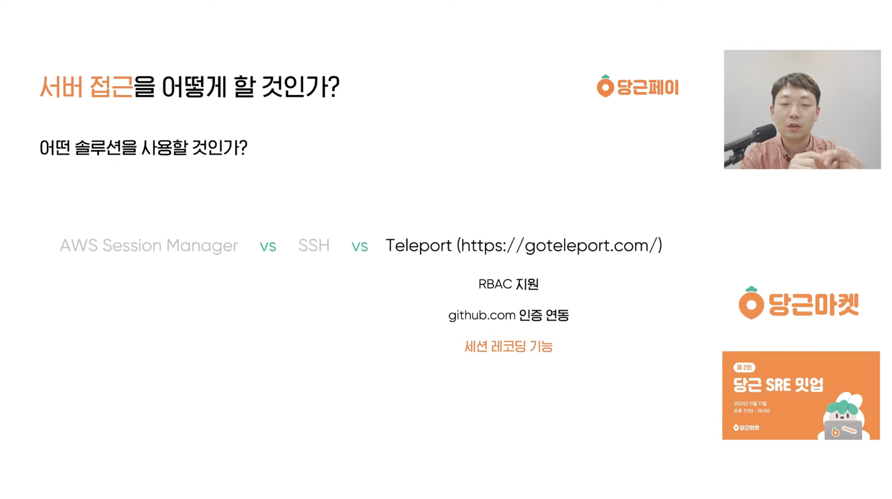
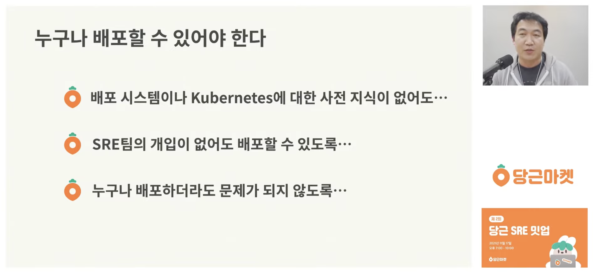
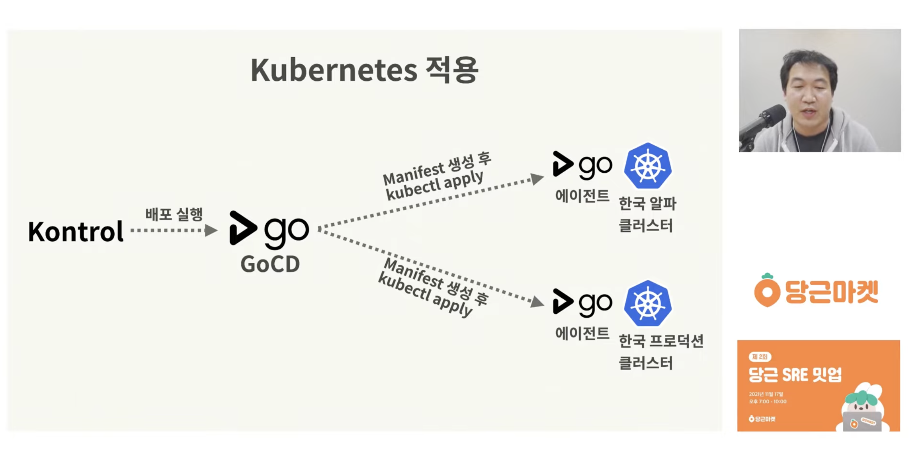
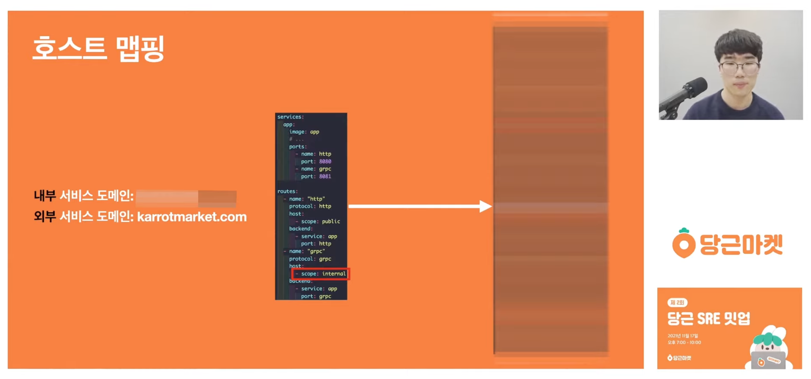
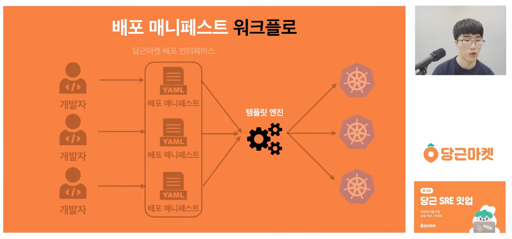

[前回の記事]()ではトス SLASH 21のインフラに関する発表をまとめた。今回は再びDaangnに戻り、[Daangn SRE ミートアップ 第1回]()に続いて、2021年11月に開かれた**Daangn SRE ミートアップ 第2回**を整理する。第2回のテーマはサービスのデプロイで、4つの発表があった。

---

## 1. Kubernetesマルチクラスター環境でAddonsを管理する方法

ユ・ジョンヨルさん(Daangn マーケット SRE チーム クラスターパート)



タイトルだけを見るとKubernetesでAddons(Grafana、Loki、Prometheusなど)を管理する内容のように思えるが、実際にはKubernetesクラスター全体をどう管理するかを網羅した発表に近い。単にAddonsをデプロイするだけでなく、ALBの設定、ドメインの設定、そして各EKSクラスターをArgoCDにどう登録するかまで扱っている。

発表自体は落ち着いて説明する講義形式なので、特に難しい部分や新しい部分はなかったが、ArgoCDでAddonsのマニフェストを管理する際にApplicationSet方式を使っている点が印象的だった。以前マニフェストを管理しながらapp-of-appsとApplicationSetの間で悩んだことがあったので、DaangnがApplicationSetを選んだ理由が気になったが、それについての説明は特になかった。

かなり驚いたのは、発表動画が公開されてから5年近く経っているのに、発表で紹介されたGitHubリポジトリを覗いてみると、サンプルコードが今もきちんとメンテナンスされていたことだ。今の会社でも近いうちにEKSベースのKubernetesクラスターを管理することになりそうなので、この発表動画を何度も見返し、リファレンスリポジトリもしっかり勉強してみようと思う。まさに会社でEKSベースのサービスを運用する方法をAからZまで教えてくれる動画だ。

---

## 2. Daangn Pay、6か月間のインフラ構築ストーリー

カン・ジヌさん(Daangn Pay SRE チーム)



発表は冒頭から、ペイメントというドメインが持つ特殊性を扱っている。金融に関わるため、他のドメインとは違って特有のコンプライアンスを遵守しなければならず、金融の問題はそのまま金銭的な損失につながるため、より慎重に管理せざるを得ない。Daangnでもこれまで挑戦したことのなかったペイメント分野に第一歩を踏み出す中で経験した試行錯誤を、5つほどに分けて紹介する発表だ。

記憶に残っているのは、2つ目の悩みであるサーバーへのアクセス方法だ。サーバーアクセスといえば普通はSSHやAWS Session Managerを思い浮かべ、そこにbastionを何重にも置いてIP帯域を制限するくらいを考えるだろうが、面白いことにこの発表ではTeleportという選択肢が登場した。

構成はかなり複雑だそうだが、セッションリプレイで接続したユーザーが何をしたかを確認できるという。サーバーアクセスはSSHを使う方法しかないのではと思っていたので、Teleportというツールがあること自体を初めて知った。セッションリプレイまでは必要なくても、もっと安全で便利に管理できる別のツールがあるかもしれないので、選択肢をもっと広く検討してみるべきだと思った。

発表の4つ目の悩みはデプロイパイプラインをどう構成するかだったが、JenkinsやCircleCIのような中央管理型のパイプラインツールではなく、GitHub Actionsを採用した。私も主にGitHub Actionsを使ってきたし、GitHub上ですぐにCI/CDパイプラインの状態を確認できる点はとても良かった。しかし時間が経つにつれ、中央管理型のCI/CDのほうが少し楽なのではないかと思うようになった。今の会社でも最初に取り組んだのが、共通のGitHub Actionsワークフローを管理する中央リポジトリを作り、各サービスがそれを呼び出して使う構成だったが、そうしてもJenkinsのような中央管理型ツールほど便利ではない気がする。(もっとも、Jenkinsをハードに使ったことはあまりない)

Daangnは今もGitHub Actionsを軸にサービスをデプロイしているようだ。発表ではJavaのエコシステムでコンテナイメージのビルドを助けるJibというツールがかなり便利だと紹介されていて、self-hosted runnerを積極的に活用することも重要だと思う。

発表は全体的に、Daangn Payのアーキテクチャの核となる部分を紹介する内容だった。コンプライアンスが重要な分野なのでSaaSを使うのが簡単ではなく、モニタリングのようなツールも自前で構築する必要があるという。

---

## 3. Daangnマーケットはなぜデプロイシステムを作るのか?

ピョン・ジョンフンさん(Daangn マーケット SRE チーム デリバリーパート)



この発表はDaangnマーケットのデプロイシステムについての話だ。Daangnのミートアップに参加したことがある人や関心が高い人なら、Daangnが自前のプラットフォームを構築して使っていることを知っているだろうが、この発表ではなぜデプロイプラットフォームを自分たちで作るのかを扱っている。

発表したピョン・ジョンフンさん(アウトサイダーというニックネームを使っている)は他のカンファレンスでもよく登壇しているが、一貫して語っているテーマが「誰でもデプロイできるべきだ」ということだ。ここ数年のDevOpsエンジニアリングのホットなキーワードといえばGitOpsやプラットフォームエンジニアリングが挙げられるが、この発表の当時は、プラットフォームエンジニアリングがなぜ重要でなぜ必要なのかが語られ始めた時期だったようだ。今の会社でも最近、開発者だけでなく開発者ではない人もデプロイできる、文字どおり「誰でもデプロイできる」プラットフォームを構築するのに頭を悩ませているので、発表の内容が全体的にとても心に響いた。

DaangnではKubernetesへのデプロイにKontrolというプラットフォームを使い、その裏側ではGoCDを使っているという。各クラスターにGoCDエージェントをインストールしているので、KontrolがAPIでGoCDにデプロイを依頼すると、GoCDがエージェントを通じてマニフェストを生成して適用する。

全体的に、開発者が簡単にサービスを作ってデプロイできるようにするには、デプロイプラットフォームをどう構成すべきかという悩みが詰まった発表だった。プラットフォームエンジニアリングについて考えているなら、ぜひ見てほしい内容だ。

---

## 4. cdk8sを活用したDaangnマーケットのサービスデプロイテンプレート作り

キム・ギュファンさん(Daangn マーケット SRE チーム デリバリーパート)



前の発表がデプロイプラットフォーム(Kontrol)をなぜ作ったのかを扱ったとすれば、この発表はその上で開発者が実際にアプリケーションをどうデプロイするのかを扱っている。**社内開発者プラットフォーム**(Internal Developer Platform、IDP)であれば、アプリをデプロイする側がドメインを付けたり、社内ネットワークからのみアクセスできるよう制限したりする設定を簡単にできるべきだが、この発表はそうした設定をどう表現し、どう処理するのかを詳しく説明している。

gRPCを使いたければprotocolに`grpc`を、社内ネットワークでのみ使いたければhost scopeに`internal`を書くといった具合に、デプロイしたい内容を1つのYAMLファイルに宣言してアップロードすれば、そのままデプロイされるようにしてある。メモリのようなリソース設定も同じファイルに書けるので、たった1つのYAMLファイルでサービスをデプロイできるという。

ただしKubernetesに適用するには、最終的にこのファイルをDeployment、Service、IngressのようなKubernetes APIに合ったマニフェストに変換する必要があり、この役割を担うのがテンプレートエンジンだ。まるで継承のように、開発者が設定した情報を受け取って、それぞれのDeploymentやServiceなどに展開する構造だ。テンプレートエンジンの候補としてはHelm templateとcdk8sを検討し、この発表ではcdk8sでテンプレートエンジンを構築した話を扱っている。cdk8sはプログラミング言語でKubernetesマニフェストを生成できるツールなので、Helm templateのような宣言的な方式よりも動的に実装できるという。

Helmとcdk8sの関係は、まるでTerraformとPulumiの関係のように感じられた。以前Pulumiを選んだ理由は、すでに慣れた言語の学習コストとエコシステムをそのまま使えるという点だったが、この2つのKubernetesテンプレートエンジンの間でも同じ感覚がある。Daangnはcdk8sのおかげでTypeScriptベースの動的なプログラミングで楽に作業でき、TypeScriptエコシステムのテストツールもそのまま使えたという。Kontrolが提供するデプロイマニフェストのプレビュー機能も、TypeScriptベースだったからこそ簡単に作れたのだと思う。

ただ、今は自分でコードを書くよりもAIエージェントに自然言語で指示してインフラコードを作る時代なので、慣れた言語を使えるというcdk8sの利点は発表当時ほど大きくないだろう。むしろ今なら、シンプルで宣言的なHelm templateのほうが優勢かもしれないと思う。それでも、今後IDPを構築することになったら、ぜひまた参考にしたい発表だ。

---

## おわりに

今回のDaangn SRE ミートアップ 第2回は、発表同士のつながりがかなり良かった。Daangn Payの発表は少しカジュアルに語られた印象だったが、残りの3つの発表は、Daangnのインフラがどう構成されていてEKSをどう活用しているのかから始まり、デプロイプラットフォームをなぜ・どう作ったのか、そして最後にアプリケーション開発者がファイル1つをアップロードしてデプロイする方法まで、順を追ってうまくつながっていた。

第1回に続いて第2回まで見て、Daangnのインフラチームが持つ哲学もある程度理解できた気がする。「誰でもデプロイできるべきだ」という言葉がその代表だ。オープンソースをそのまま導入するのではなく、より親切な社内プラットフォームを自分たちで構築するには多くのコストがかかるはずで、その決定にはこうした哲学が大きく影響したのだろう。

オープンソースを最大限に活用するトスと比べると、Daangnは自前で構築して使っているプラットフォームがかなり多いように見える。オープンソースの活用と自前構築に対する両社の哲学の違いがどこから来ているのかも、これから気にして見ていきたい部分だ。

### References

- [Kubernetesマルチクラスター環境でAddonsを管理する方法 — Daangn マーケット SRE ミートアップ 第2回 (YouTube)](https://www.youtube.com/watch?v=tqyj1klizCU)
- [Daangn Pay、6か月間のインフラ構築ストーリー — Daangn マーケット SRE ミートアップ 第2回 (YouTube)](https://www.youtube.com/watch?v=8a2-b9X7Xno)
- [Daangnマーケットはなぜデプロイシステムを作るのか? — Daangn マーケット SRE ミートアップ 第2回 (YouTube)](https://www.youtube.com/watch?v=pc3H9i6Yv2Y)
- [cdk8sを活用したDaangnマーケットのサービスデプロイテンプレート作り — Daangn マーケット SRE ミートアップ 第2回 (YouTube)](https://www.youtube.com/watch?v=tPEXZI2JO-g)
- [Daangn SRE ミートアップ 第2回 再生リスト](https://www.youtube.com/playlist?list=PLaHcMRg2hoBqJRSlnE7Xw_QpVkf8u6ISH)
