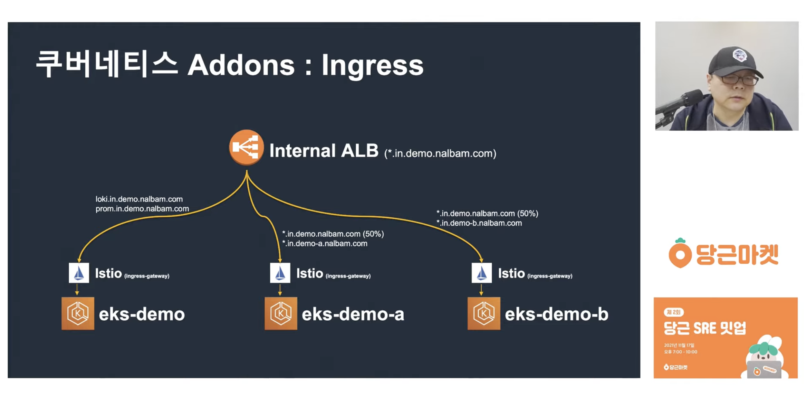
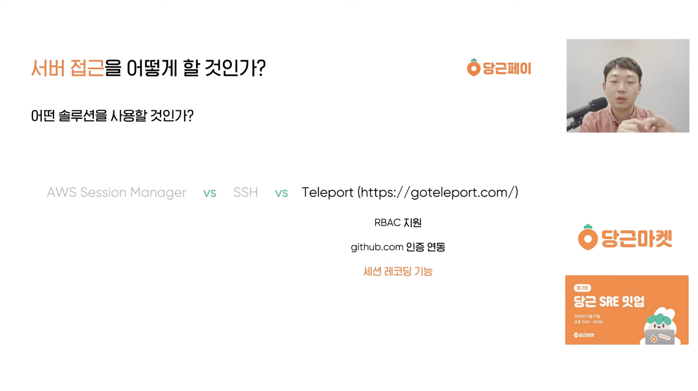
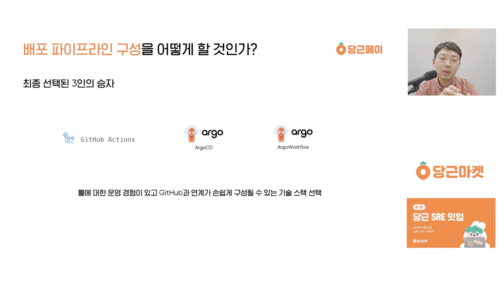
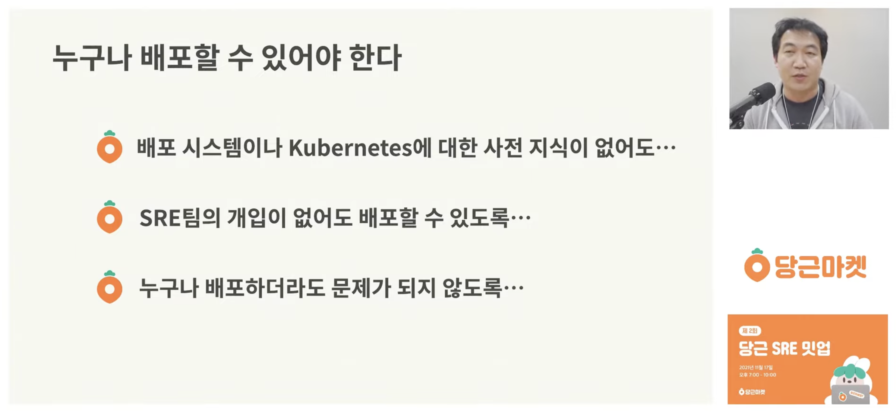
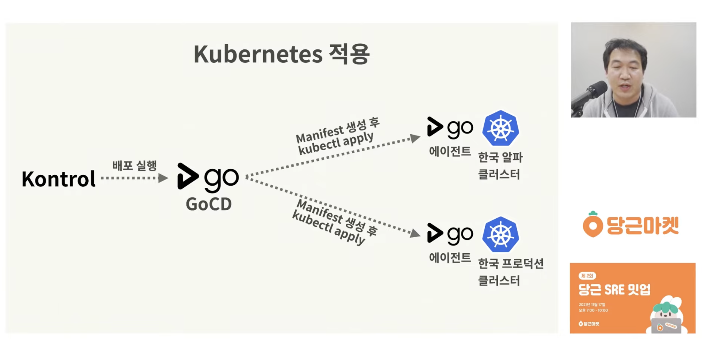
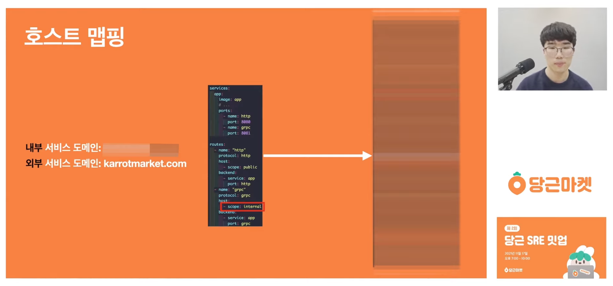
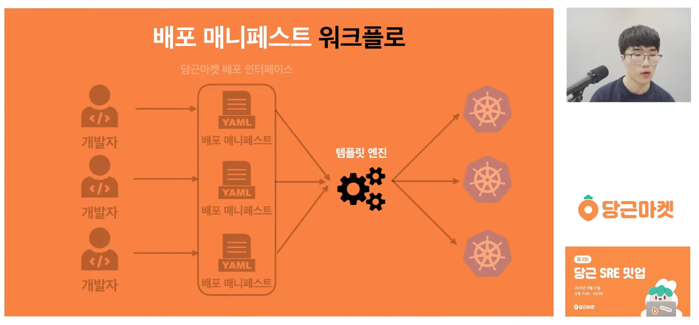

[이전 글]()에서는 토스 SLASH 21의 인프라 발표를 정리했다. 이번에는 다시 당근으로 돌아와, [당근 SRE 밋업 1회]()에 이어 2021년 11월에 열린 **당근 SRE 밋업 2회**를 정리한다. 2회의 주제는 서비스 배포이고, 네 개의 발표가 있었다.

---

## 1. 쿠버네티스 멀티 클러스터에서 Addons를 관리하는 방법

유정열 님 (당근마켓 SRE 팀 클러스터 파트)



이번 발표는 제목만 보면 쿠버네티스에서 Addons(Grafana, Loki, Prometheus 등)를 관리하는 내용 같지만, 사실은 쿠버네티스 클러스터 전체를 어떻게 관리하는지 총망라한 발표에 가깝다. 단순히 Addons를 배포하는 것을 넘어 ALB 설정, 도메인 설정, 그리고 각 EKS 클러스터를 ArgoCD에 어떻게 등록하는지까지 다룬다.

발표 자체는 차분하게 설명하는 강의 형식이라 크게 어렵거나 새로운 부분은 없었지만, ArgoCD에서 Addons의 매니페스트를 관리할 때 ApplicationSet 방식을 쓰는 점이 인상 깊었다. 예전에 매니페스트를 관리하면서 app-of-apps와 ApplicationSet 사이에서 고민한 적이 있어서, 당근이 ApplicationSet을 선택한 이유가 궁금했는데 그에 대한 설명은 따로 없었다.

꽤 놀라웠던 점은 발표 영상이 공개된 지 5년 가까이 지났는데도, 발표에 나온 GitHub 레포지토리에 들어가 보니 예제 소스가 여전히 잘 관리되고 있었다는 것이다. 지금 회사에서 조만간 EKS 기반의 쿠버네티스 클러스터를 관리하게 될 것 같은데, 이 발표 영상을 두고두고 살펴보고 레퍼런스 레포지토리도 잘 공부해 보려고 한다. 정말 회사에서 EKS 기반으로 서비스를 운영하는 방법을 A부터 Z까지 알려주는 영상이다.

---

## 2. 당근페이, 6개월 간의 인프라 구축 이야기

강진우 님 (당근페이 SRE 팀)



발표는 앞부분부터 페이(payment)라는 도메인이 가진 특수성을 다룬다. 금융과 연관되어 있기 때문에 다른 도메인과 달리 특수한 컴플라이언스를 준수해야 하고, 금융 문제는 곧바로 금전적인 손해로 이어지기 때문에 더욱 신중하게 관리할 수밖에 없다. 당근에서도 시도해 본 적 없던 페이먼트 분야에 첫발을 내디디며 겪은 시행착오를 다섯 가지 정도로 나누어 소개하는 발표다.

기억에 남는 것은 두 번째 고민인 서버 접근 방식이다. 서버 접근이라고 하면 보통 SSH나 AWS Session Manager를 떠올리고, 거기에 bastion을 겹겹이 두고 IP 대역을 제한하는 정도를 생각할 텐데, 신기하게도 이번 발표에서는 Teleport라는 선택지가 등장했다.

구성하기는 꽤 복잡하다고 하지만, 세션 리플레이로 접속한 사용자가 무엇을 했는지 확인할 수 있다고 한다. 서버 접근은 SSH를 쓰는 방법밖에 없지 않나 싶었는데, Teleport라는 툴이 있다는 것 자체를 처음 알았다. 세션 리플레이까지는 아니더라도 좀 더 안전하고 편리하게 관리할 수 있는 다른 툴이 있을 수 있으니, 선택지를 더 넓게 고려해 봐야겠다.

발표의 네 번째 고민은 배포 파이프라인을 어떻게 구성할 것인가였는데, Jenkins나 CircleCI 같은 중앙 관리형 파이프라인 툴이 아니라 GitHub Actions를 채택했다. 나도 GitHub Actions를 주로 써 왔고, GitHub에서 바로 CI/CD 파이프라인의 상태를 확인할 수 있다는 점은 매우 좋았다. 하지만 시간이 지날수록 중앙 관리형 CI/CD가 조금 더 편하지 않을까 하는 생각이 들었다. 지금 회사에서도 가장 먼저 한 작업이 공통 GitHub Actions 워크플로를 관리하는 중앙 레포지토리를 만들고 각 서비스가 이를 가져다 쓰는 구조였는데, 이렇게 해도 Jenkins 같은 중앙 관리형 툴만큼 편하지는 않은 것 같다. (물론 Jenkins를 하드하게 써 본 적은 별로 없다)

당근은 여전히 GitHub Actions를 주축으로 서비스를 배포하고 있는 것으로 보인다. 발표에서는 Java 진영에서 컨테이너 이미지 빌드를 돕는 Jib이라는 툴이 꽤 편리하다고 했고, self-hosted runner를 적극적으로 활용하는 것도 중요하다고 생각한다.

발표는 전반적으로 당근페이 아키텍처의 핵심 부분을 소개하는 내용이었다. 컴플라이언스가 중요한 분야이다 보니 SaaS를 쓰기가 쉽지 않아서, 모니터링 같은 툴도 직접 구축해야 한다고 한다.

---

## 3. 당근마켓은 왜 배포 시스템을 만드는가?

변정훈 님 (당근마켓 SRE 팀 딜리버리 파트)



이번 발표는 당근마켓의 배포 시스템에 대한 이야기다. 당근의 밋업에 참여해 봤거나 관심이 많은 사람이라면 당근이 자체 플랫폼을 구축해서 쓰고 있다는 것을 알 텐데, 왜 배포 플랫폼을 직접 만드는지를 다룬다.

발표를 진행한 변정훈 님(아웃사이더라는 닉네임을 쓰신다)은 다른 컨퍼런스에서도 자주 발표하시는데, 꾸준히 이야기하는 주제가 바로 '누구나 배포할 수 있어야 한다'는 것이다. 몇 년 전부터 DevOps 엔지니어링의 뜨거운 키워드라고 하면 GitOps나 플랫폼 엔지니어링을 꼽을 수 있을 텐데, 이 발표 당시는 플랫폼 엔지니어링이 왜 중요하고 왜 필요한지가 막 대두되던 시기였던 것 같다. 지금 회사에서도 최근 개발자뿐 아니라 개발자가 아닌 사람도 배포할 수 있는, 말 그대로 '누구나 배포할 수 있는' 플랫폼을 구축하느라 골머리를 앓고 있어서 발표 내용이 전반적으로 크게 와닿았다.

당근에서는 쿠버네티스에 배포할 때 Kontrol이라는 플랫폼을 사용하고, 뒷단에서는 GoCD를 사용한다고 한다. 각 클러스터에 GoCD 에이전트를 설치해 두었기 때문에, Kontrol이 API로 GoCD에 배포를 요청하면 GoCD가 에이전트를 통해 매니페스트를 생성하고 적용한다.

전반적으로 배포 플랫폼을 어떻게 구성해야 개발자가 손쉽게 서비스를 만들어 배포할 수 있는지에 대한 고민이 많이 담긴 발표였다. 플랫폼 엔지니어링을 고민하고 있다면 꼭 보면 좋을 내용이다.

---

## 4. cdk8s 활용 당근마켓 서비스 배포 템플릿 만들기

김규환 님 (당근마켓 SRE 팀 딜리버리 파트)



앞의 발표가 배포 플랫폼(Kontrol)을 왜 만들었는지를 다뤘다면, 이번 발표는 그 위에서 개발자가 실제로 애플리케이션을 어떻게 올리는지를 다룬다. **내부 개발자 플랫폼**(Internal Developer Platform, IDP)이라면 앱을 배포하는 입장에서 도메인을 붙이거나 사내망에서만 접근하도록 제한하는 설정을 손쉽게 할 수 있어야 하는데, 이 발표는 그런 설정을 어떻게 표현하고 처리하는지를 자세히 설명한다.

gRPC를 쓰고 싶다면 protocol에 `grpc`를, 사내망에서만 쓰고 싶다면 host scope에 `internal`을 적는 식으로, 배포하려는 내용을 하나의 YAML 파일에 선언해 올리면 그대로 배포되도록 해 두었다. 메모리 같은 리소스 설정도 같은 파일에 담을 수 있어서, 단 하나의 YAML 파일로 서비스를 배포할 수 있다고 한다.

다만 쿠버네티스에 적용하려면 결국 이 파일을 Deployment, Service, Ingress 같은 쿠버네티스 API에 맞는 매니페스트로 변환해야 하고, 이 역할을 하는 것이 템플릿 엔진이다. 마치 상속을 받듯이, 개발자가 설정한 정보를 받아 각각의 Deployment, Service 등으로 확장하는 구조다. 템플릿 엔진 후보로는 Helm template과 cdk8s를 고민했고, 이 발표는 cdk8s로 템플릿 엔진을 구축한 이야기를 다룬다. cdk8s는 프로그래밍 언어로 쿠버네티스 매니페스트를 생성하게 해 주는 툴이어서, Helm template 같은 선언형 방식보다 동적으로 구현할 수 있다고 한다.

Helm과 cdk8s의 관계는 마치 Terraform과 Pulumi의 관계처럼 느껴졌다. 예전에 Pulumi를 선택한 이유는 이미 익숙한 언어의 러닝 커브와 생태계를 그대로 쓸 수 있다는 점이었는데, 두 쿠버네티스 템플릿 엔진 사이에서도 같은 느낌이 든다. 당근은 cdk8s 덕분에 TypeScript 기반의 동적 프로그래밍으로 편하게 작업할 수 있었고, TypeScript 진영의 테스트 도구도 그대로 쓸 수 있었다고 한다. Kontrol이 제공하는 배포 매니페스트 미리보기 기능도 TypeScript 기반이었기에 쉽게 만들 수 있었던 것 같다.

다만 지금은 직접 코드를 치기보다 AI 에이전트에게 자연어로 지시해 인프라 코드를 만드는 시대라서, 익숙한 언어를 쓸 수 있다는 cdk8s의 장점이 발표 당시만큼 크지는 않을 것 같다. 오히려 지금이라면 단순한 선언형인 Helm template이 더 우세할 수도 있겠다는 생각이 든다. 그럼에도 앞으로 IDP를 구축하게 된다면 꼭 다시 참고해 볼 발표다.

---

## 마치며

이번 당근 SRE 밋업 2회는 발표 사이의 유기성이 꽤 좋았다. 당근페이 발표는 조금 더 캐주얼하게 풀어낸 느낌이었지만, 나머지 세 발표는 당근의 인프라가 어떻게 구성되어 있고 EKS를 어떻게 활용하는지에서 시작해, 배포 플랫폼을 왜·어떻게 만들었는지, 마지막으로 애플리케이션 개발자가 파일 하나를 올려 배포하는 방법까지 순서대로 잘 이어졌다.

1회에 이어 2회까지 보고 나니 당근 인프라팀의 철학도 어느 정도 이해할 수 있을 것 같다. '누구나 배포할 수 있어야 한다'는 구절이 대표적이다. 오픈소스를 그대로 도입하지 않고 더 친절한 내부 플랫폼을 직접 구축하는 데는 많은 비용이 들 텐데, 그 결정에는 이런 철학이 큰 영향을 끼쳤을 것이다.

오픈소스를 최대한 활용하는 토스와 비교하면, 당근은 직접 구축해서 쓰는 플랫폼이 꽤 많아 보인다. 오픈소스 활용과 자체 구축에 대한 두 회사의 철학 차이가 어디에서 비롯되었는지도 앞으로 궁금하게 지켜볼 부분이다.

### References

- [쿠버네티스 멀티 클러스터에서 Addons를 관리하는 방법 — 당근마켓 SRE 밋업 2회 (YouTube)](https://www.youtube.com/watch?v=tqyj1klizCU)
- [당근페이, 6개월 간의 인프라 구축 이야기 — 당근마켓 SRE 밋업 2회 (YouTube)](https://www.youtube.com/watch?v=8a2-b9X7Xno)
- [당근마켓은 왜 배포 시스템을 만드는가? — 당근마켓 SRE 밋업 2회 (YouTube)](https://www.youtube.com/watch?v=pc3H9i6Yv2Y)
- [cdk8s 활용 당근마켓 서비스 배포 템플릿 만들기 — 당근마켓 SRE 밋업 2회 (YouTube)](https://www.youtube.com/watch?v=tPEXZI2JO-g)
- [당근 SRE 밋업 2회 다시보기 재생목록](https://www.youtube.com/playlist?list=PLaHcMRg2hoBqJRSlnE7Xw_QpVkf8u6ISH)
