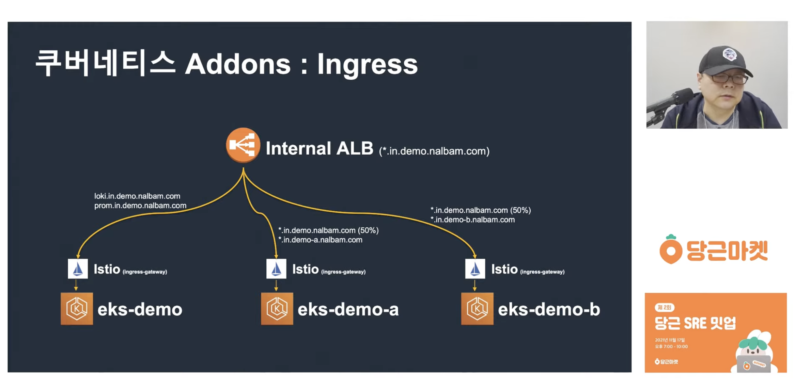
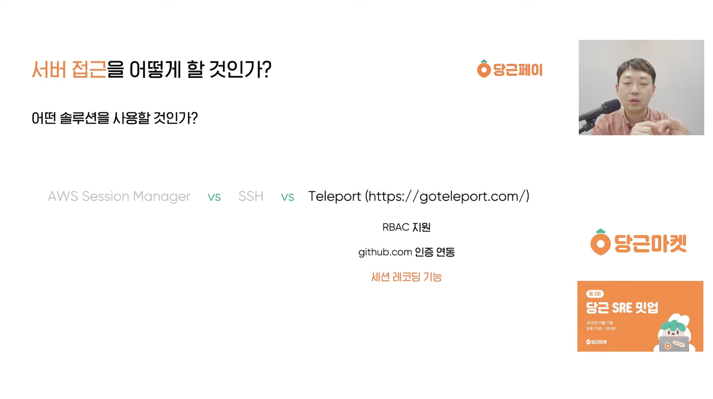
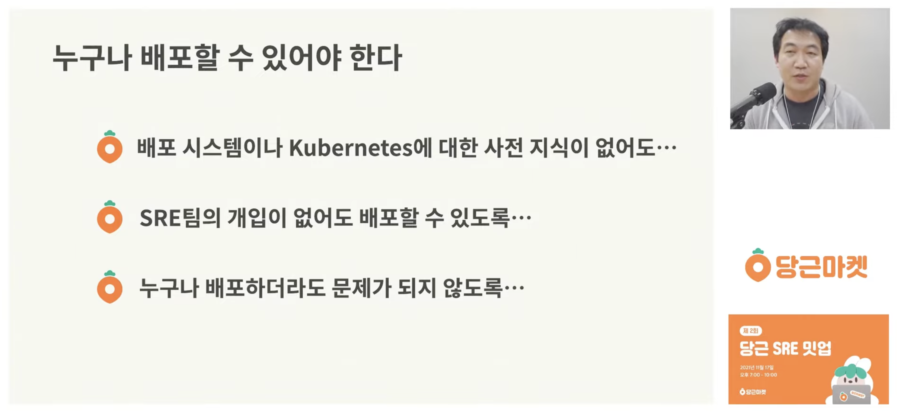
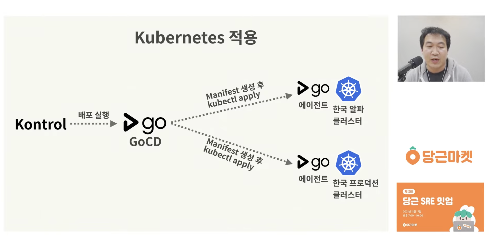
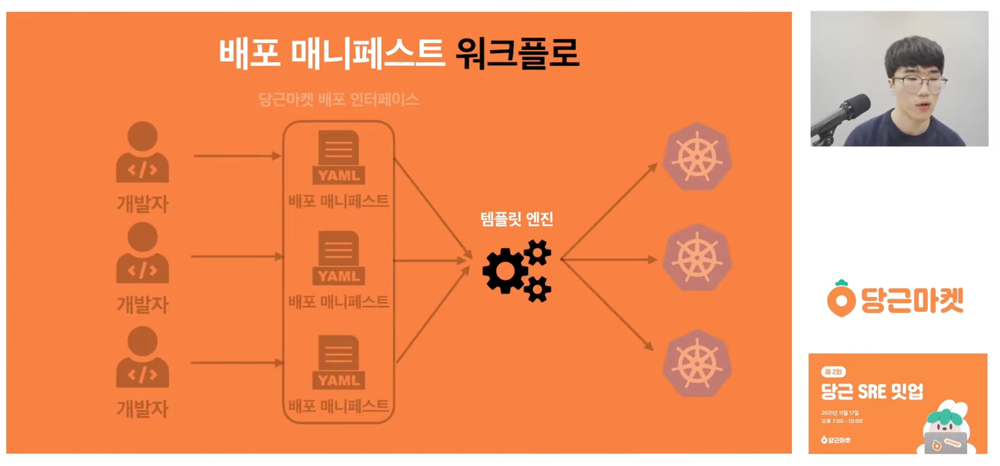

In the [previous post](), I went over the infrastructure talks from Toss SLASH 21. This time I'm back to Daangn: following [Daangn SRE Meetup #1](), this post covers **Daangn SRE Meetup #2**, held in November 2021. The theme of the second meetup was service deployment, and there were four talks.

---

## 1. Managing Addons Across Multiple Kubernetes Clusters

Jeongyeol Yoo (Daangn SRE Team, Cluster Part)



Judging by the title alone, this talk sounds like it's about managing addons (Grafana, Loki, Prometheus, and so on) on Kubernetes, but it's really closer to a comprehensive tour of how to manage an entire Kubernetes cluster. It goes beyond deploying addons to cover ALB configuration, domain setup, and how each EKS cluster gets registered with ArgoCD.

The talk itself is a calm, lecture-style walkthrough, so there wasn't much that was especially hard or new, but one thing that stood out was the use of ApplicationSet to manage addon manifests in ArgoCD. I've wavered between app-of-apps and ApplicationSet myself when managing manifests, so I was curious why Daangn chose ApplicationSet — unfortunately the talk didn't explain that.

What surprised me was that even though the video was published almost five years ago, the GitHub repository mentioned in the talk is still well maintained. It looks like I'll be managing EKS-based Kubernetes clusters at work soon, so I plan to come back to this video again and again and study the reference repository carefully. It truly is a video that walks you through running services on EKS at a company from A to Z.

---

## 2. Daangn Pay: Six Months of Building Infrastructure

Jinwoo Kang (Daangn Pay SRE Team)



From the very beginning, the talk deals with what makes payments a special domain. Because it's tied to finance, it has to comply with specific regulations that other domains don't, and since financial problems translate directly into monetary losses, it has to be managed all the more carefully. The talk introduces, in roughly five parts, the trial and error Daangn went through as it took its first steps into payments — a field it had never tried before.

What stuck with me was the second concern: how to access servers. When people think of server access, they usually picture SSH or AWS Session Manager, perhaps with layers of bastions and restricted IP ranges, but interestingly, this talk brought up Teleport as an option.

It's apparently fairly complex to set up, but session replay lets you see exactly what a connected user did. I had assumed SSH was pretty much the only way to access servers, so this was the first time I'd even heard of Teleport. Even if I don't need session replay, there may be other tools that make access safer and more convenient, so I should consider a wider range of options.

The fourth concern was how to build the deployment pipeline, and instead of a centrally managed pipeline tool like Jenkins or CircleCI, they adopted GitHub Actions. I've mostly used GitHub Actions too, and being able to check the state of the CI/CD pipeline right from GitHub is really nice. Over time, though, I've started to wonder whether centrally managed CI/CD might be a bit more convenient. At my current company, one of the first things I did was create a central repository of shared GitHub Actions workflows for each service to reuse, but even so, it doesn't feel as convenient as a centrally managed tool like Jenkins. (Admittedly, I haven't used Jenkins heavily.)

Daangn still seems to deploy its services primarily with GitHub Actions. The talk mentioned that Jib, a tool that helps build container images in the Java ecosystem, is quite convenient, and I think making active use of self-hosted runners is important too.

Overall, the talk introduced the core parts of Daangn Pay's architecture. Because compliance matters so much in this field, using SaaS isn't easy, so even tools like monitoring have to be built in-house.

---

## 3. Why Does Daangn Build Its Own Deployment System?

Jeonghun Byun (Daangn SRE Team, Delivery Part)



This talk is about Daangn's deployment system. Anyone who has attended Daangn's meetups or follows them closely will know that Daangn builds and uses its own internal platforms, and this talk explains why they build their own deployment platform.

The speaker, Jeonghun Byun (who goes by the nickname Outsider), speaks often at other conferences too, and the theme he keeps coming back to is "anyone should be able to deploy." If you had to pick the hot keywords in DevOps engineering over the past few years, GitOps and platform engineering would be near the top, and it seems this talk was given right around the time people were starting to talk about why platform engineering matters. My current company has recently been struggling to build a platform where not only developers but also non-developers can deploy — literally a platform where "anyone can deploy" — so the talk resonated with me a lot.

At Daangn, deployments to Kubernetes go through a platform called Kontrol, with GoCD behind it. Since a GoCD agent is installed in each cluster, when Kontrol asks GoCD to deploy via its API, GoCD generates and applies the manifests through those agents.

Overall, the talk was full of thinking about how to structure a deployment platform so that developers can easily build and ship services. If you're thinking about platform engineering, it's well worth watching.

---

## 4. Building Daangn's Service Deployment Templates with cdk8s

Gyuhwan Kim (Daangn SRE Team, Delivery Part)



If the previous talk covered why they built a deployment platform (Kontrol), this one covers how developers actually ship applications on top of it. An **internal developer platform** (IDP) should make it easy for whoever is deploying an app to attach a domain or restrict access to the internal network, and this talk explains in detail how those settings are expressed and processed.

If you want gRPC, you put `grpc` in the protocol; if you want the service reachable only from the internal network, you put `internal` in the host scope. You declare everything you want to deploy in a single YAML file, upload it, and it gets deployed as-is. Resource settings like memory can go in the same file too, so a single YAML file is all it takes to deploy a service.

To apply it to Kubernetes, though, that file ultimately has to be converted into manifests that fit the Kubernetes API, such as Deployment, Service, and Ingress — and that's the job of the template engine. Much like inheritance, it takes the information the developer configured and expands it into the individual Deployment, Service, and other resources. They considered Helm template and cdk8s as candidates for the template engine, and this talk covers building it with cdk8s. Because cdk8s lets you generate Kubernetes manifests with a programming language, it allows more dynamic implementations than a declarative approach like Helm template.

The relationship between Helm and cdk8s felt a lot like the relationship between Terraform and Pulumi. When I chose Pulumi in the past, the reason was that I could reuse the learning curve and ecosystem of a language I already knew, and the same feeling applies between these two Kubernetes template engines. Thanks to cdk8s, Daangn could work comfortably with dynamic TypeScript-based programming and use TypeScript testing tools as they are. Kontrol's deployment manifest preview feature was probably easy to build for the same reason — it's TypeScript-based.

That said, these days we instruct AI agents in natural language to produce infrastructure code rather than typing it ourselves, so cdk8s's advantage of letting you use a familiar language probably isn't as big as it was at the time of the talk. If anything, the simpler, declarative Helm template might have the upper hand now. Even so, if I end up building an IDP, this is a talk I'll definitely revisit.

---

## Closing Thoughts

The talks at Daangn SRE Meetup #2 fit together quite well. The Daangn Pay talk felt a bit more casual, but the other three flowed nicely in order: starting from how Daangn's infrastructure is laid out and how it uses EKS, moving to why and how they built a deployment platform, and finishing with how an application developer can deploy by uploading a single file.

After watching both meetup #1 and #2, I feel like I understand some of the philosophy of Daangn's infrastructure team. "Anyone should be able to deploy" is the clearest example. Building a friendlier internal platform yourself, rather than adopting open source as-is, must cost a lot, and that philosophy probably weighed heavily on the decision.

Compared to Toss, which makes the most of open source, Daangn seems to build quite a few of its own platforms. Where that philosophical difference between the two companies — using open source versus building in-house — comes from is something I'll be curious to keep watching.

### References

- [Managing Addons Across Multiple Kubernetes Clusters — Daangn SRE Meetup #2 (YouTube)](https://www.youtube.com/watch?v=tqyj1klizCU)
- [Daangn Pay: Six Months of Building Infrastructure — Daangn SRE Meetup #2 (YouTube)](https://www.youtube.com/watch?v=8a2-b9X7Xno)
- [Why Does Daangn Build Its Own Deployment System? — Daangn SRE Meetup #2 (YouTube)](https://www.youtube.com/watch?v=pc3H9i6Yv2Y)
- [Building Daangn's Service Deployment Templates with cdk8s — Daangn SRE Meetup #2 (YouTube)](https://www.youtube.com/watch?v=tPEXZI2JO-g)
- [Daangn SRE Meetup #2 replay playlist](https://www.youtube.com/playlist?list=PLaHcMRg2hoBqJRSlnE7Xw_QpVkf8u6ISH)
