클라우드클럽 10기에서 쿠버네티스 CNI 스터디를 하며 몇 달간 네트워크 스택을 바닥부터 다시 짚어 볼 기회가 있었다. 운영하던 클러스터가 VXLAN 기반의 Flannel을 쓰고 있어서 그 구조는 [이전 글]()에 한 번 정리해 두었는데, 그 글의 마지막에 Calico와 Cilium을 비교하면서 "Cilium은 eBPF로 netfilter를 우회한다"고 한 문단으로 적고 넘어갔었다. 스터디가 Cilium 주차에 이르러 eBPF를 공식 문서부터 파고들게 되었고, 그때 정리한 내용을 흘려보내기 아까워 이 글로 남긴다. 그 한 문단을 풀어 쓴 글이라고 보면 된다.

출발점은 Cilium 클러스터에서 겪은 작은 퍼즐이다. Pod 안에서 ClusterIP로 curl을 보내면서, 같은 Pod의 `eth0`에서 그 주소를 잡아봤다.

```bash
$ kubectl exec -it client -- sh
/ # curl -s http://10.96.45.10/ | head -1
<!DOCTYPE html>
/ # tcpdump -ni eth0 host 10.96.45.10
tcpdump: listening on eth0, link-type EN10MB (Ethernet)
^C
0 packets captured
```

curl은 성공했다. 그런데 **그 Pod 자신의 인터페이스에조차** ClusterIP가 없다. kube-proxy iptables 클러스터라면 Pod의 `eth0`에는 ClusterIP가 그대로 실리고, 호스트의 `PREROUTING`에서 DNAT가 걸린 뒤에야 Pod IP로 바뀐다. 노드에서 늘 보던 체인을 찾아봐도 없다.

```bash
$ iptables -t nat -S | grep KUBE-SVC
$ conntrack -L | grep 10.96.45.10
conntrack v1.4.7: 0 flow entries have been shown.
```

DNAT 규칙도 없고, conntrack에도 그 연결이 없다. 그런데 패킷은 간다. `ip route`, `iptables`, `conntrack`, `tcpdump`가 **전부 아무것도 못 보는** 상황이다. 이 글은 이 패킷이 어디서 처리되는지를 따라가면서 eBPF의 구조를 정리한다. eBPF가 커널의 어느 지점에 끼어드는지, 프로그램이 어떻게 올라가고 무엇으로 상태를 나누는지, 그리고 Pod가 수천 개로 늘어났을 때 iptables의 체인과 eBPF의 맵이 왜 다르게 움직이는지가 중심이다. Cilium과 Calico는 그 구조를 실제로 어떻게 쓰는지 보여주는 예시로 곁에 둔다.

1장과 2장의 그림은 전부 [ebpf.io 공식 문서 "eBPF란?"](https://ebpf.io/ko-kr/what-is-ebpf/)에서 가져왔다(CC BY 4.0). 문서가 그림을 놓은 순서를 그대로 따라간다.

---

## 1. eBPF 이전의 커널 — 설정만 넘길 수 있었다

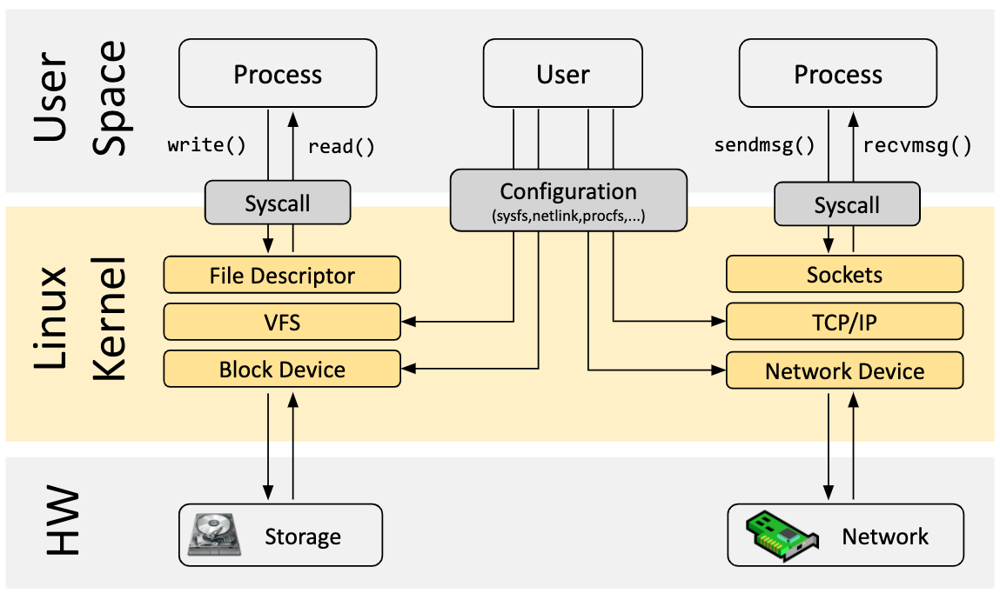

eBPF를 빼고 그린 커널이다. 프로세스는 시스템콜로만 커널에 들어가고, 패킷은 Sockets → TCP/IP → Network Device를 순서대로 내려간다. 가운데의 **Configuration(sysfs, netlink, procfs)** 상자가 유저가 커널에 영향을 줄 수 있는 유일한 통로다.

이전 글에서 쓴 도구가 전부 이 상자에 들어간다. `ip route`, `bridge fdb`, `iptables`는 netlink로 커널 자료구조에 **데이터**를 넣는 것이다. Flannel의 `flanneld`도, Calico의 Felix와 BIRD도 이 통로로 커널을 프로그래밍했다. 공통점은 **커널 코드는 그대로 두고 그 코드가 읽을 데이터만 바꾼다**는 것이다. 라우팅 테이블을 찾는 코드, iptables 체인을 위에서 아래로 훑는 코드는 커널 안에 고정돼 있다.

이 구조에서 커널의 동작 자체를 바꾸려면 선택지가 둘이다. 커널 소스를 고쳐 다시 빌드하거나, 커널 모듈을 올리는 것이다. 전자는 배포판 커널을 쓰는 환경에서 현실적이지 않고, 후자는 모듈 하나의 버그가 커널 전체를 멈출 수 있다. 네트워크 스택의 특정 지점에서 "이 패킷은 이렇게 처리하라"는 **로직**을 넣고 싶은데, 그 자리에 데이터 외의 것을 넣을 안전한 방법이 없었다.

eBPF는 이 자리에 세 번째 선택지를 더한다. **데이터가 아니라 코드를 넘기는 통로**다.

---

## 2. eBPF — 코드를 넘기는 통로

설정 인터페이스가 커널 자료구조에 값을 쓰는 통로였다면, eBPF는 커널의 정해진 지점에 작은 프로그램을 붙이는 통로다. 그 프로그램이 어떻게 생겼고 어떤 관문을 지나 커널에 들어가는지를 순서대로 본다.

### 2.1 훅 — 커널의 길목마다 프로그램을 붙일 자리

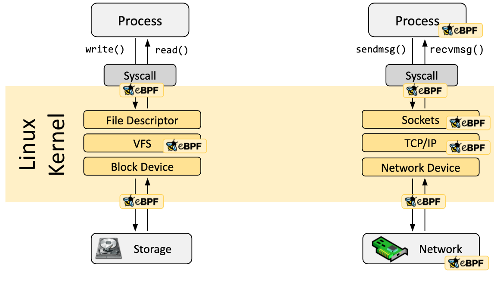

1장과 같은 그림에 eBPF 아이콘이 붙었다. **아이콘 하나가 훅**(hook) **하나**다. eBPF 프로그램은 아무 데서나 실행되지 않고, 커널이 미리 정해 둔 이 훅에만 붙는다. 시스템콜 진입, 소켓, TCP/IP, 네트워크 장치, NIC까지. 왼쪽 파일 경로의 아이콘은 추적·보안 도구의 영역이고, 이 글의 관심은 오른쪽 열이다.

| 그림의 아이콘 | 커널의 훅 | Cilium이 쓰는 용도 |
|---|---|---|
| 왼쪽 열 (File, Storage) | kprobe, tracepoint, LSM | 추적·보안 도구(bpftrace, bcc, Tetragon)의 영역 |
| Syscall 옆 | cgroup socket 훅 (`connect`, `sendmsg`, `getpeername`) | Service 처리(소켓 LB) |
| TCP/IP | **tc**(traffic control) ingress / egress | Pod 트래픽 전부. 정책, 전달, 캡슐화 |
| Network Device | **XDP**(eXpress Data Path) | NodePort 가속 |

3장에서 이 훅들이 Netfilter의 다섯 훅과 어떤 순서로 놓이는지 따로 본다.

### 2.2 이벤트가 프로그램을 깨운다

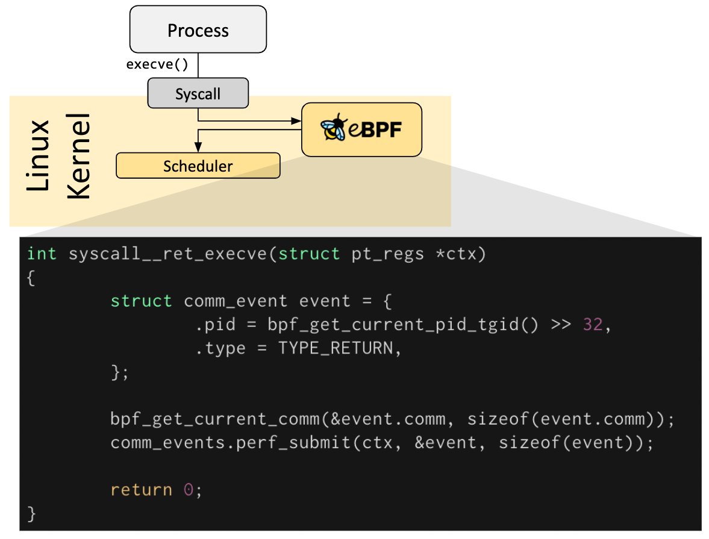

프로그램이 실제로 어떻게 생겼는지 보여주는 그림이다. 프로세스가 `execve()`를 부르면 커널이 스케줄러로 가기 전에 훅의 프로그램을 **먼저** 실행한다. 프로그램은 짧다. 컨텍스트를 받고, 헬퍼 함수로 PID와 프로세스 이름을 꺼내고, `perf_submit`으로 **유저스페이스에 이벤트를 올리고**, 0을 반환한다.

세 가지가 네트워크 쪽과 그대로 이어진다. 프로그램은 **이벤트가 일어날 때만 돈다**(패킷이 veth에 도착, `connect()` 호출). 프로그램은 **반환값으로 커널에 지시**한다. tc 훅이라면 통과, 드롭, 다른 인터페이스로 리다이렉트가 반환값이다. 그리고 `perf_submit`이 Cilium의 관측 도구 Hubble의 원형이다. 데이터패스가 패킷을 판단할 때마다 그 판단을 같은 방식으로 내보낸다.

### 2.3 C로 쓰고 바이트코드로 컴파일한다


문서는 먼저 "대부분은 eBPF를 직접 쓰지 않고 Cilium, bcc, bpftrace 같은 프로젝트를 통해 간접적으로 쓴다"고 적어 둔다. 쿠버네티스 운영자는 그 경우다. 그 프로젝트 안에서는 C의 부분집합으로 쓴 소스를 LLVM이 x86도 ARM도 아닌 **eBPF 바이트코드**로 컴파일한다. eBPF는 커널 안에 사는 작은 가상 머신이고, 바이트코드는 그 머신의 명령어다.

Cilium에서 C 소스는 저장소의 `bpf/` 디렉터리에 있고, 에이전트 이미지에 든 clang이 **노드 위에서** 컴파일한다. 노드마다 커널 버전과 설정이 다를 수 있어서 그 노드에 맞춰 컴파일하는 것이다.

### 2.4 로더 — bpf() 시스템콜로 커널에 올린다

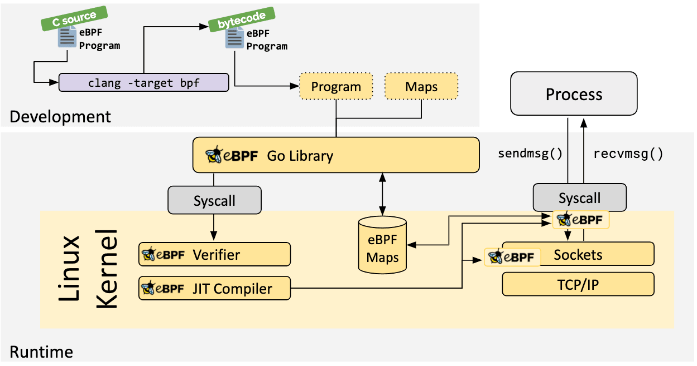

전체 그림이다. 바이트코드와 맵 정의가 **Go Library**로 들어가고, 라이브러리가 `bpf()` 시스템콜로 커널에 넘긴다. 커널 안에서 Verifier와 JIT를 거친 프로그램이 훅에 꽂히고, eBPF Maps에는 라이브러리와 프로그램 양쪽에서 화살표가 들어온다.

이 그림의 Go Library가 비유가 아니다. Cilium에서 이 자리에 선 것이 `cilium-agent`다. Go로 짜여 있고 `cilium/ebpf` 라이브러리로 `bpf()`를 부른다. 이전 글에서 iptables를 "커널 Netfilter에 규칙을 등록하는 유저스페이스 도구"라고 정리했는데, 에이전트는 그 자리에 선 **프로그램과 맵을 등록하는 유저스페이스 도구**다. 등록이 끝나면 에이전트는 패킷 경로에서 빠진다. 에이전트가 잠시 죽어도 이미 꽂힌 프로그램은 계속 돈다.

### 2.5 검증기와 JIT — 올라가기 전 두 관문


`bpf()`로 넘어온 바이트코드는 바로 실행되지 않는다. 그림의 초록 꼬리표가 상태 변화다. **bytecode → approved → x86_64.** 두 관문을 지난다.

**검증기**(verifier)는 실행 전에 모든 경로를 정적으로 검사한다. 반드시 종료해야 하고(무한 루프 금지), 범위 밖 메모리를 건드리면 안 되고, 크기와 복잡도 상한이 있고, 로드하려면 root 또는 `CAP_BPF`가 있어야 한다. 이 관문이 커널 모듈과의 결정적 차이다. 모듈은 아무 코드나 올릴 수 있어 커널을 죽일 수 있고, eBPF는 **커널이 안전하다고 증명한 것만** 들어간다. Cilium이 커널 버전을 따지는 이유도 여기 있다. 오래된 검증기는 Cilium의 프로그램 크기와 복잡도를 받아주지 않는다.

**JIT**(Just-In-Time 컴파일러)는 통과한 바이트코드를 그 머신의 네이티브 명령어로 바꾼다. 커널에 원래 있던 코드와 같은 속도로 돈다. "커널 안의 가상 머신"이라는 말에서 떠올리기 쉬운 인터프리터 오버헤드가 실제로는 없다.

### 2.6 맵 — 커널과 유저스페이스가 같이 쓰는 저장소

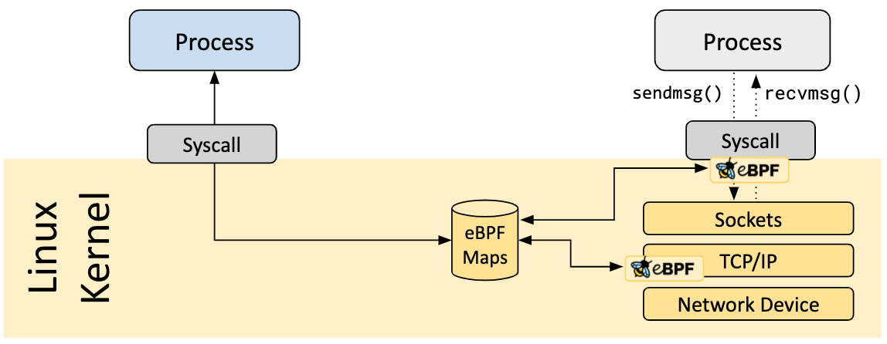

프로그램은 호출이 끝나면 스택이 사라진다. 호출을 넘어 남겨야 하는 상태는 **맵**(map)에 둔다. 그림에서 원통에 화살표 셋이 들어온다. 유저스페이스에서 하나, 서로 다른 훅의 프로그램에서 둘. 유저스페이스의 로더는 `bpf()`로 읽고 쓰고, 프로그램은 헬퍼로 읽고 쓴다. **에이전트와 커널 프로그램, 그리고 프로그램끼리 같은 맵을 본다.**

맵에는 유형이 있고, 유형마다 자료구조가 다르다. 문서가 나열하는 유형이 Cilium의 맵과 이렇게 대응한다.

| 맵 유형 | 자료구조 | Cilium에서 |
|---|---|---|
| Hash | 해시 테이블 | `policy`(정책), `lb`(Service → 백엔드) |
| LRU hash | 오래된 항목을 밀어내는 해시 | `ct`(연결 추적) |
| LPM trie | 가장 긴 프리픽스 매칭 트라이 | `ipcache`(IP → Identity, 소속 노드) |
| Array / per-CPU array | 고정 크기 배열 | 설정값, 카운터 |
| Perf / ring buffer | 커널 → 유저스페이스 이벤트 큐 | Hubble 이벤트 |

라우팅 테이블이 하던 LPM 조회가 **같은 자료구조로 맵 안에 옮겨 간 것**이고, iptables 체인이 하던 정책 판단이 해시 조회로 옮겨 간 것이다. 4장에서 이 차이가 규모와 어떻게 만나는지 본다.

### 2.7 헬퍼와 꼬리 호출

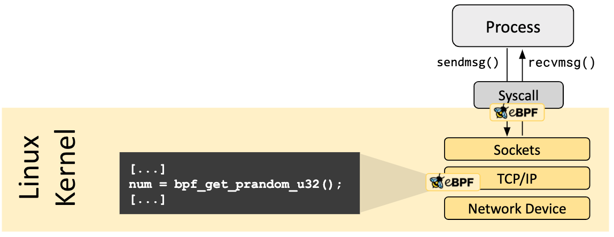

프로그램은 임의의 커널 함수를 부를 수 없다. 커널이 **안정적인 API로 약속한 헬퍼 함수**만 부른다. 난수 하나를 얻는 데도 그림처럼 `bpf_get_prandom_u32()`를 쓴다. Cilium이 패킷을 다른 인터페이스로 넘기는 `bpf_redirect`, 헤더를 고치는 `bpf_skb_store_bytes`, 맵을 찾는 `bpf_map_lookup_elem`이 전부 헬퍼다. 커널 내부 함수를 직접 부르지 못하게 막아 둔 것이 검증기가 안전을 증명할 수 있는 전제다.

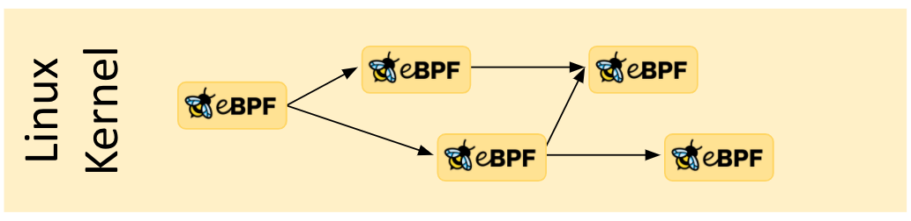

프로그램은 다른 프로그램으로 **돌아오지 않고 점프**할 수도 있다. **꼬리 호출**(tail call)이다. 검증기의 크기 상한 때문에 하나의 프로그램에 다 담지 못하는 로직을 여러 프로그램으로 쪼개 잇는 수단이고, Cilium은 Pod 하나의 패킷 처리를 이 방식으로 여러 프로그램에 나눠 둔다.

### 2.8 정리

| 요소 | 역할 | Cilium에서 |
|---|---|---|
| **프로그램** | 훅에서 실행되는 코드. 패킷을 읽고, 고치고, 보내거나 버리는 판단 | `bpf_lxc.c`, `bpf_host.c`, `bpf_overlay.c`, `bpf_sock.c` |
| **맵** | 커널에 사는 키-값 저장소. 프로그램끼리, 그리고 유저스페이스와 공유 | `ipcache`, `policy`, `ct`, `lb` |
| **훅** | 프로그램이 붙는 커널의 지점 | tc, cgroup socket, XDP |

한 문장으로 줄이면 이렇다. **커널을 다시 빌드하거나 모듈을 올리지 않고, 검증기가 안전을 증명한 작은 프로그램을 커널의 정해진 길목에 붙여 이벤트마다 실행하고, 그 프로그램과 유저스페이스가 맵으로 상태를 나누는 기능.** 1장의 Configuration 상자가 "데이터를 넘기는 통로"였다면 eBPF는 **코드를 넘기는 통로**다.

")

---

## 3. 네트워크 훅 — Netfilter 다섯 개 옆에 세 가지가 더 있다

2장에서 훅이 무엇인지 봤으니, 이제 네트워크 경로의 훅이 정확히 어디에 놓이는지를 본다. [리눅스 네트워크 내부 구조]()에서 Netfilter 훅 다섯 개(`PREROUTING`, `INPUT`, `FORWARD`, `OUTPUT`, `POSTROUTING`)를 정리했다. eBPF 훅은 그 다섯 개와 이렇게 놓인다.

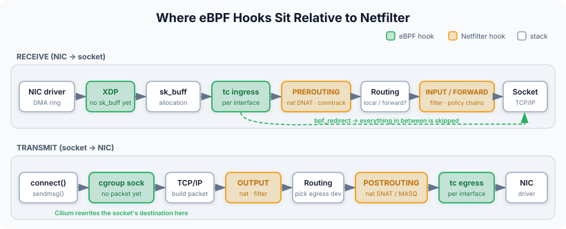

| 훅 | 위치 | Netfilter와의 순서 |
|---|---|---|
| **XDP** | NIC 드라이버가 패킷을 받은 직후. `sk_buff`가 만들어지기도 전 | `PREROUTING`보다 훨씬 앞. 물리 NIC 수신 전용 |
| **tc ingress / egress** | 인터페이스마다. 수신은 스택에 올라가기 직전, 송신은 드라이버에 넘기기 직전 | ingress는 `PREROUTING` **전**, egress는 `POSTROUTING` **후** |
| **cgroup socket** | `connect()`, `sendmsg()`, `getpeername()` 시스템콜 안 | 패킷이 **아직 없다** |

tc ingress의 위치가 핵심이다. 호스트 쪽 veth의 tc ingress는 **Pod에서 나온 프레임이 호스트 스택에 오르기 전**, 즉 브릿지 조회도 라우팅 조회도 Netfilter도 아직 하나도 일어나지 않은 지점이다. 여기서 프로그램이 `bpf_redirect`로 패킷을 다른 인터페이스로 바로 넘겨버리면 **그 뒤의 모든 것이 건너뛰어진다.** Cilium 공식 문서의 데이터패스 그림이 이것을 그대로 보여준다.

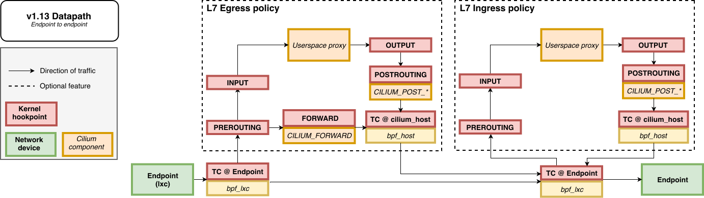

*출처: [Cilium — Life of a Packet](https://docs.cilium.io/en/stable/network/ebpf/lifeofapacket/)*

같은 노드의 두 Pod 사이다. 왼쪽 Endpoint를 나온 패킷은 **TC @ Endpoint**(`bpf_lxc`)에 잡히고, 아래의 실선을 따라 **오른쪽 Endpoint의 `bpf_lxc`로 바로** 간다. 그림에서 `PREROUTING`, `FORWARD`, `POSTROUTING`은 전부 **점선 상자 안**, 즉 L7 정책을 켰을 때만 지나는 선택 경로에 있다. Netfilter가 기본 경로에서 빠져 있다는 뜻이다.

처음 퍼즐에서 `conntrack -L`이 비어 있던 이유의 절반이 여기 있다. 패킷이 Netfilter를 지나지 않았으니 커널 conntrack이 볼 기회가 없었다. 나머지 절반은 cgroup socket 훅에 있는데, 5장에서 본다.

---

## 4. 맵이 빠른 이유 — 체인을 훑는 것과 해시를 찾는 것

3장에서 eBPF가 Netfilter보다 앞에서 패킷을 잡는다는 위치의 차이를 봤다. 그런데 위치만 다르다면 "조금 더 일찍 처리한다" 정도의 이점이다. Pod가 수천 개 규모로 늘어났을 때 체감되는 차이는 위치가 아니라 **자료구조**에서 온다.

### 4.1 iptables 체인은 위에서 아래로 훑는다

kube-proxy iptables 모드가 Service를 어떻게 구현하는지 떠올려 보자. `KUBE-SERVICES` 체인에 Service마다 규칙이 한 줄씩 있고, 매칭된 규칙이 `KUBE-SVC-*` 체인으로 점프하고, 거기서 엔드포인트마다 확률 규칙이 한 줄씩 있어 `KUBE-SEP-*` 체인으로 점프하고, 거기서 DNAT가 걸린다.

```
-A KUBE-SERVICES -d 10.96.45.10/32 -p tcp --dport 80 -j KUBE-SVC-NGINX
-A KUBE-SERVICES -d 10.96.45.11/32 -p tcp --dport 80 -j KUBE-SVC-API
-A KUBE-SERVICES -d 10.96.45.12/32 -p tcp --dport 5432 -j KUBE-SVC-DB
... (Service 수만큼)
-A KUBE-SVC-NGINX -m statistic --mode random --probability 0.33333 -j KUBE-SEP-A
-A KUBE-SVC-NGINX -m statistic --mode random --probability 0.50000 -j KUBE-SEP-B
-A KUBE-SVC-NGINX -j KUBE-SEP-C
... (엔드포인트 수만큼)
```

Netfilter는 체인의 규칙을 **위에서 아래로 하나씩** 비교한다. 패킷의 목적지가 `KUBE-SERVICES`의 1,000번째 줄에 있으면 999번 비교하고 나서야 점프한다. 규칙 수는 **Service 수 × 엔드포인트 수**에 비례해 늘어나고, 패킷당 최악의 매칭 비용이 그 수에 비례한다. 선형 탐색, O(n)이다.

conntrack이 이 비용을 상당히 감춘다. 흐름의 첫 패킷만 체인을 끝까지 내려가고, 연결이 등록된 뒤의 패킷은 `--ctstate ESTABLISHED` 한 줄에서 통과한다. 그래서 오래 사는 연결이 많은 워크로드에서는 체인 길이가 잘 느껴지지 않는다. 문제는 **새 연결이 많이 생기는** 워크로드와, 다음 절의 갱신 비용이다.

### 4.2 갱신 비용 — Pod 하나가 뜰 때마다 테이블 전체를 다시 쓴다

조회보다 더 아픈 것이 갱신이다. iptables는 규칙 하나를 고칠 때도 커널에서 테이블 전체를 읽어 와 수정한 뒤 **통째로 다시 올리는** 구조다. 그래서 kube-proxy는 규칙을 한 줄씩 넣는 대신 엔드포인트가 바뀔 때마다 `iptables-restore`로 관련 테이블 전체를 한 번에 다시 쓴다. Service가 수천 개면 규칙이 수만 줄이고, Pod 하나가 뜨거나 죽을 때마다 그 수만 줄을 통째로 교체한다. 롤링 업데이트 중에 Pod 수백 개가 연쇄로 바뀌면 갱신이 갱신을 따라가지 못하고, 그 사이 죽은 Pod로 트래픽이 가거나 새 Pod가 트래픽을 못 받는 구간이 생긴다. kube-proxy의 `minSyncPeriod` 옵션은 이 갱신을 묶어서 줄이려는 완충 장치이고, 쿠버네티스가 nftables 모드를 새로 만든 것도 같은 문제 때문이다.

NetworkPolicy 쪽은 조금 다르다. Calico의 Felix는 셀렉터를 **ipset**으로 만들어 규칙은 그대로 두고 집합의 멤버만 바꾸므로, Pod가 뜨고 죽을 때 정책 규칙을 다시 쓰는 비용은 없다. 하지만 체인 자체는 여전히 Netfilter 안에 있고, 판단 근거가 IP라는 점도 그대로다. 노드마다 그 IP가 어느 Pod인지 아는 상태를 유지해야 한다.

### 4.3 eBPF 맵은 키로 바로 찾는다

같은 일을 eBPF 맵으로 하면 이렇게 된다.

 lands directly on the backend entry")

Service 조회는 `lb` 맵에서 `(ClusterIP, 포트, 프로토콜)`을 키로 **해시 한 번**이다. Service가 10개든 10,000개든 비용이 같다. 정책 조회는 `policy` 맵에서 `(출발지 Identity, 포트, 프로토콜)`을 키로 해시 한 번이다. 출발지 IP를 Identity로 바꾸는 `ipcache` 조회는 LPM 트라이라서 프리픽스 길이에 비례할 뿐 항목 수와 무관하다. **규칙이 수천 개여도 패킷 하나가 내는 비용은 그대로다.**

갱신도 다르다. 맵은 항목 단위로 원자적으로 읽고 쓴다. Pod 하나가 뜨면 `ipcache`에 한 줄, `lb`에 백엔드 한 줄이 들어갈 뿐이고, 나머지 항목은 건드리지 않는다. 테이블 전체를 다시 쓰는 일이 없으니 Pod 수백 개가 연쇄로 바뀌어도 갱신이 밀리지 않는다.

| | iptables 체인 | eBPF 맵 |
|---|---|---|
| 조회 | 규칙을 위에서 아래로 비교. **규칙 수에 비례** | 키로 해시. **규칙 수와 무관** |
| 갱신 | 테이블 전체를 다시 써서 교체 | 항목 하나를 원자적으로 교체 |
| Pod 1,000개가 뜨면 | 규칙 수천 줄 추가, 그때마다 전체 재작성 | `ipcache`·`lb`에 항목 1,000개 추가 |
| 조회 비용을 감추는 것 | conntrack (첫 패킷 이후) | 자체 `ct` 맵 (같은 역할) |

### 4.4 그래서 언제 체감되는가

솔직하게 적어 두면, 노드 몇 대에 Pod 수십 개인 클러스터에서는 이 차이를 느낄 수 없다. iptables 규칙이 수백 줄이면 선형 탐색도 충분히 빠르고, 갱신도 밀리지 않는다. 차이가 드러나는 조건은 세 가지가 겹칠 때다. Service와 Pod가 **수천 개** 규모이고, 새 연결이 **자주** 생기고, Pod가 **자주** 뜨고 죽는 환경. 대규모 멀티테넌트 클러스터나 배치 워크로드가 쏟아지는 클러스터가 여기 해당한다.

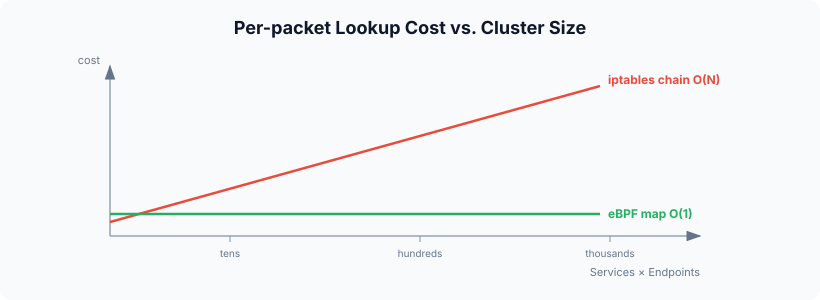

그 규모에서 iptables 모드는 패킷당 비용과 갱신 비용이 함께 늘어나는 반면, eBPF 맵은 둘 다 평평하다. 이전 글에서 "iptables는 O(n), Cilium은 O(1)"이라고 한 줄로 적은 것의 실체가 이것이다. 자료구조를 바꿨기 때문에 규모에 대한 **비용 곡선의 기울기**가 바뀐 것이지, 같은 일을 조금 더 빨리 하는 것이 아니다.

---

## 5. 곁다리 — Cilium은 eBPF를 이렇게 쓴다

여기까지가 eBPF의 구조와 그 구조가 규모에서 갖는 이점이다. 이 절은 그 구조를 Cilium이 실제로 어떻게 조립했는지를 짧게 본다. 깊이 들어가지는 않고, 앞에서 본 프로그램·맵·훅이 어디에 쓰이는지만 짚는다.

### 5.1 부품

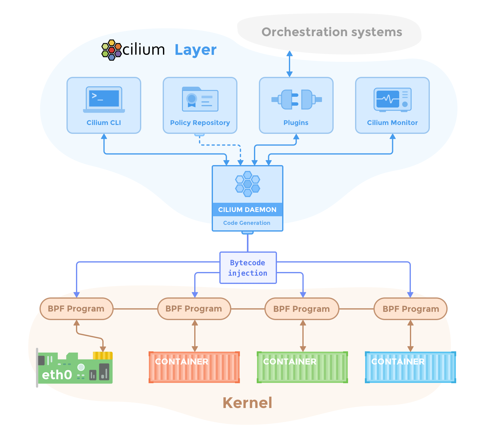

*출처: [Cilium — Component Overview](https://docs.cilium.io/en/stable/overview/component-overview/)*

공식 그림은 두 층이다. 위의 Cilium Layer에 데몬(에이전트)과 그 주변 도구가 있고, 데몬이 **Code Generation → Bytecode injection**으로 아래 Kernel 층의 BPF Program들을 만들어 꽂는다. 커널 층을 보면 프로그램이 **컨테이너마다 하나, 그리고 `eth0`에 하나** 붙어 있다. 2.4절의 ebpf.io 그림을 Cilium에 맞게 다시 그린 것이다.

| 컴포넌트 | 배포 형태 | 하는 일 |
|---|---|---|
| **Agent** (`cilium-agent`) | DaemonSet, 노드마다 | Pod·Service·정책 이벤트를 받아 **그 노드의 eBPF 프로그램과 맵을 관리**한다. 2.4절의 로더 |
| **CNI Plugin** (`cilium-cni`) | 실행 파일, Pod 생성·삭제 때 | 런타임이 부르면 노드의 에이전트에 "이 Pod의 데이터패스를 구성해 달라"고 요청한다 |
| **Operator** (`cilium-operator`) | Deployment, 클러스터에 하나 | IPAM, Identity 등 클러스터에 한 번이면 되는 일. **전달 경로에 없다.** 죽어도 트래픽은 흐른다 |
| **Hubble** | 에이전트 내장 + Relay + UI | 데이터패스가 perf 버퍼로 내보낸 판단을 플로우로 가공해 보여준다 |

노드에서 실제로 보이는 것은 이렇다. Pod의 호스트 쪽 veth마다 tc 프로그램이 붙어 있다.

```bash
$ ip -br link | grep -E 'cilium|lxc'
cilium_net@cilium_host   UP          # 호스트 스택과 eBPF 사이의 veth 쌍
cilium_host@cilium_net   UP          # Pod의 게이트웨이 IP가 여기 붙는다
lxc1a2b3c4d5e6f@if12     UP          # Pod의 호스트 쪽 veth — Flannel의 veth…, Calico의 cali… 자리

$ tc filter show dev lxc1a2b3c4d5e6f ingress
filter ... bpf ... cil_from_container direct-action ...
```

### 5.2 패킷이 가는 길

node-1의 Pod A가 node-2의 Pod B로 보내는 패킷은 다섯 단계를 지난다.

1. **Pod를 나온 프레임이 `lxc`의 tc ingress에서 `bpf_lxc`에 잡힌다.** 브릿지도, 라우팅 테이블도, iptables도 아직 안 봤다
2. **맵 세 개를 조회한다.** `ct`(이미 아는 연결인가), `ipcache`(목적지 IP는 어느 Identity·어느 노드인가), `policy`(그 Identity로 보내도 되는가). 전부 해시 또는 LPM 조회다
3. **노드 사이를 건넌다.** 터널 모드면 VXLAN으로 감싸고, native routing이면 호스트 라우팅 테이블에 맡긴다
4. **수신 노드의 `bpf_host`가 받아 목적지 Endpoint를 찾고, 그 Endpoint의 ingress 정책을 본다.** 역시 `ipcache`와 `policy` 조회다
5. **목적지 Pod의 veth로 바로 넣는다.** 호스트 라우팅도 `FORWARD` 체인도 거치지 않는다

이전 글의 Flannel에서 노드 사이 경로는 라우트·ARP·FDB 세 줄이 정했고, Calico에서는 BGP가 배운 라우트 한 줄이 정했다. Cilium 터널 모드에서는 그 역할이 **`ipcache` 맵의 한 항목**으로 옮겨 간다. 연결 추적도 자기 것을 갖는다. 첫 패킷이 정책을 통과하면 `ct` 맵에 기록되고, 같은 연결의 뒤 패킷과 응답은 정책을 다시 보지 않는다. Calico가 `--ctstate ESTABLISHED -j ACCEPT` 한 줄로 하던 일을 같은 구조로 다른 저장소에서 한다. Cilium의 연결은 `conntrack -L`이 아니라 `cilium bpf ct list`에 있다.

### 5.3 kube-proxy 대체 — 패킷이 생기기 전에 끝낸다

처음 퍼즐의 나머지 절반이다. Pod 안의 curl이 `connect(10.96.45.10:80)`을 부른다. 시스템콜이 커널에 들어가면 **패킷이 만들어지기 전에** 루트 cgroup에 붙은 프로그램이 실행된다. 프로그램은 `lb` 맵에서 Service를 찾고 백엔드 하나를 골라 **소켓의 목적지 주소 자체를 Pod IP로 바꿔 쓴다.** 그 뒤 커널은 평범하게 Pod IP로 SYN을 만든다. Pod의 `eth0`에도, 어느 와이어에도 ClusterIP는 존재한 적이 없다.

| | kube-proxy iptables | Cilium 소켓 LB |
|---|---|---|
| 변환 시점 | 첫 패킷이 `PREROUTING`에 왔을 때 | `connect()` 안 |
| 변환 대상 | 패킷 헤더. 응답은 conntrack이 되돌림 | 소켓의 목적지. 응답은 그냥 Pod IP로 돌아온다 |
| 패킷마다 비용 | 첫 패킷 체인 스캔, 이후 conntrack 조회 | **0.** 연결당 한 번 |
| `iptables -t nat` | `KUBE-SVC-*` 체인 | 없음. `cilium bpf lb list` |

`KUBE-SVC-*`가 없는 건 kube-proxy가 없으니 당연하고, `conntrack`이 비어 있는 건 DNAT가 소켓 단계에서 끝나 Netfilter가 변환할 것이 없었기 때문이다. **변환이 없으니 되돌릴 것도 없고, 되돌릴 것이 없으니 conntrack도 필요 없다.** 애플리케이션은 이 사실을 모른다. `getpeername()`을 부르면 같은 cgroup 훅의 프로그램이 가로채 원래 ClusterIP를 돌려준다.

소켓이 없는 패킷도 있다. 클러스터 밖에서 NodePort로 들어오는 패킷에는 `connect()`를 부른 프로세스가 없으므로, `eth0`의 tc 프로그램 또는 XDP가 **패킷 헤더에 DNAT**를 건다. 소켓 LB가 첫 번째 그물이고 tc가 두 번째 그물이다.

### 5.4 Identity — IP 대신 번호로 판단한다

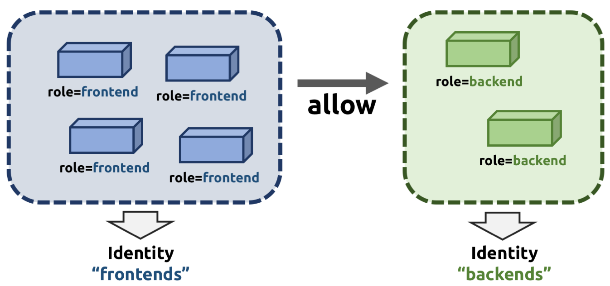

*출처: [Cilium — Identity-Based Security](https://docs.cilium.io/en/stable/security/network/identity/)*

4장의 `policy` 맵 키에 IP가 아니라 Identity가 들어간 것이 Cilium의 또 다른 설계다. 공식 그림이 핵심을 다 말한다. `role=frontend` Pod 넷은 몇 개든 **Identity "frontends" 하나**로 묶이고, 정책은 frontends → backends 사이의 **allow 화살표 하나**다. Pod가 늘어도 화살표는 그대로다.

Pod가 뜨면 에이전트가 보안에 의미 있는 라벨(`app=frontend`, 네임스페이스 등)을 모아 정렬하고, 그 집합에 클러스터 전역 번호 하나를 배정한다. `CiliumIdentity` CRD에 저장되므로 **모든 노드가 같은 번호를 본다.**

정책은 이 번호 사이의 관계로 저장된다. `frontend → backend 80/TCP 허용`은 backend의 `policy` 맵에 `(1234, 80, TCP) → allow` 한 줄이다. frontend Pod가 4개에서 40개로 늘어도 이 한 줄은 그대로이고, `ipcache`에만 IP → 1234 줄이 36개 늘어난다. 4.3절에서 본 "갱신이 항목 단위"라는 이점 위에, 정책 쪽은 Pod 수와 아예 무관하게 만든 것이다.

---

## 6. 곁다리 — Calico와 나란히 놓으면

5장이 Cilium을 봤으니 같은 자리에 Calico를 놓고 비교한다. 이전 글에서 Calico를 "netfilter 위에 쌓은 성숙한 아키텍처"라고 정리했는데, 4장의 눈으로 다시 보면 그 말의 의미가 조금 더 구체적이 된다.

Calico의 기본 데이터플레인은 iptables다. 각 노드의 Felix가 `filter` 테이블 `FORWARD` 체인에 `cali-FORWARD`를 걸고, 인터페이스 이름으로 분기해 Pod마다 `cali-fw-`(from-workload), `cali-tw-`(to-workload) 체인을 둔다. 정책은 Pod의 veth 바로 앞에서 평가된다. 셀렉터는 ipset으로 만들어 규칙은 그대로 두고 멤버만 바꾸고, 첫 패킷 이후는 conntrack이 통과시킨다. 노드 사이는 BGP, IPIP, VXLAN 중 하나로 건넌다. Service는 kube-proxy에 맡긴다.

**이 구조의 장점은 1장의 설정 인터페이스 안에 머문다는 것**이다. `ip route`, `iptables -S`, `ipset list`, `conntrack -L`로 끝까지 읽을 수 있다. 커널 버전을 가리지 않고, 운영자가 이미 아는 도구로 디버깅한다. 단점은 4장 그대로다. 체인은 선형이고, Service 규칙은 kube-proxy가 전체 재작성으로 갱신하고, 판단 근거가 IP라서 노드마다 IP → Pod 상태를 들고 있어야 한다.

| 관점 | Calico (iptables 모드) | Cilium (eBPF) |
|---|---|---|
| **패킷 처리 위치** | Netfilter `FORWARD` 체인 | tc ingress, Netfilter 앞 |
| **정책 조회** | 체인 선형 탐색 + ipset 멤버 확인 | `policy` 해시 맵 |
| **정책 갱신** | ipset 멤버 변경 (규칙은 그대로) | 맵 항목 원자적 변경 |
| **Service** | kube-proxy iptables. 전체 재작성 갱신 | `lb` 맵 + 소켓 LB. 항목 단위 갱신 |
| **연결 추적** | 커널 conntrack | 자체 `ct` 맵 |
| **판단 근거** | IP (노드마다 ipset) | Identity (클러스터 전역 번호) |
| **노드 간** | BGP / IPIP / VXLAN | VXLAN·Geneve / native routing |
| **디버깅 도구** | `iptables`, `ipset`, `conntrack`, `tcpdump` | `cilium bpf *`, `hubble observe`, `bpftool` |
| **커널 요구** | 특별히 없음 | 5.10 이상 (최근 Cilium 버전 기준) |

한 가지 덧붙여야 공정하다. **Calico도 eBPF 데이터플레인이 있다.** 켜면 tc 훅, 자체 연결 추적 맵, kube-proxy 대체까지 Cilium과 같은 뼈대를 갖는다. 다른 것은 그 위의 모델이다. Calico eBPF는 **IP 기반 정책 모델을 그대로 두고 데이터플레인만 바꾼 것**이라 iptables 모드로 돌아갈 수 있고, Cilium은 **Identity를 전제로 설계돼 iptables 모드가 없다.** 그래서 "Calico 대 Cilium"보다 정확한 비교는 "iptables 체인 대 eBPF 맵"이고, 이 글이 4장에 가장 많은 지면을 쓴 이유다.

---

## 마치며

이 글은 이전 글에서 한 문단으로 넘긴 "Cilium은 eBPF로 netfilter를 우회한다"를 풀어 쓴 것이다. 풀어 보니 세 겹이었다. eBPF는 설정 인터페이스가 데이터를 넘기던 자리에 **코드를 넘기는 통로**이고, 그 코드는 검증기가 안전을 증명한 뒤 JIT로 네이티브 속도로 돌며, 상태는 맵으로 커널과 유저스페이스가 나눠 쓴다. 네트워크 훅은 Netfilter보다 앞(tc)과 위(소켓)에 놓여 있어 거기서 처리가 끝나면 Netfilter는 패킷을 볼 기회조차 없다. 그리고 그 처리가 해시 맵 조회라서 Pod가 수천 개가 되어도 패킷 하나의 비용과 갱신 하나의 비용이 평평하다.

정리하면서 가장 인상 깊었던 것은 두 가지다. 하나는 **옮겨진 판단의 구조 자체는 낯설지 않았다**는 것이다. `ct` 맵은 conntrack이었고, `ipcache`는 라우팅 테이블과 FDB를 합친 것이었고, `policy` 맵은 Calico의 체인이었고, `lb` 맵은 `KUBE-SVC-*` 체인이었다. 이전 글에서 본 자료구조 하나하나에 맵 하나씩이 대응했다. 달라진 것은 조회가 전부 해시라 규모에 무관하다는 것과, 그 저장소를 유저스페이스 도구가 아니라 커널 안의 프로그램이 직접 읽는다는 것이다. 다른 하나는 **DNAT가 패킷에서 시스템콜로 올라간 것**이다. conntrack을 주소 변환의 전제로 받아들이고 있었는데, 변환을 패킷이 생기기 전에 끝내면 conntrack이 할 일이 아예 없어진다. 자료구조를 바꾼 게 아니라 문제가 생기는 층을 바꿔서 문제를 없앤 것이고, 그래서 `conntrack -L`이 비어 있는 게 결함이 아니라 설계였다.

반대로 이 이점이 공짜가 아니라는 것도 분명해졌다. 커널 버전을 따지고, 디버깅 도구가 통째로 바뀌고, 노드 몇 대짜리 클러스터에서는 체감되지도 않는다. iptables가 느려서 Cilium을 쓰는 것이 아니라, **iptables의 비용 곡선이 문제가 되는 규모에 도달했는지**가 판단 기준이다. 그 규모에 있지 않다면 `iptables -S`로 끝까지 읽히는 쪽이 운영에는 더 편할 수 있다.

다음에는 Pod에 인터페이스가 둘 이상 붙는 경우를 정리해 보려고 한다. Cilium의 모든 판단이 Pod의 첫 번째 veth 하나에 붙어 있는데, Multus로 두 번째 인터페이스를 붙이면 그 트래픽은 정책도 Hubble도 보지 못할 것이기 때문이다. eBPF가 "어디에 꽂히는가"가 곧 "무엇을 볼 수 있는가"의 경계라는 점을 그 사례로 확인해 볼 생각이다.

---

### References

- [ebpf.io — eBPF란?](https://ebpf.io/ko-kr/what-is-ebpf/)
- [Linux kernel — BPF documentation](https://docs.kernel.org/bpf/)
- [cilium/ebpf — Go eBPF 라이브러리](https://github.com/cilium/ebpf)
- [Cilium — eBPF Datapath](https://docs.cilium.io/en/stable/network/ebpf/)
- [Cilium — Life of a Packet](https://docs.cilium.io/en/stable/network/ebpf/lifeofapacket/)
- [Cilium — Component Overview](https://docs.cilium.io/en/stable/overview/component-overview/)
- [Cilium — Kubernetes Without kube-proxy](https://docs.cilium.io/en/stable/network/kubernetes/kubeproxy-free/)
- [Cilium — Identity-Based Security](https://docs.cilium.io/en/stable/security/network/identity/)
- [Cilium Blog — Why is the kernel community replacing iptables with BPF?](https://cilium.io/blog/2018/04/17/why-is-the-kernel-community-replacing-iptables/)
- [Kubernetes 공식 문서 — Virtual IPs and Service Proxies](https://kubernetes.io/docs/reference/networking/virtual-ips/)
- [Calico — eBPF dataplane](https://docs.tigera.io/calico/latest/operations/ebpf/)
- 직접 정리한 글 — [쿠버네티스 네트워크의 본질: CNI, VXLAN, 그리고 Pod는 어떻게 통신하는가]()
