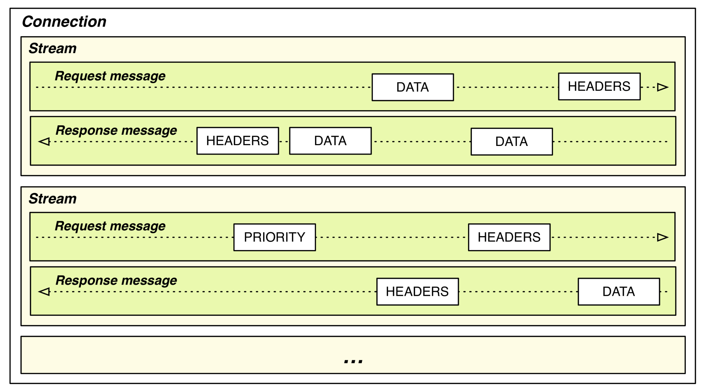
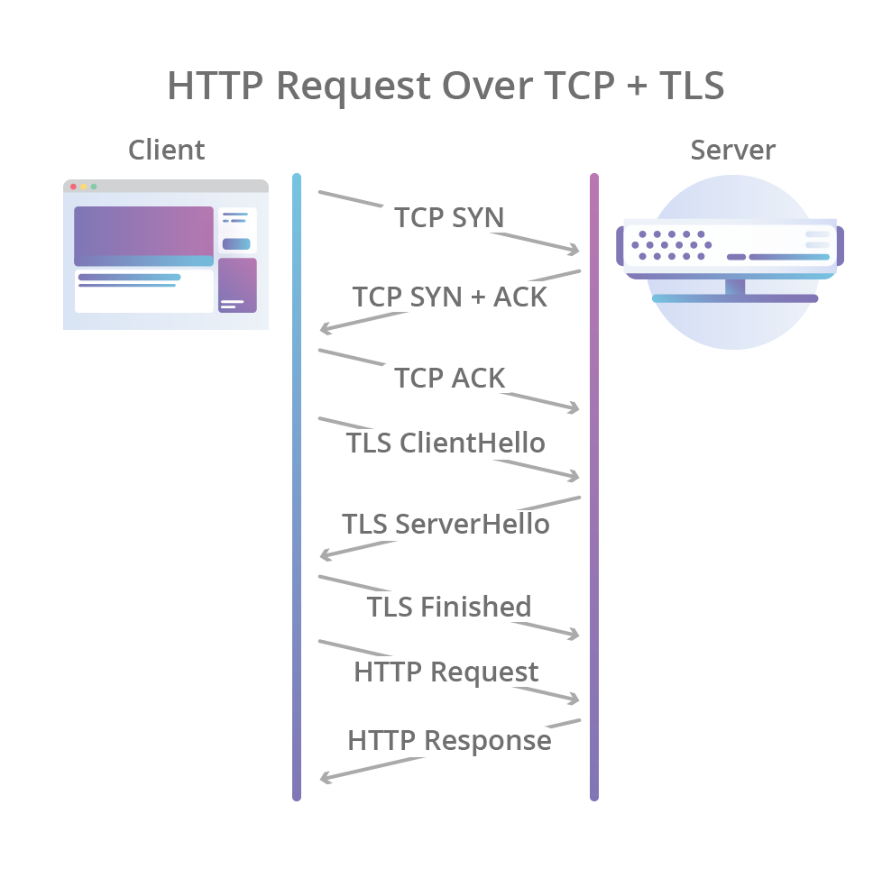
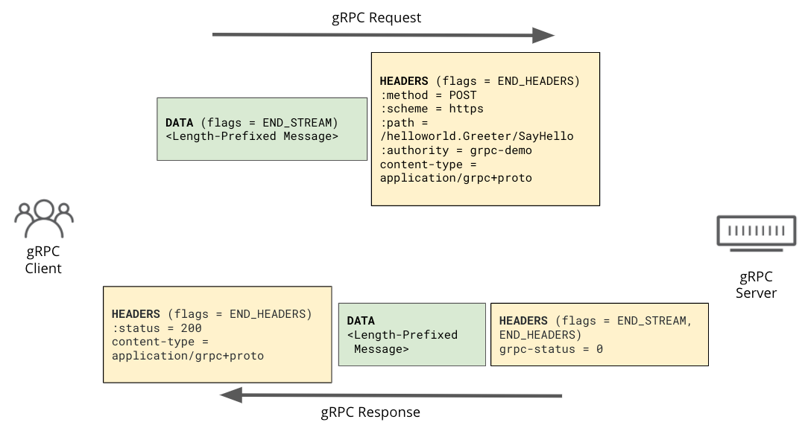
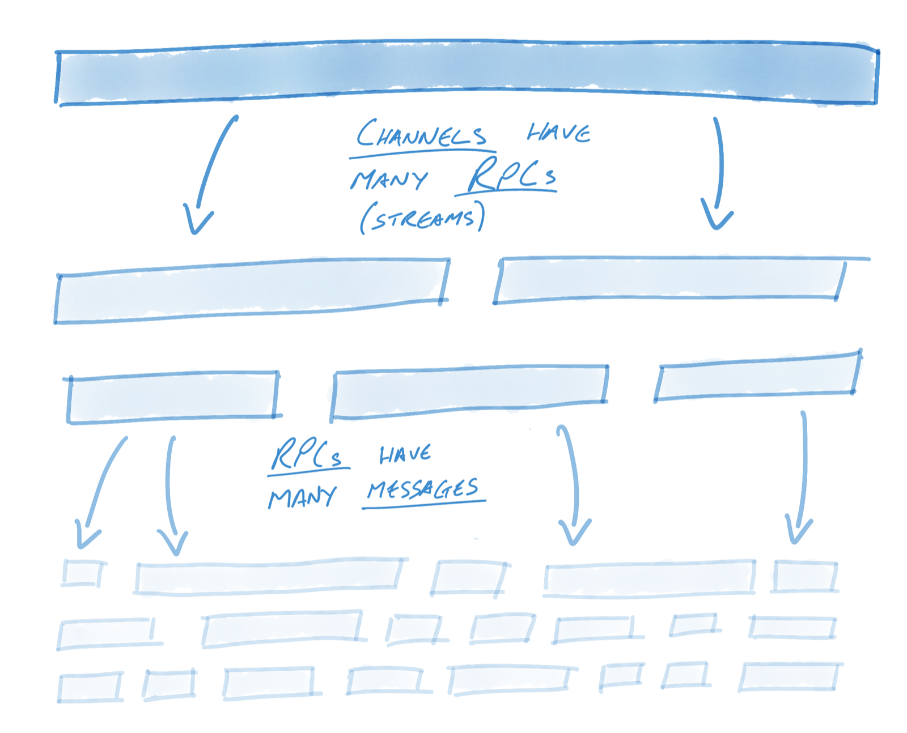
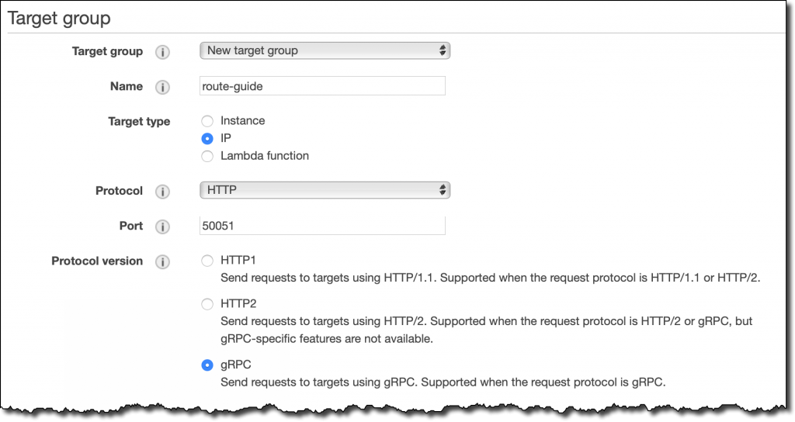
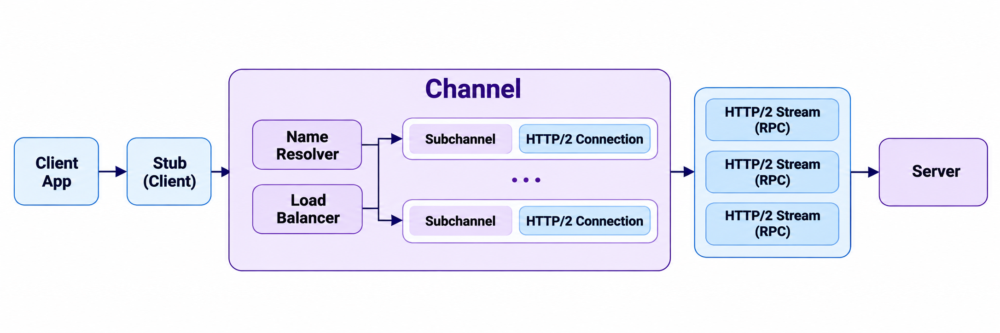
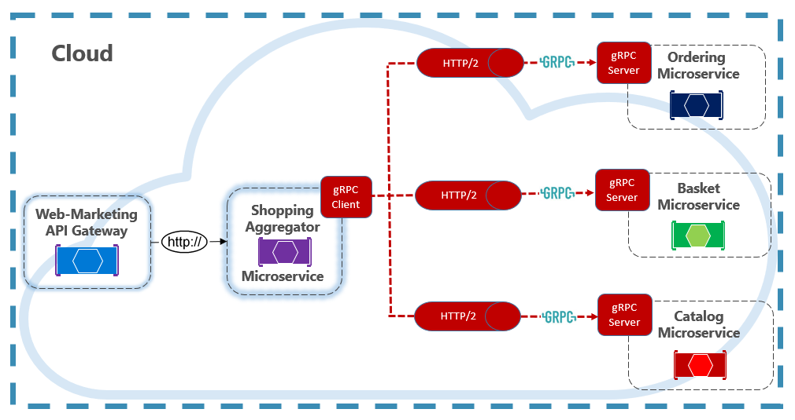
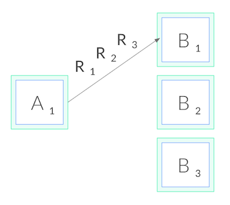
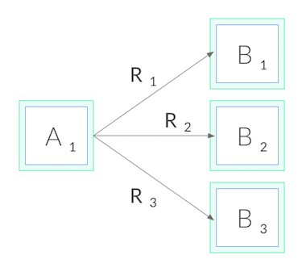

実はgRPCについてはある程度簡単に整理して理解しているつもりだったが、[前回の記事]()でDaangn SRE ミートアップのgRPC運用の発表をまとめながら、gRPCそのものをきちんと理解しておく必要を感じた。単に独自のプロトコルを使う、という程度にしか知らなかったが、SRE/DevOpsの観点でトラブルシューティングや分析をするには、もっと詳しく知っておくべきだと思った。

たとえばgRPCは独自のステータスコードを使うため、HTTPのstatus codeが200として集計されていても、内部には別のgRPCステータスコードが入っていることがある。また、L4/L7レイヤーを設定するときにも、gRPC向けの設定を別途しなければならないケースがかなりあった。この記事では、HTTP/2の基本単位から始めて、gRPCがその上でどう動くのか、そして実務でなぜ主に内部サービス間通信に使われるのかを整理する。

---

### はじめに

まず、gRPCはRemote Procedure Callの略であるRPCの前に、Googleが開発したという意味でgを付けてgRPCと呼ぶ。現代のHTTPプロトコルを勉強してみるとわかるが、HTTP/1.1、HTTP/2、HTTP/3がさまざまに使われており、その中で私たちがよく知る一般的なRESTful APIサーバーはHTTP/1.1方式を使っている。

HTTP/2になってさまざまな機能が追加されたが、gRPCはこれらの機能を積極的に活用するため、通信において多くの利点を得られる。主にMSAで内部サービス間の通信によく使われる。記事はHTTP/2から始めて、gRPCの順に説明していく。

## 1. HTTP/2の基本単位

gRPCが走る道路であるHTTP/2から見ていこう。HTTP/1.1はテキストベースで、1つのTCPコネクション上でリクエストとレスポンスが一度に1つずつ順番にやり取りされる。HTTP/2はこの構造を**バイナリフレーミング層**(binary framing layer)に置き換えた。

HTTP/2でデータを扱う単位は次のように分かれる。


<small>出典: [Ilya Grigorik, High Performance Browser Networking — HTTP/2: Streams, Messages, and Frames](https://hpbn.co/http2/#streams-messages-and-frames)</small>

| 単位 | 説明 |
|---|---|
| コネクション | TCPコネクション1つ。長く維持される |
| ストリーム | コネクション内の独立した論理チャネル。リクエスト/レスポンスの1組が1つのストリームを使う |
| メッセージ | HTTPリクエスト1つ、またはレスポンス1つ。複数のフレームで構成される |
| フレーム | 実際に送信される最小単位。HEADERS、DATAなどのタイプがある |

ちなみに、ここで言うコネクション、ストリーム、メッセージといった概念は、後でgRPCを扱うときにそのまま登場するので、よく押さえておきたい。次は、gRPCが恩恵を受ける核心的な概念であるマルチプレクシングだ。

### マルチプレクシング

ポイントは、複数のストリームのフレームが1つのコネクション上で混ざって(interleave)送信され、受信側がStream IDで再び組み立てるという点だ。これが**マルチプレクシング**(multiplexing)である。

```text
TCPコネクション1つ
 ├─ [HEADERS sid=1][DATA sid=3][DATA sid=1][HEADERS sid=5][DATA sid=3] ...
 └─ 受信側でsidごとに再組み立て → ストリーム1、3、5が同時に進行
```

HTTP/1.1ではレスポンスが来るまでそのコネクションが塞がるため、並行性を上げるにはコネクションを複数開く必要があった。HTTP/2は1つのコネクションで複数のリクエストを同時に処理できる。

### コネクションが確立される過程

では、このコネクションはどのように確立されるのか。HTTP/2だからといってTCPの3-wayハンドシェイクが変わるわけではない。TCPハンドシェイクとTLSハンドシェイクまではHTTP/1.1とまったく同じで、その上で最初にやり取りするデータだけが変わる。


<small>出典: [Cloudflare Blog — HTTP/3: the past, the present, and the future](https://blog.cloudflare.com/http3-the-past-present-and-future/)</small>

上の図の最後のHTTP Requestの位置で、HTTP/2特有の過程が加わる。HTTP/2まで含めると次のようになる。

```text
クライアント                              サーバー
── TCP 3-wayハンドシェイク ───────────────────────
SYN                    ──────▶
                       ◀──────  SYN/ACK
ACK                    ──────▶
── TLSハンドシェイク ─────────────────────────────
ClientHello (ALPN: h2, http/1.1)  ──────▶
                       ◀──────  ServerHello ... (ALPN: h2)
Finished               ──────▶
── HTTP/2 ────────────────────────────────────────
connection preface + SETTINGS  ──────▶
HEADERS (stream 1)     ──────▶     ← サーバーの応答を待たずにすぐ送る
                       ◀──────  SETTINGS, SETTINGS ACK
SETTINGS ACK           ──────▶
                       ◀──────  HEADERS + DATA (stream 1 のレスポンス)
```

1. **TCP 3-wayハンドシェイク**: バイトを信頼性をもってやり取りするパイプを作る。
2. **TLSハンドシェイク**: 鍵を交換し、サーバー証明書を検証する。このとき**ALPN**(Application-Layer Protocol Negotiation)で、どのHTTPバージョンを使うかも決める。クライアントがClientHelloに「h2とhttp/1.1が使える」と書いて送ると、サーバーがその中から1つを選んで応答する。
3. **HTTP/2 connection preface**: h2に決まると、クライアントは`PRI * HTTP/2.0\r\n\r\nSM\r\n\r\n`という固定文字列とSETTINGSフレームを送り、サーバーも自分のSETTINGSを送ったうえで、互いにACKする。

prefaceは相手の応答を待たずに、そのまま最初のリクエストまで続けて送れるため、HTTP/1.1よりRTTが増えることはない。HTTP/2の利点は最初の接続の速さではなく、一度確立したコネクションの上で、以降のリクエストを追加のRTTなしに新しいストリームとして開き続けられる点にある。

ちなみに、TLSなしの平文で使うHTTP/2は**h2c**と呼ぶ。ALPNがないため、TCPハンドシェイクの直後にすぐprefaceを送る。内部ネットワークでの平文のgRPC通信は、たいていこの方式だ。

---

## 2. gRPCはHTTP/2をどう使うのか

HTTP/2の構造を見たので、次はその上でgRPCの呼び出しがどんな形になるのかを見ていこう。一言でまとめると、**RPC呼び出し1回 = HTTP/2ストリーム1つ**である。リクエストは次のように行われる。


<small>出典: [Cloudflare Blog — Road to gRPC](https://blog.cloudflare.com/road-to-grpc/)</small>

### 2種類の「メッセージ」

ここで混同しやすい点が1つある。gRPCで言うメッセージは**protobufメッセージ1つ**を指し、HTTP/2のメッセージ(リクエスト/レスポンス全体)とは別物だ。

gRPCメッセージは5バイトの長さプレフィックス(圧縮フラグ1バイト + 長さ4バイト)を付けた状態で、DATAフレームの中に連続して載る。そのため1つのストリームの中に複数のgRPCメッセージが入ることができ、これがgRPCストリーミングの正体である。


<small>出典: [gRPC Blog — gRPC on HTTP/2: Engineering a Robust, High-performance Protocol](https://grpc.io/blog/grpc-on-http2/)</small>

### 4つの呼び出し方式

この構造のおかげで、gRPCの4つの呼び出し方式が自然に生まれる。HTTP/2の観点ではどれも同じくストリーム1つで、その中でgRPCメッセージがいくつやり取りされるかだけが違う。

| タイプ | 形 | 代表的な用途 |
|---|---|---|
| Unary | リクエスト1 → レスポンス1 | 一般的な参照・作成API(大半がこれ) |
| Server streaming | リクエスト1 → レスポンスN | watch/購読、大量の結果を流す、LLMのトークンストリーミング |
| Client streaming | リクエストN → レスポンス1 | ログ・メトリクスのアップロード、ファイルのチャンクアップロード |
| Bidirectional streaming | リクエストN ↔ レスポンスN | チャット、エージェント-コントロールプレーン、xDS |

### なぜHTTP/2でなければならないのか

では、gRPCはなぜよりによってHTTP/2でなければならないのか。gRPCはHTTP/2の次のような機能に頼っている。

- **マルチプレクシング**: 1つのコネクションで多数のRPCを同時に処理する。
- **全二重通信**: 1つのストリームでクライアントとサーバーが同時にデータを送れるため、双方向ストリーミングが可能になる。
- **Trailers**: 本文を送り終えた後、最終ステータス(`grpc-status`)をtrailerに載せて送る。
- **ストリーム単位のフロー制御**: 遅いストリーム1つがコネクション全体を塞がない。
- **バイナリフレーミングとHPACK**: 繰り返されるヘッダーを圧縮し、protobufのバイナリとも相性が良い。
- **PINGフレーム**: 長く維持されるコネクションのkeepaliveと生存確認に使う。

そのため、gRPCを使うにはクライアントからサーバーまでの経路全体がHTTP/2でなければならない。ところが現実には、クライアント側の区間はHTTP/2、バックエンド側の区間はHTTP/1.1というケースがよくある。

- **ALB**はクライアントとh2で通信していても、ターゲットグループのprotocol versionのデフォルト値がHTTP1なので、ターゲットにはHTTP/1.1で送る。gRPCを使うには、ターゲットグループをgRPC(またはHTTP2)に指定する必要がある。
- **nginx**の`proxy_pass`も、デフォルトではupstreamにHTTP/1.xを使う。gRPCには別途`grpc_pass`を使う必要がある。


<small>出典: [AWS News Blog — New – Application Load Balancer Support for End-to-End HTTP/2 and gRPC](https://aws.amazon.com/blogs/aws/new-application-load-balancer-support-for-end-to-end-http-2-and-grpc/)</small>

まとめると、REST/JSONはHTTP/2の特定の機能に依存しないため、どのバージョンの上でも動く。一方gRPCはストリーム、trailer、全二重通信に依存するため、経路全体(end-to-end)がHTTP/2でなければならない。

---

## 3. gRPCの構成要素

実はgRPCを勉強しようとしていたのに、ここまでHTTP/2の話ばかりしてきた。しかしHTTP/2はgRPCが走る道路のような存在なので、一緒に考えるとgRPCをずっと理解しやすくなる。gRPCは大きく3つの塊に分けて見るとわかりやすい。

> gRPC = インターフェース定義(protobuf) + コード生成 + HTTP/2上のRPCランタイム

### RPCとは

**RPC**(Remote Procedure Call)は、別のサーバーにある関数を、自分のコードの関数のように呼び出す方式だ。

```go
// RESTスタイル: 「どのURLにどんなJSONを送るか」を直接扱う
resp, _ := http.Post("http://user-svc/users/42", "application/json", body)
json.Unmarshal(resp.Body, &user)

// RPCスタイル: ただの関数呼び出し
user, err := userClient.GetUser(ctx, &pb.GetUserRequest{Id: 42})
```

RESTがリソース(URL)と動詞(GET/POST)中心だとすれば、RPCはサービスとメソッド中心だ。ネットワーク通信、シリアライズ、エラー処理をフレームワークが隠してくれるので、開発者は関数のシグネチャだけを気にすればよい。

### Protocol Buffers: 契約書であり、シリアライズ形式でもある

gRPCは`.proto`ファイルでサービスとメッセージを定義する。

```protobuf
syntax = "proto3";
package user.v1;

service UserService {
  rpc GetUser(GetUserRequest) returns (User);                 // unary
  rpc ListUsers(ListUsersRequest) returns (stream User);      // サーバーストリーミング
  rpc UploadEvents(stream Event) returns (UploadSummary);     // クライアントストリーミング
  rpc Chat(stream ChatMessage) returns (stream ChatMessage);  // 双方向ストリーミング
}

message GetUserRequest {
  int64 id = 1;
}

message User {
  int64  id    = 1;
  string name  = 2;
  string email = 3;
}
```

ここで`= 1`、`= 2`はデフォルト値ではなく**フィールド番号**だ。protobufはバイナリにエンコードするとき、フィールド名の代わりにこの番号を使う。たとえば上の`User`で`{id: 150, name: "hi"}`をエンコードすると次のようになる。

```text
JSON:      {"id":150,"name":"hi"}            → 22バイト
Protobuf:  08 96 01   12 02 68 69            → 7バイト
           └ フィールド1(整数) 150をvarintで
                      └ フィールド2(文字列) 長さ2 "hi"
```

フィールド名がまったく送信されないので小さく、パースも速い。そしてこの構造から互換性のルールが生まれる。

- フィールド名は変えてもよい。送信されるのは番号だからだ。
- フィールド番号は絶対に変えたり再利用したりしてはいけない。古いクライアントが別の意味で解釈してしまう。フィールドを削除するときは`reserved 3;`で番号を塞いでおく。
- 新しいフィールドの追加は安全だ。知らない番号のフィールドは、古いバージョンがそのまま無視する。

この`.proto`を`protoc`や`buf`でコンパイルすると、Go、Java、Python、TypeScriptなど言語ごとに、メッセージ型とサーバーインターフェース(スタブ)、クライアントコードが生成される。

### クライアントとサーバーの構造

クライアントアプリのコードがサーバーと通信する構造は次のとおりだ。



1. **Stub**: アプリのコードが呼び出す生成済みのクライアント。リクエストをprotobufにシリアライズする。
2. **Channel**: サーバーへの仮想コネクション。中では**Name Resolver**がアドレスをバックエンドのIPリストに変換し、**Load Balancer**がRPCごとに送り先のバックエンドを選ぶ。
3. **Subchannel**: バックエンド1つと結んだ実際のHTTP/2コネクション。
4. **HTTP/2 Stream**: RPC1つがストリーム1つとしてサーバーに届けられる。

つまり「gRPCはコネクション1つを長く使う」という言葉は、正確にはChannelが複数のバックエンドとのHTTP/2コネクションを管理しているという意味だ。そのためChannelはアプリケーションの起動時に一度作って再利用する。リクエストごとに新しく作ると、毎回ハンドシェイクをすることになる。

### 標準で提供される機能

RESTではチームごとに自前で作る必要があったものが、gRPCには標準で入っている。

**デッドライン**(deadline)。クライアントが「この呼び出しはいつまでに終わらなければならない」と指定すると、`grpc-timeout`ヘッダーでサーバーに伝わる。サーバーがそのコンテキストで別のサービスを呼び出すと残り時間がそのまま伝播し、時間が過ぎるとチェーン全体が`DEADLINE_EXCEEDED`でキャンセルされる。

```go
ctx, cancel := context.WithTimeout(ctx, 300*time.Millisecond)
defer cancel()
user, err := userClient.GetUser(ctx, req)
```

**キャンセル**(cancellation)。クライアントが呼び出しをキャンセルするとHTTP/2の`RST_STREAM`が送られ、サーバーハンドラーのコンテキストもキャンセルされる。ユーザーがすでに去ったのにサーバーが働き続けるという無駄を防いでくれる。

**メタデータ**(metadata)。HTTPヘッダーに相当する。認証トークン、トレースID、リクエストIDなどを載せて送る。レスポンス側にはheader metadataとtrailer metadataが別々にある。

**インターセプター**(interceptor)。HTTPのミドルウェアに相当する。認証、ロギング、メトリクス、トレーシング、リトライをすべてのRPCに共通で差し込む。

**ステータスコード**(status code)。HTTPステータスコードの代わりに、gRPC専用のコードがtrailerの`grpc-status`で届く。

| コード | 意味 | HTTPで言うと |
|---|---|---|
| OK (0) | 成功 | 200 |
| INVALID_ARGUMENT (3) | 不正なリクエスト | 400 |
| DEADLINE_EXCEEDED (4) | デッドライン超過 | 504 |
| NOT_FOUND (5) | 存在しない | 404 |
| PERMISSION_DENIED (7) | 権限なし | 403 |
| RESOURCE_EXHAUSTED (8) | クォータ・レートリミット超過 | 429 |
| UNIMPLEMENTED (12) | 存在しないメソッド | 501 |
| INTERNAL (13) | サーバー内部エラー | 500 |
| UNAVAILABLE (14) | 一時的な障害、リトライ可能 | 503 |
| UNAUTHENTICATED (16) | 認証失敗 | 401 |

ほかにも、ヘルスチェックプロトコル(`grpc.health.v1.Health`)、サーバーリフレクション、HTTP/2 PINGベースのkeepalive、メソッドごとのリトライ・タイムアウトを指定するservice config、メッセージ単位の圧縮などが標準で提供される。

---

## 4. なぜ内部サービス通信に使うのか

構造を理解したので、次は実務に移ろう。gRPCは主に内部のサービス間(east-west)通信に使われる。

外部公開APIとしては不便な点が多い。ブラウザで使うにはgRPC-Webと別途のプロキシが必要で、バイナリなのでcurlで確認しにくく、外部ユーザーに`.proto`とコード生成を求めるのも負担になる。一方、内部ではクライアントとサーバーの両方を自分たちで管理しているため、こうした欠点がほとんどなくなる。


<small>出典: [Microsoft Learn — gRPC (Architecting Cloud Native .NET Applications for Azure)](https://learn.microsoft.com/en-us/dotnet/architecture/cloud-native/grpc)</small>

### 内部通信で得られる利点

MSAで内部通信にgRPCを導入すると、次のような利点があるという。

- **契約の強制**: `.proto`がそのまま契約になる。フィールドが番号で識別されるので後方互換のルールが明確で、`buf breaking`のようなツールでCIの段階で互換性の破壊を検出できる。
- **多言語環境**: proto1つからGo、Python、Javaなど、すべての言語のクライアントを生成する。
- **深い呼び出しチェーン**: コネクションの再利用とprotobufのシリアライズで、ホップごとに積み重なるオーバーヘッドを減らす。
- **デッドラインの伝播**: 最上位リクエストのデッドラインが下位の呼び出しまで伝播し、時間を超えるとチェーン全体がキャンセルされる。「上位はもう諦めたのに下位は働き続ける」という無駄がないため、SREの観点では性能よりも実質的な利点だ。
- **ストリーミング**: watch、ログ・メトリクスのアップロード、エージェントとコントロールプレーンの接続のように、ポーリングやWebSocketを別途付けていたものをRPCの中で解決する。

### すでに使われているところ

インフラ側にはGoで書かれたコンポーネントが多く、gRPCを使っているところも多い。オープンソースをそのまま使うだけでなく、設定ファイルをきちんと扱うには、gRPC関連の設定を知っておくとよさそうだ。

- **Kubernetes**: kubelet ↔ containerd(CRI)とetcd API
- **OpenTelemetry**: OTLPのデフォルトの転送(4317ポート)
- **Envoy / Istio**: コントロールプレーンがEnvoyに設定を配信するxDS
- **NetBird**: management・signalサーバーがピアにポリシー変更をpushする
- **Temporal、Vitess、CockroachDB**など、分散システムの内部通信

### あえて使わなくてもよい場合

サービスが数個しかなく1つの言語に統一されている場合や、主な利用者がブラウザや外部パートナーであれば、REST/JSONで十分だ。そのため実務では**外部はREST/JSON、内部はgRPC**に分け、エッジにgrpc-gatewayやEnvoyのgRPC-JSON transcoderを置く構成がよく見られる。

---

## 5. 運用するときに知っておくこと

最後に、gRPCを実際に運用するときにぶつかる問題をまとめる。そのほとんどはHTTP/2の特性に由来する。

### L4ロードバランシングの偏り

gRPCはコネクション1つを長く維持しながら、その上でRPCを送り続ける。ところがNLBやKubernetesのデフォルトのService(kube-proxy)はコネクション単位で分散するため、特定のPodにトラフィックが集中する現象がよく起きる。



<small>出典: [Kubernetes Blog — gRPC Load Balancing on Kubernetes without Tears](https://kubernetes.io/blog/2018/11/07/grpc-load-balancing-on-kubernetes-without-tears/)</small>

解決策は、L7 LB(Envoy、ALBのgRPCターゲット、サービスメッシュ)を使うか、headless Serviceとクライアント側LBを組み合わせることだ。前に見たChannelの構造のおかげで、クライアント側LBが可能になる。

### エラーがHTTP 200で返る

gRPCのエラーはHTTPステータスとしては`200`で返り、実際の結果はtrailerの`grpc-status`に入っている。そのため、ALBや一般的なHTTPモニタリングで5xxだけを見ているとエラーを見逃す。APMツールで`grpc.status_code`を基準にエラー率を見る必要がある。

---

## おわりに

最初はgRPCを、ただ何かのプロトコルだという程度にしか知らず、実務で使っていないこともあって、それ以上は踏み込まずにいた。ところがgRPC関連の発表動画を見ると、合う状況ではかなり良いツールに感じられ、詳しく勉強しようとしたらHTTP/2と一緒に扱うのがよさそうだったので、勉強しながら記事も書くことにした。

個人的にいちばん腑に落ちたのは、gRPCがMSAで人気がある理由は速いからではない、ということだ。サービスやチームが増えたときに、サービス間の契約、タイムアウト、ストリーミングなどを標準化してくれることが核心であり、性能はおまけに近かった。また、技術を知っていることとは別に、インフラの観点でどうモニタリングし、どう分析するかは、また別に勉強すべき領域だと感じた。時間があれば、Wiresharkのようなツールで実際にパケットを分析してみたい。(簡単ではないだろうけれど)

## 参考

- [gRPC 公式ドキュメント](https://grpc.io/docs/)
- [gRPC over HTTP2 プロトコル仕様](https://github.com/grpc/grpc/blob/master/doc/PROTOCOL-HTTP2.md)
- [RFC 9113 — HTTP/2](https://www.rfc-editor.org/rfc/rfc9113)
- [Protocol Buffers Encoding](https://protobuf.dev/programming-guides/encoding/)
