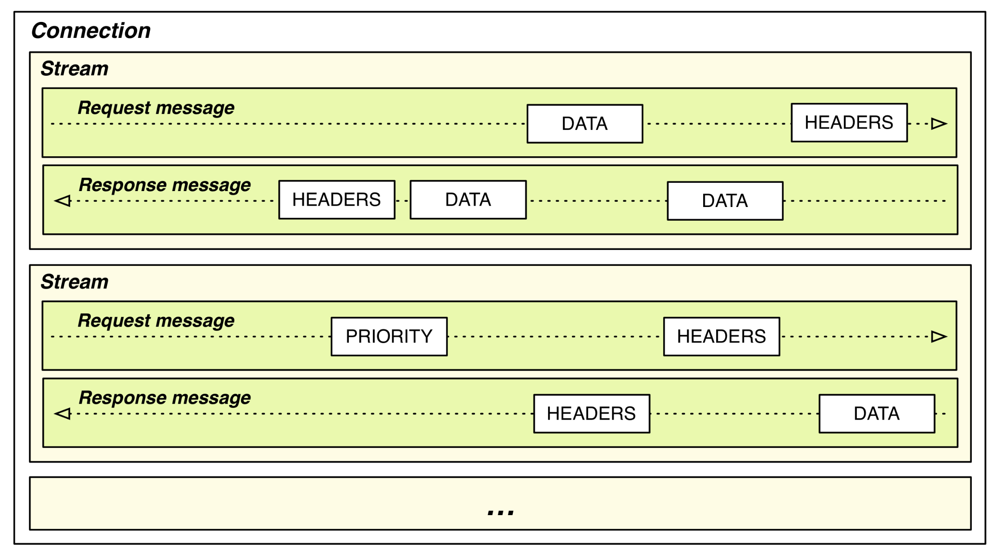
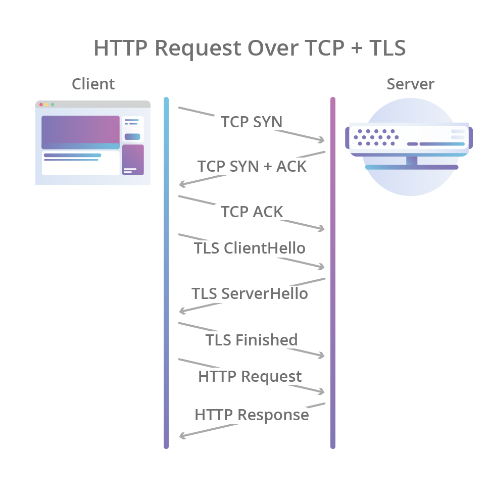
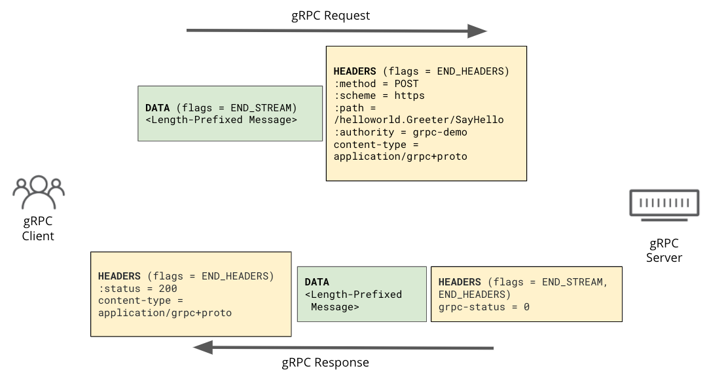
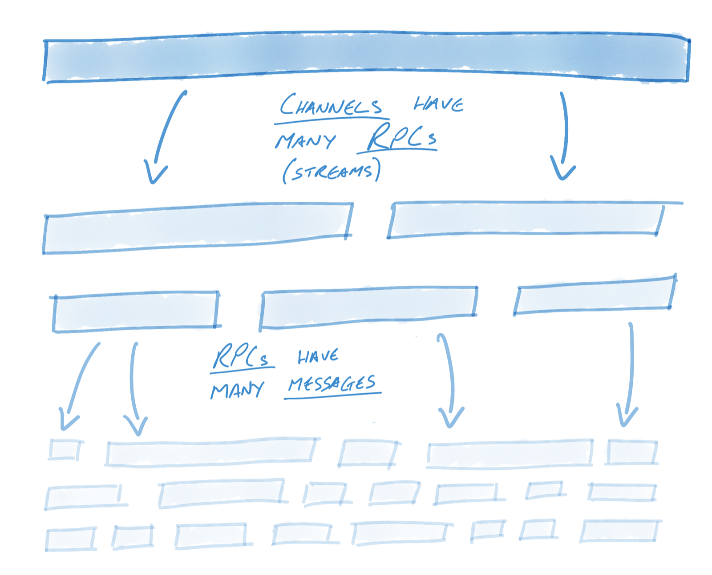
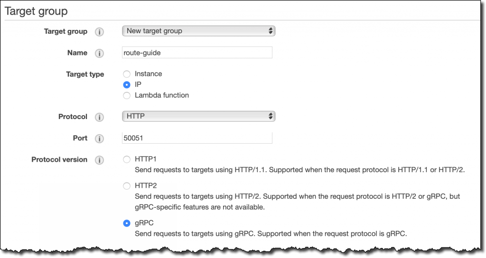
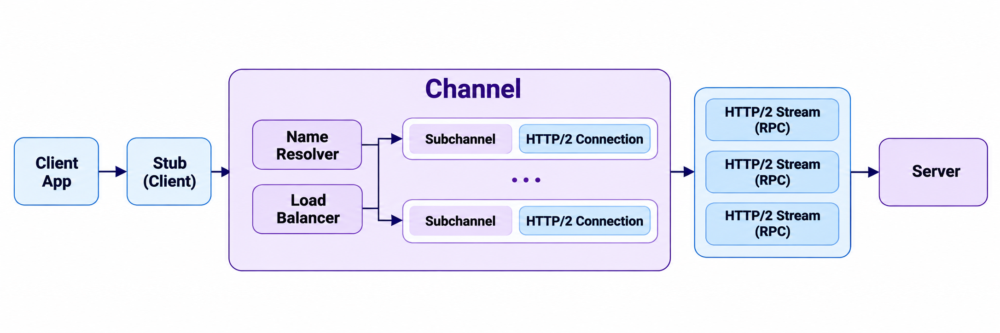
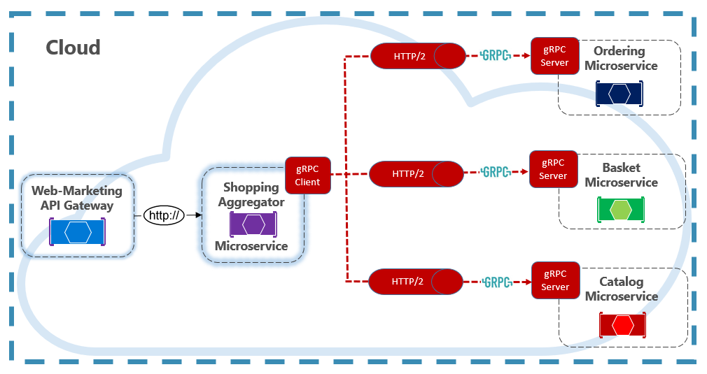
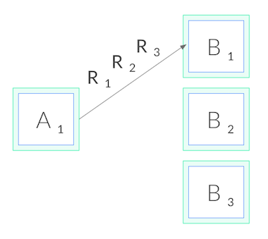
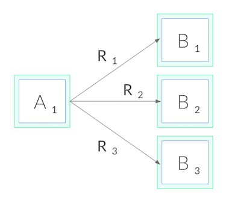

사실 gRPC에 대해서는 어느 정도 간단하게 정리해서 알고 있다고 생각했는데, [이전 글]()에서 당근 SRE 밋업의 gRPC 운영 발표를 정리하면서 gRPC 자체를 제대로 알아둘 필요를 느꼈다. 단순히 독자적인 프로토콜을 쓴다는 수준으로만 알고 있었는데, SRE/DevOps 관점에서 트러블슈팅이나 분석을 하려면 더 자세하게 알아두어야 한다고 생각했다.

대표적으로 gRPC는 독자적인 상태 코드를 사용하기 때문에 HTTP status code가 200으로 집계되더라도 내부적으로는 다른 gRPC 상태 코드가 담겨 있을 수 있고, L4/L7 레이어를 설정할 때도 gRPC에 맞는 설정을 따로 해야 하는 경우가 꽤 있었다. 이 글에서는 HTTP/2의 기본 단위부터 시작해서, gRPC가 그 위에서 어떻게 동작하는지, 그리고 실무에서 왜 내부 서비스 간 통신에 주로 쓰이는지를 정리하려고 한다.

---

### 들어가며

먼저, gRPC는 Remote Procedure Call의 약자인 RPC 앞에 Google이 개발했다는 의미로 g를 붙여 gRPC라고 부른다. 현대 HTTP 프로토콜을 공부해 보면 알겠지만 HTTP/1.1, HTTP/2, HTTP/3가 다양하게 사용되고 있는데, 그중 우리가 흔히 아는 일반적인 RESTful API 서버는 HTTP/1.1 방식을 사용한다.

HTTP/2로 넘어오면서 다양한 기능이 추가되었는데, gRPC는 이 기능들을 적극적으로 활용하기 때문에 통신에서 많은 이점을 누릴 수 있으며, 주로 MSA에서 내부 서비스 간 통신에 많이 사용된다. 글은 HTTP/2부터 시작해서 gRPC 순서로 설명하려고 한다.

## 1. HTTP/2의 기본 단위

gRPC가 올라타는 도로인 HTTP/2부터 살펴보자. HTTP/1.1은 텍스트 기반이고, 하나의 TCP 커넥션에서 요청과 응답이 한 번에 하나씩 순서대로 오간다. HTTP/2는 이 구조를 **바이너리 프레이밍 계층**(binary framing layer)으로 바꿨다.

HTTP/2에서 데이터를 다루는 단위는 다음과 같이 나뉜다.


<small>출처: [Ilya Grigorik, High Performance Browser Networking — HTTP/2: Streams, Messages, and Frames](https://hpbn.co/http2/#streams-messages-and-frames)</small>

| 단위 | 설명 |
|---|---|
| 커넥션 | TCP 커넥션 하나. 오래 유지된다 |
| 스트림 | 커넥션 안의 독립적인 논리 채널. 요청/응답 한 쌍이 스트림 하나를 쓴다 |
| 메시지 | HTTP 요청 하나 또는 응답 하나. 여러 프레임으로 이루어진다 |
| 프레임 | 실제로 전송되는 최소 단위. HEADERS, DATA 등의 타입이 있다 |

참고로, 여기에서 말하는 커넥션, 스트림, 메시지 같은 개념은 뒤에서 gRPC를 다룰 때 그대로 등장하기 때문에 잘 알아두어야 한다. 다음은 gRPC가 이점을 얻는 핵심 개념인 멀티플렉싱이다.

### 멀티플렉싱

핵심은 여러 스트림의 프레임이 한 커넥션 위에서 섞여서(interleave) 전송되고, 수신 측이 Stream ID로 다시 조립한다는 점이다. 이것이 **멀티플렉싱**(multiplexing)이다.

```text
TCP 커넥션 하나
 ├─ [HEADERS sid=1][DATA sid=3][DATA sid=1][HEADERS sid=5][DATA sid=3] ...
 └─ 수신 측에서 sid별로 재조립 → 스트림 1, 3, 5가 동시에 진행
```

HTTP/1.1에서는 응답이 올 때까지 그 커넥션이 묶여 있기 때문에, 동시성을 높이려면 커넥션을 여러 개 열어야 했다. HTTP/2는 커넥션 하나로 여러 요청을 동시에 처리할 수 있다.

### 커넥션이 맺어지는 과정

그렇다면 이 커넥션은 어떻게 맺어질까. HTTP/2라고 해서 TCP 3-way 핸드셰이크가 달라지지는 않는다. TCP 핸드셰이크와 TLS 핸드셰이크까지는 HTTP/1.1과 똑같고, 그 위에서 처음 주고받는 데이터만 달라진다.


<small>출처: [Cloudflare Blog — HTTP/3: the past, the present, and the future](https://blog.cloudflare.com/http3-the-past-present-and-future/)</small>

위 그림의 마지막 HTTP Request 자리에서 HTTP/2만의 과정이 추가된다. HTTP/2까지 포함하면 다음과 같다.

```text
클라이언트                                서버
── TCP 3-way 핸드셰이크 ──────────────────────────
SYN                    ──────▶
                       ◀──────  SYN/ACK
ACK                    ──────▶
── TLS 핸드셰이크 ────────────────────────────────
ClientHello (ALPN: h2, http/1.1)  ──────▶
                       ◀──────  ServerHello ... (ALPN: h2)
Finished               ──────▶
── HTTP/2 ────────────────────────────────────────
connection preface + SETTINGS  ──────▶
HEADERS (stream 1)     ──────▶     ← 서버 응답을 기다리지 않고 바로 보낸다
                       ◀──────  SETTINGS, SETTINGS ACK
SETTINGS ACK           ──────▶
                       ◀──────  HEADERS + DATA (stream 1 응답)
```

1. **TCP 3-way 핸드셰이크**: 바이트를 신뢰성 있게 주고받을 파이프를 만든다.
2. **TLS 핸드셰이크**: 키를 교환하고 서버 인증서를 검증한다. 이때 **ALPN**(Application-Layer Protocol Negotiation)으로 어떤 HTTP 버전을 쓸지도 정한다. 클라이언트가 ClientHello에 "h2와 http/1.1을 할 수 있다"고 적어 보내면, 서버가 그중 하나를 골라 응답한다.
3. **HTTP/2 connection preface**: h2로 정해지면 클라이언트는 `PRI * HTTP/2.0\r\n\r\nSM\r\n\r\n`이라는 고정 문자열과 SETTINGS 프레임을 보내고, 서버도 자기 SETTINGS를 보낸 뒤 서로 ACK한다.

preface는 상대의 응답을 기다리지 않고 바로 첫 요청까지 이어서 보낼 수 있어서, HTTP/1.1보다 RTT가 늘지 않는다. HTTP/2의 이득은 첫 연결 속도가 아니라, 한 번 맺은 커넥션 위에서 이후 요청을 추가 RTT 없이 새 스트림으로 계속 열 수 있다는 데 있다.

참고로 TLS 없이 평문으로 쓰는 HTTP/2는 **h2c**라고 부른다. ALPN이 없으니 TCP 핸드셰이크 직후 바로 preface를 보내며, 내부망의 평문 gRPC 통신이 보통 이 방식이다.

---

## 2. gRPC는 HTTP/2를 어떻게 쓰는가

HTTP/2의 구조를 봤으니, 이제 그 위에서 gRPC 호출이 어떤 모양이 되는지 살펴보자. 한 줄로 요약하면 **RPC 호출 1번 = HTTP/2 스트림 1개**다. 요청은 다음과 같이 이루어진다.


<small>출처: [Cloudflare Blog — Road to gRPC](https://blog.cloudflare.com/road-to-grpc/)</small>

### 두 가지 "메시지"

여기서 헷갈리기 쉬운 점이 하나 있다. gRPC에서 말하는 메시지는 **protobuf 메시지 하나**를 뜻하고, HTTP/2의 메시지(요청/응답 전체)와는 다르다.

gRPC 메시지는 5바이트 길이 프리픽스(압축 플래그 1바이트 + 길이 4바이트)를 붙인 채로 DATA 프레임 안에 연속으로 실린다. 그래서 스트림 하나 안에 gRPC 메시지가 여러 개 들어갈 수 있고, 이것이 gRPC 스트리밍의 정체다.


<small>출처: [gRPC Blog — gRPC on HTTP/2: Engineering a Robust, High-performance Protocol](https://grpc.io/blog/grpc-on-http2/)</small>

### 네 가지 호출 방식

이 구조 덕분에 gRPC의 네 가지 호출 방식이 자연스럽게 나온다. HTTP/2 관점에서는 모두 똑같이 스트림 하나이고, 그 안에 gRPC 메시지가 몇 개씩 오가느냐만 다르다.

| 타입 | 형태 | 대표 사례 |
|---|---|---|
| Unary | 요청 1 → 응답 1 | 일반적인 조회, 생성 API (대부분이 이것) |
| Server streaming | 요청 1 → 응답 N | watch/구독, 대량 결과 흘려주기, LLM 토큰 스트리밍 |
| Client streaming | 요청 N → 응답 1 | 로그·메트릭 업로드, 파일 청크 업로드 |
| Bidirectional streaming | 요청 N ↔ 응답 N | 채팅, 에이전트-컨트롤 플레인, xDS |

### 왜 HTTP/2여야 할까

그렇다면 gRPC는 왜 하필 HTTP/2여야 할까. gRPC는 HTTP/2의 다음과 같은 기능에 기대고 있다.

- **멀티플렉싱**: 커넥션 하나로 수많은 RPC를 동시에 처리한다.
- **전이중 통신**: 한 스트림에서 클라이언트와 서버가 동시에 데이터를 보낼 수 있어 양방향 스트리밍이 가능하다.
- **Trailers**: 본문을 다 보낸 뒤 최종 상태(`grpc-status`)를 trailer에 담아 보낸다.
- **스트림 단위 흐름 제어**: 느린 스트림 하나가 커넥션 전체를 막지 않는다.
- **바이너리 프레이밍과 HPACK**: 반복되는 헤더를 압축하고, protobuf 바이너리와 잘 맞는다.
- **PING 프레임**: 오래 유지되는 커넥션의 keepalive와 생존 확인에 쓴다.

그래서 gRPC를 쓰려면 클라이언트에서 서버까지 가는 경로 전체가 HTTP/2여야 한다. 그런데 현실에서는 클라이언트 쪽 구간은 HTTP/2, 백엔드 쪽 구간은 HTTP/1.1인 경우가 흔하다.

- **ALB**는 클라이언트와 h2로 통신해도, 타겟 그룹의 protocol version 기본값이 HTTP1이라 타겟에는 HTTP/1.1로 보낸다. gRPC를 쓰려면 타겟 그룹을 gRPC(또는 HTTP2)로 지정해야 한다.
- **nginx**의 `proxy_pass`도 기본적으로 upstream에 HTTP/1.x를 쓴다. gRPC는 `grpc_pass`를 따로 써야 한다.


<small>출처: [AWS News Blog — New – Application Load Balancer Support for End-to-End HTTP/2 and gRPC](https://aws.amazon.com/blogs/aws/new-application-load-balancer-support-for-end-to-end-http-2-and-grpc/)</small>

정리하면, REST/JSON은 HTTP/2의 특정 기능에 의존하지 않기 때문에 어느 버전 위에서든 동작한다. 반면 gRPC는 스트림, trailer, 전이중 통신에 의존하기 때문에 경로 전체(end-to-end)가 HTTP/2여야 한다.

---

## 3. gRPC의 구성 요소

사실 gRPC를 공부하려고 했는데 그동안 HTTP/2 이야기만 계속했다. 하지만 HTTP/2는 gRPC가 다니는 도로 같은 존재라서, 함께 생각하면 gRPC를 훨씬 쉽게 이해할 수 있다. gRPC는 크게 세 덩어리로 나눠 보면 쉽다.

> gRPC = 인터페이스 정의(protobuf) + 코드 생성 + HTTP/2 위의 RPC 런타임

### RPC란

**RPC**(Remote Procedure Call)는 다른 서버에 있는 함수를 내 코드의 함수처럼 호출하는 방식이다.

```go
// REST 스타일: "어떤 URL에 어떤 JSON을 보낸다"를 직접 다룸
resp, _ := http.Post("http://user-svc/users/42", "application/json", body)
json.Unmarshal(resp.Body, &user)

// RPC 스타일: 그냥 함수 호출
user, err := userClient.GetUser(ctx, &pb.GetUserRequest{Id: 42})
```

REST가 리소스(URL)와 동사(GET/POST) 중심이라면, RPC는 서비스와 메서드 중심이다. 네트워크 통신, 직렬화, 에러 처리를 프레임워크가 감춰주고, 개발자는 함수 시그니처만 신경 쓰면 된다.

### Protocol Buffers: 계약서이자 직렬화 포맷

gRPC는 `.proto` 파일로 서비스와 메시지를 정의한다.

```protobuf
syntax = "proto3";
package user.v1;

service UserService {
  rpc GetUser(GetUserRequest) returns (User);                 // unary
  rpc ListUsers(ListUsersRequest) returns (stream User);      // 서버 스트리밍
  rpc UploadEvents(stream Event) returns (UploadSummary);     // 클라이언트 스트리밍
  rpc Chat(stream ChatMessage) returns (stream ChatMessage);  // 양방향 스트리밍
}

message GetUserRequest {
  int64 id = 1;
}

message User {
  int64  id    = 1;
  string name  = 2;
  string email = 3;
}
```

여기서 `= 1`, `= 2`는 기본값이 아니라 **필드 번호**다. protobuf는 바이너리로 인코딩할 때 필드 이름 대신 이 번호를 쓴다. 예를 들어 위의 `User`에서 `{id: 150, name: "hi"}`를 인코딩하면 다음과 같다.

```text
JSON:      {"id":150,"name":"hi"}            → 22바이트
Protobuf:  08 96 01   12 02 68 69            → 7바이트
           └ 필드1(정수) 150을 varint로
                      └ 필드2(문자열) 길이2 "hi"
```

필드 이름이 아예 전송되지 않으니 작고, 파싱도 빠르다. 그리고 이 구조 때문에 호환성 규칙이 생긴다.

- 필드 이름은 바꿔도 된다. 전송되는 것은 번호이기 때문이다.
- 필드 번호는 절대 바꾸거나 재사용하면 안 된다. 옛 클라이언트가 다른 의미로 해석하게 된다. 필드를 지울 때는 `reserved 3;`로 번호를 막아둔다.
- 새 필드 추가는 안전하다. 모르는 번호의 필드는 옛 버전이 그냥 무시한다.

이 `.proto`를 `protoc`나 `buf`로 컴파일하면 Go, Java, Python, TypeScript 등 언어별로 메시지 타입과 서버 인터페이스(스텁), 클라이언트 코드가 생성된다.

### 클라이언트와 서버의 구조

클라이언트 앱 코드가 서버와 통신하는 구조는 다음과 같다.



1. **Stub**: 앱 코드가 호출하는 생성된 클라이언트. 요청을 protobuf로 직렬화한다.
2. **Channel**: 서버로 가는 가상 커넥션. 안에서 **Name Resolver**가 주소를 백엔드 IP 목록으로 바꾸고, **Load Balancer**가 RPC마다 보낼 백엔드를 고른다.
3. **Subchannel**: 백엔드 하나와 맺은 실제 HTTP/2 커넥션.
4. **HTTP/2 Stream**: RPC 하나가 스트림 하나로 서버에 전달된다.

즉 "gRPC는 커넥션 하나를 오래 쓴다"는 말은, 정확히는 Channel이 여러 백엔드와의 HTTP/2 커넥션을 관리한다는 뜻이다. 그래서 Channel은 애플리케이션 시작 시 한 번 만들고 재사용한다. 요청마다 새로 만들면 매번 핸드셰이크를 하게 된다.

### 기본으로 제공되는 기능들

REST에서는 팀마다 직접 만들어야 했던 것들이 gRPC에는 표준으로 들어 있다.

**데드라인**(deadline). 클라이언트가 "이 호출은 언제까지 끝나야 한다"를 지정하면 `grpc-timeout` 헤더로 서버에 전달된다. 서버가 그 컨텍스트로 다른 서비스를 호출하면 남은 시간이 그대로 전파되고, 시간이 지나면 체인 전체가 `DEADLINE_EXCEEDED`로 취소된다.

```go
ctx, cancel := context.WithTimeout(ctx, 300*time.Millisecond)
defer cancel()
user, err := userClient.GetUser(ctx, req)
```

**취소**(cancellation). 클라이언트가 호출을 취소하면 HTTP/2 `RST_STREAM`이 나가고, 서버 핸들러의 컨텍스트도 취소된다. 사용자가 이미 떠났는데 서버가 계속 일하는 낭비를 막아준다.

**메타데이터**(metadata). HTTP 헤더에 해당한다. 인증 토큰, 트레이스 ID, 요청 ID 등을 실어 보낸다. 응답 쪽에는 header metadata와 trailer metadata가 따로 있다.

**인터셉터**(interceptor). HTTP의 미들웨어에 해당한다. 인증, 로깅, 메트릭, 트레이싱, 재시도를 모든 RPC에 공통으로 끼워 넣는다.

**상태 코드**(status code). HTTP 상태 코드 대신 gRPC 전용 코드가 trailer의 `grpc-status`로 온다.

| 코드 | 의미 | HTTP로 치면 |
|---|---|---|
| OK (0) | 성공 | 200 |
| INVALID_ARGUMENT (3) | 잘못된 요청 | 400 |
| DEADLINE_EXCEEDED (4) | 데드라인 초과 | 504 |
| NOT_FOUND (5) | 없음 | 404 |
| PERMISSION_DENIED (7) | 권한 없음 | 403 |
| RESOURCE_EXHAUSTED (8) | 쿼터·레이트리밋 초과 | 429 |
| UNIMPLEMENTED (12) | 없는 메서드 | 501 |
| INTERNAL (13) | 서버 내부 오류 | 500 |
| UNAVAILABLE (14) | 일시적 장애, 재시도 가능 | 503 |
| UNAUTHENTICATED (16) | 인증 실패 | 401 |

그 외에도 헬스 체크 프로토콜(`grpc.health.v1.Health`), 서버 리플렉션, HTTP/2 PING 기반 keepalive, 메서드별 재시도·타임아웃을 지정하는 service config, 메시지 단위 압축 등이 표준으로 제공된다.

---

## 4. 왜 내부 서비스 통신에 쓰는가

구조를 이해했으니 이제 실무로 넘어가 보자. gRPC는 주로 내부 서비스 간(east-west) 통신에 쓰인다.

외부 공개 API로는 불편한 점이 많다. 브라우저에서 쓰려면 gRPC-Web과 별도 프록시가 필요하고, 바이너리라서 curl로 확인하기 어렵고, 외부 사용자에게 `.proto`와 코드 생성을 요구하는 것도 부담이다. 반면 내부에서는 클라이언트와 서버를 모두 우리가 통제하기 때문에 이런 단점이 거의 사라진다.


<small>출처: [Microsoft Learn — gRPC (Architecting Cloud Native .NET Applications for Azure)](https://learn.microsoft.com/en-us/dotnet/architecture/cloud-native/grpc)</small>

### 내부 통신에서 얻는 이점

MSA에서 내부 통신에 gRPC를 도입하면 다음과 같은 장점이 있다고 한다.

- **계약 강제**: `.proto`가 곧 계약이다. 필드가 번호로 식별되어 하위 호환 규칙이 명확하고, `buf breaking` 같은 도구로 CI에서 호환성 깨짐을 잡을 수 있다.
- **다국어 환경**: proto 하나로 Go, Python, Java 등 모든 언어의 클라이언트를 생성한다.
- **깊은 호출 체인**: 커넥션 재사용과 protobuf 직렬화로 홉마다 쌓이는 오버헤드를 줄인다.
- **데드라인 전파**: 최상위 요청의 데드라인이 하위 호출까지 전파되고, 시간이 초과되면 체인 전체가 취소된다. "상위는 이미 포기했는데 하위는 계속 일하는" 낭비가 없어서, SRE 관점에서는 성능보다 더 실질적인 이점이다.
- **스트리밍**: watch, 로그·메트릭 업로드, 에이전트와 컨트롤 플레인 연결처럼 폴링이나 웹소켓을 따로 붙이던 것을 RPC 안에서 해결한다.

### 이미 쓰고 있는 곳들

인프라 쪽에는 Go로 작성된 컴포넌트가 많고, gRPC를 사용하는 곳도 많다. 오픈소스를 그대로 쓰는 것을 넘어 설정 파일을 제대로 다루려면 gRPC 관련 설정을 알아두는 것이 좋아 보인다.

- **Kubernetes**: kubelet ↔ containerd(CRI)와 etcd API
- **OpenTelemetry**: OTLP의 기본 전송(4317 포트)
- **Envoy / Istio**: 컨트롤 플레인이 Envoy에 설정을 내려주는 xDS
- **NetBird**: management·signal 서버가 피어에게 정책 변경을 push
- **Temporal, Vitess, CockroachDB** 등 분산 시스템의 내부 통신

### 굳이 쓰지 않아도 되는 경우

서비스가 몇 개 안 되고 한 언어로 통일되어 있거나, 주 소비자가 브라우저나 외부 파트너라면 REST/JSON으로 충분하다. 그래서 실무에서는 **외부는 REST/JSON, 내부는 gRPC**로 나누고, 엣지에 grpc-gateway나 Envoy의 gRPC-JSON transcoder를 두는 구성이 흔하다.

---

## 5. 운영할 때 알아둘 것

마지막으로 gRPC를 실제로 운영할 때 부딪히는 문제들을 정리한다. 대부분 HTTP/2의 특성에서 비롯된다.

### L4 로드밸런싱 쏠림

gRPC는 커넥션 하나를 오래 유지하면서 그 위로 RPC를 계속 보낸다. 그런데 NLB나 쿠버네티스의 기본 Service(kube-proxy)는 커넥션 단위로 분산하기 때문에, 특정 Pod에 트래픽이 몰리는 현상이 자주 생긴다.



<small>출처: [Kubernetes Blog — gRPC Load Balancing on Kubernetes without Tears](https://kubernetes.io/blog/2018/11/07/grpc-load-balancing-on-kubernetes-without-tears/)</small>

해결책은 L7 LB(Envoy, ALB gRPC 타겟, 서비스 메시)를 쓰거나, headless Service와 클라이언트 측 LB를 조합하는 것이다. 앞에서 본 Channel 구조 덕분에 클라이언트 측 LB가 가능하다.

### 에러가 HTTP 200으로 나간다

gRPC 에러는 HTTP 상태로는 `200`으로 나가고, 실제 결과는 trailer의 `grpc-status`에 담긴다. 그래서 ALB나 일반 HTTP 모니터링으로 5xx만 보고 있으면 에러를 놓친다. APM 도구에서 `grpc.status_code` 기준으로 에러율을 봐야 한다.

---

## 마치며

처음에는 gRPC를 그저 어떤 프로토콜이라는 정도로만 알고 있었고, 실무에서 쓰지 않다 보니 그 정도로 넘어갔었다. 그런데 gRPC 관련 발표 영상을 보니 맞는 상황에서는 꽤 좋은 도구로 느껴졌고, 자세히 공부하려고 보니 HTTP/2와 함께 다루는 것이 좋아 보여서 공부하면서 포스팅도 작성하게 됐다.

개인적으로 가장 와닿았던 점은 gRPC가 MSA에서 인기 있는 이유가 빨라서가 아니라는 것이다. 서비스와 팀이 많아질 때 서비스 간 계약, 타임아웃, 스트리밍 등을 표준화해 주는 것이 핵심이고, 성능은 덤에 가까웠다. 또한 기술을 아는 것과 별개로, 인프라 관점에서 어떻게 모니터링하고 분석할지는 따로 공부해야 하는 영역이라고 느꼈다. 시간이 된다면 Wireshark 같은 툴로 직접 패킷을 분석해 보고 싶다. (쉽진 않겠지만)

## 참고

- [gRPC 공식 문서](https://grpc.io/docs/)
- [gRPC over HTTP2 프로토콜 명세](https://github.com/grpc/grpc/blob/master/doc/PROTOCOL-HTTP2.md)
- [RFC 9113 — HTTP/2](https://www.rfc-editor.org/rfc/rfc9113)
- [Protocol Buffers Encoding](https://protobuf.dev/programming-guides/encoding/)
