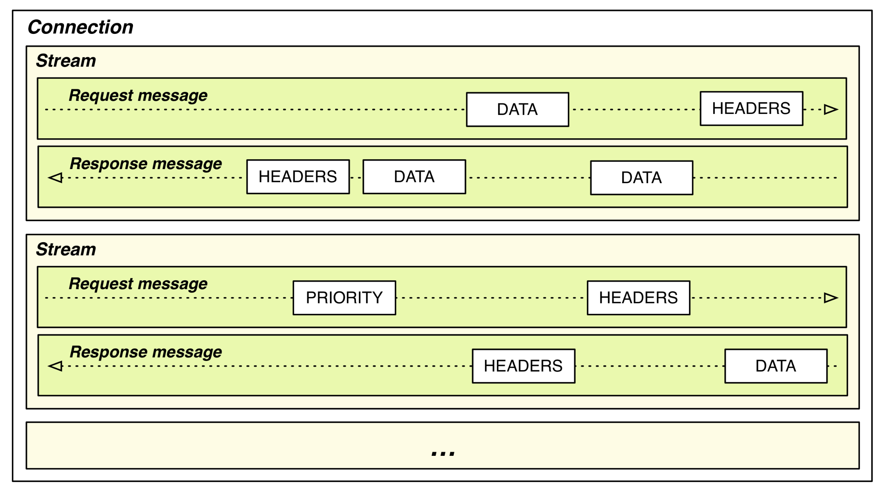
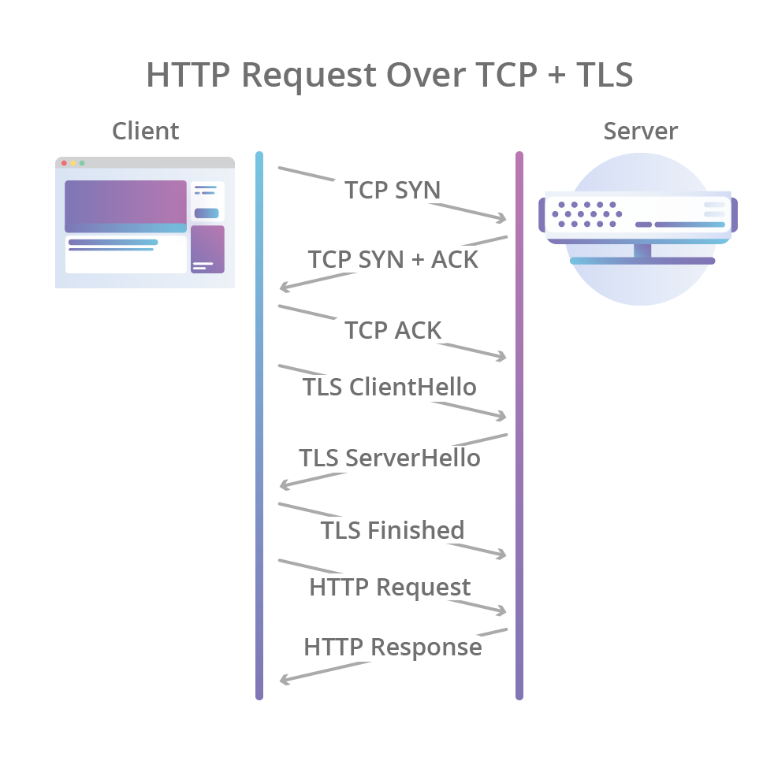
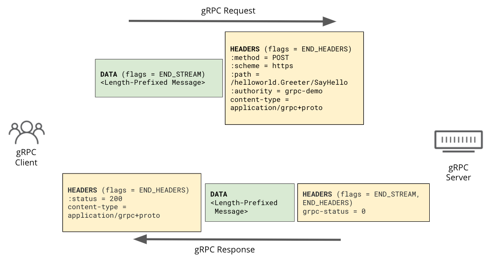
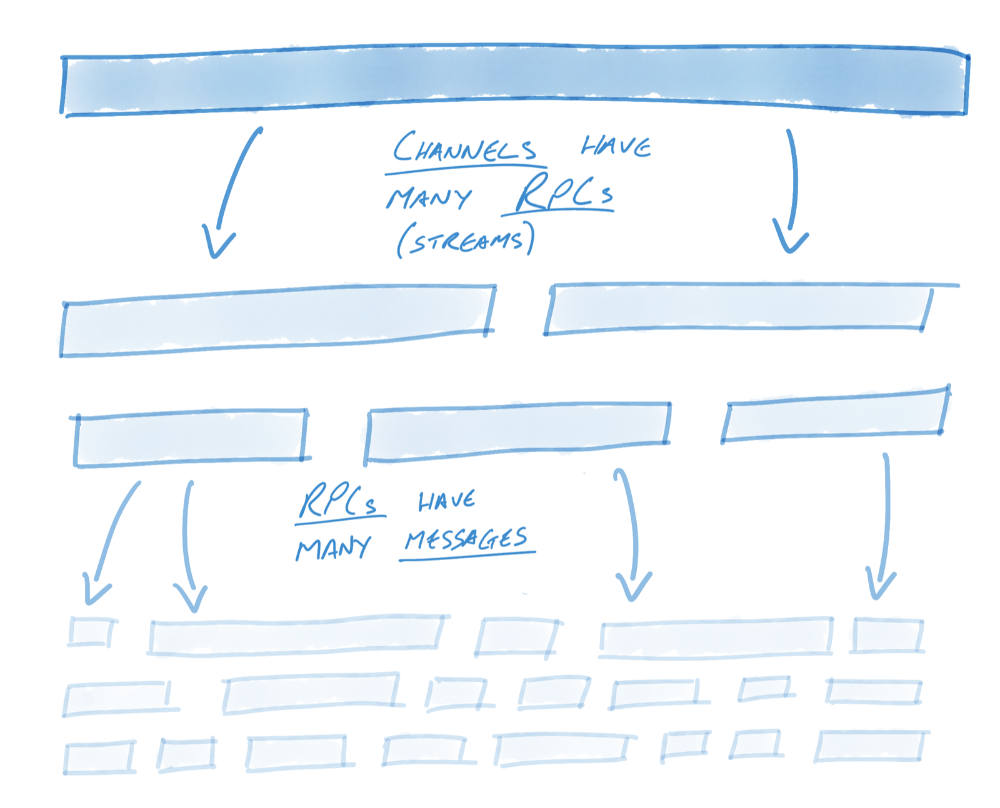
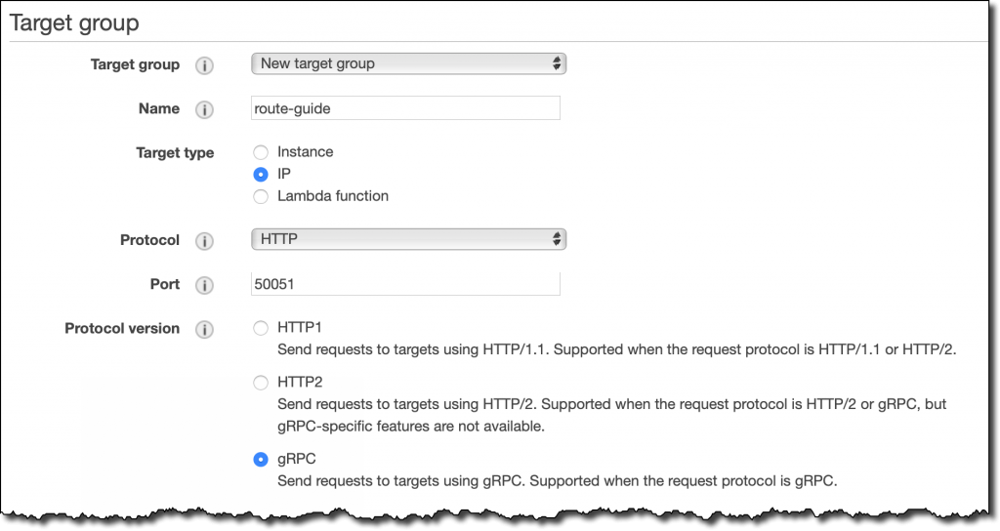
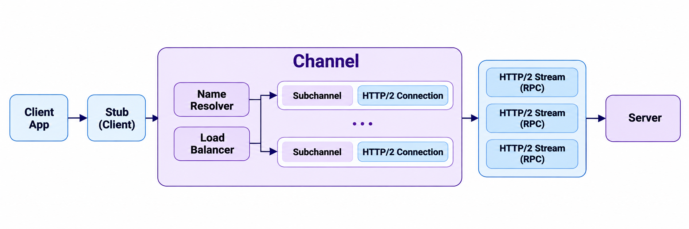
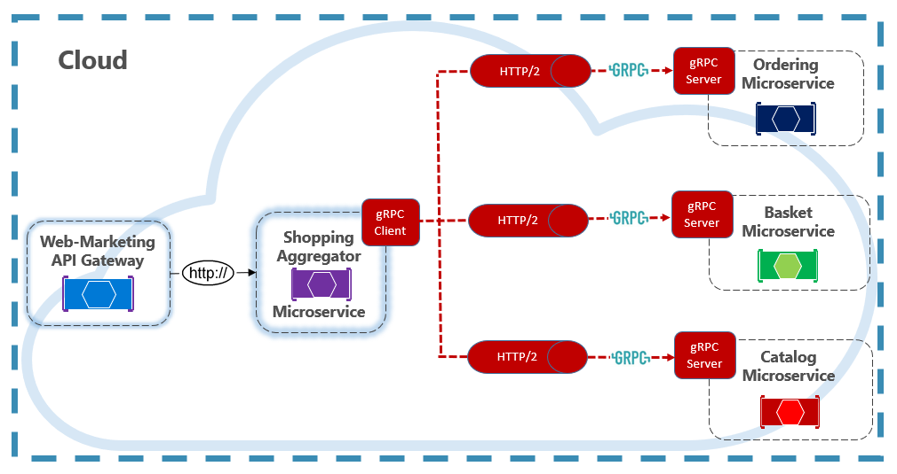
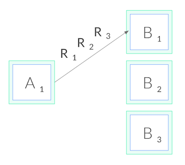
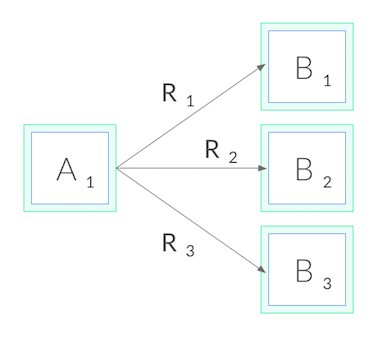

I thought I had a reasonably good grasp of gRPC, but while writing up the gRPC operations talk from the Daangn SRE meetup in the [previous post](), I realized I needed to understand gRPC itself properly. I only knew it at the level of "it uses its own protocol," and from an SRE/DevOps perspective, troubleshooting and analysis call for knowing it in more detail.

For example, gRPC uses its own status codes, so even when the HTTP status code is counted as 200, a different gRPC status code may be carried inside. And when configuring L4/L7 layers, there were quite a few cases that needed gRPC-specific settings. In this post, I start from the basic units of HTTP/2, then cover how gRPC works on top of it and why, in practice, it is mainly used for internal service-to-service communication.

---

### Getting Started

First, gRPC is RPC — short for Remote Procedure Call — with a "g" in front because Google developed it. If you study modern HTTP, you'll know that HTTP/1.1, HTTP/2, and HTTP/3 are all in wide use, and while RESTful APIs are often associated with HTTP/1.1, REST/JSON is independent of the HTTP version and works just as well over HTTP/2 or HTTP/3.

HTTP/2 added many features, and because gRPC makes active use of them, it gains a lot of advantages in communication. It is mostly used for internal service-to-service communication in MSA. This post goes in order from HTTP/2 to gRPC.

## 1. The Basic Units of HTTP/2

Let's start with HTTP/2, the road that gRPC drives on. HTTP/1.1 is text-based, and on a single TCP connection requests and responses travel one at a time, in order. HTTP/2 replaced this with a **binary framing layer**.

In HTTP/2, the units that carry data are divided as follows.


<small>Source: [Ilya Grigorik, High Performance Browser Networking — HTTP/2: Streams, Messages, and Frames](https://hpbn.co/http2/#streams-messages-and-frames)</small>

| Unit | Description |
|---|---|
| Connection | A single TCP connection. Kept open for a long time |
| Stream | An independent logical channel inside the connection. One request/response pair uses one stream |
| Message | One HTTP request or one response. Made up of multiple frames |
| Frame | The smallest unit actually transmitted. Has types such as HEADERS and DATA |

Note that the concepts of connection, stream, and message here show up again unchanged when we get to gRPC, so they're worth getting comfortable with. Next is multiplexing, the core concept gRPC benefits from.

### Multiplexing

The key point is that frames from multiple streams are interleaved on a single connection, and the receiver reassembles them by Stream ID. This is **multiplexing**.

```text
One TCP connection
 ├─ [HEADERS sid=1][DATA sid=3][DATA sid=1][HEADERS sid=5][DATA sid=3] ...
 └─ Receiver reassembles by sid → streams 1, 3, 5 progress concurrently
```

In HTTP/1.1, a connection is tied up until the response arrives, so raising concurrency meant opening multiple connections. HTTP/2 can handle many requests at once over a single connection.

### How the Connection Is Established

So how is this connection set up? HTTP/2 doesn't change the TCP 3-way handshake. Everything up through the TCP handshake and the TLS handshake is the same as HTTP/1.1; only the first data exchanged on top of it is different.


<small>Source: [Cloudflare Blog — HTTP/3: the past, the present, and the future](https://blog.cloudflare.com/http3-the-past-present-and-future/)</small>

HTTP/2 adds its own steps at the "HTTP Request" position at the end of the figure above. Including HTTP/2, the flow looks like this.

```text
Client                                    Server
── TCP 3-way handshake ───────────────────────────
SYN                    ──────▶
                       ◀──────  SYN/ACK
ACK                    ──────▶
── TLS handshake ─────────────────────────────────
ClientHello (ALPN: h2, http/1.1)  ──────▶
                       ◀──────  ServerHello ... (ALPN: h2)
Finished               ──────▶
── HTTP/2 ────────────────────────────────────────
connection preface + SETTINGS  ──────▶
HEADERS (stream 1)     ──────▶     ← sent right away, without waiting for the server
                       ◀──────  SETTINGS, SETTINGS ACK
SETTINGS ACK           ──────▶
                       ◀──────  HEADERS + DATA (stream 1 response)
```

1. **TCP 3-way handshake**: Builds a pipe for exchanging bytes reliably.
2. **TLS handshake**: Exchanges keys and verifies the server certificate. This is also where **ALPN** (Application-Layer Protocol Negotiation) decides which HTTP version to use. The client writes "I can speak h2 and http/1.1" in its ClientHello, and the server picks one of them in its response.
3. **HTTP/2 connection preface**: Once h2 is chosen, the client sends the fixed string `PRI * HTTP/2.0\r\n\r\nSM\r\n\r\n` and a SETTINGS frame, the server sends its own SETTINGS, and each side ACKs the other.

Because the client can send its first request right after the preface without waiting for a reply, HTTP/2 adds no RTT compared to HTTP/1.1. The benefit of HTTP/2 is not a faster first connection; it is that once the connection is established, later requests can keep opening new streams without any extra RTT.

For reference, HTTP/2 over plaintext without TLS is called **h2c**. Since there's no ALPN, the client sends the preface immediately after the TCP handshake, and plaintext gRPC traffic inside an internal network usually works this way.

---

## 2. How gRPC Uses HTTP/2

Now that we've seen how HTTP/2 is structured, let's look at what a gRPC call looks like on top of it. In one line: **one RPC call = one HTTP/2 stream**. A request goes like this.


<small>Source: [Cloudflare Blog — Road to gRPC](https://blog.cloudflare.com/road-to-grpc/)</small>

### Two Kinds of "Message"

One point is easy to confuse here. A message in gRPC means **a single protobuf message**, which is different from an HTTP/2 message (an entire request or response).

gRPC messages are carried back to back inside DATA frames, each with a 5-byte length prefix (a 1-byte compression flag + a 4-byte length). That's why a single stream can hold multiple gRPC messages, and that is what gRPC streaming really is.


<small>Source: [gRPC Blog — gRPC on HTTP/2: Engineering a Robust, High-performance Protocol](https://grpc.io/blog/grpc-on-http2/)</small>

### Four Call Types

This structure naturally gives rise to gRPC's four call types. From HTTP/2's point of view they are all just one stream; the only difference is how many gRPC messages travel inside it.

| Type | Shape | Typical use |
|---|---|---|
| Unary | 1 request → 1 response | Ordinary lookups and create APIs (most calls) |
| Server streaming | 1 request → N responses | Watch/subscribe, streaming large results, LLM token streaming |
| Client streaming | N requests → 1 response | Log and metric uploads, chunked file uploads |
| Bidirectional streaming | N requests ↔ N responses | Chat, agent–control plane, xDS |

### Why It Has to Be HTTP/2

So why HTTP/2 in particular? gRPC relies on the following HTTP/2 features.

- **Multiplexing**: Handles many RPCs at once over a single connection.
- **Full-duplex communication**: The client and server can send data on one stream at the same time, which makes bidirectional streaming possible.
- **Trailers**: After the body is sent, the final status (`grpc-status`) is sent in a trailer.
- **Per-stream flow control**: One slow stream doesn't block the entire connection.
- **Binary framing and HPACK**: Repeated headers are compressed, and the framing fits protobuf's binary format well.
- **PING frames**: Used for keepalive and liveness checks on long-lived connections.

So to use gRPC, the entire path from client to server has to be HTTP/2. In practice, though, it's common for the client-side leg to be HTTP/2 while the backend leg is HTTP/1.1.

- An **ALB** may talk h2 with the client, but the target group's default protocol version is HTTP1, so it sends HTTP/1.1 to the targets. To use gRPC, you have to set the target group to gRPC (or HTTP2).
- **nginx**'s `proxy_pass` also uses HTTP/1.x to the upstream by default. gRPC needs `grpc_pass` instead.


<small>Source: [AWS News Blog — New – Application Load Balancer Support for End-to-End HTTP/2 and gRPC](https://aws.amazon.com/blogs/aws/new-application-load-balancer-support-for-end-to-end-http-2-and-grpc/)</small>

To sum up, REST/JSON doesn't depend on any particular HTTP/2 feature, so it works on any version. gRPC, on the other hand, depends on streams, trailers, and full-duplex communication, so the entire path (end-to-end) has to be HTTP/2.

---

## 3. The Building Blocks of gRPC

To be honest, I set out to study gRPC and have only been talking about HTTP/2 so far. But HTTP/2 is like the road gRPC travels on, so thinking about the two together makes gRPC much easier to understand. gRPC is easiest to see as three pieces.

> gRPC = interface definition (protobuf) + code generation + an RPC runtime on top of HTTP/2

### What Is RPC

**RPC** (Remote Procedure Call) is a way of calling a function that lives on another server as if it were a function in your own code.

```go
// REST style: you deal directly with "send this JSON to this URL"
resp, _ := http.Post("http://user-svc/users/42", "application/json", body)
json.Unmarshal(resp.Body, &user)

// RPC style: just a function call
user, err := userClient.GetUser(ctx, &pb.GetUserRequest{Id: 42})
```

If REST is centered on resources (URLs) and verbs (GET/POST), RPC is centered on services and methods. The framework hides network communication, serialization, and error handling, and the developer only has to care about the function signature.

### Protocol Buffers: Both Contract and Serialization Format

gRPC defines services and messages in a `.proto` file.

```protobuf
syntax = "proto3";
package user.v1;

service UserService {
  rpc GetUser(GetUserRequest) returns (User);                 // unary
  rpc ListUsers(ListUsersRequest) returns (stream User);      // server streaming
  rpc UploadEvents(stream Event) returns (UploadSummary);     // client streaming
  rpc Chat(stream ChatMessage) returns (stream ChatMessage);  // bidirectional streaming
}

message GetUserRequest {
  int64 id = 1;
}

message User {
  int64  id    = 1;
  string name  = 2;
  string email = 3;
}
```

Here, `= 1` and `= 2` are not default values but **field numbers**. When protobuf encodes to binary, it uses these numbers instead of field names. For example, encoding `{id: 150, name: "hi"}` with the `User` above gives the following.

```text
JSON:      {"id":150,"name":"hi"}            → 22 bytes
Protobuf:  08 96 01   12 02 68 69            → 7 bytes
           └ field 1 (int) 150 as a varint
                      └ field 2 (string) length 2 "hi"
```

Since field names are never sent, the payload is small and fast to parse. This structure also produces some compatibility rules.

- You can rename a field. What gets sent is the number.
- Never change or reuse a field number. Old clients would interpret it with a different meaning. When removing a field, block its number with `reserved 3;`.
- Adding a new field is safe. Older versions simply ignore fields with numbers they don't know.

Compiling this `.proto` with `protoc` or `buf` generates message types, server interfaces (stubs), and client code for each language — Go, Java, Python, TypeScript, and more.

### Client and Server Structure

Here is how client application code communicates with the server.



1. **Stub**: The generated client that application code calls. Serializes requests into protobuf.
2. **Channel**: A virtual connection to the server. Inside it, the **Name Resolver** turns an address into a list of backend IPs, and the **Load Balancer** picks a backend for each RPC.
3. **Subchannel**: The actual HTTP/2 connection to a single backend.
4. **HTTP/2 Stream**: Each RPC is delivered to the server as one stream.

In other words, when people say "gRPC uses one connection for a long time," what they precisely mean is that the Channel manages HTTP/2 connections to multiple backends. That's why a Channel is created once at application startup and reused. Creating a new one per request means a handshake every time.

### Built-in Features

Things each team had to build themselves with REST come standard in gRPC.

**Deadline**. When the client specifies "this call must finish by such-and-such time," it is passed to the server in the `grpc-timeout` header. If the server calls other services with that context, the remaining time propagates as is, and once time runs out the whole chain is cancelled with `DEADLINE_EXCEEDED`.

```go
ctx, cancel := context.WithTimeout(ctx, 300*time.Millisecond)
defer cancel()
user, err := userClient.GetUser(ctx, req)
```

**Cancellation**. When the client cancels a call, an HTTP/2 `RST_STREAM` goes out and the server handler's context is cancelled too. This prevents the waste of the server continuing to work after the user has already left.

**Metadata**. The equivalent of HTTP headers. Carries auth tokens, trace IDs, request IDs, and so on. On the response side, header metadata and trailer metadata are separate.

**Interceptor**. The equivalent of HTTP middleware. Plugs authentication, logging, metrics, tracing, and retries into every RPC.

**Status code**. Instead of HTTP status codes, gRPC-specific codes arrive in the trailer's `grpc-status`.

| Code | Meaning | HTTP equivalent |
|---|---|---|
| OK (0) | Success | 200 |
| INVALID_ARGUMENT (3) | Bad request | 400 |
| DEADLINE_EXCEEDED (4) | Deadline exceeded | 504 |
| NOT_FOUND (5) | Not found | 404 |
| PERMISSION_DENIED (7) | Permission denied | 403 |
| RESOURCE_EXHAUSTED (8) | Quota or rate limit exceeded | 429 |
| UNIMPLEMENTED (12) | Method not implemented | 501 |
| INTERNAL (13) | Internal server error | 500 |
| UNAVAILABLE (14) | Transient failure, retryable | 503 |
| UNAUTHENTICATED (16) | Authentication failed | 401 |

Beyond these, a health checking protocol (`grpc.health.v1.Health`), server reflection, HTTP/2 PING-based keepalive, service config for per-method retries and timeouts, and per-message compression are provided as standard.

---

## 4. Why It's Used for Internal Service Communication

Now that we understand the structure, let's move on to practice. gRPC is mainly used for internal, service-to-service (east-west) communication.

It's inconvenient as a public external API. Using it from a browser requires gRPC-Web and a separate proxy, the binary format makes it hard to check with curl, and asking external users to deal with `.proto` files and code generation is a burden. Internally, though, we control both the client and the server, so these drawbacks largely disappear.


<small>Source: [Microsoft Learn — gRPC (Architecting Cloud Native .NET Applications for Azure)](https://learn.microsoft.com/en-us/dotnet/architecture/cloud-native/grpc)</small>

### Benefits for Internal Communication

Adopting gRPC for internal communication in an MSA is said to bring the following benefits.

- **Enforced contracts**: The `.proto` is the contract. Fields are identified by number, so backward-compatibility rules are clear, and tools like `buf breaking` can catch compatibility breaks in CI.
- **Polyglot environments**: A single proto generates clients for every language — Go, Python, Java, and more.
- **Deep call chains**: Connection reuse and protobuf serialization reduce the overhead that piles up at each hop.
- **Deadline propagation**: The top-level request's deadline propagates down to downstream calls, and when time runs out the whole chain is cancelled. There's no waste of "the upstream already gave up but the downstream keeps working," which from an SRE perspective is a more practical benefit than raw performance.
- **Streaming**: Things that used to need polling or a separate WebSocket — watches, log and metric uploads, agent–control plane connections — are handled within the RPC model.

### Where It's Already in Use

On the infrastructure side, many components are written in Go, and many of them use gRPC. To go beyond using open source as is and actually handle the configuration files well, it seems worth knowing gRPC-related settings.

- **Kubernetes**: kubelet ↔ containerd (CRI) and the etcd API
- **OpenTelemetry**: The default OTLP transport (port 4317)
- **Envoy / Istio**: xDS, through which the control plane pushes configuration to Envoy
- **NetBird**: The management and signal servers push policy changes to peers
- **Temporal, Vitess, CockroachDB**, and other distributed systems' internal communication

### When You Don't Need It

If you only have a few services, everything is in one language, or your main consumers are browsers or external partners, REST/JSON is enough. That's why a common setup in practice is **REST/JSON externally, gRPC internally**, with grpc-gateway or Envoy's gRPC-JSON transcoder at the edge.

---

## 5. Things to Know When Operating It

Finally, here are the problems you run into when actually operating gRPC. Most of them stem from the characteristics of HTTP/2.

### L4 Load Balancing Imbalance

gRPC keeps a single connection open for a long time and keeps sending RPCs over it. But an NLB or Kubernetes' default Service (kube-proxy) balances per connection, so traffic often piles up on a particular Pod.



<small>Source: [Kubernetes Blog — gRPC Load Balancing on Kubernetes without Tears](https://kubernetes.io/blog/2018/11/07/grpc-load-balancing-on-kubernetes-without-tears/)</small>

The fix is to use an L7 LB (Envoy, ALB gRPC targets, a service mesh), or to combine a headless Service with client-side load balancing. Client-side load balancing is possible thanks to the Channel structure we saw earlier.

### Errors Go Out as HTTP 200

gRPC errors go out as HTTP status `200`, and the actual result is in the trailer's `grpc-status`. So if you're only watching for 5xx in an ALB or ordinary HTTP monitoring, you'll miss errors. Error rates have to be tracked by `grpc.status_code` in an APM tool.

---

## Closing

At first I only knew gRPC as "some protocol," and since I don't use it at work, I left it at that. But after watching a talk about gRPC, it struck me as quite a good tool in the right situations, and when I sat down to study it properly, it seemed best to cover it together with HTTP/2 — so I wrote this post while studying.

What resonated with me most is that gRPC isn't popular in MSA because it's fast. The core value is standardizing service-to-service contracts, timeouts, streaming, and so on as the number of services and teams grows; the performance is closer to a bonus. I also felt that, separate from knowing the technology, how to monitor and analyze it from an infrastructure perspective is a whole other area to study. When I have time, I'd like to analyze the packets myself with a tool like Wireshark. (It won't be easy, though.)

## References

- [gRPC documentation](https://grpc.io/docs/)
- [gRPC over HTTP2 protocol specification](https://github.com/grpc/grpc/blob/master/doc/PROTOCOL-HTTP2.md)
- [RFC 9113 — HTTP/2](https://www.rfc-editor.org/rfc/rfc9113)
- [Protocol Buffers Encoding](https://protobuf.dev/programming-guides/encoding/)
