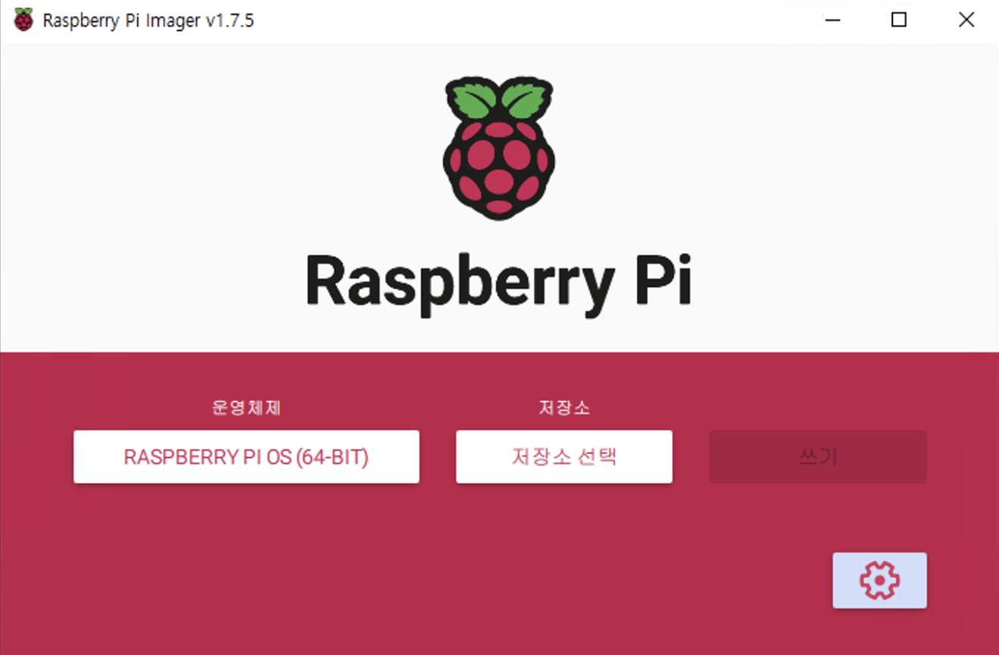
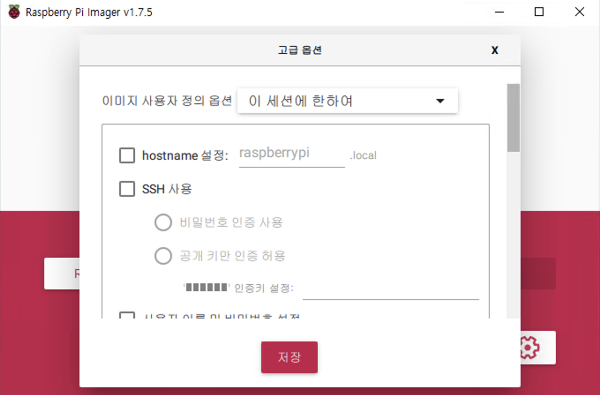
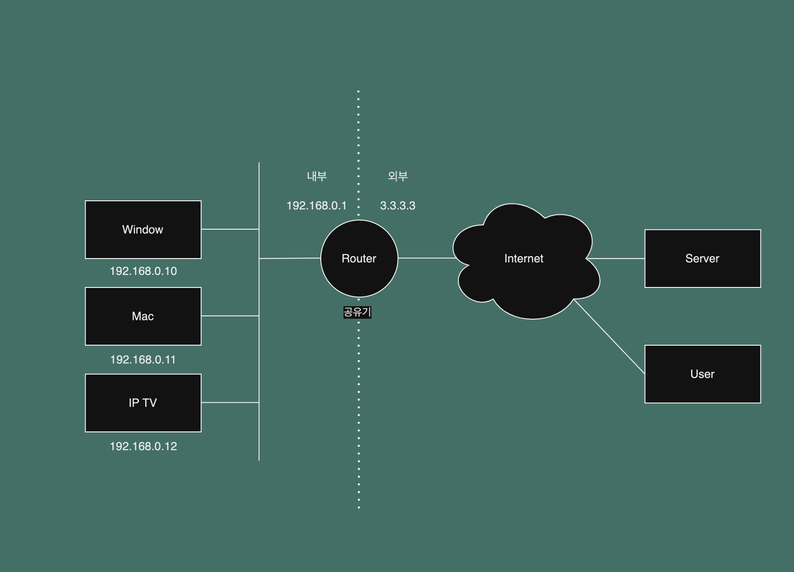
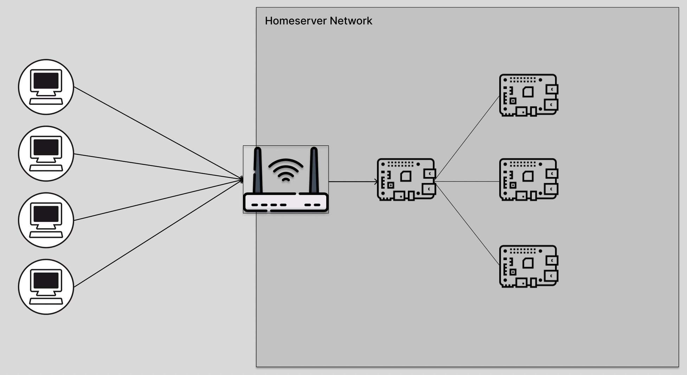
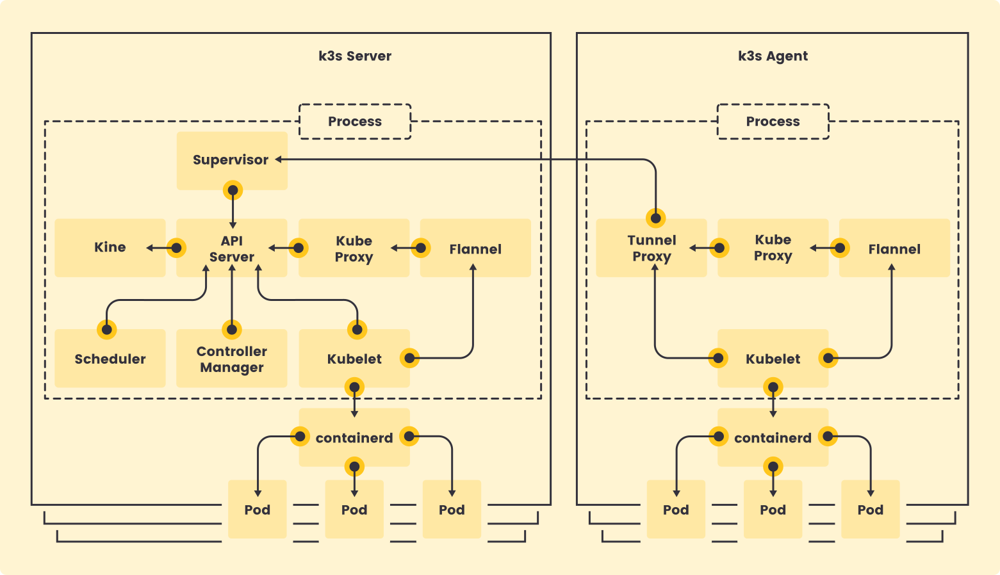
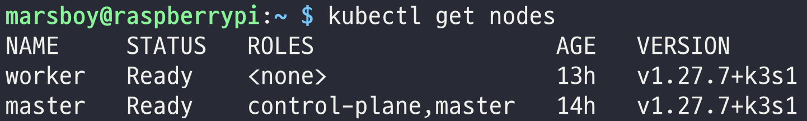

I had been working with all kinds of AWS infrastructure services for close to a year when the free tier started running out. Once it ends, a fixed bill arrives every month — more than I wanted to pay for infrastructure I was running purely to learn on. So I decided to put a few small computers on my desk and build a Kubernetes cluster myself.

This post is the record of that starting point. It covers putting an operating system on a Raspberry Pi, attaching it to the network, building a cluster with K3s, and getting the first workload to respond. I have kept running this cluster since I first wrote about it, so I have also folded in the parts I would do differently from the start, knowing what I know now. The configuration paths that changed when Raspberry Pi OS moved to Bookworm are the clearest example.

---

## 1. Motivation: Why On-Premises?

With the free tier ending, I had two options. Pay and stay in the cloud, or run the servers myself.

| | Cloud (AWS) | On-premises (Raspberry Pi) |
|---|---|---|
| **Up-front cost** | None (free tier) | Cost of buying the Raspberry Pis |
| **Running cost** | Monthly bill (after the free tier) | Electricity (negligible) |
| **Learning scope** | Mostly managed services | Network, OS, the whole cluster |
| **Flexibility** | High | Bounded by physical limits |
| **Who owns an outage** | The cloud provider | Entirely me |

I happened to be living in a university dormitory at the time and paid no utility bills, so with nothing but the Raspberry Pis I could put together an on-premises environment essentially for free. The bigger reason than cost was the learning scope. Managed services hide a great deal in exchange for their convenience. How a node attaches to the network, what the container runtime actually is, what path traffic from outside the cluster takes to reach a Pod — none of that is visible in the EKS console. On a Raspberry Pi you have to touch all of it yourself.

The last row is something I added later. When the power goes out the cluster goes down, when the router reboots the IP changes, and when an SD card wears out a node disappears. All of that is part of the learning, clearly — but if you plan to run anything seriously, it is better to know going in.

It is also worth putting a number on "electricity is negligible." A Raspberry Pi 4 draws about 3W at idle and 6 to 7W under load. Running two of them around the clock comes to roughly 10kWh a month at a generous estimate, which works out to under 2,000 KRW a month at Korean residential electricity rates. Running two comparable `t4g.small` instances on AWS without a free tier comes close to 30,000 KRW a month. The purchase cost pays for itself in a few months.

### 1.1 Choosing the Hardware

I started with the two **Raspberry Pi 4** boards (4GB RAM) I already had on hand. If I were choosing again, these are the criteria I would use.

- **Model and memory**: a K3s server node uses more than 500MB even at idle. 4GB is enough for a small cluster, but if you plan to run a monitoring stack on top, the 8GB model makes life easier. The Raspberry Pi 5 is more than twice as fast on CPU as the 4 and can attach an NVMe SSD directly over PCIe, so for a new purchase I would go with the 5.
- **Storage**: the SD card is the first part to fail. Kubernetes hammers the disk constantly with state store writes, container image layers, and logs. The Raspberry Pi 4 supports booting from a USB 3.0 SSD and the 5 supports an NVMe HAT, so it is worth using an SSD at least for the server node. This post uses an SD card.
- **Power**: when power is unstable, a Raspberry Pi throws an undervoltage warning and either throttles or reboots. Use the official adapter or one that supports USB PD, and account for the extra draw if you attach a USB SSD.
- **Cooling**: under sustained load without a heatsink, throttling kicks in around 80°C. A fan case, or at minimum a heatsink, is worth attaching.
- **Network**: wired LAN is better for performance and stability where possible, especially in a Kubernetes environment with frequent node-to-node traffic. That said, this build was for learning rather than for serving anything, so I went with Wi-Fi. If you use wireless, be sure to check the power-save issue covered later.

Whether power and cooling are adequate can be checked after the OS is installed using commands provided by the Raspberry Pi firmware. This is the first place to look when the cluster is slow for no clear reason or nodes reboot on their own.

```bash
vcgencmd measure_temp        # temp=52.1'C
vcgencmd get_throttled       # throttled=0x0 means all good
```

If `get_throttled` is anything other than `0x0`, throttling from undervoltage or overheating is happening or has happened. A value like `0x50000`, with only the upper bits set, means it occurred in the past and has since cleared; a value like `0x50005`, with the lower bits set too, means it is happening right now. Swap the adapter or attach a heatsink and watch whether this value returns to `0x0`.

---

## 2. Raspberry Pi OS Setup

With the hardware chosen, it is time to install the operating system and get it onto the network. This chapter turns the Raspberry Pi into "a Linux host connected to the network."

### 2.1 Infrastructure Layout


The network is laid out as shown above, through a consumer router. I use an iptime router, and since this will not handle large volumes of traffic, the router's own settings are enough — no separate load balancer required. The router acts as both DHCP server and NAT, and the Raspberry Pis sit beneath it in the `192.168.0.0/24` range.

### 2.2 Installing the OS

The first step is installing an operating system on the Raspberry Pi. Installation means writing an OS image to an SD card (or SSD) and booting the Raspberry Pi from that storage device.

Download Imager from the official Raspberry Pi site.

- **Raspberry Pi Imager** : [https://www.raspberrypi.com/software/](https://www.raspberrypi.com/software/)



Running Imager brings up the screen above. For storage, select the inserted SD card; for the operating system, select **Raspberry Pi OS Lite** (64-bit). Since this will only ever be a server, the Lite version without a desktop environment is enough, and it saves memory to match. The reason to pick 64-bit is container images. Most images ship as `arm64`, and 32-bit (`armv7`) images are steadily disappearing.

> **Note**: installing K3s on the Ubuntu build for Raspberry Pi sometimes errors out because of differences in kernel modules or cgroup settings. Raspberry Pi OS involved the least trial and error. If you must use Ubuntu, install the extra package (`linux-modules-extra-raspi`) listed in the K3s docs under [Raspberry Pi requirements](https://docs.k3s.io/installation/requirements#raspberry-pi) first.

After selecting the OS and the SD card, make sure to configure **Enable SSH** and **wireless LAN** in the settings options. This will run without a monitor or keyboard, so if you do not open SSH at this step there is no way to connect after boot.



On this screen, enable SSH and set the username and password you will connect with. There used to be a default `pi` / `raspberry` account, but since Bullseye there is no default account for security reasons, so you have to create one yourself. Set the hostname here too — something like `k3s-master` or `k3s-worker1` that makes the role obvious, so the nodes are immediately distinguishable in `kubectl get nodes` output later. Configure wireless LAN at the same time by entering the Wi-Fi details for the home server router.

Where possible, choose **public key authentication** instead of a password and register your own SSH public key. The moment you expose SSH to the outside through port forwarding, password login becomes a target for brute-force attacks.

### 2.3 Basic Setup After the First Boot

Once the image is written to the SD card and the Raspberry Pi boots from it, the operating system is installed. This little computer is now a host on the network. Before the real configuration begins, there are a few things worth doing on every node.

First, confirm it booted with a 64-bit kernel. If you picked the wrong 32-bit image, `arm64` container images will not run later, and catching it here is the cheapest place to catch it.

```bash
uname -m
# aarch64
```

Line up the time zone and packages. Kubernetes uses time for certificate expiry and node-to-node communication, so clocks that drift apart between nodes cause problems that are hard to diagnose.

```bash
sudo timedatectl set-timezone Asia/Seoul
timedatectl                       # check that NTP service is active

sudo apt update && sudo apt full-upgrade -y
```

Finally, **turn off swap**. Raspberry Pi OS creates a swap file on the SD card by default, but Kubernetes is designed around killing and rescheduling Pods when memory runs short rather than riding it out on swap. With swap enabled, the node simply gets slower without the problem ever surfacing, and it burns through SD card life for nothing. K3s will not refuse to install with swap present, but turning it off makes behavior easier to predict.

```bash
sudo dphys-swapfile swapoff
sudo dphys-swapfile uninstall
sudo systemctl disable --now dphys-swapfile

free -h                           # done when the Swap row reads 0B
```

### 2.4 Configuring SSH Access

The host is ready, so now we build a way in from outside. There are three paths to cover in order: same network, different network, and between nodes.

#### Finding and Pinning the Private IP

Open the router admin page (`192.168.0.1`) and go to **Advanced Settings > Network Management > DHCP Server Settings**.


**DHCP** (Dynamic Host Configuration Protocol) is the protocol that dynamically assigns IP addresses to hosts on the network. The problem is that a different IP can be assigned on every connection. The IP of a Raspberry Pi used as a server has to be pinned. K3s in particular configures worker nodes to connect to the server node's IP, so if the server node's IP changes, the whole cluster breaks.

There are two ways to pin an IP: a **DHCP reservation** on the router that always hands out the same IP based on MAC address, or a **static IP** configured on the Raspberry Pi itself. Either one alone is enough, but pinning on the router side keeps management in a single place, which is easier. In the **IP addresses in use** section, click the Raspberry Pi's IP and press the **Manual registration** button to pin it.

If you want to set a static IP on the Raspberry Pi side, there is one thing to watch out for. Older material tells you to edit `/etc/dhcpcd.conf`, but **since Raspberry Pi OS Bookworm (October 2023), NetworkManager manages the network**, so that file is no longer read. Configure it with `nmcli`.

```bash
# check the connection name (Wi-Fi set up via Imager is usually "preconfigured")
nmcli connection show

# set static IP, gateway, and DNS
sudo nmcli connection modify "preconfigured" \
  ipv4.method manual \
  ipv4.addresses 192.168.0.128/24 \
  ipv4.gateway 192.168.0.1 \
  ipv4.dns "1.1.1.1 8.8.8.8"

sudo nmcli connection up "preconfigured"
```

Put the router address (`192.168.0.1`) in `ipv4.gateway`. On a wired connection the connection name is `Wired connection 1`.

#### Connecting from the Same Network

On the same Wi-Fi, SSH works directly over the private IP.

```bash
ssh marsboy@192.168.0.128
```

The password or the registered key gets you into the Raspberry Pi.

#### Connecting from a Different Network (Port Forwarding)

Connecting from an external network requires a **port forwarding** rule on the router.



Hosts inside the router are assigned private IPs in the `192.168.0.*` range by DHCP. From outside, though, those private IPs cannot be addressed directly. That is why you need a **port forwarding** rule that takes connections arriving on a given port of the router's public IP and passes them through to an internal private IP.

Concretely, configure it to **forward connections arriving on external port 22 to port 22 on internal 192.168.0.128**. After that, SSH works through the router's public IP.

```bash
ssh marsboy@<router public IP>
```

This works, but it has two problems. First, the public IP on a home internet line is dynamic and can change at any time. Second, exposing an SSH port directly to the internet means login attempt logs start piling up within hours. Longer term it is better to replace this with a VPN such as Tailscale, and that is in fact what this cluster moved to. If you use it as a stopgap until then, at least disable password login and allow key authentication only.

```bash
# /etc/ssh/sshd_config.d/hardening.conf
PasswordAuthentication no
PermitRootLogin no
```

```bash
sudo systemctl restart ssh
```

#### Reaching the Other Raspberry Pi



After connecting to the first Raspberry Pi (192.168.0.128) through port forwarding, you can SSH from that host to the other Raspberry Pi on the same internal network. You are already inside the home server network, so the private IP alone is enough. In other words, the first node serves as a kind of bastion.

```bash
# from inside the session on 192.168.0.128
ssh marsboy@192.168.0.129
```

Instead of connecting twice every time, setting up **ProxyJump** in your laptop's `~/.ssh/config` gets you into the worker node in one step. It applies just as well to the SSH tunnels used by `scp` and `kubectl`.

```
# ~/.ssh/config
Host k3s-master
    HostName 192.168.0.128
    User marsboy

Host k3s-worker1
    HostName 192.168.0.129
    User marsboy
    ProxyJump k3s-master
```

```bash
ssh k3s-worker1   # straight from the laptop to the worker node
```

### 2.5 Disabling Wireless Power Save

If you went wireless, there is one more thing to do. The Raspberry Pi's Wi-Fi driver has **power save** enabled by default, so the wireless chip sleeps when there is no traffic and wakes back up. That is fine for desktop use, but on a server it causes SSH sessions to stall intermittently and K3s nodes to flicker into `NotReady`.

```bash
# check the current state
iw dev wlan0 get power_save

# disable permanently via NetworkManager (2 = disable)
sudo nmcli connection modify "preconfigured" wifi.powersave 2
sudo nmcli connection up "preconfigured"
```

On a wired connection you can skip this step.

---

## 3. Building the K3s Cluster


> *Lightweight Kubernetes. Easy to install, half the memory, all in a binary of less than 100MB.*

The hosts are ready, so now Kubernetes goes on top of them. Building upstream Kubernetes with kubeadm on low-spec hardware like a Raspberry Pi is possible, but K3s is far more realistic in terms of memory footprint and installation complexity.

### 3.1 What Is K3s?

K3s is a lightweight Kubernetes distribution designed to stay fully compatible with Kubernetes while running light. The story goes that since Kubernetes is ten letters long, the name was halved to K3s. It is a CNCF-certified distribution, so what you learn on K3s carries over directly to EKS or GKE.



K3s has the structure shown above. There are three main differences from upstream Kubernetes.

1. **A single binary**: the API server, scheduler, controller manager, kubelet, and kube-proxy all run as one process. Node roles split into `server` (control plane) and `agent` (worker).
2. **A lighter data store**: **SQLite** is used by default instead of etcd. That is enough for a small cluster with a single server node, and you can switch to embedded etcd if you need high availability.
3. **Built-in components**: things you would install yourself on upstream Kubernetes are included from the start.

| Built-in component | Role | Notes |
|---|---|---|
| **containerd** | Container runtime | No Docker installation needed |
| **Flannel** | CNI (Pod network, VXLAN) | Replaceable with another CNI |
| **CoreDNS** | Cluster DNS | |
| **Traefik** | Ingress Controller | Can be excluded with `--disable traefik` |
| **ServiceLB** (Klipper) | Implements `LoadBalancer` type Services | Claims node ports directly |
| **local-path-provisioner** | Default StorageClass | Uses node-local disk |
| **metrics-server** | Supports `kubectl top` | |

Knowing this table up front lets you decide what to disable and what to keep among the install options.

There is one more difference worth knowing. A cluster built with kubeadm puts a `NoSchedule` taint on the control plane node so ordinary Pods cannot land there, but **a K3s server node also acts as a worker by default**. On a two-Raspberry-Pi cluster it would be a waste to leave one of them idle, so this default is actually welcome. Once you have enough nodes and want to protect the control plane, add `node-taint` to the server configuration.

#### The Container Runtime Is containerd

The idea that "you have to install Docker before you can use Kubernetes" still lingers, but it no longer holds. As of 1.24, Kubernetes removed **dockershim**, the layer through which kubelet talked directly to the Docker daemon, and since then it only uses runtimes that implement the CRI (Container Runtime Interface). **containerd** is what took over that standard position. K3s has embedded containerd from the beginning, so Pods run right away with no separate runtime installation.

An image built with Docker and pushed to Docker Hub is an OCI standard image, so containerd pulls and runs it as is. In other words, it does not matter that the tool that builds the image and the runtime that runs it are different. This post proceeds with the default containerd setup.

When you want to inspect containers directly on a node, use `crictl`, included with K3s, instead of `docker ps`.

```bash
sudo k3s crictl ps
sudo k3s crictl images
```

### 3.2 Common Node Prep: cgroup Settings

K3s requires the memory cgroup to be enabled. Raspberry Pi OS has it off by default, so add it to the kernel boot parameters on **every node** and reboot.

```bash
# Bookworm and later: /boot/firmware/cmdline.txt
# Bullseye and earlier: /boot/cmdline.txt
sudo sed -i '$ s/$/ cgroup_memory=1 cgroup_enable=memory/' /boot/firmware/cmdline.txt
sudo reboot
```

`cmdline.txt` must be **a single line**. Appending with `echo >>` inserts a newline that sometimes causes the setting to be ignored at boot, so I used `sed` to append to the end of the existing line instead. After rebooting, verify with the following command.

```bash
cat /proc/cgroups | grep memory
# memory  0  ...  1   <- enabled when the last column is 1
```

Next, install the packages K3s needs. Thinking ahead to possibly attaching NFS volumes later, I installed `nfs-common` as well.

```bash
sudo apt install -y curl nfs-common
```

### 3.3 Installing the Server Node

K3s lets you write install options into `/etc/rancher/k3s/config.yaml` instead of passing command-line flags. Leaving them in a file rather than stringing out a long list of flags makes it much easier later to answer "what options did I build this cluster with again?"

```yaml
# /etc/rancher/k3s/config.yaml (server)
node-name: k3s-master
write-kubeconfig-mode: "0644"
tls-san:
  - 192.168.0.128
disable:
  - servicelb
```

Here is what each option means.

- `node-name`: the node name shown in the cluster. Matching it to the hostname avoids confusion.
- `write-kubeconfig-mode`: the default is `0600`, readable only by root, which means you cannot use `kubectl` as a regular user. This is a personal cluster, so I relaxed it to `0644`.
- `tls-san`: additional addresses to include in the API server certificate. Whatever address your laptop uses to reach the API server, that address has to be listed here to pass certificate validation. If you plan to connect over a VPN IP or a domain later, add it then and restart K3s.
- `disable: servicelb`: ServiceLB works by **claiming the node's actual ports** when you create a `LoadBalancer` type Service. It tends to cause early confusion along the lines of "why is port 80 already in use?", so I turned it off. I later replaced it with MetalLB while bringing up an Istio Gateway, and that story is in [From Ingress to Istio Gateway](). If you plan to start with plain NodePort, leaving it on is fine.

Once the config file is in place, run the install script.

```bash
sudo mkdir -p /etc/rancher/k3s
sudo tee /etc/rancher/k3s/config.yaml > /dev/null <<'EOF'
node-name: k3s-master
write-kubeconfig-mode: "0644"
tls-san:
  - 192.168.0.128
disable:
  - servicelb
EOF

curl -sfL https://get.k3s.io | sh -
```

When the install finishes, K3s is registered as a systemd service and starts automatically at boot. `kubectl` is installed along with it, and the kubeconfig is created at `/etc/rancher/k3s/k3s.yaml`. Point an environment variable at it so you do not have to pass `--kubeconfig` every time.

```bash
echo 'export KUBECONFIG=/etc/rancher/k3s/k3s.yaml' >> ~/.bashrc
source ~/.bashrc

kubectl get nodes
kubectl get pods -A
```

Once the CoreDNS, Traefik, local-path-provisioner, and metrics-server Pods in the `kube-system` namespace are `Running`, the server node is ready. On a Raspberry Pi 4 it takes a minute or two for them all to come up. If something does not come up, look at the K3s logs themselves. Because the Kubernetes components live in one process, the logs are gathered in one place too.

```bash
sudo systemctl status k3s
sudo journalctl -u k3s -f
```

#### Pinning the Version

The command above pulls the latest stable version at the time you run it. That is fine for learning, but it becomes a problem when you add a worker node later or reinstall a node and end up with a version different from the server's. Kubernetes does not allow a worker to be on a higher minor version than the server. Specifying a channel or an exact version avoids this.

```bash
# pin to a minor version channel
curl -sfL https://get.k3s.io | INSTALL_K3S_CHANNEL=v1.31 sh -

# pin to an exact version
curl -sfL https://get.k3s.io | INSTALL_K3S_VERSION=v1.31.4+k3s1 sh -
```

To upgrade, run the same script again with the new version. Only the binary is replaced; `config.yaml` and the cluster data stay as they are. The order is **server node first, then worker nodes**.

Grab the server node's token for the worker node installation.

```bash
sudo cat /var/lib/rancher/k3s/server/node-token
# K10xxxx...::server:xxxx
```

### 3.4 Installing the Worker Node

On the worker node, assuming the cgroup settings and package installation above are done, install in agent mode by specifying the server address and the token.

```bash
# substitute the values you got from the server node
export K3S_URL=https://192.168.0.128:6443
export K3S_TOKEN=K10xxxx...::server:xxxx

curl -sfL https://get.k3s.io | INSTALL_K3S_EXEC="agent --node-name k3s-worker1" sh -
```

When the install completes, check the cluster state from the server node.

```bash
kubectl get nodes -o wide
```



When both nodes show as **Ready**, the K3s cluster is built. Adding `-o wide` also lets you confirm containerd as the runtime in each node's `OS-IMAGE`, `KERNEL-VERSION`, and `CONTAINER-RUNTIME` columns.

The worker node's `ROLES` column is empty, showing `<none>`. That is because Kubernetes automatically labels only the server node as `control-plane` and leaves the worker's role up to the user. Attaching a label makes the output easier to read and is also useful later when placing workloads on workers only with `nodeSelector`.

```bash
kubectl label node k3s-worker1 node-role.kubernetes.io/worker=worker
kubectl get nodes
# NAME          STATUS   ROLES                  AGE   VERSION
# k3s-master    Ready    control-plane,master   20m   v1.31.4+k3s1
# k3s-worker1   Ready    worker                 3m    v1.31.4+k3s1
```

#### When the Worker Will Not Join

If the worker node does not appear in `kubectl get nodes` or stays `NotReady`, watch the logs on the worker with `sudo journalctl -u k3s-agent -f` and check the following in order. In practice the cause was almost always one of these four.

| Symptom | Cause | How to check |
|---|---|---|
| `401 Unauthorized` | Token mismatch | Confirm you re-copied the server's `node-token` |
| `connection refused` / timeout | Server IP or port 6443 unreachable | From the worker, `curl -k https://192.168.0.128:6443` |
| Joins, but Pod-to-Pod traffic fails | Flannel VXLAN (UDP 8472) blocked | If you enabled a firewall (ufw or similar), open the ports below |
| Node flips between `Ready` and `NotReady` | Wireless power save | Confirm the settings from 2.5 were applied to the worker too |

Raspberry Pi OS ships with the firewall off, so port problems are rare, but if you enabled `ufw` for security you have to open the ports K3s uses.

| Port | Protocol | Direction | Purpose |
|---|---|---|---|
| 6443 | TCP | Worker → server | Kubernetes API |
| 8472 | UDP | Between all nodes | Flannel VXLAN |
| 10250 | TCP | Between all nodes | kubelet (logs, `exec`, metrics) |

To add more nodes, repeat the same procedure. This cluster did in fact grow to three worker nodes later, and they are the `k3s-worker2` and `k3s-worker3` that show up in [Why Redis Health Checks Fail over a Tailscale Tunnel: An MTU Story]().

### 3.5 Using kubectl from the Laptop

SSHing into the server node to type `kubectl` every time is inconvenient. Bring the kubeconfig over to the laptop and use it there.

```bash
# run on the laptop
scp marsboy@192.168.0.128:/etc/rancher/k3s/k3s.yaml ~/.kube/k3s-home.yaml

# change the server address from 127.0.0.1 to the server node IP
sed -i '' 's/127.0.0.1/192.168.0.128/' ~/.kube/k3s-home.yaml

export KUBECONFIG=~/.kube/k3s-home.yaml
kubectl get nodes
```

The `server` field in `k3s.yaml` defaults to `https://127.0.0.1:6443`, so it must be changed to the server node's address. That address has to match the value put in `tls-san` earlier to pass certificate validation. This setup only works inside the same Wi-Fi. To use it away from home, you need the VPN mentioned earlier.

### 3.6 When It Goes Wrong: Wiping It Clean

One of the advantages of K3s is how easy it is to remove. When you want to change install options or the cluster gets tangled, running the uninstall script that the install script left behind returns everything to its initial state.

```bash
# server node
/usr/local/bin/k3s-uninstall.sh

# worker node
/usr/local/bin/k3s-agent-uninstall.sh
```

I ran these scripts five or six times during the first build. Cheap experiments are the greatest advantage of a home server, so do not hesitate to wipe it and build it again.

### 3.7 Verifying with a First Workload

A node being `Ready` only means the kubelet is talking to the API server; it does not guarantee that Pods actually start and are reachable from outside. As the last step of building the cluster, deploy the simplest possible workload and check the whole path.

```bash
kubectl create deployment hello --image=nginx --replicas=2
kubectl expose deployment hello --type=NodePort --port=80
kubectl get pods -o wide
kubectl get svc hello
```

With `-o wide` you can see the two Pods scheduled one on the server and one on the worker. As mentioned above, the server node takes workloads too. The official `nginx` image is a multi-architecture image that includes `arm64`, so it runs on a Raspberry Pi as is. This is something you have to verify when pushing your own images — an image built on an amd64 laptop dies on a Raspberry Pi with `exec format error`. I plan to pick this up in the next post, which covers the CI/CD pipeline.

A `NodePort` type Service opens the same port on every node. Whichever node's IP you hit, traffic goes through the Service and reaches a Pod, and if you hit a node with no Pod on it, Flannel forwards it to another node.

```bash
# run on the laptop. The port number is the 30000-range value from kubectl get svc
curl -s http://192.168.0.128:31234 | grep title
curl -s http://192.168.0.129:31234 | grep title
# <title>Welcome to nginx!</title>
```

Getting a response from both nodes means scheduling, image pull, the Pod network, and Service routing are all working. Finally, use the built-in metrics-server to check how much headroom the nodes have left. On a Raspberry Pi 4, a K3s server node with nothing deployed uses around 600 to 700MB of memory.

```bash
kubectl top nodes
# NAME          CPU(cores)   CPU%   MEMORY(bytes)   MEMORY%
# k3s-master    186m         4%     712Mi           18%
# k3s-worker1   62m          1%     318Mi           8%
```

Once the check is done, clean up.

```bash
kubectl delete svc,deployment hello
```

---

## Closing

This post covered building a K3s cluster on Raspberry Pi, prompted by the end of the AWS free tier.

1. **Hardware and OS** — choosing a model and storage, installing Raspberry Pi OS Lite, time zone and swap settings after the first boot
2. **Network** — static IP, port forwarding and SSH hardening, ProxyJump, wireless power save
3. **K3s cluster** — installing containerd-based server and worker nodes, the config file and version management, join troubleshooting, `kubectl` from the laptop, verifying with a first workload

When I first wrote this, the goal was "the cluster is up." Looking back now, I learned more from the problems I ran into afterward than from the time it took to bring the cluster up. They are problems I would never have met in the cloud, and running into them taught me in a physical way what managed services had been doing on my behalf. On cost, too, almost nothing is spent beyond the initial purchase of the Raspberry Pis, so I still think this is the best option for anyone who wants to learn infrastructure from the ground up.

With the cluster up, it is time to put something on it. This cluster has kept changing shape since, as CI/CD and GitOps, remote access over a VPN, a service mesh, and monitoring were layered on one at a time. The deployment side continues in [What Is GitOps?](), and the network problem I hit while connecting to external services continues in [Why Redis Health Checks Fail over a Tailscale Tunnel: An MTU Story]().

### References

- [Raspberry Pi official site](https://www.raspberrypi.com/software/)
- [Raspberry Pi OS Bookworm release notes — the move to NetworkManager](https://www.raspberrypi.com/news/bookworm-the-new-version-of-raspberry-pi-os/)
- [K3s docs — Requirements (Raspberry Pi)](https://docs.k3s.io/installation/requirements#raspberry-pi)
- [K3s docs — Configuration File](https://docs.k3s.io/installation/configuration#configuration-file)
- [K3s docs — Networking Services (ServiceLB, Traefik)](https://docs.k3s.io/networking/networking-services)
- [Kubernetes — Dockershim removal FAQ](https://kubernetes.io/blog/2022/02/17/dockershim-faq/)
- [core_kubernetes — Installing Kubernetes](https://github.com/bjpublic/core_kubernetes/tree/master/chapters/03)
