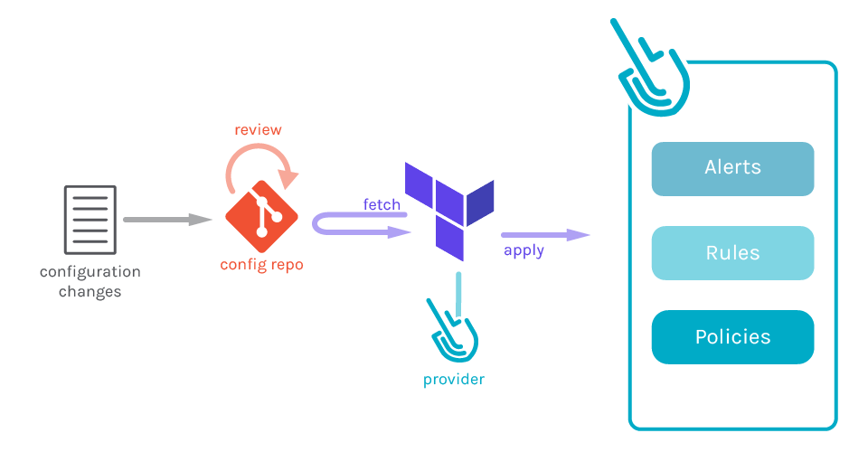

<!-- TODO: 인트로 — 왜 이 글을 쓰는지, 어떤 기간(4월~11월)에 무엇을 했는지 1~2문단 -->

팀스파르타에서 데브옵스 엔지니어로서 2026년을 회고해보면 꽤 다사다난했다. 정해져 있는 기준에 맞춰서 일을 진행한 것이 아니라, 정립되어 있는 인프라 표준이 없던 상황에서 일년 내내 인프라 표준을 맞추는 일을 꾸준히 진행했다. 흩어져 있던 인프라 서비스들을 Terraform으로 모으면서, 이번 해에는 항상 일관성, 그리고 기초(파운데이션)에 대해서 많이 고민했다.

포스팅은 내용이 길어 1편과 2편으로 분리하여 작성하였고, 다음과 같은 내용으로 구성되어 있다.

- **1편**(이 글): 기존 인프라의 상황, Terraform으로 ECS를 들여온 과정, 공용 GitHub Actions 파이프라인
- **2편**: Datadog IaC, nestjs-pino 기반 로깅 패키지와 Datadog/Grafana 이원화, 환경 변수 주입 방식 개선

<!-- TODO: 2편 공개 후 링크로 교체 — [2편]() -->

---

## 1. 처음 마주한 인프라

<!-- TODO: 합류 시점(또는 작업 시작 시점)의 인프라 상태를 담담하게 묘사. 숫자가 있으면 좋다 (서비스 수, 계정 수, 배포 방식 수 등) -->

팀스파르타에서는 4월경 인프라테크에 합류하여 데브옵스 엔지니어로 일을 하게 되었다. 당시에는 하나의 AWS 계정을 주축으로 사용하고 있었고, 모든 클라우드 인프라를 하나의 AWS 계정에서 관리하고 있었다. ECS는 service 기준으로 약 40개 정도이며, 글을 쓰는 지금은 여러 환경이 증설되었기 때문에 약 100개 정도의 서비스를 운영하고 있는 상황이다.

이때는 서비스를 새롭게 만듦에 있어서 어떤 기준도 제시되지 않았기 때문에 개발자가 스스로 원하는 구성을 갖춰 쓰는 구조였다. 예를 들어서 보안 그룹은 적당히 만들고 싶다면 만들고, 아니라면 기존의 것을 가져다 쓰기도 했고, 데이터베이스 설정이나 배포 파이프라인마저도 GitHub Actions와 AWS CodePipeline 계열로 양분되어 있었다.

합류하고 나서 가장 먼저 처리한 작업은 보안 그룹 정리였다. 당시 최우선 과제는 ISMS 인증을 위해 보안 관련 과업을 정리하는 것이었다. 나는 그 중에서 클라우드쪽 ISMS 과제를 쳐내고 있었고, 우리 서비스 대부분의 보안 그룹 인바운드 규칙을 정리하는 일부터 시작했다. 기본으로 AWS에서 만들어주는 default-sg를 사용하고 있던 것은 물론 컨벤션 없이 사용을 하고 있었기 때문에 문제가 많았고 다른 작업을 진행할 수가 없는 상황이었다.

보안 그룹은 꼬일 대로 꼬여있어서 최악의 경우 보안 그룹의 인바운드 룰이 20개가 넘어가는 경우도 있었다. 이게 어디서 오는 것이며 누가 설정했는지 추적하기도 어려운 상황이기 때문에 작업 속도가 매우 더뎠고, 보안 그룹을 잘못 제거하는 경우에 서비스에 큰 문제가 발생하게 된다. 작업을 진행할 때, AWS CLI를 통해서 작업을 진행했는데 당시에 꽤 많은 문제가 발생했었고 롤백이나 작업 파악도 꽤 어려운 문제가 있었다. 이때 인프라테크에서 가장 먼저 도입한 것이 바로 Terraform이었다.

### 1.1 콘솔에서 만들어진 리소스들

작업을 진행하며 살펴보니 대부분의 리소스는 AWS 콘솔에서 직접 만들어진 리소스였다. AWS 콘솔 내에서 클릭하여 리소스를 만들게 되면 언제 만들었는지 추적하기도 어렵고, 어떤 영향을 미치는지 파악하기가 어렵다. 이러한 방식을 ClickOps라고 부르며, 이는 데브옵스 관점에서 안티 패턴에 해당한다.



*출처: [devopsschool.com](https://www.devopsschool.com/blog/how-to-implement-gitops-using-terraform/)*

반대로 그렇다면 가장 모범적인 패턴은 GitOps 패턴이다. Terraform을 통해 소스 코드로 관리하게 되면 누가 언제 무엇을 변경했는지 git으로 이력이 남아서 손쉽게 인프라의 변화를 파악할 수 있고 롤백도 git revert를 통해서 수행할 수 있을 정도로 매우 간단하다. Git의 상태가 곧 인프라의 상태를 나타내는 GitOps를 통한 AWS 인프라 관리의 필요성을 느꼈다.

### 1.2 서비스마다 다른 배포 방식

또한, 서비스별로 다른 배포 방식을 사용했는데 크게 2가지 방식이었다. 첫 번째는 CodeDeploy를 사용하는 방식 그리고 GitHub Actions를 사용하는 방식이었다.

팀스파르타의 서비스 중에서 꽤 예전에 쓰인 서비스들은 주로 CodeDeploy로 동작했고, 최근에 만들어진 서비스들은 GitHub Actions를 사용하고 있었다. 이런 방식 또한 문제가 있었는데, Terraform으로 서비스를 옮겨올 때 기존에 있던 리소스를 가져오려면 import를 사용해서 옮길 수 있다. 다만, 어떤 서비스는 Terraform을 통해서 CodeDeploy를 관리하고 어떤 서비스들은 그대로 GitHub Actions를 쓰게 한다면 일관성이 맞지 않아서 배포 관련된 작업을 할 때 양이 두배로 늘어난다. 이러한 관리 포인트를 줄이기 위해서 Terraform 이관 전에 미리 어떤 인프라의 표준을 세울지 고민하게 되었다. 결국은 GitHub Actions를 사용하게 되었다.

### 1.3 Terraform이 없을 때 느낀 문제들

인프라테크에 합류해서, 서비스를 프로비저닝해야 하는 상황이 있었다. ECS 기반의 웹 - 백엔드 - 데이터베이스로 이루어지는 3-tier 애플리케이션의 배포였고, 하나의 서비스를 배포해야 하는 상황에서는 개인적으로 자주 해 봤던 대로 AWS 콘솔을 통해서 작업하는 것이 훨씬 빠르겠지만, 앞으로 수많은 서비스들을 프로비저닝할 것이 뻔했기 때문에 Terraform 스크립트를 작성하기 시작했으며, 좀 더 시간적 공수를 들여서 어떻게 ECS의 설정들을 사용할 것인지 논의 후에 기본 스펙을 하나 정하게 되었다.

또한, 내가 특정 툴을 도입할 때 가장 중요하게 생각했었던 것은 AI를 쓰는 환경에서의 앞으로의 전망이다. 앞으로 AI 기술은 더욱 발전할 것이라 생각하고 대부분을 AI가 읽고 작업하기 편한 구조로 남기는 것이 매우 유리하다고 생각했다. (지금도 이 생각은 매우 중요하다고 생각한다)

따라서, Terraform을 사용하자는 것으로 의견을 냈고 큰 부담 없이 받아들여져서 작업을 바로 시작하게 되었다. 예상했던 대로 서비스 프로비저닝 요청이 연달아 들어오게 되면서 2개~3개의 서비스를 동시에 프로비저닝해야 하는 상황이었는데, Terraform + AI coding agent 조합이 빛을 발했다. 이렇게 테라폼으로 우선 ECS를 프로비저닝하게 되면서 효용성을 느끼고, 다른 ECS 서비스들과 많은 환경들을 import 해오기 시작했다.

개인적으로 Terraform을 사용하면서 느낀 장점은 다음과 같다.

1. AI Agent와 함께 빠르고 안전하게 작업할 수 있다
2. 인프라 변동사항이 있을 때, 전파하기 매우 쉽다
3. 협업이 용이하다

우선 AI Agent와 함께 plan을 검토하면서 안전하게 작업할 수 있으며 기존에 있던 스캐폴드를 바탕으로 새로운 서비스를 템플릿에 맞춰서 생성하는 속도 또한 매우 빠르다. 또한 인프라 변동사항이 있을 때, 예를 들어서 AWS의 많은 서비스에 태그를 붙여야 하는 상황이라면 Terraform + AI agent 조합으로 빠르게 작업할 수 있다. 마지막으로 우리 팀스파르타에서는 Atlantis를 사용하여 개발자도 직접 Terraform 레포에 PR을 올리고 바로 인프라에 변동사항을 적용할 수 있게 되었다.

반대로 인프라 관리의 표준이 되어있는 Terraform을 쓰지 않는다면 이러한 점을 겪을 수도 있다.

1. **변경 이력이 남지 않는다** — 보안 그룹 규칙이 언제 왜 무슨 이유로 열렸는지 알 수 없음
2. **환경 간 차이를 알 수 없다** — dev와 prod 설정이 미묘하게 달라서 prod에서만 재현되는 문제
3. **재현이 불가능하다** — 같은 구성으로 하나 더 만들려면 콘솔을 일일이 살펴봐야 하는 문제

---

## 2. Terraform으로 ECS 들여오기

<!-- 전환 문장 -->

(예시) 문제를 정리하고 나니 방향은 분명했다. 새로 만드는 것부터 코드로 만들고, 기존 것은 하나씩 코드 안으로 들여오는 것이다.

### 2.1 레포지토리와 상태 관리 구조

<!-- TODO: terraform 레포 구조, state backend(S3 + DynamoDB lock 등), 환경/서비스 단위 분리 기준 -->

```text
# (예시) 디렉터리 구조
terraform/
├── modules/
│   ├── ecs-service/
│   └── alb/
└── envs/
    ├── dev/
    └── prod/
```

<!-- TODO: 왜 이렇게 나눴는지 — state blast radius, 권한 분리 등 -->

### 2.2 ECS 서비스 모듈 설계

<!-- TODO: 공용 모듈이 무엇을 추상화했는지 (task definition, service, target group, autoscaling, log 설정...). 모듈 입력 변수 예시 -->

```hcl
# (예시) 모듈 사용부
module "service_a" {
  source = "../../modules/ecs-service"

  name          = "service-a"
  cpu           = 512
  memory        = 1024
  desired_count = 2
}
```

### 2.3 기존 리소스를 점진적으로 넘기기

<!-- TODO: import 전략 (terraform import / import 블록), 신규 서비스부터 vs 기존 서비스부터, 무중단 전환 방법 -->

(예시) 한 번에 모든 것을 옮기지 않았다. 먼저 신규 서비스를 Terraform으로 만들고, 그다음 트래픽이 적은 서비스부터 순서대로 옮겼다.

<!-- TODO: 이관 순서/타임라인 다이어그램 (images/migration-timeline.svg) -->

### 2.4 이관하면서 겪은 문제들

<!-- TODO: 실제로 부딪힌 문제. 예: import 후 plan diff가 계속 뜨는 문제, 콘솔 수정과의 drift, 리소스 이름 규칙 충돌 등 -->

- (예: import 직후 `plan`에서 의도치 않은 diff가 발생)
- (예: 누군가 콘솔에서 수정해서 drift 발생)

---

## 3. 공용 GitHub Actions 파이프라인

<!-- 전환 문장 -->

(예시) 인프라를 코드로 정리하고 나니, 이번에는 그 위에 애플리케이션을 올리는 과정 — 배포 — 이 서비스마다 다르다는 점이 눈에 띄었다.

### 3.1 레포마다 복사된 workflow의 문제

<!-- TODO: 각 레포에 비슷하지만 조금씩 다른 workflow 파일이 있던 상황. 하나를 고치면 N개를 고쳐야 했던 경험 -->

### 3.2 Reusable workflow로 파이프라인 모으기

<!-- TODO: 공용 파이프라인 레포 구조, reusable workflow(workflow_call) 또는 composite action 선택 이유, 버전 관리(tag) 전략 -->

```yaml
# (예시) 서비스 레포 쪽 호출부
jobs:
  deploy:
    uses: <org>/<shared-pipeline-repo>/.github/workflows/ecs-deploy.yml@v1
    with:
      service-name: service-a
      environment: prod
    secrets: inherit
```

<!-- TODO: 파이프라인 흐름 다이어그램 — build → push(ECR) → task def render → deploy (images/shared-pipeline-flow.svg) -->

### 3.3 인증과 권한

<!-- TODO: OIDC로 AWS role assume, 환경별 role 분리 등 -->

### 3.4 바뀐 것

<!-- TODO: before/after 비교. 숫자가 있으면 좋다 (배포 시간, 신규 서비스 온보딩 시간, workflow 파일 줄 수 등) -->

| 항목                  | Before                           | After                  |
| --------------------- | -------------------------------- | ---------------------- |
| 신규 서비스 배포 설정 | (예: workflow 파일 복붙 후 수정) | (예: 10줄 호출부 작성) |
| 파이프라인 수정       | (예: N개 레포 PR)                | (예: 공용 레포 1개 PR) |

---

## 마치며

<!-- 요약 → 개인적 인사이트 → 다음 방향(2편 예고) -->

(예시) 1편에서는 콘솔 중심이던 인프라를 Terraform으로 옮기고, 배포 파이프라인을 하나로 모은 과정을 정리했다.

<!-- TODO: 개인적 인사이트 — 예: "IaC의 진짜 가치는 자동화보다 '합의된 기록'에 있다고 느꼈다" -->

(예시) 다음 글에서는 이렇게 정리된 기반 위에서 Datadog과 로깅, 환경 변수 주입 방식을 어떻게 정비했는지 이어서 다룬다.

### References

<!-- TODO: 참고한 문서 링크 -->

- [Terraform — Import](https://developer.hashicorp.com/terraform/language/import)
- [GitHub Actions — Reusing workflows](https://docs.github.com/en/actions/using-workflows/reusing-workflows)
