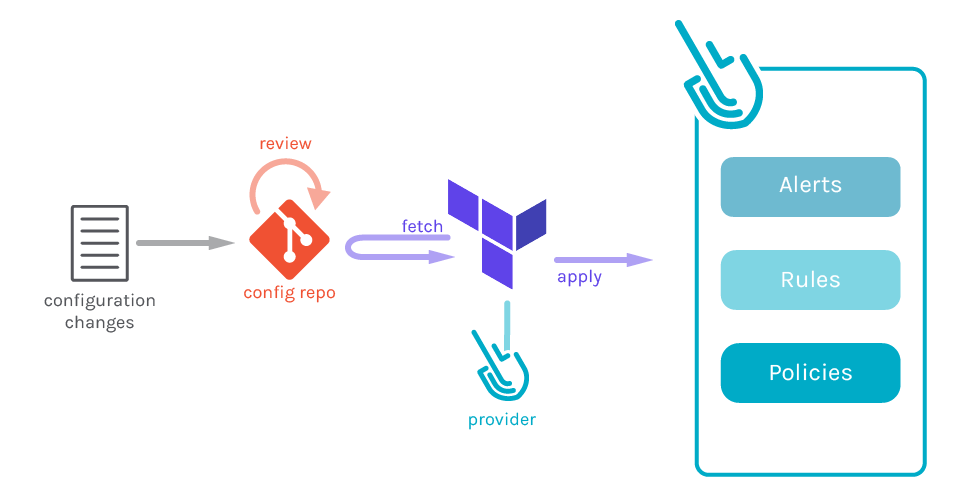
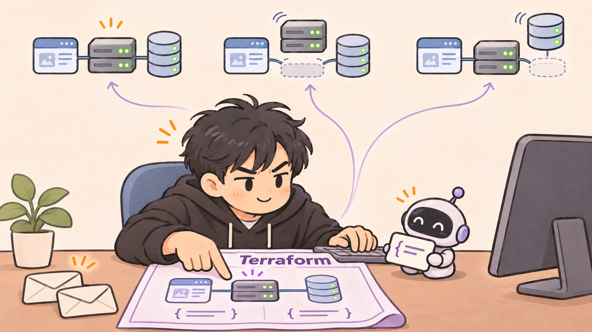
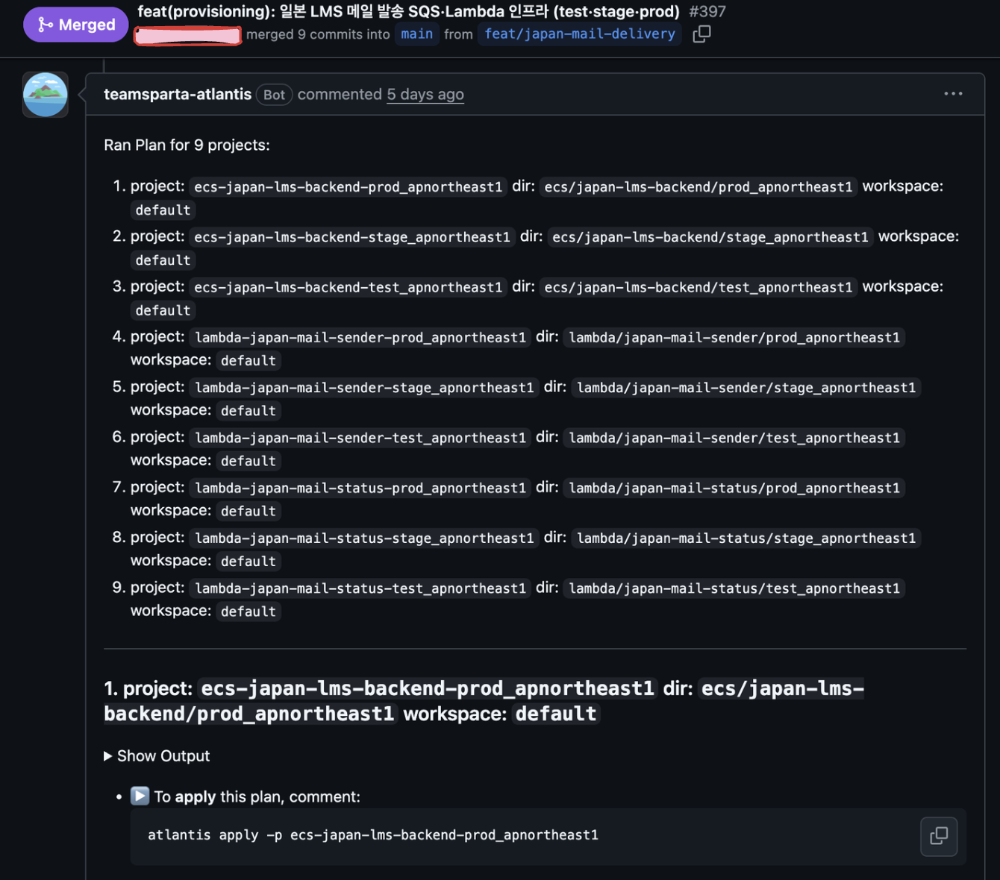
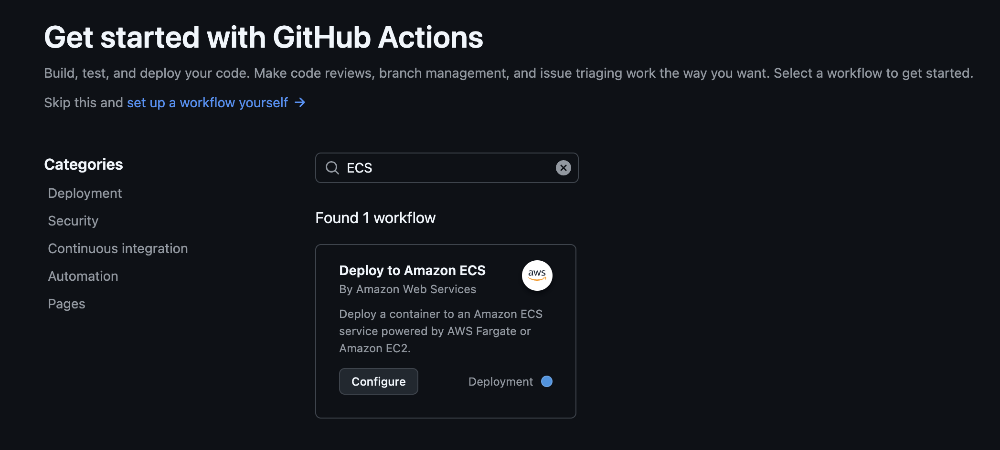

<!-- TODO: 인트로 — 왜 이 글을 쓰는지, 어떤 기간(4월~11월)에 무엇을 했는지 1~2문단 -->

팀스파르타에서 데브옵스 엔지니어로서 2026년을 회고해보면 꽤 다사다난했다. 정해져 있는 기준에 맞춰서 일을 진행한 것이 아니라, 정립되어 있는 인프라 표준이 없던 상황에서 일년 내내 인프라 표준을 맞추는 일을 꾸준히 진행했다. 흩어져 있던 인프라 서비스들을 Terraform으로 모으면서, 이번 해에는 항상 일관성, 그리고 기초(파운데이션)에 대해서 많이 고민했다.

포스팅은 내용이 길어 1편과 2편으로 분리하여 작성하였고, 다음과 같은 내용으로 구성되어 있다.

- **1편**(이 글): 기존 인프라의 상황, Terraform으로 ECS를 들여온 과정, 공용 GitHub Actions 파이프라인
- **2편**: Datadog IaC, nestjs-pino 기반 로깅 패키지와 Datadog/Grafana 이원화, 환경 변수 주입 방식 개선

<!-- TODO: 2편 공개 후 링크로 교체 — [2편]() -->

---

## 1. 처음 마주한 인프라


팀스파르타에서는 4월경 인프라테크에 합류하여 데브옵스 엔지니어로 일을 하게 되었다. 당시에는 하나의 AWS 계정을 주축으로 사용하고 있었고, 모든 클라우드 인프라를 하나의 AWS 계정에서 관리하고 있었다. ECS는 service 기준으로 약 40개 정도이며, 글을 쓰는 지금은 여러 환경이 증설되었기 때문에 약 100개 정도의 서비스를 운영하고 있는 상황이다.

이때는 서비스를 새롭게 만듦에 있어서 어떤 기준도 제시되지 않았기 때문에 개발자가 스스로 원하는 구성을 갖춰 쓰는 구조였다. 예를 들어서 보안 그룹은 적당히 만들고 싶다면 만들고, 아니라면 기존의 것을 가져다 쓰기도 했고, 데이터베이스 설정이나 배포 파이프라인마저도 GitHub Actions와 AWS CodePipeline 계열로 양분되어 있었다.

합류하고 나서 가장 먼저 처리한 작업은 보안 그룹 정리였다. 당시 최우선 과제는 ISMS 인증을 위해 보안 관련 과업을 정리하는 것이었다. 나는 그 중에서 클라우드쪽 ISMS 과제를 쳐내고 있었고, 우리 서비스 대부분의 보안 그룹 인바운드 규칙을 정리하는 일부터 시작했다. 기본으로 AWS에서 만들어주는 default-sg를 사용하고 있던 것은 물론 컨벤션 없이 사용을 하고 있었기 때문에 문제가 많았고 다른 작업을 진행할 수가 없는 상황이었다.

보안 그룹은 꼬일 대로 꼬여있어서 최악의 경우 보안 그룹의 인바운드 룰이 20개가 넘어가는 경우도 있었다. 이게 어디서 오는 것이며 누가 설정했는지 추적하기도 어려운 상황이기 때문에 작업 속도가 매우 더뎠고, 보안 그룹을 잘못 제거하는 경우에 서비스에 큰 문제가 발생하게 된다. 작업을 진행할 때, AWS CLI를 통해서 작업을 진행했는데 당시에 꽤 많은 문제가 발생했었고 롤백이나 작업 파악도 꽤 어려운 문제가 있었다. 이때 인프라테크에서 가장 먼저 도입한 것이 바로 Terraform이었다.

### 1.1 콘솔에서 만들어진 리소스들

작업을 진행하며 살펴보니 대부분의 리소스는 AWS 콘솔에서 직접 만들어진 리소스였다. AWS 콘솔 내에서 클릭하여 리소스를 만들게 되면 언제 만들었는지 추적하기도 어렵고, 어떤 영향을 미치는지 파악하기가 어렵다. 이러한 방식을 ClickOps라고 부르며, 이는 데브옵스 관점에서 안티 패턴에 해당한다.



_출처: [devopsschool.com](https://www.devopsschool.com/blog/how-to-implement-gitops-using-terraform/)_

반대로 그렇다면 가장 모범적인 패턴은 GitOps 패턴이다. Terraform을 통해 소스 코드로 관리하게 되면 누가 언제 무엇을 변경했는지 git으로 이력이 남아서 손쉽게 인프라의 변화를 파악할 수 있고 롤백도 git revert를 통해서 수행할 수 있을 정도로 매우 간단하다. Git의 상태가 곧 인프라의 상태를 나타내는 GitOps를 통한 AWS 인프라 관리의 필요성을 느꼈다.

### 1.2 서비스마다 다른 배포 방식

또한, 서비스별로 다른 배포 방식을 사용했는데 크게 2가지 방식이었다. 첫 번째는 CodeDeploy를 사용하는 방식 그리고 GitHub Actions를 사용하는 방식이었다.

팀스파르타의 서비스 중에서 꽤 예전에 쓰인 서비스들은 주로 CodeDeploy로 동작했고, 최근에 만들어진 서비스들은 GitHub Actions를 사용하고 있었다. 이런 방식 또한 문제가 있었는데, Terraform으로 서비스를 옮겨올 때 기존에 있던 리소스를 가져오려면 import를 사용해서 옮길 수 있다. 다만, 어떤 서비스는 Terraform을 통해서 CodeDeploy를 관리하고 어떤 서비스들은 그대로 GitHub Actions를 쓰게 한다면 일관성이 맞지 않아서 배포 관련된 작업을 할 때 양이 두배로 늘어난다. 이러한 관리 포인트를 줄이기 위해서 Terraform 이관 전에 미리 어떤 인프라의 표준을 세울지 고민하게 되었다. 결국은 GitHub Actions를 사용하게 되었다.

### 1.3 Terraform이 없을 때 느낀 문제들



인프라테크에 합류해서, 서비스를 프로비저닝해야 하는 상황이 있었다. ECS 기반의 웹 - 백엔드 - 데이터베이스로 이루어지는 3-tier 애플리케이션의 배포였고, 하나의 서비스를 배포해야 하는 상황에서는 개인적으로 자주 해 봤던 대로 AWS 콘솔을 통해서 작업하는 것이 훨씬 빠르겠지만, 앞으로 수많은 서비스들을 프로비저닝할 것이 뻔했기 때문에 Terraform 스크립트를 작성하기 시작했으며, 좀 더 시간적 공수를 들여서 어떻게 ECS의 설정들을 사용할 것인지 논의 후에 기본 스펙을 하나 정하게 되었다.

또한, 내가 특정 툴을 도입할 때 가장 중요하게 생각했었던 것은 AI를 쓰는 환경에서의 앞으로의 전망이다. 앞으로 AI 기술은 더욱 발전할 것이라 생각하고 대부분을 AI가 읽고 작업하기 편한 구조로 남기는 것이 매우 유리하다고 생각했다. (지금도 이 생각은 매우 중요하다고 생각한다)

따라서, Terraform을 사용하자는 것으로 의견을 냈고 큰 부담 없이 받아들여져서 작업을 바로 시작하게 되었다. 예상했던 대로 서비스 프로비저닝 요청이 연달아 들어오게 되면서 2개~3개의 서비스를 동시에 프로비저닝해야 하는 상황이었는데, Terraform + AI coding agent 조합이 빛을 발했다. 이렇게 테라폼으로 우선 ECS를 프로비저닝하게 되면서 효용성을 느끼고, 다른 ECS 서비스들과 많은 환경들을 import 해오기 시작했다.

개인적으로 Terraform을 사용하면서 느낀 장점은 다음과 같다.

1. AI Agent와 함께 빠르고 안전하게 작업할 수 있다
2. 인프라 변동사항이 있을 때, 전파하기 매우 쉽다
3. 협업이 용이하다

우선 AI Agent와 함께 plan을 검토하면서 안전하게 작업할 수 있으며 기존에 있던 스캐폴드를 바탕으로 새로운 서비스를 템플릿에 맞춰서 생성하는 속도 또한 매우 빠르다. 또한 인프라 변동사항이 있을 때, 예를 들어서 AWS의 많은 서비스에 태그를 붙여야 하는 상황이라면 Terraform + AI agent 조합으로 빠르게 작업할 수 있다. 마지막으로 우리 팀스파르타에서는 Atlantis를 사용하여 개발자도 직접 Terraform 레포에 PR을 올리고 바로 인프라에 변동사항을 적용할 수 있게 되었다.

반대로 인프라 관리의 표준이 되어있는 Terraform을 쓰지 않는다면 이러한 점을 겪을 수도 있다.

1. **변경 이력이 남지 않는다** — 보안 그룹 규칙이 언제 왜 무슨 이유로 열렸는지 알 수 없음
2. **환경 간 차이를 알 수 없다** — dev와 prod 설정이 미묘하게 달라서 prod에서만 재현되는 문제
3. **재현이 불가능하다** — 같은 구성으로 하나 더 만들려면 콘솔을 일일이 살펴봐야 하는 문제

---

## 2. Terraform으로 ECS 들여오기


Terraform을 쓰기로 결정한 뒤, 본격적으로 작업하기 전에 꼭 정해야 할 것들을 먼저 정리했다. 수십 개의 서비스와 여러 환경을 하나의 레포에 담으려면, 먼저 "무엇을 어디에 둘 것인가"라는 규칙부터 정해야 했다. 이 장에서는 그 규칙인 leaf 구조와, ECS를 옮기면서 가장 신경 썼던 task definition 관리 방식을 다룬다.

### 2.1 계정과 환경으로 나눈 leaf 구조

레포의 디렉터리는 `<리소스>/<서비스명>/<환경>_<리전>/` 세 단계로 나뉜다. 가장 안쪽 디렉터리를 **leaf**라고 부르며, leaf 하나가 곧 하나의 Terraform 루트 모듈이자 하나의 state 파일이다.

```text
terraform/
├── modules/
│   └── ecs_app_service/            # ECS 서비스 공용 모듈
├── variables/
│   └── var_global.tf               # 모든 leaf가 심볼릭 링크로 공유
├── ecs/
│   ├── example-backend/
│   │   ├── dev_apnortheast2/       # leaf (non-prod 계정)
│   │   ├── stage_apnortheast2/     # leaf (non-prod 계정)
│   │   └── prod_apnortheast2/      # leaf (prod 계정)
│   └── test-shared/                # 환경 공용 리소스(클러스터, ALB 리스너, IAM role)
├── rds/
├── elasticache/
├── s3/
│   └── ecs-taskdefs/               # task definition 정본 저장소 (2.4)
└── ...
```

환경은 계정을 결정한다. 팀스파르타에서는 prod/non-prod/sandbox라는 세 개의 계정을 사용한다. 처음에는 하나의 AWS 계정에 모든 환경이 섞여 있었지만, 지금은 prod만 prod 계정에 두고 dev·test·stage는 모두 non-prod 계정으로 옮겼다. 계정이 다르면 state 버킷도 다르기 때문에, **계정 경계가 곧 state 경계**가 된다. leaf의 `backend.tf`만 보면 이 leaf가 어느 계정에 속하는지 알 수 있다.

```hcl
# ecs/example-backend/prod_apnortheast2/backend.tf
terraform {
  backend "s3" {
    bucket         = "<prod-account>-apnortheast2-tfstate"
    key            = "provisioning/terraform/ecs/example-backend/prod_apnortheast2/terraform.tfstate"
    region         = "ap-northeast-2"
    encrypt        = true
    dynamodb_table = "terraform-lock"
  }
}
```

서비스끼리 공유하는 리소스(클러스터, 공용 ALB 리스너, IAM role, DB 보안 그룹)는 `test-shared`, `stage-shared` 같은 별도 leaf가 소유하고, 각 서비스 leaf는 `terraform_remote_state`로 그 출력값을 읽기만 한다. 공용 리소스를 서비스 leaf에서 다시 선언하는 일이 없도록 소유자를 한 곳으로 정해 둔 것이다.

<!-- TODO: 다이어그램 — 계정 2개(prod / non-prod) 안에 shared leaf와 service leaf가 remote_state로 연결되는 그림 (images/leaf-structure.svg) -->

### 2.2 왜 leaf 단위로 쪼갰나

처음부터 leaf 단위로 정한 것은 아니다. 원래는 더 큰 모듈 단위로 관리하려고 했다. 하지만 앞으로는 많은 개발자가 AI 에이전트와 함께 직접 Terraform을 다루게 될 것이고, 자잘한 설정 작업은 에이전트가 맡게 되니 잘게 나눠 관리하는 오버헤드도 크지 않을 것이라고 판단했다. 그래서 leaf를 작게 가져가기로 했고, 지금까지 다음과 같은 이점을 누리고 있다.

1. **폭발 반경이 작다** — 한 서비스의 `plan`/`apply`가 다른 서비스의 리소스를 건드릴 수 없다. state가 작으니 `plan`도 빠르고, 실수가 나도 그 leaf 안에서 끝난다.
2. **리뷰 단위와 배포 단위가 같다** — PR에서 건드린 leaf가 곧 Atlantis가 `plan`하는 프로젝트다. 리뷰어는 코드가 아니라 그 leaf의 plan 결과를 보고 승인한다.
3. **경로로 권한을 나눌 수 있다** — `dev*`·`test*`·`stage*` leaf는 승인 없이 apply할 수 있고, `prod_*` leaf나 DB·네트워크처럼 되돌리기 어려운 경로만 CODEOWNERS로 인프라 담당자의 승인을 받는다. 디렉터리 이름 자체가 권한 정책이 되는 셈이다.

대신 leaf가 많아진다는 비용이 있다. 글을 쓰는 시점에 레포의 leaf는 680개를 넘었고, ECS만 90개가 넘는다. leaf가 늘수록 Atlantis 설정(`atlantis.yaml`)에 새 leaf를 등록하는 것을 잊기 쉬운데, 등록되지 않은 leaf는 PR에서 아무것도 `plan`되지 않았는데도 체크가 초록불로 뜬다. 그래서 `atlantis.yaml`은 손으로 고치지 않고 디렉터리를 스캔해 만드는 생성 스크립트로 관리하고, CI에서 누락 여부를 검사한다.



위 사진은 PR에 `atlantis apply` 코멘트를 남기면 변경 사항을 적용해 주는 Atlantis를 사용하는 모습이다. 일본팀 프로덕트 엔지니어가 올린 PR에 적용 방법을 코멘트로 안내했는데, leaf가 여러 개에 걸쳐 있다 보니 apply 명령어를 무려 9번 입력해야 했다. 번거로운 것은 사실이지만, 이 작업 또한 AI 에이전트에게 맡길 수 있다. 실제로 적용할 때는 에이전트가 test → stage → prod 순서로 하나씩 apply하면서 검증한다.

### 2.3 ECS 서비스 모듈

leaf가 많아도 내용이 제각각이면 의미가 없다. 그래서 ECS 서비스를 구성하는 리소스를 `ecs_app_service` 모듈 하나로 묶었다. 모듈 하나가 다음을 모두 만든다.

- ECR 레포지토리(server, proxy)와 라이프사이클 정책
- task definition과 ECS 서비스
- ALB 타깃 그룹과 리스너 룰(공용 ALB 모드 / 전용 ALB 모드)
- CloudWatch 로그 그룹, 서비스 보안 그룹, Route 53 레코드

leaf는 이 모듈을 호출하고 `terraform.tfvars`에 서비스별 값만 채운다. 새 서비스를 만들 때는 같은 환경의 형제 leaf를 참고해 값만 바꾸면 되고, 이 과정은 `/provisioning`이라는 Claude Code 스킬로 만들어 두어 개발자가 직접 PR을 올릴 수 있게 했다.

<!-- TODO: 모듈 호출부 예시를 실제 leaf에서 민감 정보를 지우고 붙이기 -->

```hcl
# (예시) 서비스 leaf의 main.tf
module "service" {
  source = "../../../modules/ecs_app_service"

  service_name = "example-backend-prod"
  task_config = {
    cpu    = 1024
    memory = 2048
  }
  shared_alb_config = { ... }
}
```

모듈에서 가장 중요한 부분은 오히려 **Terraform이 관리하지 않기로 한 것**이다.

```hcl
# modules/ecs_app_service/service.tf
resource "aws_ecs_service" "this" {
  # ...
  lifecycle {
    ignore_changes = [desired_count, task_definition]
  }
}

# modules/ecs_app_service/task_definition.tf
resource "aws_ecs_task_definition" "this" {
  # ...
  lifecycle {
    ignore_changes = [container_definitions]
  }
}
```

`desired_count`는 오토스케일링이, 실행 중인 task definition과 이미지는 배포 파이프라인이 바꾼다. 이 값들까지 Terraform이 들고 있으면 `apply`할 때마다 런타임이 바꿔 둔 값을 코드 값으로 되돌리려 한다. 그래서 Terraform은 서비스의 **뼈대**를 처음 한 번 만들고, 이후의 런타임 상태는 각자의 소유자에게 넘긴다. 그렇다면 CPU, 메모리, 환경 변수, 사이드카처럼 task definition의 내용은 누가 관리해야 할까? 이 질문의 답이 다음 절이다.

### 2.4 task definition을 S3에서 관리하기


ECS를 Terraform으로 옮기면서 가장 공을 들인 부분이다. 원래는 각 애플리케이션 레포가 자기 task definition을 직접 들고 있었기 때문에, 같은 설정을 서비스 10개에 적용하려면 레포 10개에서 따로 작업해야 했다. 그래서 모든 서비스의 task definition을 Terraform에서 한 번에 관리하는 것을 목표로 잡았다. 결론부터 말하면 최종 구조는 task definition을 S3에 모아 두는 방식이며, 거기까지 세 단계의 고민을 거쳤다.

#### 1단계 — 레포마다 있는 task-definition.json



GitHub Actions로 ECS에 배포할 때 가장 흔한 방법은 GitHub이 제공하는 Deploy to Amazon ECS 템플릿이다. `amazon-ecs-render-task-definition` 액션이 **애플리케이션 레포에 들어 있는** `task-definition.json`의 이미지만 새 태그로 바꾸고, `amazon-ecs-deploy-task-definition` 액션이 그 파일을 새 revision으로 등록해 배포한다.

```yaml
# 기존: 앱 레포의 workflow
- uses: aws-actions/amazon-ecs-render-task-definition@v1
  with:
    task-definition: task-definition.json # 앱 레포 안의 파일
    container-name: server
    image: ${{ steps.build.outputs.image }}
- uses: aws-actions/amazon-ecs-deploy-task-definition@v2
  with:
    task-definition: ${{ steps.render.outputs.task-definition }}
    service: example-backend-prod
    cluster: prod-cluster
```

서비스가 몇 개뿐이라면 문제없는 방식이다. 하지만 서비스가 수십 개가 되면 task definition도 수십 개의 레포에 흩어진다. 모든 서비스의 Datadog 사이드카 설정을 바꾸거나 로그 설정을 통일하려면, 수십 개의 레포를 열어 각자의 `task-definition.json`을 확인하고 PR을 따로 올려야 한다. 게다가 이 파일은 인프라 설정인데도 앱 레포에 있어서, 실제로 어떤 값으로 돌고 있는지 인프라 쪽에서는 알 수 없었다.

실제로 Node.js 서비스에서 이벤트 루프나 가비지 컬렉터 같은 런타임 메트릭을 수집하려고 `DD_RUNTIME_METRICS_ENABLED`를 켜야 했을 때, 레포마다 들어가서 직접 작업해야 했다. 작업은 오래 걸리고, 나중에 어느 서비스에 적용되었는지 확인하기도 어렵다. 애플리케이션 개발자 입장에서도 자기 레포에 인프라 설정 커밋이 계속 쌓이면서 불필요한 컨텍스트가 늘어난다.

#### 2단계 — Terraform이 등록한 최신 revision을 CI가 가져오기

처음 떠올린 방법은 task definition을 Terraform의 `aws_ecs_task_definition` 리소스로 관리하고, CI는 레포의 파일 대신 AWS CLI로 ECS에 등록된 최신 revision을 가져와 이미지만 바꿔 배포하는 것이었다.

```bash
# CI에서 최신 revision을 가져와 이미지만 바꾸는 방식
aws ecs describe-task-definition \
  --task-definition example-backend-prod \
  --query taskDefinition > task-definition.json
```

앱 레포에서 task definition 파일이 사라진다는 점에서는 한 걸음 나아간 방식이다. 하지만 이 구조에서는 task definition이 ECS 서비스와 같은 leaf 안에 묶이게 된다. task definition이 서비스 모듈의 일부라서, 설정 하나를 모든 서비스에 반영하려면 결국 서비스 leaf 수십 개를 하나씩 plan하고 apply해야 한다. 레포를 돌아다니던 일이 leaf를 돌아다니는 일로 바뀌었을 뿐이다.

소유권도 꼬인다. Terraform이 만든 revision 위에 CI가 배포할 때마다 새 revision을 등록하기 때문에, "가장 최신 revision"이 Terraform이 만든 것인지 CI가 만든 것인지 매번 달라진다. 2.3에서 `container_definitions`를 `ignore_changes`로 막아 둔 이유도 여기에 있다. Terraform이 task definition을 직접 들고 있으면, 오래된 이미지 태그를 가진 revision이 배포를 덮어쓸 위험이 생긴다.

<!-- TODO: 2단계에서 실제로 막혔던 기억이 더 있다면 보충 -->

#### 3단계 — task definition만 모아서 S3에 올리기

결국 task definition만 따로 떼어서 한곳에 모아야 한다는 결론에 이르렀다. 그 한곳으로 고른 것이 S3다. 환경마다 `s3/ecs-taskdefs/<환경>_<리전>/` leaf 하나를 두고, 그 아래 `taskdefs/`에 서비스별 JSON 파일을 둔다. Terraform은 이 파일들을 S3 버킷에 그대로 업로드할 뿐, 렌더링도 가공도 하지 않는다.

```hcl
# s3/ecs-taskdefs/prod_apnortheast2/main.tf
resource "aws_s3_object" "taskdef" {
  for_each = fileset("${path.module}/taskdefs", "*.json")

  bucket = aws_s3_bucket.taskdefs.id
  key    = "taskdefs/${each.value}"
  source = "${path.module}/taskdefs/${each.value}"
  etag   = filemd5("${path.module}/taskdefs/${each.value}") # 내용이 바뀐 파일만 다시 올린다
}
```

애플리케이션 레포의 CI는 이제 자기 레포의 파일도, ECS의 최신 revision도 아닌 S3의 JSON을 가져와서 이미지 태그만 커밋 SHA로 바꾼 뒤 새 revision을 등록하고 배포한다.

```text
Developer edits taskdefs/<svc>-<env>.json   (cpu, memory, env, ports, sidecars)
        │  PR → Atlantis plan → apply
        ▼
Terraform uploads JSON to S3               (nothing changes in production yet)
        │
        ▼
App repo push → CI (AWS OIDC)
   ├─ fetch task definition from S3
   ├─ replace only the image → :<commit SHA>
   └─ register new revision → update-service
        ▲
        └─ the new shape and the new image go live together here
```

<!-- TODO: 위 흐름을 SVG 다이어그램으로 (images/taskdef-s3-flow.svg) -->

핵심은 소유권의 분리다. task definition의 **모양**(shape)은 Terraform이, 이미지는 CI가 소유한다. CPU나 환경 변수를 바꾸고 싶으면 Terraform 레포에 PR을 올리고, 코드를 배포하고 싶으면 앱 레포에 push하면 된다. 두 경로가 섞이지 않는다.

여기에 한 가지 결정을 더했다. task definition 변경 중 환경 변수를 추가하거나 새 시크릿을 연결하는 작업은 인프라 담당자보다 애플리케이션 개발자가 훨씬 자주 하게 될 작업이다. 이런 변경마다 인프라 담당자의 리뷰를 기다리게 하면 그 자체가 병목이 된다. 그래서 2.2에서 본 경로 기반 권한 규칙에 예외를 하나 두었다. `s3/ecs-taskdefs/*/taskdefs/*.json` 경로는 prod를 포함해도 별도 코드 리뷰 승인 없이 `atlantis apply`로 바로 적용할 수 있다. 어차피 apply만으로는 라이브 서비스가 바뀌지 않고, 실제 반영은 개발자 본인이 앱을 다시 배포하는 시점에 일어나기 때문에 가능한 판단이었다.

#### 이렇게 해서 얻은 것

- **설정 변경이 한 곳에서 끝난다** — 모든 서비스의 task definition이 환경별 leaf 하나에 모여 있으니, 공통 설정을 바꾸는 것도 PR 하나, apply 한 번이면 된다.
- **리뷰하기 쉽다** — task definition이 git에 JSON 파일로 있기 때문에, PR의 Files changed 탭에서 어떤 컨테이너의 어떤 환경 변수가 어떻게 바뀌었는지 줄 단위로 바로 보인다.
- **apply가 곧 배포는 아니다** — Terraform apply는 S3에 새 shape를 올릴 뿐 라이브 서비스를 건드리지 않는다. 실제 반영은 다음 배포 때 일어나므로, 인프라 변경이 예상치 못한 재시작을 일으키지 않는다.
- **이미지는 항상 불변 태그다** — CI가 `:latest` 대신 커밋 SHA 태그로 이미지를 바꾸기 때문에, 태스크가 재시작되어도 배포되지 않은 코드가 뜨는 일이 없다. 배포마다 새 revision이 생기므로 롤백도 이전 revision을 다시 가리키면 된다.
- **계정을 옮기기 쉽다** — S3의 객체는 git에 있는 JSON의 파생물일 뿐이다. 서비스를 다른 계정으로 옮길 때 데이터를 마이그레이션할 필요 없이, 버킷 이름만 바꿔 apply하면 된다.

#### 한계 — plan으로는 JSON의 무엇이 바뀌는지 보이지 않는다

아쉬운 점도 하나 있다. 처음에는 JSON을 고치고 `terraform plan`을 돌리면 task definition의 어느 부분이 어떻게 바뀌는지 plan에 나올 거라고 기대했다. 그런데 실제 plan은 이렇게 나온다.

```text
  # aws_s3_object.taskdef["example-backend-prod.json"] will be updated in-place
  ~ resource "aws_s3_object" "taskdef" {
      ~ etag   = "a2f9c8bea262e652e0f9f3654a59ca22" -> "afa00ffa93b4edd6f57fa9f1eab09695"
        id     = "taskdefs/example-backend-prod.json"
        # (12 unchanged attributes hidden)
    }
```

이유는 `aws_s3_object`에 파일을 넘기는 방식에 있다. `source` 인자에 넘기는 것은 파일의 **내용이 아니라 경로**다. Terraform state에는 `source = "./taskdefs/example-backend-prod.json"`이라는 문자열만 저장되고, 파일 내용은 apply할 때 읽어서 S3에 올릴 뿐 state에 남지 않는다. 경로 문자열은 바뀌지 않으니, Terraform이 "파일이 바뀌었다"는 사실을 알 수 있는 유일한 단서는 `etag`에 넣은 `filemd5()` 값이다. 결국 plan이 보여 줄 수 있는 것은 **MD5 해시가 바뀌었다**는 사실뿐이고, JSON의 어느 줄이 바뀌었는지는 알 수 없다.

반대로 파일 내용을 `content = file(...)`처럼 문자열로 넘기면, Terraform은 그 문자열이 JSON이라는 것을 알아보고 plan에서 구조적인 diff를 보여 준다.

```text
      ~ content = jsonencode(
          ~ {
              ~ containerDefinitions = [
                  ~ {
                      ~ environment = [
                            {
                                name  = "NODE_ENV"
                                value = "production"
                            },
                          + {
                              + name  = "DD_RUNTIME_METRICS_ENABLED"
                              + value = "true"
                            },
                        ]
```

다만 이 방식은 서비스 수십 개의 task definition 전문이 state 파일에 그대로 들어가고, plan 출력도 그만큼 길어진다는 비용이 있다. 지금은 `source` + `etag` 방식을 유지하면서, **변경 내용은 GitHub PR diff로 리뷰하고 plan은 "어떤 파일이 다시 올라가는지"만 확인하는 용도**로 역할을 나눠 쓰고 있다. 무엇이 바뀌는지는 PR에서, 실제로 무엇이 적용되는지는 plan에서 보는 셈이다.

<!-- TODO: content 방식으로 바꿀지에 대한 개인적인 생각이 있다면 한 줄 -->

<!-- TODO: 적용 순서 — stage에서 먼저 검증 → prod로 확장 → dev/test 이식 같은 실제 롤아웃 과정 -->

### 2.5 이관하면서 겪은 문제들

모든 것이 순조롭지는 않았다. 특히 "Terraform이 소유하는 것과 런타임이 소유하는 것"의 경계에서 문제가 많이 생겼다.

<!-- TODO: 아래는 레포 문서에 남아 있는 사례를 요약한 것. 공개해도 되는 범위인지 확인하고 다듬기 -->

- **오래된 이미지로 롤백되는 문제** — leaf의 `tfvars`에 남아 있던 `image_tag`는 처음 만들 때의 값이라 실제로 돌고 있는 이미지보다 한참 오래되어 있었다. Terraform이 만든 task definition revision으로 서비스를 다시 가리키자 몇 시간 동안 예전 코드가 서비스되었다. 이후 `ignore_changes = [container_definitions]`로 컨테이너 정의를 CI에 완전히 넘겼다.
- **apply가 서비스를 재시작시키는 문제** — 서비스 리소스에 `force_new_deployment = true`가 있어서, 보안 그룹만 바꾸는 apply에도 라이브 태스크가 롤링 재시작되었다. 인프라 변경과 재배포를 분리하는 것이 생각보다 중요했다.
- **컨테이너 이름 불일치** — CI의 render 단계는 지정한 컨테이너 이름과 JSON 안의 이름이 정확히 같을 때만 이미지를 교체하고, 다르면 에러 없이 넘어간다. 서비스마다 컨테이너 이름이 제각각이어서, 전부 `server`/`proxy`로 통일한 뒤에야 이 방식을 붙일 수 있었다.
- **조용히 넘어가는 plan** — 새 leaf를 `atlantis.yaml`에 등록하지 않으면 PR 체크가 초록불인데도 실제로는 아무것도 plan되지 않았다. task definition JSON처럼 `fileset()`으로 읽는 데이터 파일 변경이 감지되지 않은 적도 있었다.

<!-- TODO: import 과정의 경험 — 기존 리소스를 import할 때 겪은 diff/drift 문제가 있다면 추가 -->

---

## 3. 공용 GitHub Actions 파이프라인

<!-- 전환 문장 -->

(예시) 인프라를 코드로 정리하고 나니, 이번에는 그 위에 애플리케이션을 올리는 과정 — 배포 — 이 서비스마다 다르다는 점이 눈에 띄었다.

### 3.1 레포마다 복사된 workflow의 문제

<!-- TODO: 각 레포에 비슷하지만 조금씩 다른 workflow 파일이 있던 상황. 하나를 고치면 N개를 고쳐야 했던 경험 -->

### 3.2 Reusable workflow로 파이프라인 모으기

<!-- TODO: 공용 파이프라인 레포 구조, reusable workflow(workflow_call) 또는 composite action 선택 이유, 버전 관리(tag) 전략 -->

```yaml
# (예시) 서비스 레포 쪽 호출부
jobs:
  deploy:
    uses: <org>/<shared-pipeline-repo>/.github/workflows/ecs-deploy.yml@v1
    with:
      service-name: service-a
      environment: prod
    secrets: inherit
```

<!-- TODO: 파이프라인 흐름 다이어그램 — build → push(ECR) → task def render → deploy (images/shared-pipeline-flow.svg) -->

### 3.3 인증과 권한

<!-- TODO: OIDC로 AWS role assume, 환경별 role 분리 등 -->

### 3.4 바뀐 것

<!-- TODO: before/after 비교. 숫자가 있으면 좋다 (배포 시간, 신규 서비스 온보딩 시간, workflow 파일 줄 수 등) -->

| 항목                  | Before                           | After                  |
| --------------------- | -------------------------------- | ---------------------- |
| 신규 서비스 배포 설정 | (예: workflow 파일 복붙 후 수정) | (예: 10줄 호출부 작성) |
| 파이프라인 수정       | (예: N개 레포 PR)                | (예: 공용 레포 1개 PR) |

---

## 마치며

<!-- 요약 → 개인적 인사이트 → 다음 방향(2편 예고) -->

(예시) 1편에서는 콘솔 중심이던 인프라를 Terraform으로 옮기고, 배포 파이프라인을 하나로 모은 과정을 정리했다.

<!-- TODO: 개인적 인사이트 — 예: "IaC의 진짜 가치는 자동화보다 '합의된 기록'에 있다고 느꼈다" -->

(예시) 다음 글에서는 이렇게 정리된 기반 위에서 Datadog과 로깅, 환경 변수 주입 방식을 어떻게 정비했는지 이어서 다룬다.

### References

<!-- TODO: 참고한 문서 링크 -->

- [Terraform — Import](https://developer.hashicorp.com/terraform/language/import)
- [GitHub Actions — Reusing workflows](https://docs.github.com/en/actions/using-workflows/reusing-workflows)
