2026년을 돌아보면 꽤 다사다난한 한 해였는데요. 정해진 기준에 맞춰 일을 했다기보다는, 정립된 인프라 표준이 없던 상황에서 일 년 내내 그 표준을 하나씩 세워 나가는 일을 했습니다. 흩어져 있던 인프라를 테라폼(Terraform)으로 모으면서 늘 일관성, 그리고 기초(파운데이션)에 대해 고민했고, 많은 분들과 커피챗을 나누며 어떻게 하면 모두가 편하고 효율적으로 일할 수 있을지 고민한 한 해였습니다. (해당 내용은 팀 블로그에 게시될 예정이기 때문에 평소의 문체와 다르게 작성하였습니다)

이번 회고는 내용이 길어 1편과 2편으로 나누어 작성했습니다. 각 편에서 다루는 내용은 다음과 같습니다.

- **1편**(이 글): 기존 인프라의 상황, 테라폼으로 ECS를 들여온 과정, 공용 GitHub Actions 파이프라인
- **2편**: 환경 변수 주입 방식 개선, 테라폼 PR 리뷰 에이전트, AI 에이전트와 함께하는 플랫폼 엔지니어링

<!-- TODO: 2편 공개 후 2편 링크 추가 -->

---

## 1. 처음 마주한 인프라


안녕하세요. 팀스파르타 플랫폼개발팀 인프라파트에서 데브옵스 엔지니어로 일하고 있는 강형준입니다. 저는 2026년 4월 인프라파트에 합류해 지금까지 팀스파르타의 인프라를 관리하고 있습니다. 인프라파트는 플랫폼개발팀 소속으로, 팀원들이 편리하고 안전하게 애플리케이션을 개발할 수 있도록 돕는 일을 합니다. 제가 합류했을 때부터 지금까지 인프라파트는 저를 포함하여 QA 엔지니어, 데이터 엔지니어로 구성되어 있습니다.

합류하자마자 가장 많은 시간을 쓴 부분은 인프라의 표준을 세우는 일이었습니다. 예를 들어 앞으로 ECS 서비스는 어떤 구성으로 만들지, 데이터베이스가 필요할 때는 어떻게 구축할지 같은 것들을 정해 나갔습니다.

이런 기준을 하나씩 적다 보니 그 기준을 담아 둘 문서나 코드가 필요했고, 마침 테라폼을 도입해 이 문제를 풀어 보기로 했습니다. 이전부터 리소스를 선언형으로 관리하는 방식을 많이 고민해 왔고, 최근에는 AI 에이전트의 성능이 좋아져 테라폼 코드를 손쉽게 작성할 수 있었기 때문에 타이밍도 좋았습니다. 앞으로 더 좋아질 AI의 성능을 생각하면 AWS의 상태를 git의 소스 코드로 나타내는 GitOps 철학이 장기적으로 큰 도움이 될 것이라 판단하게 되었습니다.

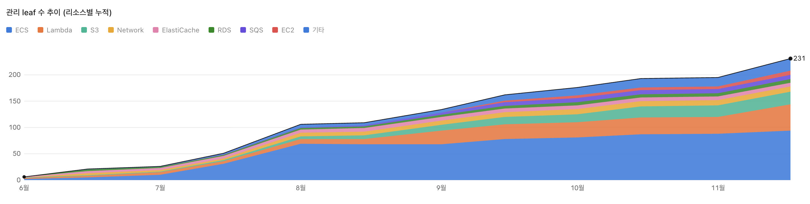

위 그래프는 테라폼을 처음 운영하기 시작한 6월부터 이 글을 쓰는 11월까지, 약 반년 동안 테라폼으로 관리하게 된 leaf의 수를 나타낸 것입니다. leaf는 서비스 하나에 해당하는 관리 단위라고 생각하시면 편한데요. ECS, Lambda, EC2 같은 컴퓨팅 리소스를 중심으로, 지금은 231개의 leaf를 테라폼으로 관리하고 있습니다. 이번 글에서는 테라폼을 도입하면서 내렸던 굵직한 결정들과, 그 결정에 이르기까지의 과정을 다뤄 보려고 합니다.

### 1.1 콘솔에서 만들어진 리소스들

인프라파트에 합류하고 나서 가장 먼저 AWS를 정리하는 일을 맡게 되었습니다. 당시 대부분의 리소스는 AWS 콘솔 기반으로 만들어져 있는 서비스였기 때문에 추적하기가 어려웠으며, 서비스가 어떻게 영향을 끼치는지 파악하기가 어려웠습니다. 이렇게 콘솔에서 만들거나 AWS CLI를 통해서 리소스를 만들게 되면 명령을 통해서 만들게 되며, 이런 방식을 **명령형(Imperative) 프로그래밍 패러다임**이라고 부르며 일반적으로 안티 패턴(Anti-pattern)에 가깝습니다. 하나씩 명령어를 통해서 리소스를 생성하기 때문에 어떤 변화가 있었는지 추적하기 어려운 문제가 있습니다.

반대는 이상적으로 여겨지는 **선언형(Declarative) 프로그래밍 패러다임**입니다. 필요한 리소스를 전부 써두면, 테라폼의 프로바이더(provider)나 쿠버네티스의 엔진이 선언되어 있는 상태에 맞게 구현하는 것을 의미합니다. 인프라와 배포 환경에서는 '어떻게 변경할 것인가'보다 '최종적으로 어떤 상태가 되어야 하는가'를 보장하는 선언형 방식이 거의 표준으로 자리잡았고, 이를 도와주는 툴이 많이 존재합니다. 선언형 패러다임을 사용하면 다음과 같은 장점을 얻을 수 있다고 합니다.

1. **멱등성(Idempotency) 보장**: 선언형은 같은 코드를 100번 실행해도 항상 동일한 최종 상태를 유지합니다.
2. **구성 드리프트**: 운영자가 서버에 직접 접속해 명령어로 긴급 수정을 가하면 코드와 실제 인프라 상태가 달라지고, 파악하기가 어렵습니다.
3. **상태 추적 및 롤백의 한계**: 선언형 도구(테라폼, 쿠버네티스 등)는 현재 상태와 목표 상태를 비교해 변경분만 적용합니다.
4. **GitOps 구현**: 현대 데브옵스의 핵심인 GitOps를 통해서 Git 저장소를 단일 진실 공급원(Single Source of Truth)으로 삼습니다.


_출처: [devopsschool.com](https://www.devopsschool.com/blog/how-to-implement-gitops-using-terraform/)_

이 외에도 많은 장점이 있는데, GitOps가 의미하는 것은 단순히 Git으로 이력을 관리할 수 있다는 것을 넘어서, 함께 Git 기반으로 협업을 할 수 있다는 것을 의미합니다. 또한, AI 에이전트가 많이 발달하여 소스 코드의 형태로 인프라를 나타내는 것이 매우 큰 레버리지를 가지고 있다고 생각하였고, 앞으로 더욱 발전할 것이기 때문에 미래를 생각해서도 지금부터 소스 코드 기반으로 컨텍스트를 관리하는 것이 중요하다고 판단했습니다.

### 1.2 테라폼의 도입과 데브옵스의 고민


인프라파트에 합류하기 이전에도 소수의 서비스를 테라폼으로 프로비저닝하고 있었고, 도입이 논의되고 있었기 때문에 테라폼을 도입하는 것은 어렵지 않았습니다. 바로 가장 먼저 들어온 서비스 프로비저닝 요청 건을 테라폼으로 처리하기 시작했고, 전사 인프라를 하나의 GitHub 레포지토리로 관리할 수 있도록 신경을 많이 써야 했습니다.

가장 큰 고민은 단순히 인프라의 관리를 소스 코드로 하는 것을 넘어서, '인프라 프로비저닝을 자동화하고 반복되는 프로세스를 없앨 수 있는가?'였습니다. 테라폼을 도입하고 혼자서 AI 에이전트를 통해서 빠르게 작업을 하기 시작했습니다. 덕분에 기존보다 프로비저닝 요청이 들어오면 빠르게 처리할 수 있는 상황이 되었습니다. 3-tier의 애플리케이션도 반나절 정도 걸리던 것에서 한 시간 이내로 작업할 수 있게 되었습니다.

하지만 데브옵스 엔지니어의 처리 속도가 빨라졌다고 해봐야 개발자분들의 생산성도 같이 올라갔기 때문에 여전히 할 일이 많은 상태였습니다. 따라서 3배 정도가 아닌 10배, 100배로 빠르게 할 수 있을 만한 방법이 필요하다고 생각했습니다. 또한 데브옵스의 본질은 개발(dev)과 운영(ops)의 벽을 허무는 것이라고 생각했기 때문에 이 테라폼을 통해서 개발자가 스스로 인프라를 프로비저닝할 수 있는 **플랫폼**(platform)을 만들 수 있을지 고민하게 되었습니다.

---

## 2. 테라폼으로 ECS 들여오기

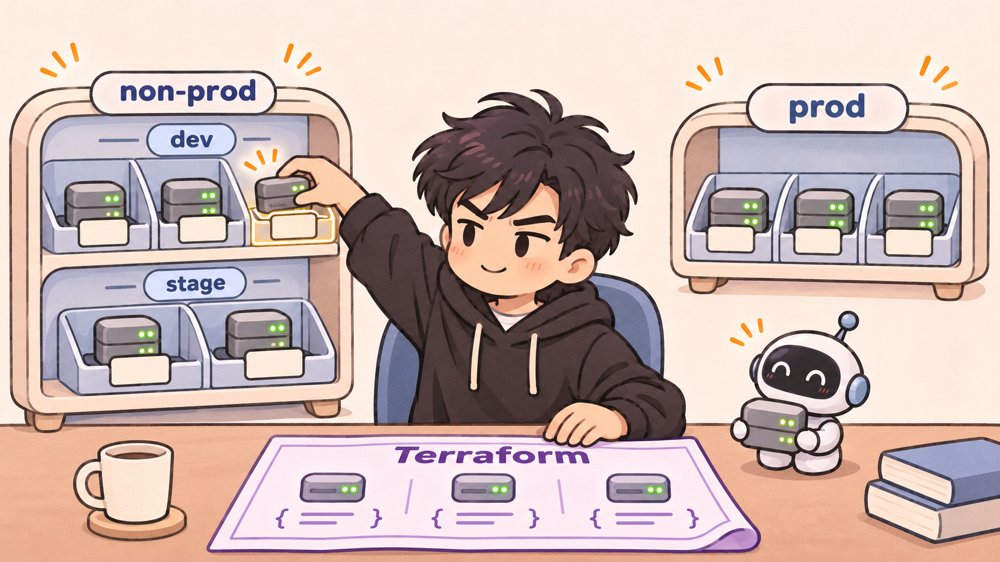

테라폼을 쓰기로 결정한 뒤, 본격적으로 작업하기 전에 꼭 정해야 할 것들부터 정리했습니다. 수십 개의 서비스와 여러 환경을 하나의 레포에 담으려면 "무엇을 어디에 둘 것인가"라는 규칙이 먼저 필요했기 때문인데요. 이번 장에서는 그 규칙인 leaf 구조와, ECS를 옮기면서 가장 신경 썼던 작업 정의(task definition) 관리 방식을 소개하겠습니다.

### 2.1 계정과 환경으로 나눈 leaf 구조

레포의 디렉터리는 `<리소스>/<서비스명>/<환경>_<리전>/` 세 단계로 나뉩니다. 가장 안쪽 디렉터리를 **leaf**라고 부르는데요, leaf 하나가 곧 하나의 테라폼 루트 모듈이자 하나의 state 파일입니다.

```text
terraform/
├── modules/
│   └── ecs_app_service/            # ECS 서비스 공용 모듈
├── variables/
│   └── var_global.tf               # 모든 leaf가 심볼릭 링크로 공유
├── ecs/
│   ├── example-backend/
│   │   ├── dev_apnortheast2/       # leaf (non-prod 계정)
│   │   ├── test_apnortheast2/      # leaf (non-prod 계정)
│   │   ├── stage_apnortheast2/     # leaf (non-prod 계정)
│   │   └── prod_apnortheast2/      # leaf (prod 계정)
│   ├── dev-shared/                 # dev 공용 클러스터·ALB
│   ├── test-shared/                # test 공용 클러스터·ALB·리스너·IAM role
│   ├── stage-shared/               # stage 공용 클러스터·ALB·리스너·IAM role
│   └── clusters/                   # prod ECS 클러스터 모음
├── rds/
├── elasticache/
├── s3/
│   └── ecs-taskdefs/               # task definition 정본 저장소 (2.4)
└── ...
```

환경이 곧 계정을 결정합니다. 팀스파르타는 prod, non-prod, sandbox 세 개의 계정을 사용하는데요. 처음에는 하나의 AWS 계정에 모든 환경이 섞여 있었지만, 지금은 prod만 prod 계정에 두고 dev·test·stage는 모두 non-prod 계정으로 옮겼습니다. 계정이 다르면 state 버킷도 다르기 때문에 **계정 경계가 곧 state 경계**가 됩니다. 그래서 leaf의 `backend.tf`만 보면 이 leaf가 어느 계정에 속하는지 알 수 있습니다.

```hcl
# ecs/example-backend/prod_apnortheast2/backend.tf
terraform {
  backend "s3" {
    bucket         = "<prod-account>-apnortheast2-tfstate"
    key            = "provisioning/terraform/ecs/example-backend/prod_apnortheast2/terraform.tfstate"
    region         = "ap-northeast-2"
    encrypt        = true
    dynamodb_table = "terraform-lock"
  }
}
```

ECS 클러스터는 계정마다 쓰는 방식이 다릅니다. non-prod 계정의 dev·test·stage는 환경마다 클러스터를 하나씩만 두고, 그 환경의 모든 서비스를 한 클러스터에 함께 올립니다. 그래서 환경마다 `dev-shared`, `test-shared`, `stage-shared`라는 공용 leaf가 있는데요. 이 leaf가 공용 ECS 클러스터와 공용 ALB, HTTPS 리스너, ALB 보안 그룹, 서비스들이 함께 쓰는 IAM role(실행·태스크·배포용)을 소유합니다. 서비스 leaf는 `terraform_remote_state`로 공용 leaf의 출력값(클러스터 ID, 리스너 ARN, IAM role ARN)을 읽어 와서, 자기 몫인 타깃 그룹과 호스트 기반 리스너 룰만 만듭니다. 서비스가 늘어나도 공용 leaf는 바뀌지 않고, 공용 리소스를 서비스 leaf에서 다시 선언하는 일도 없습니다. 소유자를 한 곳으로 정해 둔 것입니다.

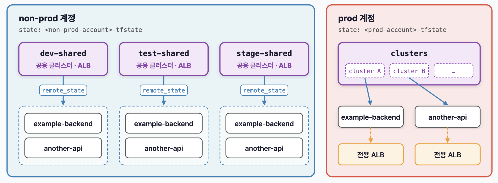

반면 prod는 웬만하면 서비스마다 클러스터와 ALB를 따로 둡니다. prod 클러스터는 `ecs/clusters` leaf 하나가 모아서 소유하고, 서비스 leaf는 클러스터 이름으로 `data` 소스를 조회해 그 위에 서비스를 올린 뒤, 서비스 전용 ALB의 443 리스너에 호스트 룰만 붙입니다. 이 글을 쓰는 시점에 non-prod의 공용 클러스터 3개에는 환경별로 17~24개의 서비스가 올라가 있고, prod에는 17개의 클러스터가 있습니다.

### 2.2 왜 leaf 단위로 쪼갰을까

처음부터 leaf 단위로 정한 것은 아니었습니다. 원래는 더 큰 모듈 단위로 관리하려고 했는데요. 앞으로는 많은 개발자가 AI 에이전트와 함께 직접 테라폼을 다루게 될 것이고, 자잘한 설정 작업은 에이전트가 맡게 되니 잘게 나눠 관리하는 오버헤드도 크지 않을 것이라고 판단했습니다. 그래서 leaf를 작게 가져가기로 했고, 지금까지 다음과 같은 이점을 누리고 있습니다.

1. **폭발 반경이 작습니다** — 한 서비스(leaf)의 `plan`/`apply`가 다른 서비스를 건드리지 않으며, state가 작으니 `plan`도 빠릅니다.
2. **리뷰 단위와 배포 단위가 같습니다** — PR에서 건드린 leaf가 곧 Atlantis가 `plan`하는 프로젝트이며, 디렉터리를 통해서 어떤 서비스가 대상인지 파악하기 쉽습니다.
3. **경로로 권한을 나눌 수 있습니다** — `dev*`·`test*`·`stage*` leaf는 승인 없이 apply할 수 있고, `prod_*` leaf나 DB·네트워크처럼 되돌리기 어려운 경로만 CODEOWNERS를 설정하여 리뷰를 꼭 거칩니다.

대신 leaf가 많아진다는 비용이 있습니다. 이 글을 쓰는 시점에 레포의 leaf는 230개를 넘었고, ECS만 90개가 넘습니다. 위에 쓰인 Atlantis라는 툴은 테라폼 소스 코드를 plan/apply하는 권한을 위임받아서 대신 처리하는 것을 돕는 오픈소스입니다. Approve를 받은 PR은 직접 코멘트에 atlantis apply 명령어를 남김으로써, 바로 AWS 인프라에 적용할 수 있으며 다음과 같이 leaf 단위로 표시하게 됩니다.


위 사진은 PR에 `atlantis apply` 코멘트를 남기면 변경 사항을 적용해 주는 Atlantis를 사용하는 모습입니다. 일본팀 프로덕트 엔지니어분이 올린 PR에 적용 방법을 코멘트로 안내했는데, leaf가 여러 개에 걸쳐 있다 보니 apply 명령어를 무려 9번이나 입력해야 했습니다. 번거롭다고 느낄 수도 있지만, 대다수의 개발자분이 gh api 기반으로 Claude Code와 같은 터미널 기반 코딩 에이전트를 사용하고 있기 때문에 손쉽게 적용할 수 있으며 오히려 잘게 나뉘어 있기 때문에 에이전트가 test → stage → prod 순서로 하나씩 apply하면서 검증하게 할 수 있습니다.

### 2.3 ECS 서비스 모듈 — 인프라 설정과 배포를 나누기

테라폼 코드에서도 모듈의 재사용성을 높이고, 반복되는 코드를 줄이기 위해서 ECS 서비스를 구성하는 리소스를 `ecs_app_service` 모듈 하나로 묶었습니다. 이 모듈 하나가 다음 리소스를 모두 만들도록 처음에 설정해두었습니다.

- ECR 레포지토리(server, proxy)와 라이프사이클 정책
- 작업 정의와 ECS 서비스
- ALB 타깃 그룹과 리스너 룰(공용 ALB 모드 / 전용 ALB 모드)
- CloudWatch 로그 그룹, 서비스 보안 그룹, Route 53 레코드

leaf는 이 모듈을 호출하고 `terraform.tfvars`에 서비스별 값만 채웁니다. 새 서비스를 만들 때는 같은 환경의 형제 leaf를 참고해 값만 바꾸면 되는데요, 이 과정을 `/provisioning`이라는 Claude Code 스킬로 만들어 두어 개발자가 직접 PR을 올릴 수 있게 했습니다.

```hcl
# ecs/example-backend/prod_apnortheast2/main.tf
module "service" {
  source = "../../../modules/ecs_app_service"

  service_name = var.service_name

  image_config = {
    ecr_server_repo = var.ecr_server_repo
    image_tag       = var.image_tag # 최초 1회 부트스트랩에만 쓰인다
  }

  task_config_optional = {
    task_cpu          = var.task_cpu
    task_memory       = var.task_memory
    desired_count     = var.desired_count
    health_check_path = var.health_check_path
  }

  shared_alb_config = {
    existing_listener_arn = var.existing_listener_arn
    rule_host_headers     = var.rule_host_headers
  }

  deployment_circuit_breaker = true
}
```

#### apply가 곧 배포가 되는 문제

leaf와 모듈로 모양을 맞춘 뒤에도 자잘한 문제가 남아 있었습니다. 그중 가장 신경 쓰였던 것은 **ECS leaf를 apply하면 곧바로 롤링 업데이트가 일어난다**는 점이었는데요. 작업 정의가 테라폼 리소스라서, CPU나 환경 변수처럼 컨테이너 설정을 하나만 바꿔도 `apply`가 새 revision을 등록하고 ECS 서비스가 그 revision으로 재배포됩니다.

더 위험한 경우도 있었습니다. 실제로 돌고 있는 이미지는 CI가 배포할 때마다 바뀌는데, 테라폼 코드의 `image_tag`는 처음 만든 시점의 값에 머물러 있습니다. 이 상태에서 다른 설정을 고치려고 `apply`하면 테라폼이 오래된 이미지로 서비스를 되돌려 버립니다.

그래서 **인프라를 설정하는 일과 배포를 일으키는 일을 분리**하기로 했습니다. 테라폼은 서비스가 존재하기 위한 설정을 맡고, 실제로 새 revision을 올려 재배포하는 것은 배포 파이프라인만 할 수 있게 한 것인데요. 이렇게 둘을 분리하면 설정을 바꾼 뒤에 재배포를 직접 돌려야 해서 번거로울 수 있다고 생각하기도 했으나, 앞서 leaf를 잘게 쪼갰을 때처럼 이 정도의 추가 작업은 AI 에이전트가 충분히 대신해 줄 수 있다고 판단했습니다. 번거로움보다는 **apply를 언제 해도 안전하다**는 유연함을 택하게 되었습니다.

#### 테라폼이 관리하지 않기로 한 것

이 분리는 모듈의 `lifecycle` 설정 두 줄로 구현됩니다.

```hcl
# modules/ecs_app_service/service.tf
resource "aws_ecs_service" "this" {
  # ...
  lifecycle {
    # 실행 중인 revision은 CI가, 태스크 수는 오토스케일링이 바꾼다
    ignore_changes = [desired_count, task_definition]
  }
}

# modules/ecs_app_service/task_definition.tf
resource "aws_ecs_task_definition" "this" {
  # ...
  lifecycle {
    # 최초 1회 부트스트랩 이후 컨테이너 정의는 CI가 소유한다
    ignore_changes = [container_definitions]
  }
}
```

테라폼은 서비스의 **뼈대**를 처음 한 번 만들 때만 작업 정의를 등록합니다. 그 뒤로는 컨테이너 정의가 바뀌어도, 서비스가 가리키는 revision이 바뀌어도 테라폼은 이를 변경으로 보지 않습니다. 그래서 ECS leaf에 `apply`를 해도 새 revision이 생기지 않고, 재배포도 일어나지 않습니다. 오래된 `image_tag`로 서비스를 되돌리는 사고도 함께 사라졌습니다.

이제 위와 같은 문제를 해결하기 위해서 ignore 설정을 해두었는데, 그렇다면 빠진 부분은 어떤 식으로 채워지게 될까요? 이 디테일을 채우기 위한 고민들을 이어서 소개합니다.

### 2.4 작업 정의를 S3에서 관리하기

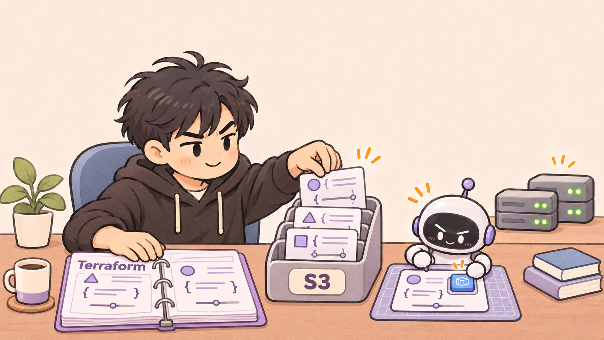

ECS를 테라폼으로 옮기면서 가장 공을 들인 부분입니다. 원래는 깃허브에서 각 애플리케이션 레포가 자기 작업 정의를 직접 들고 있었기 때문에, 같은 설정을 서비스 10개에 적용하려면 레포 10개에서 따로 작업해야 했습니다. 그래서 모든 서비스의 작업 정의를 테라폼에서 한 번에 관리하는 것을 목표로 잡았습니다. 여러 고민 끝에 최종적으로는 작업 정의를 S3에 모아 두는 방식을 택하게 되었습니다.

#### 첫 번째 고민 — 레포마다 있는 task-definition.json


GitHub Actions로 ECS에 배포할 때 가장 흔한 방법은 GitHub이 제공하는 Deploy to Amazon ECS 템플릿입니다. `amazon-ecs-render-task-definition` 액션이 **애플리케이션 레포에 들어 있는** `task-definition.json`의 이미지만 새 태그로 바꾸고, `amazon-ecs-deploy-task-definition` 액션이 그 파일을 새 revision으로 등록해 배포합니다.

```yaml
# 기존: 앱 레포의 workflow
- uses: aws-actions/amazon-ecs-render-task-definition@v1
  with:
    task-definition: task-definition.json # 앱 레포 안의 파일
    container-name: server
    image: ${{ steps.build.outputs.image }}
- uses: aws-actions/amazon-ecs-deploy-task-definition@v2
  with:
    task-definition: ${{ steps.render.outputs.task-definition }}
    service: example-backend-prod
    cluster: prod-cluster
```

서비스가 얼마 없다면 문제가 없겠지만, 관리해야 하는 레포지토리가 많기 때문에 관리가 쉽지 않았습니다. 실제로 Node.js 서비스에서 이벤트 루프나 가비지 컬렉터 같은 런타임 메트릭을 수집하려고 `DD_RUNTIME_METRICS_ENABLED`를 켜야 했을 때, 레포마다 들어가서 직접 작업해야 했습니다.

작업은 오래 걸리고, 나중에 어느 서비스에 적용되었는지 확인하기도 어렵습니다. 애플리케이션 개발자 입장에서도 자기 레포에 인프라 설정 커밋이 계속 쌓이면서 불필요한 컨텍스트가 늘어납니다.

#### 두 번째 고민 — 테라폼이 등록한 최신 revision을 CI가 가져오기

처음 떠올린 방법은 작업 정의를 테라폼의 `aws_ecs_task_definition` 리소스로 관리하고, CI는 레포의 파일 대신 AWS CLI로 ECS에 등록된 최신 revision을 가져와 이미지만 바꿔 배포하는 것이었습니다.

```bash
# CI에서 최신 revision을 가져와 이미지만 바꾸는 방식
aws ecs describe-task-definition \
  --task-definition example-backend-prod \
  --query taskDefinition > task-definition.json
```

앱 레포에서 작업 정의 파일이 사라진다는 점에서는 한 걸음 나아간 방식입니다. 하지만 이 구조에서는 작업 정의가 ECS 서비스와 같은 leaf 안에 묶이게 됩니다. 작업 정의가 서비스 모듈의 일부라서 설정을 변경하는 것이 어려웠고, 작업 정의는 ECS의 테라폼 코드들과 다른 디렉터리에 별도로 관리하여 애플리케이션 개발자도 관리가 용이하게 하고 싶었습니다.

#### 세 번째 고민 — 작업 정의만 모아서 S3에 올리기

결국 작업 정의만 따로 떼어서 한곳에 모아야 한다는 결론에 이르렀고, 그 한곳으로 고른 것이 S3입니다. 환경마다 `s3/ecs-taskdefs/<환경>_<리전>/` leaf 하나를 두고, 그 아래 `taskdefs/`에 서비스별 JSON 파일을 둡니다. 테라폼은 이 파일(.json)들을 S3 버킷에 그대로 업로드하는 역할을 합니다.

```hcl
# s3/ecs-taskdefs/prod_apnortheast2/main.tf
resource "aws_s3_object" "taskdef" {
  for_each = fileset("${path.module}/taskdefs", "*.json")

  bucket = aws_s3_bucket.taskdefs.id
  key    = "taskdefs/${each.value}"
  source = "${path.module}/taskdefs/${each.value}"
  etag   = filemd5("${path.module}/taskdefs/${each.value}") # 내용이 바뀐 파일만 다시 올린다
}
```

이제 애플리케이션이 배포될 때, S3의 JSON을 가져와서 이미지 태그만 커밋 SHA로 바꾼 뒤 새 revision을 등록하고 배포하는 구조가 되었습니다.

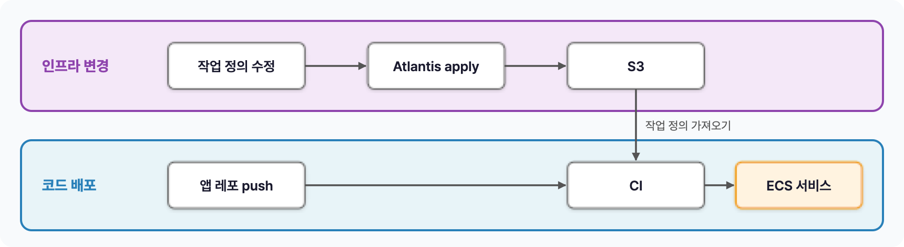

핵심은 소유권의 분리입니다. 작업 정의의 **모양**(shape)은 테라폼이, 이미지는 CI가 소유합니다. CPU나 환경 변수를 바꾸고 싶으면 테라폼 레포에 PR을 올리고, 코드를 배포하고 싶으면 앱 레포에 push하면 됩니다. 두 경로가 섞이지 않습니다.

참고로, plan에는 작은 디테일이 하나 있습니다. 지금처럼 파일을 `source`와 `etag`(`filemd5()`)로 넘기면 JSON을 고쳐도 plan에는 `etag` 해시가 바뀌었다는 것만 보이는데, `content = file(...)`처럼 파일 내용을 문자열로 넘기면 테라폼이 이를 JSON으로 알아보고 어떤 값이 바뀌었는지까지 plan에서 보여 줍니다. 다만 작업 정의는 이미 git에 JSON 파일로 있어 PR diff에서 변경 내용이 그대로 보이고, 요즘은 그 diff를 AI 에이전트가 먼저 리뷰하는 경우가 많아져서 굳이 이 방식을 쓰지는 않았습니다.

### 2.5 결과

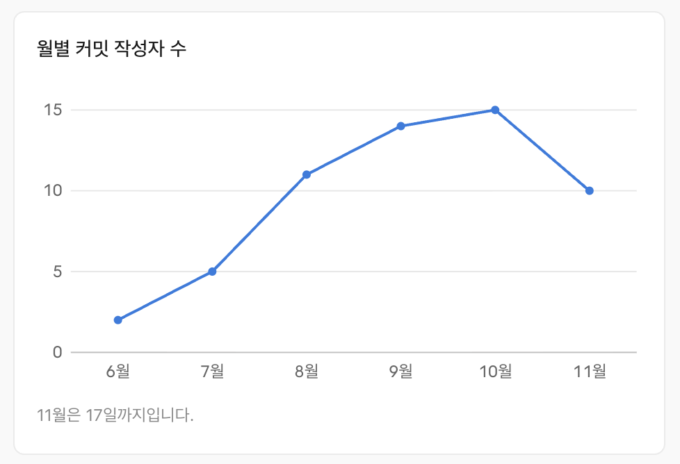

ECS를 손쉽게 제어할 수 있도록 체계를 꼼꼼하게 정했고, 에이전트를 위한 컨텍스트와 skill과 같은 것들을 통해서 혼자서 작업하던 상황에서 테라폼 기반으로 직접 개발자가 셀프 서비스로 프로비저닝할 수 있는 환경을 갖게 되었습니다. Atlantis와 GitHub을 적극 활용하여 익숙한 플랫폼에서 코드 리뷰 등의 협업도 가능하게 되었습니다.

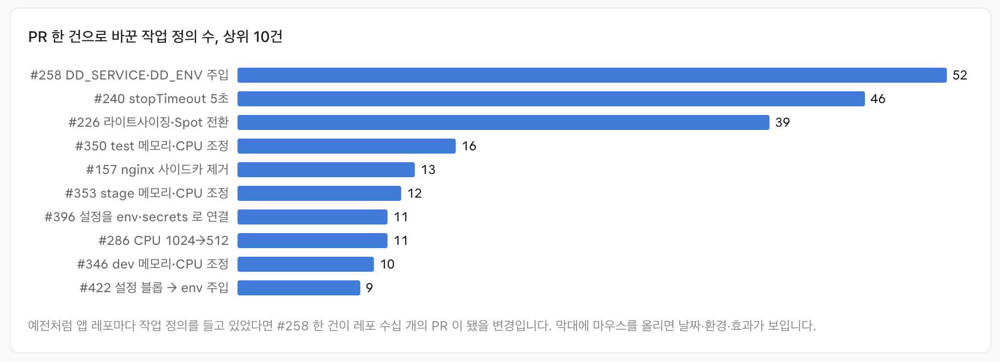

또한 설정 변경이 한 곳에서 끝나는 장점이 있었기 때문에 테라폼 소스 코드가 모인 레포지토리에서 작업을 빠르게 진행할 수 있었고, 기존에 레거시였던 nginx와 ALB를 같이 사용하고 있던 패턴이나, 잘못된 환경 변수 주입 패턴, 데이터독 설정 일괄 변경 등의 작업을 한 번에 패치할 수 있게 되었는데요. 설정을 변경하고 나서 배포 타이밍은 직접 바로 트리거를 하거나, 개발자분들의 배포 타이밍에 함께 나갈 수 있도록 해두었습니다.

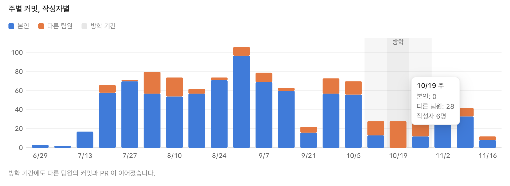

팀스파르타에서는 방학이라는 제도가 있는데요. 제가 10월 중순에 7일 가까이 쉬었는데도 문제없이 팀원들이 테라폼을 통해서 인프라 작업을 이어나갈 수 있었고, 실제로 일주일 동안 부재했던 기간에도 6명의 팀원들이 28개의 커밋을 쌓으면서 인프라를 직접 프로비저닝할 수 있었습니다.

---

## 3. 공용 GitHub Actions 파이프라인

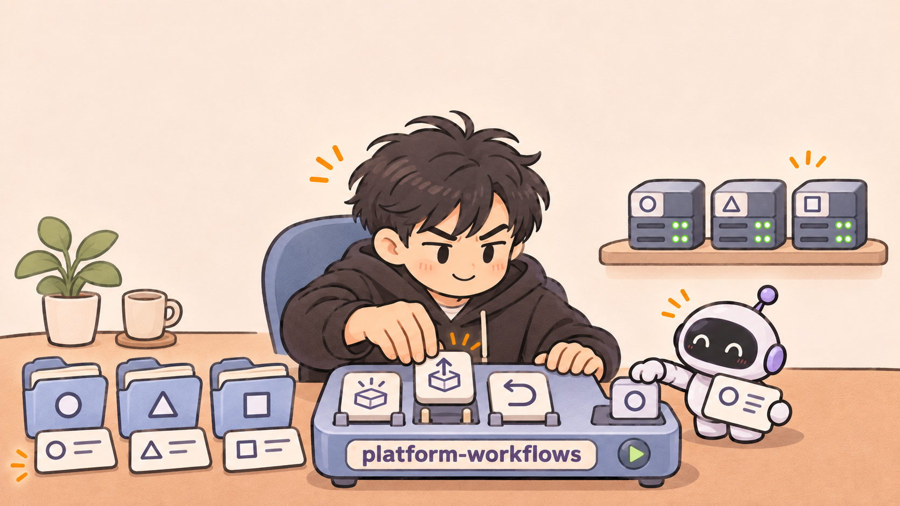

인프라를 테라폼 레포 한 곳에 모으고 나니, 이번에는 그 위에 애플리케이션을 올리는 배포 파이프라인이 서비스마다 제각각이라는 점이 눈에 띄었습니다. 2장에서 인프라 설정과 배포를 나눠 두었기 때문에, 배포 쪽도 한 곳에서 관리할 수 있어야 비로소 이 구조가 완성된다고 생각했는데요. 이번 장에서는 흩어져 있던 CI/CD를 하나로 모은 과정을 짧게 소개하겠습니다.

### 3.1 서비스마다 달랐던 배포 방식

기존에는 서비스마다 배포 방식이 다른 문제가 있었습니다. 몇몇 서비스는 CodeDeploy를 사용하고 있었고, 비교적 최근 서비스들은 GitHub Actions를 사용하고 있었습니다. 뿐만 아니라, 같은 GitHub Actions 방식을 사용하더라도 workflow의 설정이 조금씩 다른 문제가 있었습니다.

우선, 하나의 플랫폼으로 관리할 수 있도록 두 방식 중 하나를 선택하게 되었는데요. 결국에는 GitHub 안에서 배포까지 파이프라인을 확인할 수 있는 GitHub Actions를 사용하게 되었습니다. CodeDeploy의 경우에는 AWS 콘솔을 확인해야 배포 상태를 확인할 수 있었고, Slack 웹훅과 연동이 필요할 때도 개발자의 관점에서 GitHub보다 다루기 어려웠습니다.

GitHub Actions를 쓰던 서비스들도 사정이 크게 다르지는 않았습니다. 대부분 아래와 같은 스텝을 레포마다 복사해서 쓰고 있었는데요. 액션의 버전, 작업 정의 파일의 위치, 슬랙 알림의 형식이 레포마다 조금씩 달랐고, prod 배포 workflow 하나가 100줄을 훌쩍 넘기는 경우도 많았습니다.

```yaml
# 기존 서비스 레포의 배포 job (요약)
steps:
  - uses: actions/checkout@v3
  - uses: aws-actions/configure-aws-credentials@v4
  - uses: aws-actions/amazon-ecr-login@v1
  - uses: docker/setup-buildx-action@v1
  # ... docker build & push
  - uses: aws-actions/amazon-ecs-render-task-definition@v1
  - uses: aws-actions/amazon-ecs-deploy-task-definition@v2
  - uses: 8398a7/action-slack@v3
```

이렇게 되면 2.4에서 이야기한 작업 정의와 똑같은 문제가 생깁니다. 배포 알림의 형식을 바꾸거나 액션의 버전을 하나 올리려고 해도, 서비스 레포마다 같은 PR을 하나씩 올려야 했습니다.

### 3.2 platform-workflows — 배포를 한 레포에 모으기

깃허브 액션즈(GitHub Actions, 이하 깃액션)를 사용하도록 결정이 되면서 고민은 이러한 배포 파이프라인을 중앙관리할 수 있도록 하는 것이었습니다. 이를 위해서 깃허브 내에서 제공하는 깃허브의 다른 레포지토리의 깃액션 workflows를 그대로 가져다 쓸 수 있는 패턴을 사용했고, 이를 위해서 platform-workflows라는 레포지토리를 만들고 관리하게 되었습니다.

GitHub Actions에는 `on: workflow_call`로 선언한 workflow를 다른 레포에서 `uses:`로 불러 쓰는 **재사용 가능한 워크플로우**(reusable workflow)가 있는데요. platform-workflows에는 이미지 빌드(`docker-build`), ECS 배포(`ecs-deploy`), 마이그레이션(`ecs-migrate`), 롤백(`ecs-rollback`), Lambda 배포(`lambda-deploy`) 같은 workflow를 모아 두었고, 서비스 레포에는 아래처럼 "무엇을 어디에 배포할지"만 적는 호출부만 남게 되었습니다. 이 외에도 패키지 스캔이나 docker 이미지 스캔 등의 워크플로우들을 추가로 작업하고 있습니다.

```yaml
# 서비스 레포의 배포 workflow
jobs:
  build:
    uses: <org>/platform-workflows/.github/workflows/docker-build.yml@v1
    with:
      service_name: example-backend
      ecr_repository: example-backend
      image_tag: ${{ github.sha }}
      # ...

  deploy:
    needs: build
    uses: <org>/platform-workflows/.github/workflows/ecs-deploy.yml@v1
    with:
      service_name: example-backend
      environment: stage
      cluster: <cluster>
      task_definition_source: s3
      task_definition_s3_uri: s3://<bucket>/taskdefs/example-backend-stage.json
      terraform_managed_task_definition: true
      container_name: server
      image_uri: ${{ needs.build.outputs.image_uri }}
```

여기서 `task_definition_source: s3`가 2.4와 이어지는 부분입니다. `ecs-deploy`는 테라폼이 S3에 올려 둔 작업 정의를 내려받고, 그 안의 이미지만 방금 빌드한 이미지로 바꿔서 새 revision으로 등록한 뒤 배포합니다. 그래서 작업 정의의 CPU, 메모리, 환경 변수 같은 설정은 테라폼 레포가, 이미지는 배포 파이프라인이 맡는 구조가 됩니다.

서비스 레포는 `@v1` 태그를 바라보고 있어서, 공용 레포에서 배포 알림이나 배포 소요 시간 측정 같은 기능을 추가하고 `v1` 태그를 옮기면 모든 서비스에 한 번에 반영됩니다. 반대로 말하면 `v1`을 옮기는 순간 20개가 넘는 서비스에 그대로 퍼지기 때문에, 기존 호출부를 깨뜨리는 변경은 `v2`로 따로 내고 `v1.4.0`처럼 고정된 버전 태그도 함께 남겨 두어 문제가 생기면 바로 되돌아갈 수 있도록 했습니다.

### 3.3 workflow_dispatch — 인프라 변경과 배포를 따로 트리거하기

앞에서, 인프라 설정을 테라폼으로 진행하면서 배포가 한 번에 나가는 상황이 문제가 되어 인프라 설정과 배포를 분리해두었다고 이야기했는데요. 그 부분에서 배포하는 방법은 서비스 레포의 배포 workflow마다 `push` 트리거 옆에 `workflow_dispatch`를 함께 열어 두었습니다. 이제 테라폼을 통해서 ECS 태스크의 스펙을 변경하고 배포는 이 워크플로우를 직접 트리거하거나, 혹은 특정 브랜치에 머지해서 일반적으로 배포하는 것처럼 동작할 수 있도록 설정해두었습니다.

```yaml
on:
  push:
    branches: [main]
  workflow_dispatch: # 인프라 변경 후 코드 변경 없이 재배포
```

그래서 테라폼 PR이 apply되어 S3의 작업 정의가 바뀌고 나면, 코드 변경 없이 Actions 탭에서 Run workflow를 누르거나 아래 명령어 한 줄로 재배포할 수 있습니다. 배포 workflow는 실행될 때마다 S3에서 작업 정의를 새로 가져오기 때문에, 이번 배포에는 테라폼에서 바꾼 설정이 그대로 담기게 됩니다. 급한 변경이 아니라면 굳이 재배포하지 않아도, 개발자분들의 다음 배포에 자연스럽게 함께 나가게 됩니다.

```bash
gh workflow run deploy-stage.yml --repo <org>/example-backend --ref main
```

덕분에 인프라 작업과 애플리케이션 배포는 서로를 기다리지 않고 따로 진행할 수 있게 되었습니다. 요즘은 Claude Code 같은 AI 에이전트가 테라폼 PR의 apply를 확인한 뒤 이 명령어로 재배포까지 이어서 해 주는 경우도 많은데요. 같은 서비스로 배포가 동시에 트리거되더라도, `ecs-deploy`에는 `ecs-<환경>-<서비스>` 단위의 `concurrency` 그룹이 걸려 있어서 먼저 들어온 배포가 끝날 때까지 다음 배포가 기다리도록 했습니다.

### 3.4 롤백

배포 파이프라인을 모으면서 롤백도 공용 workflow로 함께 만들었습니다. 일부 서비스는 ECS의 배포 서킷 브레이커(deployment circuit breaker)가 꺼져 있어서, 잘못된 배포가 나가면 자동으로 되돌아가지 않았는데요. 이런 서비스에서는 이전 이미지 태그를 찾아 다시 빌드하거나 콘솔에서 직접 작업 정의를 바꾸는 것 말고는 빠르게 되돌릴 방법이 마땅치 않았습니다.

`ecs-rollback`은 앞에서 본 구조 덕분에 단순하게 만들 수 있었습니다. `ecs-deploy`가 배포할 때마다 작업 정의의 새 revision을 등록하기 때문에, 롤백은 서비스가 바라보는 revision을 이전 번호로 돌려놓기만 하면 됩니다. 서비스 레포에는 아래처럼 `workflow_dispatch`로 실행하는 롤백 workflow를 하나 두고, `target_revision`을 비워 두면 직전 revision으로, 숫자를 넣으면 그 revision으로 되돌아가도록 했습니다.

```yaml
# 서비스 레포의 rollback workflow
on:
  workflow_dispatch:
    inputs:
      target_revision:
        description: "되돌릴 작업 정의 revision (비우면 직전 revision)"
        required: false

jobs:
  rollback:
    uses: <org>/platform-workflows/.github/workflows/ecs-rollback.yml@v1
    with:
      service_name: example-backend
      environment: prod
      target_revision: ${{ inputs.target_revision }}
      # ...
```

공용 workflow 안에서는 현재 서비스가 쓰는 작업 정의의 revision을 읽어 되돌아갈 revision을 정하고, 그 revision이 아직 `ACTIVE` 상태인지 확인한 다음 서비스를 업데이트합니다.

```bash
current_arn="$(aws ecs describe-services --cluster "$CLUSTER" --services "$SERVICE" \
  --query 'services[0].taskDefinition' --output text)"
family_rev="${current_arn##*/}"   # example-backend:42
family="${family_rev%:*}"
current_rev="${family_rev##*:}"
target_rev="${TARGET_REVISION:-$((current_rev - 1))}"

aws ecs update-service --cluster "$CLUSTER" --service "$SERVICE" \
  --task-definition "${family}:${target_rev}"
```

한 가지 주의할 점은 revision 단위로 되돌린다는 것입니다. revision에는 이미지뿐만 아니라 그 시점의 CPU, 메모리, 환경 변수 같은 설정도 함께 들어 있어서, 롤백하면 이미지와 설정이 함께 이전으로 돌아갑니다. 그래서 설정만 되돌리고 싶을 때는 롤백 대신 테라폼 레포에서 작업 정의를 고친 뒤 3.3의 방식으로 재배포하도록 안내하고 있습니다. 롤백도 배포와 같은 `concurrency` 그룹을 쓰기 때문에, 배포가 진행되는 도중에 롤백이 끼어들어 서로 엉키는 일은 없습니다.

### 3.5 결과

가장 먼저, 기존에 CodeDeploy와 깃액션을 사용하는 서비스가 나뉘어져 있었고, 깃액션마저도 워크플로우 부분부분이 다르기 때문에 배포가 완료되었을 때, Slack으로 받아보는 알림의 형태가 모두 달랐습니다. 공용 파이프라인을 적용하고 나니, 백엔드 전체 서비스에 대해서 다음과 같이 Slack에서 같은 형식의 배포 알림을 받아볼 수 있었습니다.

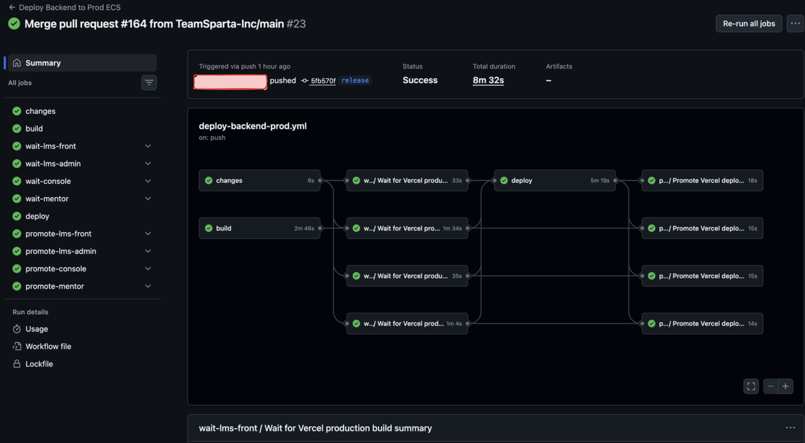

처음에는 해당 서비스를 관리하는 파트를 태그할 수 있도록 설정하였으나, test나 stage 환경의 경우에는 배포한 사람만 태그하도록 수정해줄 수 없냐는 의견을 받았는데요. 이 작업 또한 platform-workflows를 수정하는 것으로 한 번에 적용이 가능했습니다.

또한, Lambda가 먼저 배포되어야 한다거나, 모노레포에서 백엔드가 먼저 배포되고 나서 프론트엔드가 배포되어야 한다거나 하는 까다로운 순서를 지켜야 하는 경우에도 미리 워크플로우를 정의하여, 가져다 쓸 수 있도록 설정해두었습니다.

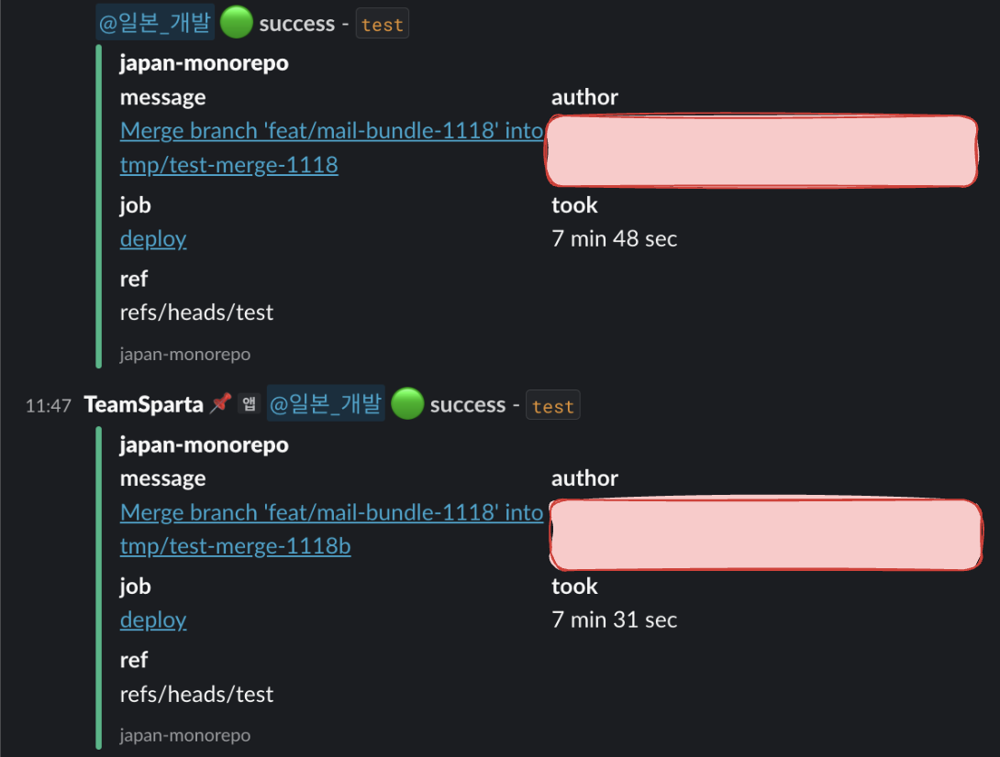

이 외에도 별도의 Summary가 남아서 서비스 별로 각 step마다 얼마나 오래 걸렸는지, 어떤 부분에서 얼마나 걸렸는지를 한 번에 받아볼 수 있는 요약을 제공하여 개발자는 스스로 배포가 잘 되었는지나 특이사항이 없는지 확인할 수 있게 되었습니다.

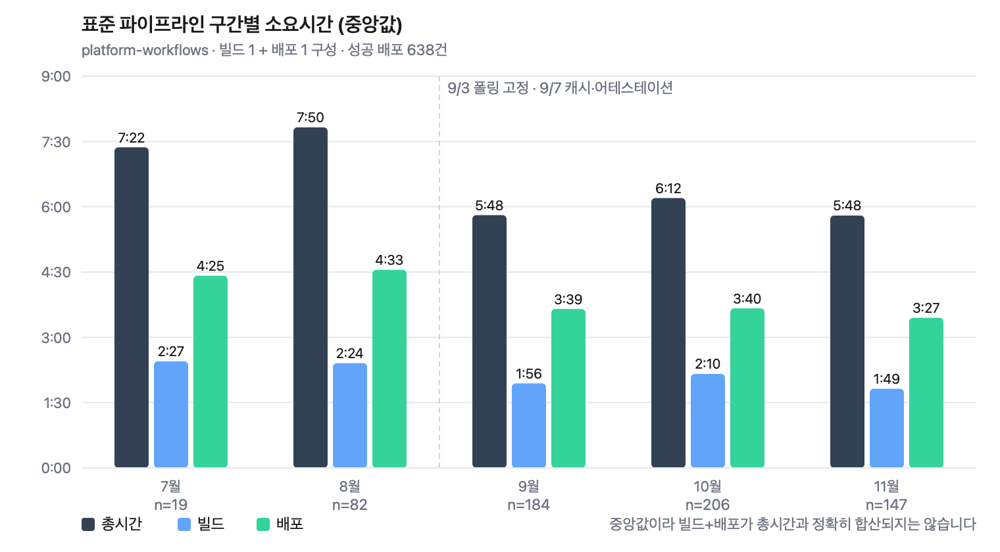

추가적으로, 그동안 깃액션의 설정이 다른 부분이 많았기 때문에 캐시가 적용되고 있는 부분도 있었고 아닌 부분도 있었는데, 이번에 일관성 작업을 진행하면서 한 번에 설정할 수 있게 되었습니다.

위 그래프는 표준 배포 파이프라인(빌드 1 + 배포 1) 런 638건의 월별 중앙값입니다. 8월과 9월 사이 점선에서 세 구간이 함께 내려가는데, 그 주에 공용 레포에 들어간 변경 두 건 때문입니다.

**9월 3일** — ECS를 배포하고 나서의 안정화 대기를 고쳤습니다. SDK 웨이터가 폴링 간격을 120초까지 벌려서, 서비스가 이미 안정화돼도 최대 2분을 더 기다리고 있었습니다. `wait-max-delay-seconds`를 15초로 고정해 배포 구간이 4분 33초에서 3분 39초가 됐습니다.

**9월 7일** — provenance·SBOM 어테스테이션을 끄고 레이어 캐시를 GitHub Actions에서 ECR로 옮겼습니다. 어테스테이션 생성에만 중앙값 18초가 들어가고 있었습니다. 빌드 구간은 2분 24초에서 1분 56초가 됐습니다.

7월 대비 11월은 총 7분 22초에서 5분 48초로, 세 구간 모두 20%대 줄었습니다. 무엇보다 **이 변경에 서비스 레포 PR은 한 건도 필요하지 않았습니다.** 공용 레포에 PR을 올리고 `v1` 태그를 옮긴 게 전부였고, 다음 배포부터 20개가 넘는 서비스에 적용됐습니다. 일관성을 먼저 갖추고 나서 보니, 문제점을 빠르고 효율적으로 파악할 수 있었고 패치도 빠르게 진행할 수 있었습니다.

---

## 마치며


지금까지 테라폼의 도입과 깃액션을 하나로 모아 일관성 있는 인프라 구조를 구축한 건에 대해서 소개드렸습니다. 사실 이 외에도 많은 부분들이 있으나 깊게 고민한 부분과 신경 써서 작업했던 인사이트를 전하고자 일부만 골라 소개하게 되었습니다. 이번에는 기존의 테라폼을 기반으로 인프라를 관리하는 컨벤션을 따라가면서도, AI 에이전트가 많이 발전했기 때문에 함께 사용할 수 있는 부분이 없을지 고민을 많이 하게 되었습니다.

개인적으로 GitOps라고 하는 키워드는 데브옵스 엔지니어에게 있어 플랫폼 엔지니어링과 함께 중요한 키워드라고 생각합니다. 단순히 테라폼이나 쿠버네티스에서 사용하는 선언형 프로그래밍 패러다임을 넘어서, 인프라뿐만 아니라 개발자들과 사내 직원들의 Claude Code도 문제없이 작업할 수 있도록 고민을 많이 했습니다.

1편에서는 주로 일관성과 인프라의 파운데이션을 갖추면서 느꼈던 고민들에 대해서 다루었습니다. 이제 이렇게 갖춘 일관성을 바탕으로 데브옵스 엔지니어로서 AI 에이전트와 결합하여 더 큰 레버리지를 제공할 수 있게끔 했던 작업들을 2편에서 소개드리고자 합니다.

긴 포스팅을 읽어주셔서 감사합니다.
