[前回の記事]()ではDaangn SRE ミートアップ 第1回をまとめた。今回は、2021年に開かれたトスの開発者カンファレンス**SLASH 21**から、インフラに関する4つの発表を選んで整理する。

---

## 1. トスのサービスを構成するサーバー技術

イ・ハンリョンさん(トス Server Platform Team Leader)



最初に見る発表は、トスのサービスを構成するサーバー技術だ。実はこの動画が、Daangnとトスのカンファレンス動画を最初から見始めたきっかけでもある。2024年のトスの発表の途中で、2021年の動画を参考にすると役立つという言及があったので探して見ることになり、この機会に2021年の発表から整理するのがよさそうだと思った。まさにトスのインフラ技術の骨格をありありと見せてくれる発表だ。

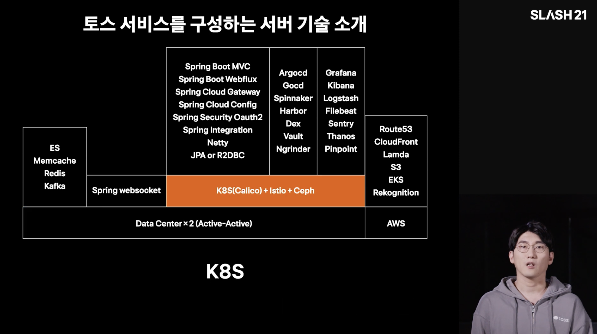

トスはこのようにK8sとIstioをベースにサービスを運用している。Daangnと比べて特徴的なのは、JavaやKotlinの比重が圧倒的に大きく見えることだ。ほとんどのサービスをSpring Bootで開発しており、トスでは一貫性を重視しているようだ。

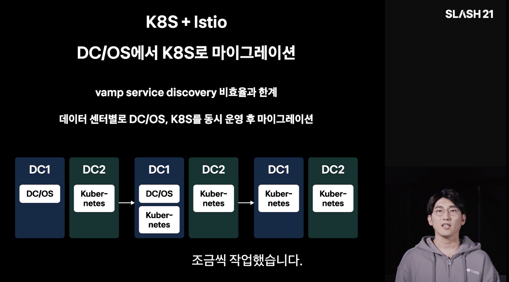

トスはもともとDC/OSという技術を使っており、vampというツールでオンプレミスのデータセンターのサービスを制御していたという。ただ、2019年にvampのservice discoveryの非効率と限界を感じて徐々に移行を進め、データセンターを2つ運用しているため、上の図のように1つずつ切り替えたそうだ。これを進める中で、Istio + K8sベースのインフラが整った。

トスならではの特徴が1つある。Istioを導入すると、普通はretryやサーキットブレーカーなどをIstioで実装することを思い浮かべがちだが、細かな制御が難しいため、発表時点ではアプリケーション側で処理しているという。トランザクションの性質によってretryを変える必要があるロジックがあるため、Istioですべてを制御するのは難しく、代わりにIstioのmTLSなどで、AサーバーからBサーバーへリクエストできないようにするアクセス制御を行っているそうだ。一方、canaryデプロイのような機能は積極的に使っているという。

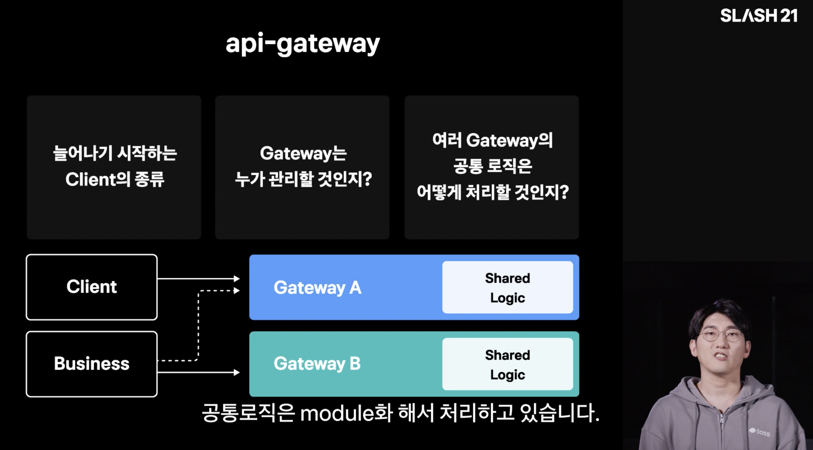

次はapi-gatewayの説明だ。以前、Netflixのように大きなMSAを運用するサービスは、認証のために大きなapi-gatewayを置くという記事を読んだことがある。passportという名前だったが、関連資料を読んで、api-gateway方式はかなり必要そうだと感じた。トスも同様にSpring Cloud Gatewayを使っているという。これも知ってはいたが、実際にどう使われているのかまでは詳しく押さえていなかったので、一度勉強してみようと思った。

続いてWebFluxやcoroutineなどの話が出てくる。以前Springで開発したことがあるのでWebFluxはだいたい知っていたが、coroutineは「そういうものがあるのか」と流していた。最近、大企業でSpringベースの開発をしているバックエンドエンジニアと話したときに、virtual threadもかなり良いという話を聞いたが、Springの中でもパフォーマンスのために試せることが多いと感じた。

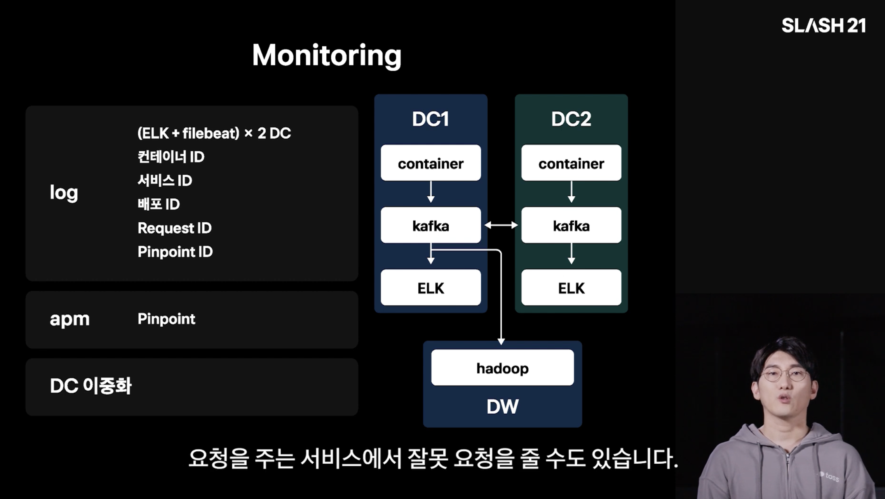

ログにはKafkaを使い、ELKスタックで確認しているという。長期保管が必要なログデータは、Hadoopに送るパイプラインを使っているそうだ。

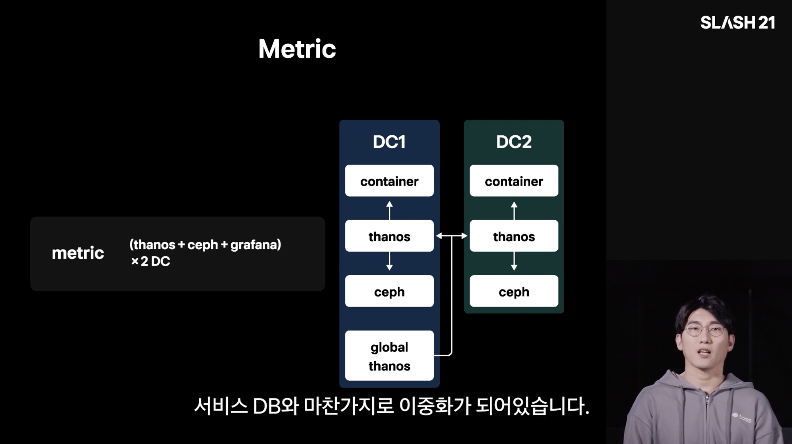

メトリクスは主にPrometheusをかなりハードに使っているようで、複数のPrometheusをまとめて管理できるThanosもよく使っているようだ。以前トスの書類選考の課題でも、Prometheusベースで膨大なトラフィックに耐えなければならない状況をどう処理するか、といった内容が出た気がするし、後の発表でもPrometheusの性能最適化に関する内容がかなり出てくる。

その後、KafkaやRedisをクラスター形態でどう管理しているかという内容とともに発表が終わる。

---

## 2. ミスなく安全にKubernetesを運用する

キム・ヒョンロクさん(トス DevOps Engineer)



この発表は前の発表に続けて見るとよい内容で、Kubernetesクラスターをどう管理しているかを紹介する。ArgoCDでGitOpsをどう運用しているか、そしてOPA(Open Policy Agent)でミスを防ぐポリシーをどう適用しているかを扱う。

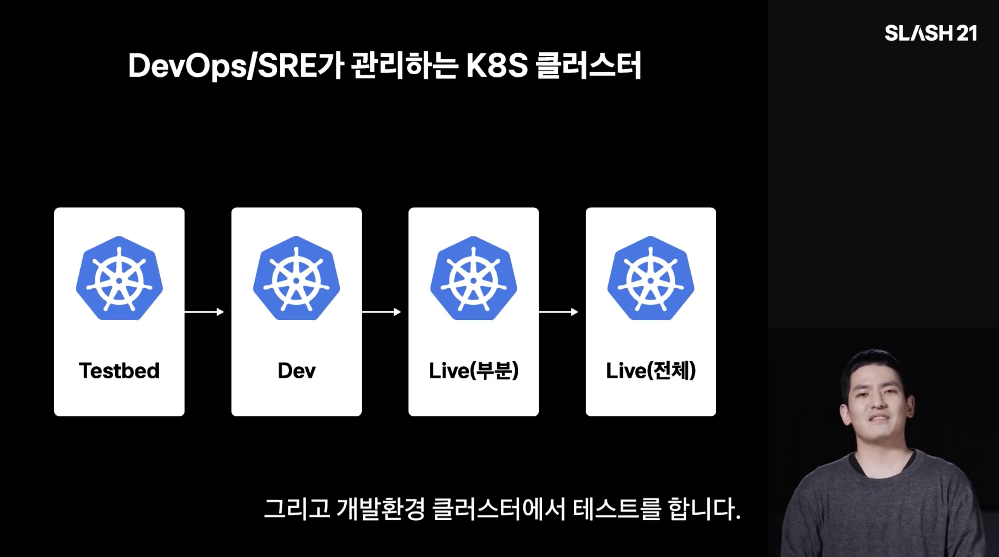

まず基本的には上のようにクラスターを構成し、TestbedとDevクラスターで確認してからLiveにデプロイする構造になっているという。この構造の上でArgoCDによるGitOpsを運用しているが、1つ特徴的なのはAuto Syncを使っていないことだ。安定性のためだと思われ、できるだけ早くレビューしてからsyncを進めているようだ。そのためトスでは、GitOpsを「gitの状態とKubernetesの状態が同一であること」ではなく、「gitの状態 = 望むKubernetesの状態」と定義しているという。個人的には、KubernetesやTerraformを管理するときも、auto-approveしてよい箇所とそうでない箇所を意図的にうまく分けることが重要だと思う。

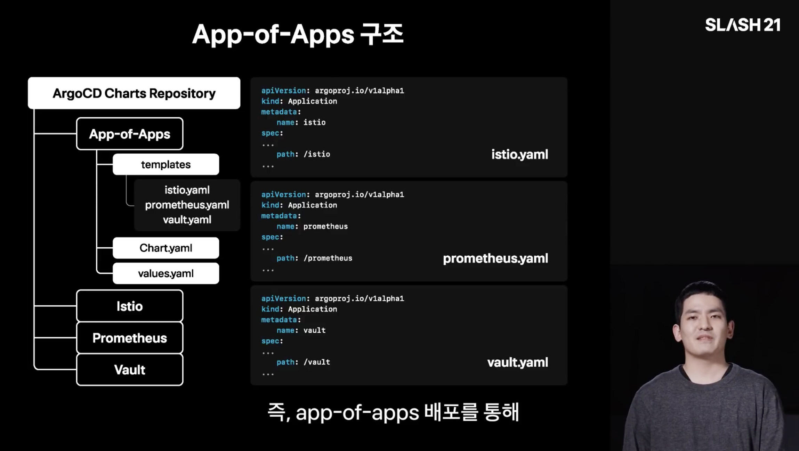

トスではHelm chartでサービスをデプロイしており、IstioのようなものもHelm chartとしてベンダリングし、app-of-apps方式で使っているという。先ほどのGitOpsの原則を守るやり方で、ArgoCDにアプリケーションを立ち上げることさえも、gitに設定ファイルとして「宣言的」に管理する方式だ。

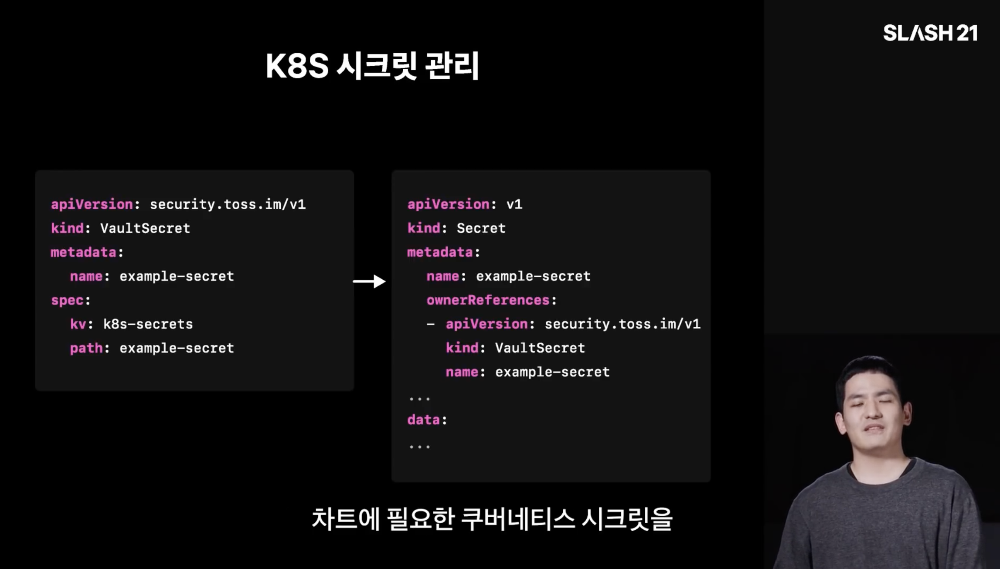

GitOpsを運用すると誰もがシークレットをどう管理するか悩むことになるが、一般的にはVaultかAWS Secrets Managerを使うようだ。AWS Secrets Managerはシークレット1つあたり月0.4ドルもかかるので、大量のシークレットを環境ごとに保存すると毎月かなりの費用になる。そのため一般的にはVaultがよく使われているようだ。

個人的にはESO(External Secrets Operator)をVaultと組み合わせて使っているが、トスは面白いことに、自前で作ったVaultSecretというAPIを活用しているようだ。どんな理由で自作のツールを使ってシークレットを取ってきているのか気になる。

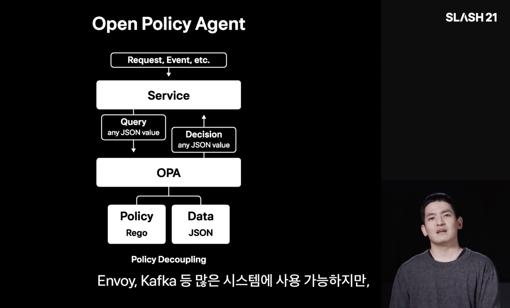

次はOPA(Open Policy Agent)だ。ヒューマンエラーを防ぐためにポリシーを適用して、ミスを防げるという。KubernetesではAdmission Controllerが許可されていないリクエストを止めるが、OPAというツールを使うと、こうしたポリシーを柔軟に設定できるという。

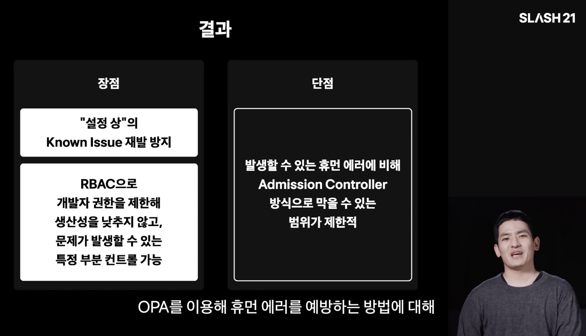

OPAの説明を見ていてまず感じたのは、KubernetesのエコシステムにおけるRBACのようだということだった。AWSを使うにせよAPIサーバーを構築するにせよ、リクエストした人のRoleに応じて許可したり拒否したりするコントロールセンターが存在するが、KubernetesではOPAがまさにその役割を果たしているようだ。Regoという独自の言語で簡単にスクリプトを書いてポリシーを設定でき、本当に多くのエンジニアがKubernetesベースのクラスターを管理するなら、こうしたアクセス制御はセキュリティの面でもヒューマンエラーの面でも良さそうだ。

---

## 3. トスのサーバーインフラモニタリング

イ・ジェソンさん(トス DevOps Engineer)



前の発表とかなりうまくつながっていると感じた。トスの全体的なインフラ技術を紹介し、Kubernetesをどう管理しているかを扱ったのに続いて、今回はトスでモニタリングをどう行っているかを教えてくれる。動画の冒頭で、2019年から2021年にかけて多くの変化があったとし、約9か月でDC/OS + Vampの組み合わせからK8s + Istioの組み合わせへ、IDC全体の切り替えに成功したという。

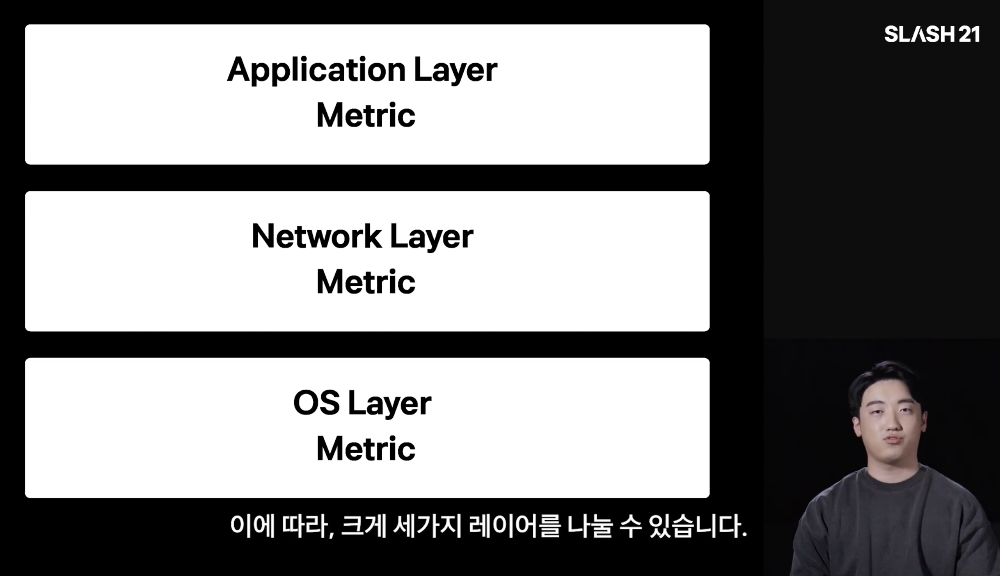

トスでどのようにモニタリングしているかを、大きく3つのレイヤーの指標に分けて見ていく。ネットワークレイヤーでは、主にIstioのサービスメッシュによってネットワークを把握できるという利点を活かしてモニタリングしており、次のような構成で2つのIDCにまたがるauto failoverを組んでいるという。

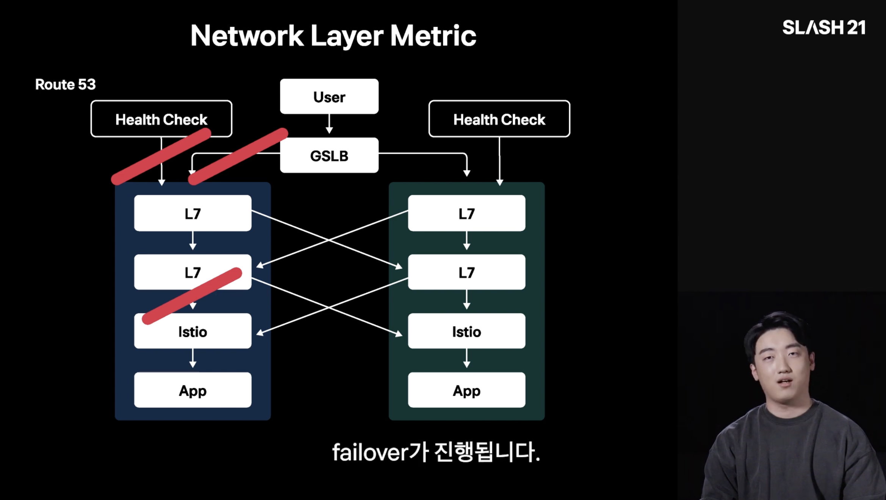

個人的には、GSLBの後ろにL7を2段で置いているが、正確にどんな目的で分けているのか把握しにくく、かなり悩んだ。前段のL7はより広いレベルで文字どおりルーティングを行い、後段のL7はロードバランシングを行っているのではないかと思う。

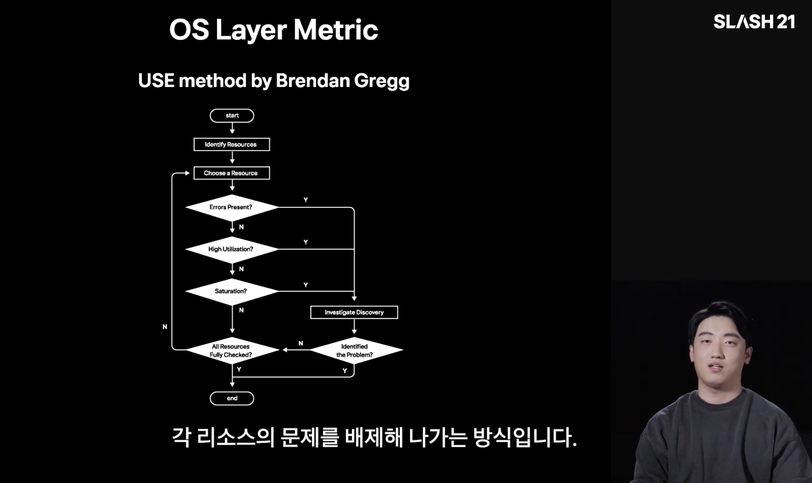

次はOSレイヤーのモニタリングとトラブルシューティングだ。OSレイヤーでは、CPUやメモリの使用率などを見てどこで問題が起きたかを確認するが、どうしても経験に頼る傾向が強いという。個々のエンジニアの力量に依存してしまうため、OSレイヤーで問題が起きたときは、ブレンダン・グレッグ(Brendan Gregg)が作ったフローチャートのようなものに沿って、順番に1つずつ点検するritualがあるそうだ。

具体的には、CPU使用率は`container_cpu_usage_seconds_total`で、CPU saturationは`container_cpu_cfs_throttled_periods_total`と`container_cpu_cfs_periods_total`で確認するといった具合だ。ちなみにトスはPrometheusをハードに使っているので、Prometheusの指標をよく見ているのだろうと思う。

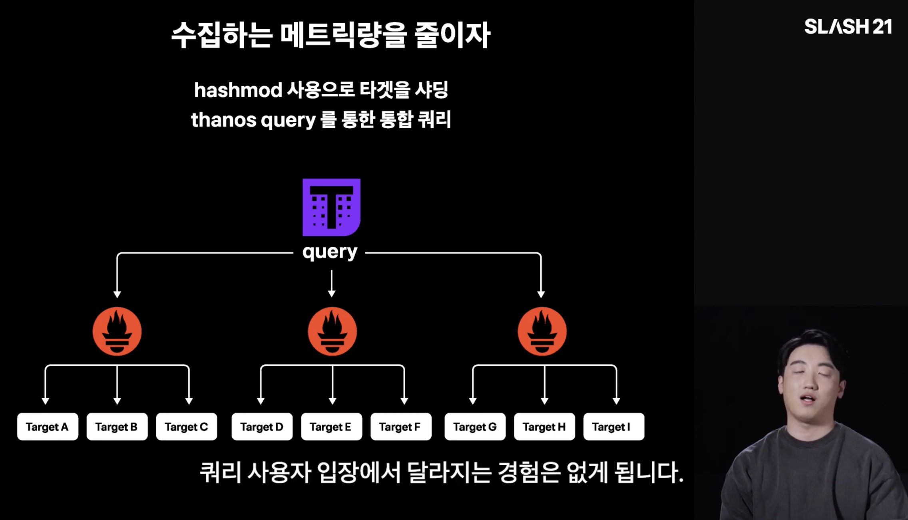

最後は、モニタリングをする主体、つまりモニタリングシステムそのもののモニタリングだ。トスでは主にPrometheusでメトリクスを収集・モニタリングしているが、そのPrometheusが落ちうる状況への備えを扱っている。実際にout-of-memoryが多く発生したため、Prometheusを並列に置き、hashmodでターゲットを分けて収集しているという。そしてThanosで複数のPrometheusを1つにまとめて管理し、長期ストレージに送ることでメトリクスを長期間保管することもできるという。

---

## 4. SRE事例の紹介

チョ・ギュヒさん(トス Site Reliability Engineer)



最後の発表は、トスのSRE事例の紹介だ。この発表ではRedis Cluster Rebalancing、Memcached Redistribute、Prometheus Scrapingの順に3つの事例を扱う。実際に問題が起きた事例を挙げて、どのように解決していったかを詳しく説明している点が特徴だ。ちなみにトスでは、SREチームがアプリケーションに近いインフラを扱い、DevOpsチームがKubernetes側のインフラを扱っていると理解している。KubernetesやIstioの設定はDevOpsが担当し、Springにカスタムメトリクスを仕込むようなことはSREが担当する、といった分担だ。

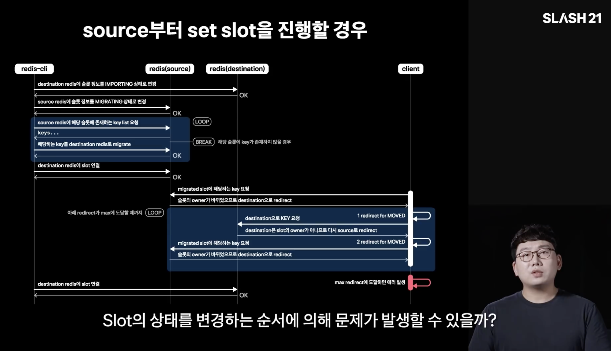

1つ目は、Redis Clusterを増設する際にリバランシングのコマンドを実行する過程で起きた問題だ。タイムアウトが1件発生したときは、サイズがかなり大きいRedisのコレクションを移そうとしてタイムアウトしたことを簡単に確認できたが、別の状況ではASK redirectがかなり発生し、その原因を追跡しなければならなかった。結果的には、SpringからRedisを簡単に扱えるようにするLettuceのバグだったが、それを突き止める過程がまさにクラシックなエンジニアリングだと感じた。

上の画像のようにRedisの流れを1つずつ説明しながら、仮説を立てて検証していく過程がかなり印象的だった。この記事を書いている今はAIがかなり多くのトラブルシューティングを代わりにやってくれるし、これからもさらに発展していくだろうが、こうしてフローチャートを描きながら技術的に検証していくことこそ、エンジニアに根本的に必要な能力だと思う。特にClaude Codeのようなターミナルベースのコーディングエージェントを使いにくいベアメタル環境で、ネットワークツールを使ってトラブルシューティングしなければならないときは、全体の流れをよく理解している必要があるので、DevOpsにとってもかなり必要な能力だと思う。

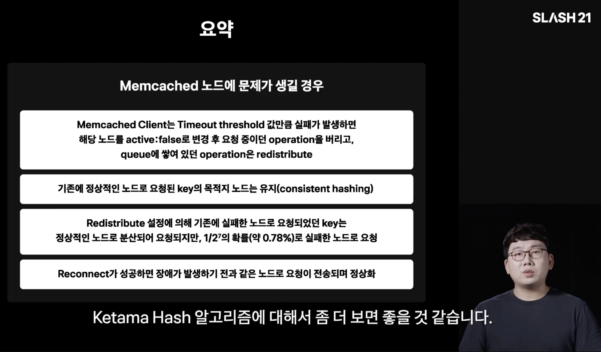

2つ目はMemcachedだ。トスではMemcachedにfailoverを適用しており、ノードに問題が起きると(発表ではhang状態に陥ったという)別のノードにリクエストを移して耐障害性を確保しているが、本当にまれに失敗する状況があったという。調べてみると、コードに2の7乗分の1の確率(約0.78%)で失敗するというコメントが残されていたそうだ。発表でもその理由はわからなかったとしており、iptablesのようなネットワークポリシーで、dead nodeにリクエストが行かないように設定したという。

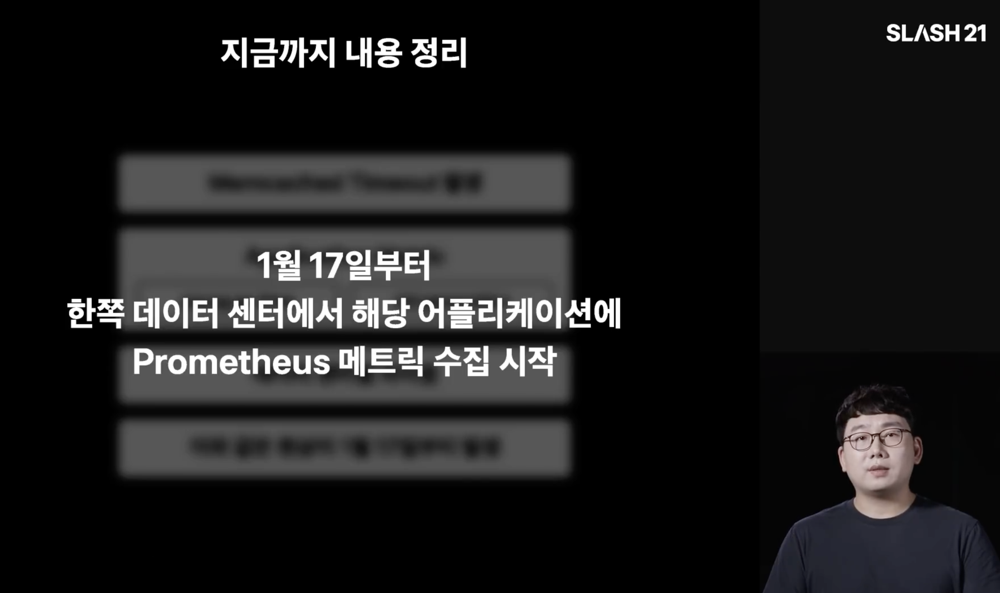

3つ目はPrometheus側で起きた問題だ。最初はMemcachedでタイムアウトが発生する問題に見えた。普段は1ms程度で応答し、タイムアウトは500msに設定されていたが、タイムアウトが断続的に発生していたので調べてみると、Prometheus側に原因があった。

データセンターによってガベージコレクションが一方に偏るskew現象があり、確認すると1月17日からその問題が起きていたという。発表でも特定の日付を基準に問題を分析する習慣が重要だと説明しているが、言い換えれば、最初からその指標をモニタリングしていれば、何かがデプロイされた直後にすぐ気づけたのではないかと思った。最近はサービスのデプロイがとても頻繁で多いため、デプロイ直後にダッシュボードをじっくり見ることはあまりないが、習慣的に見ておくことも必要だと思う。

原因はHumongous Allocationだった。ヒープリージョンより大きなオブジェクトを割り当てると、GCが想定どおりに動かなくなる現象だ。解決策としては、メトリクスの数やサイズを制限する、Heap Region Sizeを増やす、ResponseをStream方式で返す、といった方法がある。

個人的には、こういう問題に直面したら「メトリクスのサイズを少し減らしてみようか?」とまず考えていたと思う。それで問題が消えたとしても、根本原因は解決できないまま、かえって覆い隠してしまうことになりかねない。だからこそ、OSレベル、あるいはコード(さらにはオープンソース)レベルで根本的に問題を解決することが必要だと感じた。

---

## おわりに

トス SLASH 21はSREの発表まで含まれていたので、より根本的なエンジニアリングが見える感じがした。DevOpsエンジニアリングをしていると多くのツールを広く浅く扱うことになり、公式ドキュメントを見て設定をon/offするやり方が一般的で、コードを深く読み込む必要がある場面はあまりなかった。本当にエンジニアリング的に何かをしなければならないときは、ほとんどがネットワークのトラブルシューティングで、直接Podにexecでつないで確認したり、netshootなどをサイドカーとして立ち上げたりする程度だったと思う。それすら最近はAIエージェントの発展でかなり楽になったと感じる。

それなりにネットワークの勉強を地道に続けていて好きでもあるので、問題が起きたときは勘でかなり解決できるほうだ。しかし、今より複雑でさらに多様な技術を使う環境なら、かなり大変かもしれないと思う。tcpdumpやWiresharkなどで本当に根本から1つずつ見ていかなければならないとなると、まだ自信を持ってできるとは言えないが、KubernetesとIstioベースのサービスをきちんと運用するには、基本として備えておくととても良い力だと考えるようになった。もっと頑張らなければ。

### References

- [トスのサービスを構成するサーバー技術 — トス SLASH 21 (YouTube)](https://www.youtube.com/watch?v=YBXFRSAXScs)
- [ミスなく安全にKubernetesを運用する — トス SLASH 21 (YouTube)](https://www.youtube.com/watch?v=gF1wfTCDyI8)
- [トスのサーバーインフラモニタリング — トス SLASH 21 (YouTube)](https://www.youtube.com/watch?v=rxurfKT2lD8)
- [SRE事例の紹介 — トス SLASH 21 (YouTube)](https://www.youtube.com/watch?v=Tu0MMBgdyTw)
- [トス SLASH 再生リスト](https://www.youtube.com/playlist?list=PL1DJtS1Hv1PiGXmgruP1_gM2TSvQiOsFL)
