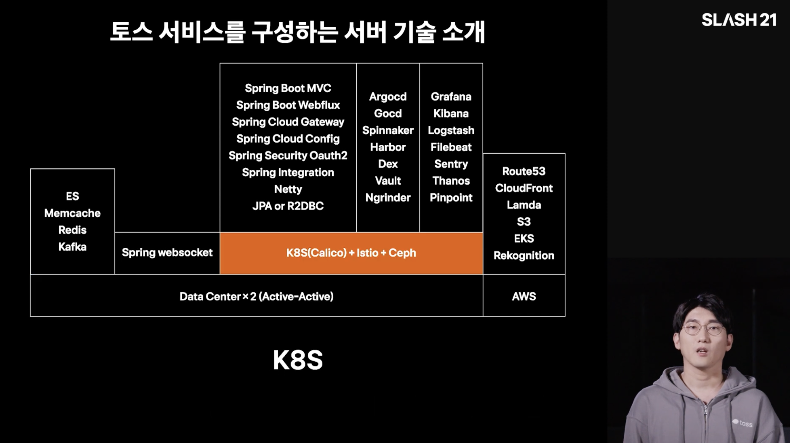
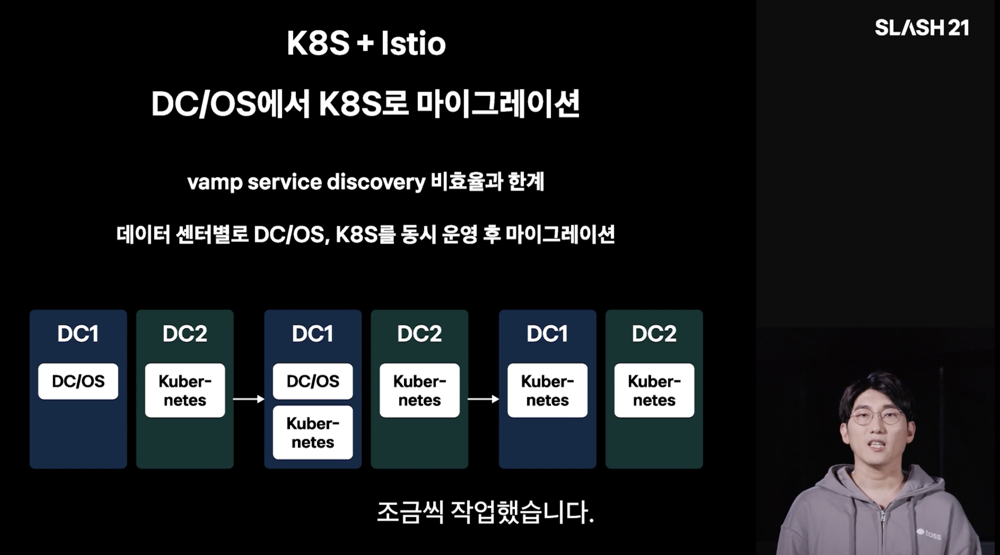
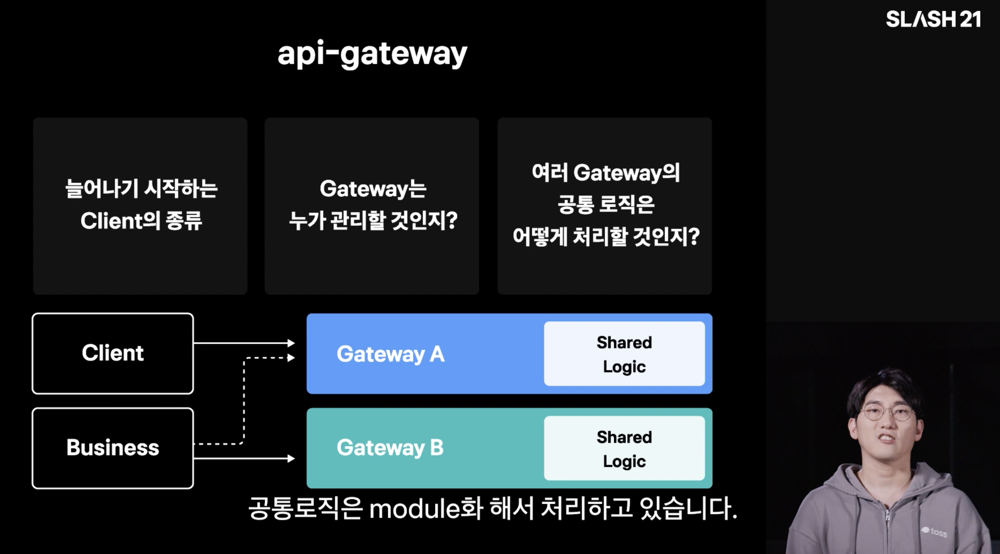
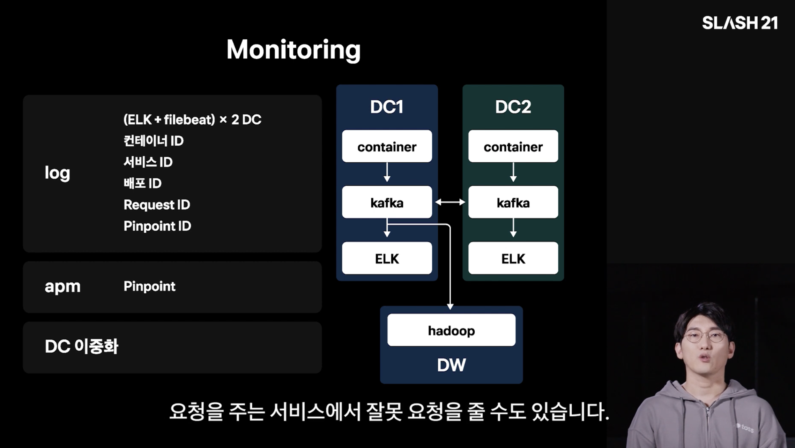
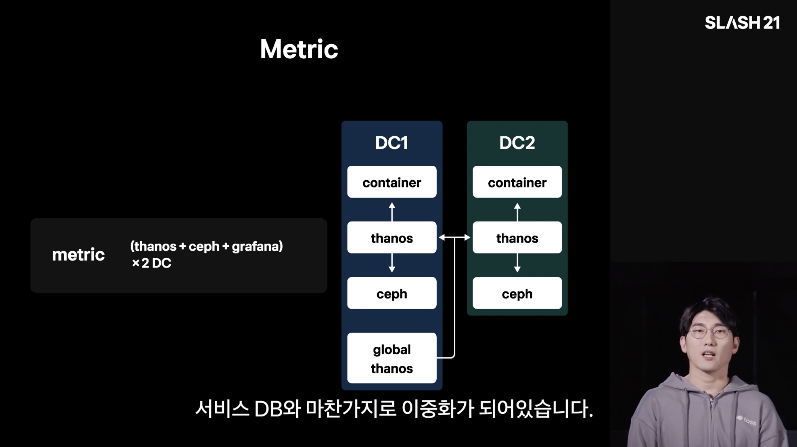
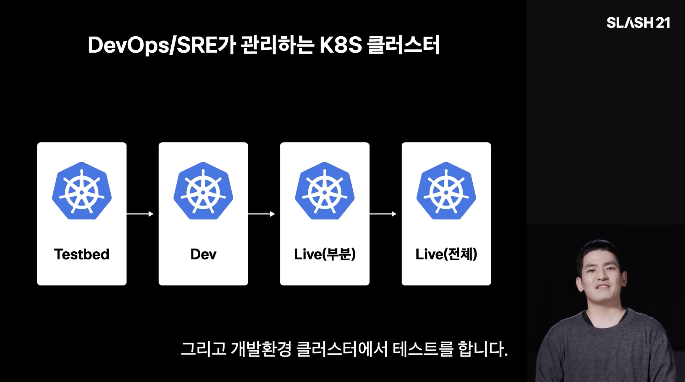
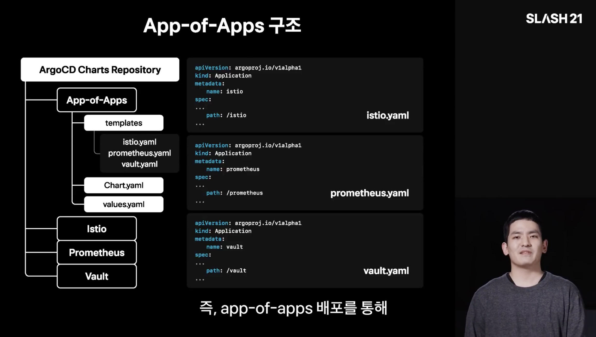
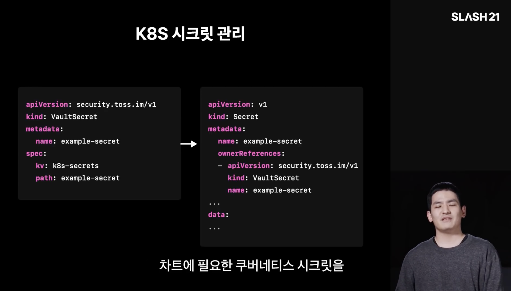
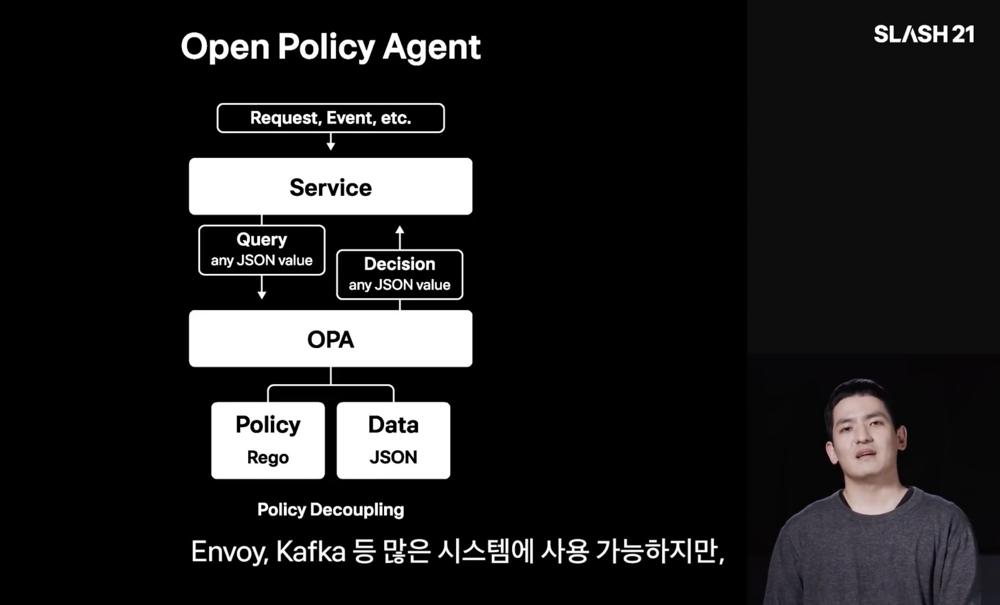
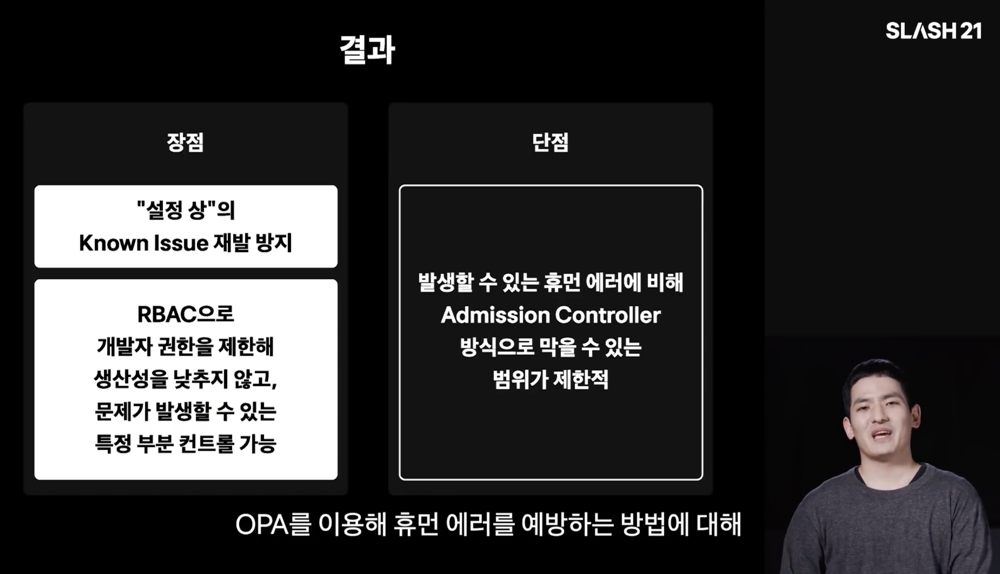

[이전 글]()에서는 당근 SRE 밋업 1회를 정리했다. 이번에는 2021년에 열린 토스의 개발자 컨퍼런스 **SLASH 21**에서 인프라와 관련된 네 개의 발표를 골라 정리한다.

<!-- TODO: 네 발표를 고른 이유, 보기 전 기대한 점 1~2문장 -->

---

## 1. 토스 서비스를 구성하는 서버 기술

<!-- TODO: 발표자 이름 (소속) -->



우선 가장 먼저, 토스 서비스를 구성하는 서버 기술이다. 사실 이 영상이 당근/토스에서 나온 컨퍼런스 영상을 처음부터 보게 된 이유이기도 하다. 24년도 토스 발표 중간에 21년도 영상을 참고하면 도움이 된다는 언급이 있어서 해당 영상을 찾아보게 되었고, 이참에 21년도 발표부터 정리하면 좋겠다고 생각했다. 정말 토스 인프라 기술의 뼈대를 여실히 보여주는 발표 영상이다.

토스는 이렇게 K8s와 Istio 기반으로 서비스를 운영한다. 당근과 비교하면 특이한 점은 Java나 Kotlin을 사용하는 비중이 압도적으로 많아 보인다는 것이다. 대부분의 서비스를 Spring Boot로 전개하고 있으며, 토스 내에서는 일관성을 중요하게 생각하는 듯하다.

토스는 원래 DC/OS라는 기술을 사용하고 있었고, vamp라는 도구를 통해서 온프레미스 데이터 센터의 서비스를 제어하고 있었다고 한다. 다만, 19년도에 vamp의 service discovery 비효율과 한계를 느끼고 서서히 마이그레이션을 진행하였으며, 데이터 센터 2개를 관리하고 있기 때문에 위 그림처럼 하나씩 전환했다고 한다. 이를 진행하면서 Istio + K8s 기반의 인프라를 갖추게 되었다.

한 가지 토스만의 특이한 점이 있다. Istio를 도입하면 보통 retry나 서킷 브레이커 등을 Istio로 구현하는 것을 떠올리기 쉬우나, 세밀한 제어가 어렵기 때문에 발표일 기준으로는 애플리케이션에서 처리한다고 한다. 트랜잭션의 성격에 따라서 retry를 다르게 줘야 하는 로직이 있기 때문에 Istio로 전부 제어하기는 어려웠고, 대신 Istio의 mTLS 등으로 A 서버에서 B 서버로 요청할 수 없도록 접근 제어를 한다고 한다. 그 외에 canary 배포와 같은 기능은 적극적으로 사용한다고 한다.

다음으로는 api-gateway에 대한 설명이다. 예전에 넷플릭스처럼 큰 MSA를 운영하는 서비스는 인증을 위해서 큰 api-gateway를 둔다는 글을 읽은 적이 있다. passport라는 이름이었는데, 관련 레퍼런스를 읽고서 api-gateway 방식이 꽤 필요하겠다고 느꼈다. 토스도 마찬가지로 Spring Cloud Gateway를 사용한다고 한다. 이 부분 또한 알고는 있었지만 실제로 어떤 식으로 사용하는지는 자세하게 알아두지 못해서 한 번 공부해 봐야겠다고 느꼈다.

바로 이어서는 WebFlux와 coroutine 등의 이야기가 나온다. 예전에 Spring으로 개발을 해본 적이 있어서 WebFlux에 대해서는 대강 알고 있었지만, coroutine은 그냥 그런 게 있구나 하고 넘어갔었다. 최근에 큰 기업에서 Spring 기반으로 개발하는 백엔드 엔지니어분과 이야기했을 때는 virtual thread도 꽤 좋다는 이야기를 들었는데, 이렇게 Spring 안에서도 퍼포먼스를 위해 할 수 있는 시도들이 많다고 느꼈다.

로그의 경우에는 Kafka를 사용하며, ELK 스택을 통해서 확인한다고 한다. 장기 보관이 필요한 로그 데이터는 Hadoop으로 쏘는 파이프라인을 사용한다고 한다.

메트릭은 주로 Prometheus를 하드하게 사용하는 것으로 보이며, 여러 Prometheus를 모아서 관리할 수 있게 해주는 Thanos도 많이 사용하는 것 같다. 예전에 토스의 서류 과제에서도 Prometheus 기반으로 엄청나게 많은 트래픽을 견뎌야 하는 상황을 어떻게 처리할 것인지와 같은 내용이 나왔던 것 같고, 이후의 발표에서도 Prometheus 성능 최적화와 관련된 내용이 꽤 나온다.

이후에는 Kafka나 Redis를 클러스터 형태로 어떻게 관리하는지에 대한 내용과 함께 발표를 마친다.

---

## 2. 실수 없이 안전하게 쿠버네티스 운영하기



이번 발표는 앞 발표에 이어서 보면 좋을 내용으로, 쿠버네티스 클러스터를 어떻게 관리하는지 소개한다. ArgoCD로 GitOps를 어떻게 운영하는지와 OPA(Open Policy Agent)로 실수를 막는 정책을 어떻게 적용하는지를 다룬다.

우선 기본적으로는 위와 같이 클러스터를 구성해서, Testbed와 Dev 클러스터에서 확인하고 나서 Live로 배포하는 구조를 갖고 있다고 한다. 이 구조에서 ArgoCD로 GitOps를 운영하는데, 한 가지 특이한 점은 Auto Sync를 사용하지 않는다는 것이다. 안정성 때문인 것 같은데, 최대한 빠르게 검토하고 나서 sync를 진행하는 것 같다. 그래서 토스에서는 GitOps를 git의 상태와 쿠버네티스의 상태가 동일한 것이 아니라, git의 상태 = 바라는 쿠버네티스 상태로 정의한다고 한다. 개인적으로 쿠버네티스나 테라폼을 관리할 때에도 auto-approve를 할 만한 지점과 아닌 지점을 의도적으로 잘 나눠보는 것이 중요할 것 같다.

토스에서는 Helm chart를 통해서 서비스들을 전개하는데, Istio 같은 것들을 Helm chart로 벤더링해서 app-of-apps 방식으로 사용한다고 한다. 앞서 이야기한 GitOps 원칙을 지키는 방식으로, ArgoCD에 애플리케이션을 띄우는 것마저도 git에 설정 파일로 '선언형'으로 관리하는 방식이다.

GitOps를 운영하면 누구나 시크릿을 어떻게 관리할 것인지 고민하게 될 텐데, 일반적으로 Vault나 AWS Secrets Manager를 사용하는 것 같다. AWS Secrets Manager는 시크릿 하나당 월 0.4달러나 하기 때문에 수많은 시크릿을 환경별로 저장한다면 매달 꽤 많은 비용이 나오게 된다. 이런 이유로 일반적으로 Vault를 많이 사용하는 것 같다.

개인적으로는 ESO(External Secrets Operator)를 Vault와 함께 사용하고 있는데, 토스는 신기하게도 자체 제작한 VaultSecret이라는 API를 활용하는 것으로 보인다. 어떤 이유로 자체 제작한 툴을 사용해서 시크릿을 땡겨오는지 궁금하다.

다음으로는 OPA(Open Policy Agent)다. 휴먼 에러를 방지하기 위해 정책을 적용하여 실수를 막을 수 있다고 한다. 쿠버네티스에서는 Admission Controller가 허가되지 않은 요청을 막는데, OPA라는 툴을 통해서 이러한 정책을 유연하게 설정할 수 있다고 한다.

OPA에 대한 설명을 보면서 딱 느꼈던 점은 쿠버네티스 생태계에 있는 RBAC 같다는 생각이었다. AWS를 가든, API 서버를 구축하든 요청자의 Role에 따라서 허가하거나 반려하는 컨트롤 센터가 존재하게 되는데, 쿠버네티스에서는 OPA가 딱 그 역할을 수행하는 것 같다. Rego라는 자체 언어로 간단하게 스크립트를 만들어서 정책을 설정할 수 있는데, 정말 많은 엔지니어가 쿠버네티스 기반의 클러스터를 관리하게 된다면 이러한 접근 제어가 보안 측면에서도, 휴먼 에러 측면에서도 좋아 보인다.

---

## 3. 토스의 서버 인프라 모니터링

<!-- TODO: 발표자 이름 (소속) -->



<!-- TODO: 앞 발표와 이어지는 전환 문장 1~2개 -->

<!-- TODO: 발표 개요 -->

<!-- TODO: 인상 깊었던 내용 + 슬라이드 캡처 -->

<!-- TODO: 당근 gRPC 발표의 모니터링 이야기와 비교해볼 만한 점 -->

---

## 4. SRE 사례 소개

<!-- TODO: 발표자 이름 (소속) -->



<!-- TODO: 앞 발표와 이어지는 전환 문장 1~2개 -->

<!-- TODO: 발표 개요 -->

<!-- TODO: 인상 깊었던 내용 + 슬라이드 캡처 -->

<!-- TODO: 개인적인 생각 -->

---

## 마치며

<!-- TODO: 네 발표 요약 -->

<!-- TODO: 개인적인 인사이트 (당근 밋업과 비교해서 느낀 점 등) -->

<!-- TODO: 앞으로의 방향 -->

### References

- [토스 서비스를 구성하는 서버 기술 — 토스 SLASH 21 (YouTube)](https://www.youtube.com/watch?v=YBXFRSAXScs)
- [실수 없이 안전하게 쿠버네티스 운영하기 — 토스 SLASH 21 (YouTube)](https://www.youtube.com/watch?v=gF1wfTCDyI8)
- [토스의 서버 인프라 모니터링 — 토스 SLASH 21 (YouTube)](https://www.youtube.com/watch?v=rxurfKT2lD8)
- [SRE 사례 소개 — 토스 SLASH 21 (YouTube)](https://www.youtube.com/watch?v=Tu0MMBgdyTw)
- [토스 SLASH 다시보기 재생목록](https://www.youtube.com/playlist?list=PL1DJtS1Hv1PiGXmgruP1_gM2TSvQiOsFL)
