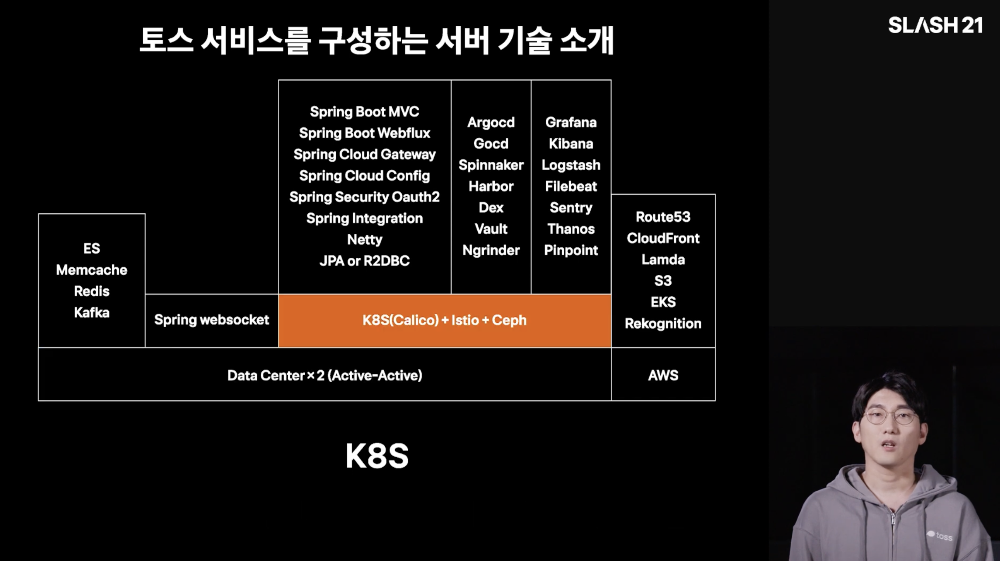

In the [previous post](), I went over Daangn SRE Meetup #1. This time, I picked four infrastructure-related talks from **SLASH 21**, the developer conference Toss held in 2021.

<!-- TODO: why these four talks -->

---

## 1. Server Technologies Behind Toss

<!-- TODO: speaker (team) -->



<!-- TODO: overview -->

<!-- TODO: highlights + slides -->

<!-- TODO: personal thoughts -->

---

## 2. Running Kubernetes Safely Without Mistakes

<!-- TODO: speaker (team) -->



<!-- TODO: transition / overview / highlights / comparison with Daangn's EKS upgrade talk -->

---

## 3. Server Infrastructure Monitoring at Toss

<!-- TODO: speaker (team) -->



<!-- TODO: transition / overview / highlights / comparison with Daangn's gRPC monitoring talk -->

---

## 4. SRE Case Studies

<!-- TODO: speaker (team) -->



<!-- TODO: transition / overview / highlights / personal thoughts -->

---

## Wrapping Up

<!-- TODO: summary → insight → future direction -->

### References

- [Server Technologies Behind Toss — Toss SLASH 21 (YouTube)](https://www.youtube.com/watch?v=YBXFRSAXScs)
- [Running Kubernetes Safely Without Mistakes — Toss SLASH 21 (YouTube)](https://www.youtube.com/watch?v=gF1wfTCDyI8)
- [Server Infrastructure Monitoring at Toss — Toss SLASH 21 (YouTube)](https://www.youtube.com/watch?v=rxurfKT2lD8)
- [SRE Case Studies — Toss SLASH 21 (YouTube)](https://www.youtube.com/watch?v=Tu0MMBgdyTw)
- [Toss SLASH playlist](https://www.youtube.com/playlist?list=PL1DJtS1Hv1PiGXmgruP1_gM2TSvQiOsFL)
