In the [previous post](), I went over Daangn SRE Meetup #1. This time, I picked four infrastructure-related talks from **SLASH 21**, the developer conference Toss held in 2021.

---

## 1. Server Technologies Behind Toss

Hangryeong Lee (Toss, Server Platform Team Leader)



The first talk is about the server technologies that make up the Toss service. This video is actually the reason I started watching the Daangn and Toss conference talks from the beginning. During a Toss talk from 2024, the speaker mentioned that the 2021 talk would be a helpful reference, so I looked it up and thought it would be a good chance to start from the 2021 talks. It really lays bare the skeleton of Toss's infrastructure.

Toss runs its services on K8s and Istio like this. Compared to Daangn, what stands out is that Java and Kotlin seem to make up an overwhelming share. Most services are built with Spring Boot, and Toss seems to place a lot of value on consistency.

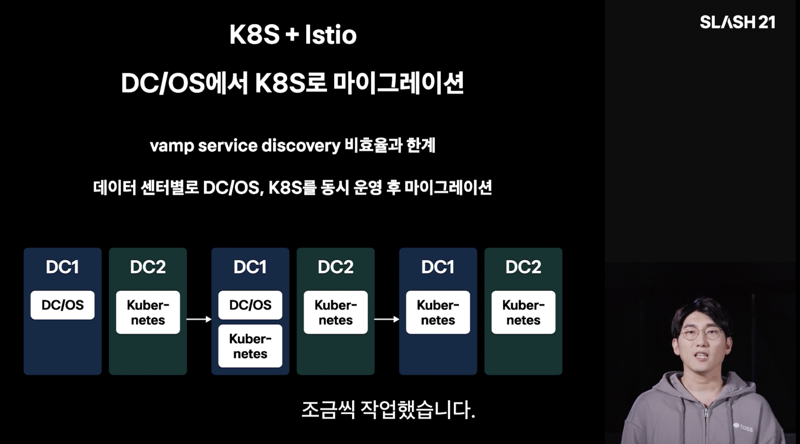

Toss originally used DC/OS and controlled the services in its on-premises data centers with a tool called vamp. In 2019, though, they felt the inefficiency and limits of vamp's service discovery and gradually migrated. Since they run two data centers, they switched over one at a time as shown above. Through this, they ended up with an Istio + K8s-based infrastructure.

There is one thing unique to Toss. When you adopt Istio, it's easy to think of implementing retries and circuit breakers with Istio, but because fine-grained control is hard, as of the talk they handle these in the application. Some logic needs different retry behavior depending on the nature of the transaction, so controlling everything through Istio was difficult. Instead, they use Istio's mTLS and similar features for access control, such as preventing server A from making requests to server B. Features like canary deployments, on the other hand, they use actively.

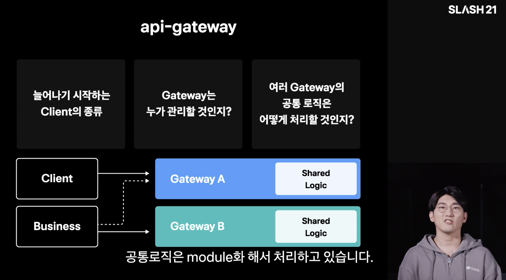

Next comes the api-gateway. I once read that services running a large MSA, like Netflix, put a big api-gateway in front for authentication. It was called passport, and after reading the related references I felt the api-gateway approach was quite necessary. Toss likewise uses Spring Cloud Gateway. I knew about it, but I hadn't looked closely at how it's used in practice, so I felt I should study it.

Right after that, the talk covers WebFlux and coroutines. Having built things with Spring before, I roughly knew WebFlux, but I had brushed coroutines off as "oh, that exists." Recently, when I talked with a backend engineer building on Spring at a large company, I heard that virtual threads are quite good too, and it struck me how many things you can try for performance even within Spring.

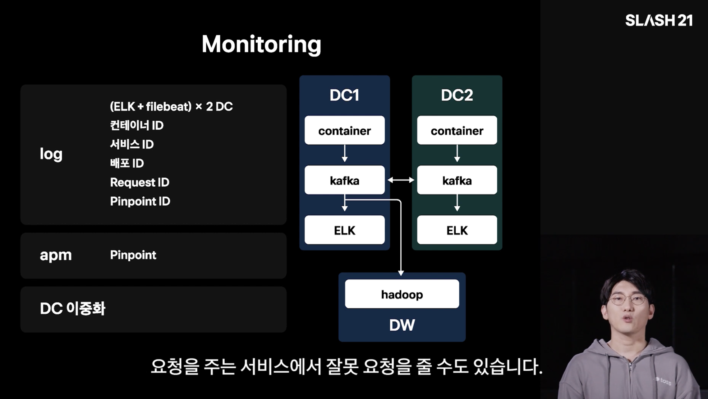

For logs, they use Kafka and check them through the ELK stack. Log data that needs long-term retention goes through a pipeline that ships it to Hadoop.

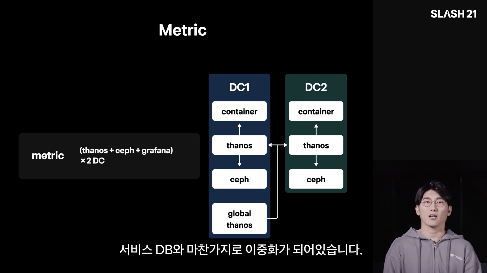

For metrics, they seem to use Prometheus heavily, along with Thanos, which lets you aggregate and manage multiple Prometheus instances. I recall that a Toss take-home assignment I once did also asked how to handle a situation where a Prometheus-based setup had to withstand an enormous amount of traffic, and the later talks also cover Prometheus performance optimization quite a bit.

The talk wraps up with how they manage Kafka and Redis as clusters.

---

## 2. Running Kubernetes Safely Without Mistakes

Hyeongrok Kim (Toss, DevOps Engineer)



This talk is good to watch right after the previous one, and it introduces how they manage Kubernetes clusters. It covers how they run GitOps with ArgoCD and how they apply policies with OPA (Open Policy Agent) to prevent mistakes.

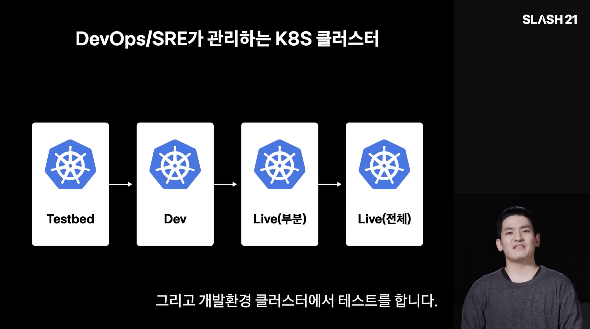

At the base, the clusters are laid out as above: changes are verified in the Testbed and Dev clusters before being deployed to Live. On top of this, they run GitOps with ArgoCD, and one notable point is that they don't use Auto Sync. It seems to be for stability; they review as quickly as possible and then sync. So at Toss, GitOps is defined not as "the git state and the Kubernetes state are identical," but as "the git state = the desired Kubernetes state." Personally, I think it's important, when managing Kubernetes or Terraform, to deliberately separate the points where auto-approve is fine from the ones where it isn't.

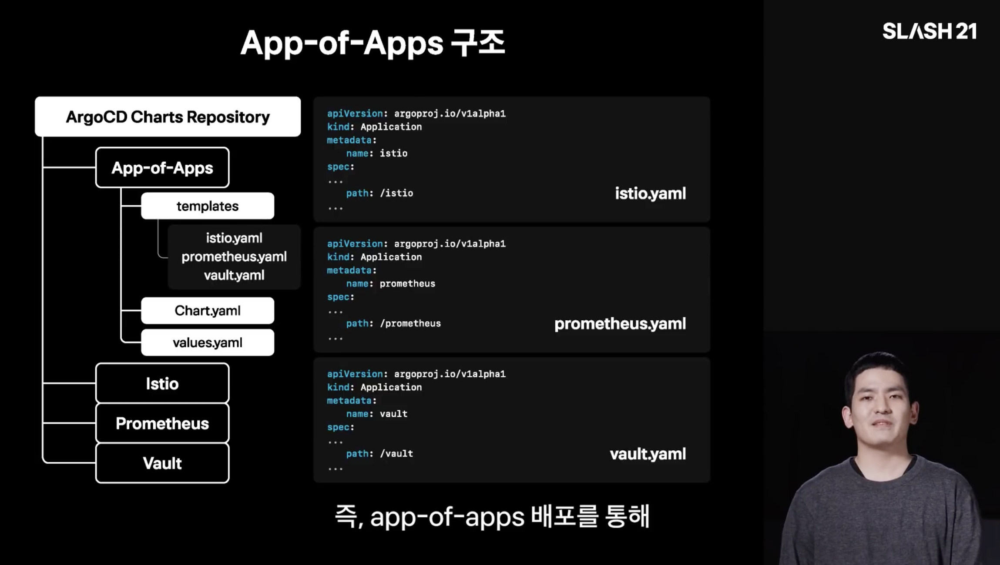

Toss deploys services through Helm charts, and vendors things like Istio as Helm charts to use them in an app-of-apps pattern. In keeping with the GitOps principle above, even launching an application in ArgoCD is managed "declaratively" as configuration files in git.

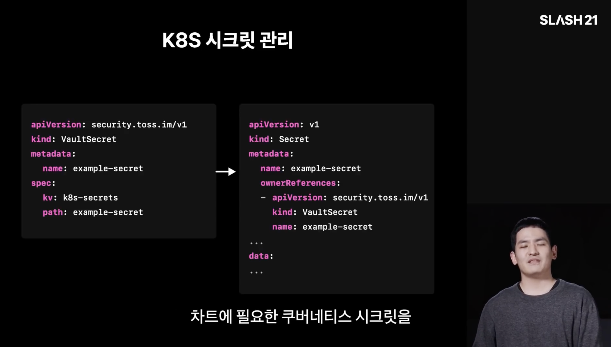

Anyone running GitOps ends up wondering how to manage secrets, and the usual choices seem to be Vault or AWS Secrets Manager. AWS Secrets Manager costs $0.40 per secret per month, so storing a large number of secrets per environment adds up to a substantial monthly bill. That seems to be why Vault is so commonly used.

Personally, I use ESO (External Secrets Operator) together with Vault, but interestingly, Toss appears to use a home-grown API called VaultSecret. I'm curious why they pull secrets with a tool they built themselves.

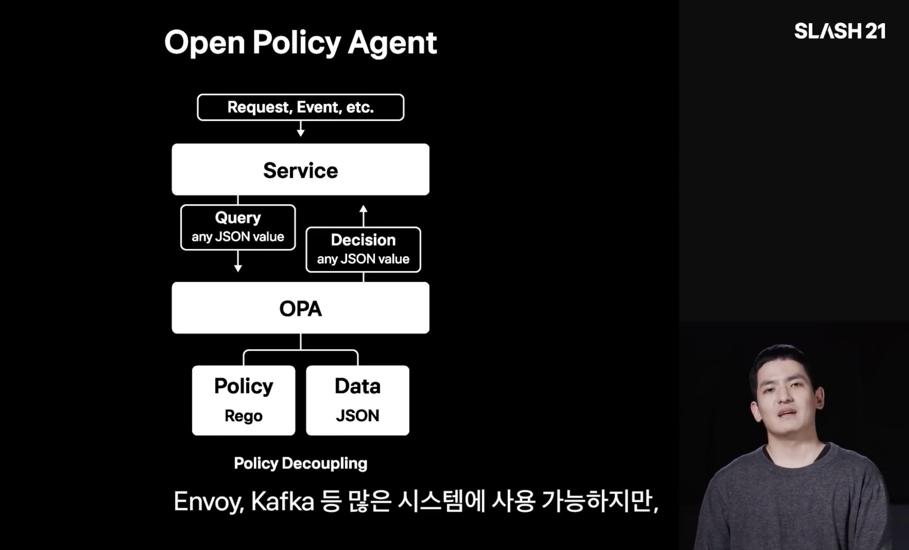

Next is OPA (Open Policy Agent). Applying policies helps prevent human error. In Kubernetes, the Admission Controller blocks unauthorized requests, and a tool called OPA lets you configure such policies flexibly.

What struck me while watching the OPA section was that it feels like RBAC for the Kubernetes ecosystem. Whether you're on AWS or building an API server, there's a control center that allows or denies requests based on the requester's Role, and in Kubernetes OPA seems to play exactly that role. You can set policies by writing simple scripts in its own language, Rego, and when a great many engineers manage Kubernetes-based clusters, this kind of access control looks good both for security and for preventing human error.

---

## 3. Server Infrastructure Monitoring at Toss

Jaeseong Lee (Toss, DevOps Engineer)



I felt this talk flows quite well from the previous ones. After introducing Toss's overall infrastructure and then how they manage Kubernetes, this time it shows how Toss approaches monitoring. Early in the video, the speaker mentions that a lot changed between 2019 and 2021, and that in about nine months they successfully moved their entire IDC from a DC/OS + Vamp combination to K8s + Istio.

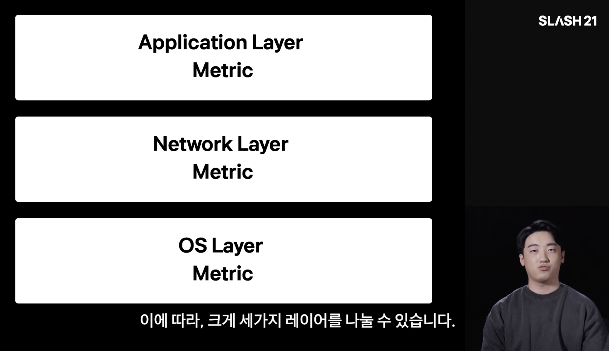

The talk looks at how Toss monitors by dividing the metrics into three broad layers. At the network layer, they mainly take advantage of the visibility the Istio service mesh gives them, and they set up auto failover across two IDCs with the following structure.

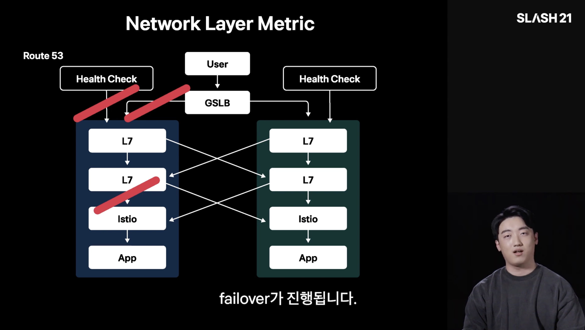

Personally, I struggled a bit with why there are two tiers of L7 behind the GSLB, since it was hard to tell exactly what purpose the split serves. My guess is that the front L7 does routing in the literal sense at a broader level, and the back L7 does load balancing.

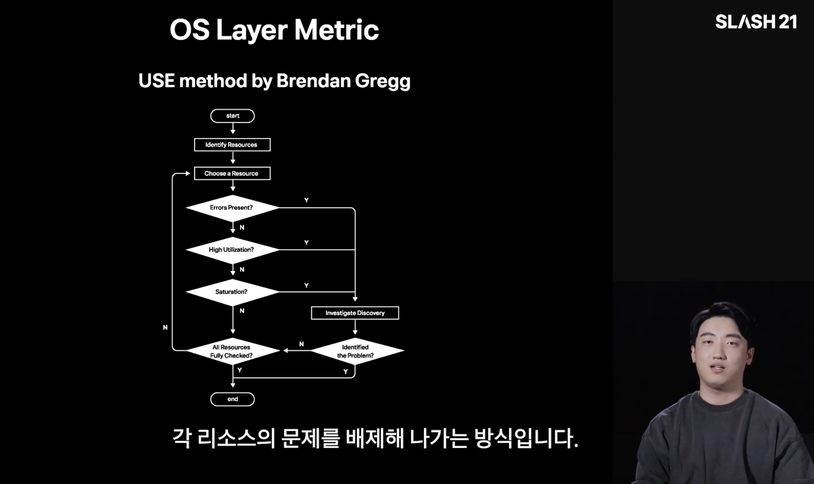

Next is monitoring and troubleshooting at the OS layer. At the OS layer, you look at things like CPU and memory utilization to find where a problem occurred, and this tends to rely heavily on experience. Because it depends on the individual engineer's skill, they have a ritual of checking things one by one in order, following something like the flowchart Brendan Gregg created, when a problem occurs at the OS layer.

Concretely, they check CPU usage with `container_cpu_usage_seconds_total`, and CPU saturation with `container_cpu_cfs_throttled_periods_total` and `container_cpu_cfs_periods_total`. Since Toss uses Prometheus heavily, I'd expect they look at Prometheus metrics a lot.

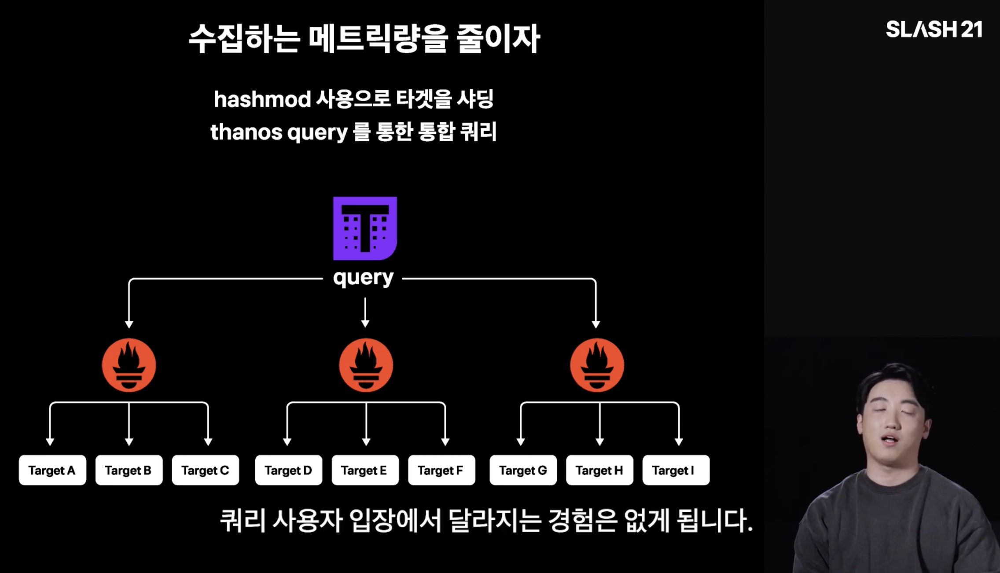

Last is monitoring the thing doing the monitoring — that is, the monitoring system itself. Toss mainly collects and monitors metrics with Prometheus, and the talk covers how they prepare for that Prometheus going down. Since out-of-memory errors actually happened a lot, they run Prometheus in parallel and split the targets with hashmod. Then they tie the Prometheus instances together with Thanos, and by shipping data to long-term storage they can also keep metrics for a long time.

---

## 4. SRE Case Studies

Gyuhee Jo (Toss, Site Reliability Engineer)



The last talk introduces SRE cases at Toss. It covers three cases, in order: Redis Cluster Rebalancing, Memcached Redistribute, and Prometheus Scraping. What sets it apart is that it walks through real incidents in detail, showing how each problem was solved. For context, my understanding is that at Toss the SRE team handles infrastructure close to the application, while the DevOps team handles the Kubernetes side. DevOps owns things like Kubernetes and Istio configuration, and SRE takes care of things like adding custom metrics to Spring.

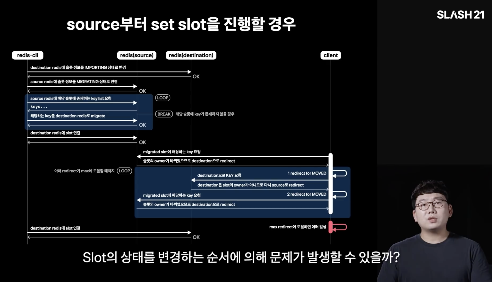

The first is a problem that occurred while running the rebalance command to scale out a Redis Cluster. When a single timeout occurred, it was easy to see that it happened while moving a fairly large Redis collection. In another situation, though, ASK redirects occurred quite often, and they had to track down the cause. In the end it was a bug in Lettuce, the library that makes Redis easy to use from Spring, and the process of finding it felt like classic engineering.

The way the talk explains the Redis flow step by step, forming hypotheses and verifying them one at a time as in the slide above, left a strong impression. As I write this, AI handles quite a lot of troubleshooting and will keep getting better, but I think drawing flowcharts and verifying things technically like this is a fundamentally necessary skill for an engineer. Especially when you have to troubleshoot with network tools in a bare-metal environment where it's hard to use a terminal-based coding agent like Claude Code, you need to understand the overall flow well, so I think it's quite a necessary skill for DevOps too.

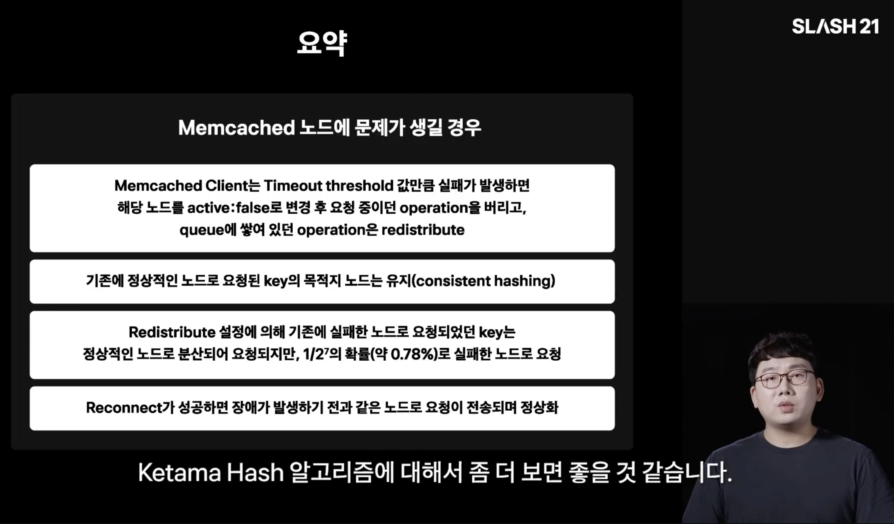

The second is Memcached. Toss applies failover to Memcached so that when a node has a problem (the talk says it fell into a hang state), requests move to another node for fault tolerance, but there were very intermittent failures. Digging in, they found a comment in the code saying it fails with probability 1 in 2^7 (about 0.78%). The talk says they couldn't figure out why, and they set up network policies such as iptables so that requests wouldn't go to the dead node.

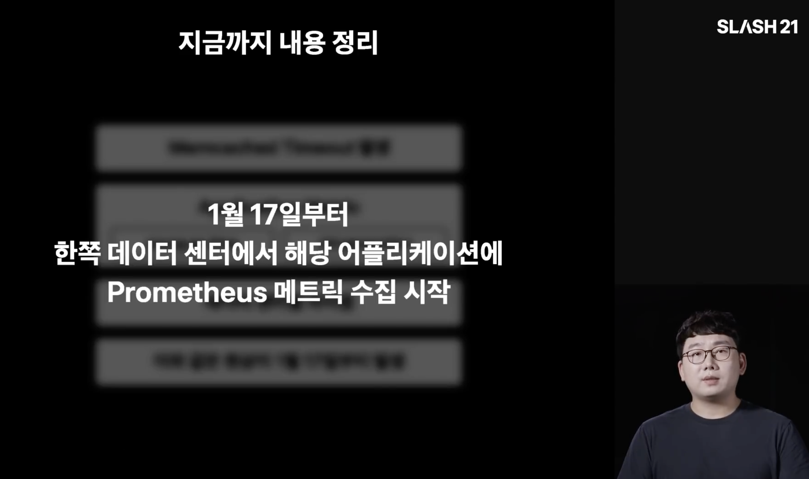

The third is a problem on the Prometheus side. At first it looked like a Memcached timeout issue. Responses normally came back in about 1ms with the timeout set to 500ms, but timeouts were occurring intermittently, and on investigation the cause turned out to be on the Prometheus side.

There was a skew where garbage collection leaned toward one side depending on the data center, and on checking, the problem had been happening since January 17. The talk also stresses the habit of analyzing a problem relative to a specific date. Put another way, it made me think that if they'd been monitoring that metric all along, they might have noticed right after whatever was deployed. These days deployments are so frequent and numerous that people don't often look closely at dashboards right after a deploy, but I think it's worth making a habit of it.

The cause was Humongous Allocation: when an object larger than a heap region is allocated, GC doesn't behave as expected. Fixes include limiting the number or size of metrics, increasing the Heap Region Size, or delivering the Response as a stream.

Personally, if I'd faced this problem, I think my first thought would have been "maybe I'll shrink the metric size a bit?" If that made the problem go away, it could end up covering it up without solving the root cause. So it made me think that fixing problems at their root — at the OS level, or at the code (and even open-source) level — is what's needed.

---

## Closing Thoughts

Because Toss SLASH 21 included an SRE talk, it felt like it showed more fundamental engineering. In DevOps engineering you handle many tools broadly and shallowly, so the usual approach is reading the official docs and toggling settings on and off, and there weren't many cases where I had to dig deep into code. When I really did have to do something engineering-heavy, it was mostly network troubleshooting — exec-ing into a Pod to check things directly, or running netshoot as a sidecar. Even that has become much easier recently as AI agents have improved.

I've been studying networking steadily and enjoy it, so when something goes wrong I can solve quite a lot on intuition. But in an environment that's more complex and uses a wider range of technologies than now, I think it could get pretty hard. If I had to really dig in from the fundamentals with tcpdump or Wireshark, I'm not yet confident I could do it, and I've come to think it's a skill that would be very good to have as a baseline for properly running Kubernetes- and Istio-based services. I need to work harder.

### References

- [Server Technologies Behind Toss — Toss SLASH 21 (YouTube)](https://www.youtube.com/watch?v=YBXFRSAXScs)
- [Running Kubernetes Safely Without Mistakes — Toss SLASH 21 (YouTube)](https://www.youtube.com/watch?v=gF1wfTCDyI8)
- [Server Infrastructure Monitoring at Toss — Toss SLASH 21 (YouTube)](https://www.youtube.com/watch?v=rxurfKT2lD8)
- [SRE Case Studies — Toss SLASH 21 (YouTube)](https://www.youtube.com/watch?v=Tu0MMBgdyTw)
- [Toss SLASH playlist](https://www.youtube.com/playlist?list=PL1DJtS1Hv1PiGXmgruP1_gM2TSvQiOsFL)
